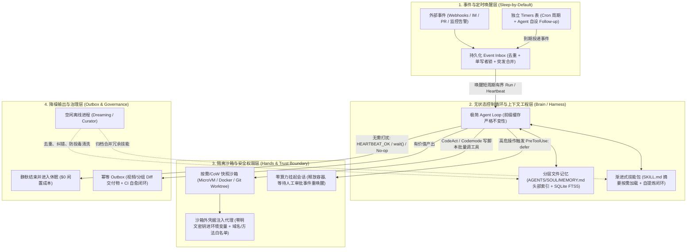

# 2026 热门 AI Agent 产品全景调研与底层架构共性报告

> [!IMPORTANT]
> **调研范围与方法说明**：本报告由 5 个并行专项调研子 Agent 联合检索一手工程文档、GitHub 源码仓、安全审计与技术博客汇总而成（时间基准：2026 年 11 月）。重点覆盖你点名的 **Anthropic《Building always-on agents》博客**、**Paperclip（常被音译/误听为 pepperclip）**、**Hermes Agent**，并横向纳入 **OpenClaw、Pi、DeepSeek Harness、Poke、Perplexity Computer、Devin 2.2、Manus 2.0、OpenAI Codex Cloud、Cursor Automations、Google Antigravity / Jules、Factory Droids、Genspark Super Agent** 及 **Lindy / Dust / Relevance / Glean** 等商业产品。

---

## 一、核心结论：2026 热门 Agent 产品的十大底层共性

纵观 2025—2026 年跑出来的爆款开源项目（如 39.5 万 Star 的 OpenClaw、26.3 万 Star 的 Hermes、11.4 万 Star 的 Paperclip、12.2 万 Star 的 Pi）与头部商业平台（Anthropic、OpenAI、Cognition、Manus、Cursor），行业已经彻底告别了早期“把 Prompt 串成死循环图（Workflow DAG）或拉群角色扮演”的玩具阶段，在系统工程层面高度收敛出 **十大底层架构共性**：

### 共性 1：“伪常驻、真休眠”的事件驱动运行模型（Sleep-by-Default, Bounded Runs）
* **打破误区**：“24h Always-On Agent”在物理实现上 **绝不是** 一个 24 小时挂在后台死循环轮询、持续消耗 CPU 与 Token 的常驻推理进程——用户感知到的“永远在线”，在底层其实是 **99% 的时间处于深度休眠（闲置计算成本趋近于 `\$0`），仅在事件到达时被唤醒执行几秒到几分钟的有界运行（Bounded Run / Heartbeat），落盘状态后立即继续休眠**。
* **跨产品印证**：
  * **Anthropic《Building always-on agents》**：明确定义 `Session`（持久化会话记录）与 `Run`（单次唤醒执行轮次）分离；Claude Managed Agents 按毫秒仅对活跃运行计费（`\$0.08`/活跃小时，休眠期 `\$0`）。
  * **Paperclip**：提出 **“Memento Man（记忆碎片主角）”模型**——Agent 平时彻底休眠，仅靠 `timer`、`assignment`、`on_demand`、`automation` 四类触发器唤醒执行一次 8 步 **Heartbeat**。
  * **Devin / Cursor / Hermes**：Devin 用自研 Rust 快照引擎 `blockdiff`（基于宿主机 `XFS reflink` 写时复制）把 20GB 虚拟机休眠与唤醒压缩到 **~200ms**；Cursor `Builds` 直接从内存热分叉运行中的 VM；Hermes 原生对接 **Modal / Daytona** 无服务器休眠容器。

### 共性 2：单写者串行化、突发事件合并与原子检出（Single-Writer & Coalescing）
* **解决痛点**：一旦 Agent 接入 GitHub Webhook、Slack 群聊、邮件流和定时任务，最大灾难就是 **并发竞态**——用户连发 4 条消息或 CI 连续报警时，多个 Worker 同时拉起会导致记忆文件互相覆盖、同一工单被重复修复、甚至对客户重复扣款/发信。
* **跨产品印证**：
  * **Anthropic**：强制每个 Event Inbox **同一时刻最多 1 个活跃 Worker**，运行期间新到达的突发事件做 **Batching 合并**（一次回复消化多条消息），并显式定义三种中途到达策略（排队等下一轮 / 工具间隙注入当前轮 / 中断重启）。
  * **Paperclip**：维护数据库级唤醒合并队列（运行中再次触发自动合并而非双开进程），并用 **单条 PostgreSQL 条件 `UPDATE` 实现原子工单检出**（抢锁失败直接返回 `409 Conflict`，零 Redis 依赖、零 LLM Token 浪费）。
  * **OpenClaw & 企业级工作流**：OpenClaw 采用 Lane-Aware FIFO 队列强制单会话 `concurrency: 1`（支持 `collect` 合并与 `steer` 转向）；Lindy / Dust / Sim 标配 Webhook HMAC 去重表与 Cron 执行互斥锁。

### 共性 3：状态、大脑与双手的彻底解耦（Session / Brain / Hands Decoupling）
* **解决痛点**：早期产品把“会话状态 + Agent 循环控制逻辑 + 代码执行沙箱”塞进同一个容器里，容器一旦崩溃或超时，整个会话与上下文全部丢失，且每次冷启动都要重新克隆仓库装依赖。
* **跨产品印证**：
  * **Claude Managed Agents**：将架构拆成三个可独立替换的“无状态牲畜（Cattle）”接口——**Session**（服务端只追加事件日志 `getEvents`）、**Harness / Brain**（无状态推理循环，挂了随时拉起新实例从最后一条事件续跑）、**Sandbox / Hands**（仅在真正发起工具调用时才懒加载容器，将 p95 首字延迟降低 **90%+**）。
  * **OpenHands V1 & DeepSeek Harness (`dsh`)**：OpenHands V1 将不可变 Agent 规格与只追加事件溯源 `ConversationState` 解耦（系统级故障率下降 **61%**）；`dsh` 基于 Cordis 将 `agentLoop`、`sandbox`、`sessions` 全部做成可热插拔插件。

### 共性 4：KV-Cache 前缀神圣不可侵犯（Prefix-Invariant Context Engineering）
* **解决痛点**：长程 Agent 一次任务往往执行 30～100 次工具调用，**输入 Prefill 与输出 Decode 的 Token 比例高达 100:1**。任何破坏历史前缀的操作都会让大模型 KV-Cache 失效，导致成本暴涨 5～10 倍、延迟退化为 $O(N^2)$。
* **跨产品印证**：
  * **Manus 六大上下文定律**：System Prompt 严禁放秒级动态时间戳；历史记录严格 **Append-Only（只追加不篡改）**；甚至在动态切换可用工具子集时 **绝不增删工具定义**，而是用 **输出 Token Logit 掩码（如强制前缀 `browser_`）** 约束动作空间。
  * **OpenAI Codex**：放弃有状态的 `previous_response_id`，每次无状态请求严格保证前缀字节一致——哪怕中途切换目录或权限，也只在数组末尾追加 `<environment_context>` 消息；超长时调用 `/responses/compact` 生成加密潜空间压缩块。
  * **Hermes Agent**：会话启动时对 `MEMORY.md` 和 `USER.md` 拍下 **冻结快照（Frozen Snapshot）**，会话中途写入磁盘但不刷新当前内存前缀，专门保护跨多轮对话的 Prompt Cache 命中率。

### 共性 5：极简原子工具 + “写代码调工具”（Minimal Primitives + CodeAct / Codemode）
* **解决痛点**：挂载 5 个 MCP Server 动辄塞入上百个 JSON Schema，光工具定义就吃掉 2 万+ Token，且多步串行工具调用每次都要把海量原始 JSON 吐回模型上下文。
* **跨产品印证**：
  * **极简原语革命**：**Pi** 仅靠 `read`、`write`、`edit`、`bash` **4 个工具 + 不到 1,000 Token 系统提示词** 在 Terminal-Bench 2.0 跻身前列；DeepSeek Harness `Minimal` 模式仅保留 `bash` 与 `str_replace_editor`。
  * **Code-over-MCP（写代码编排工具）**：Anthropic《Code execution with MCP》将 MCP 暴露为磁盘 TS/Python 模块（Token 消耗直降 **98.7%**）；**Pi 1.0 `Codemode`** 让模型写 JS 在零权限 QuickJS WASM 沙箱里并发调用 MCP 并过滤结果（省 ~40% Token）；**Hermes `execute_code`** 通过 Unix Domain Socket RPC 在一个 Python 脚本里串起 20 次工具调用，只把最终 `print()` 返回给模型；**Manus** 全程以 Python `CodeAct` 取代碎片化 JSON 工具；**Factory** 则采用 **延迟工具目录（Deferred Tool Catalog）** 按需加载 Schema。

### 共性 6：文件与 Git 即一等公民记忆，配合空闲“做梦”整理（File/Git Memory + Offline Dreaming）
* **解决痛点**：纯向量库 RAG 对代码和精确状态检索极易丢失因果结构且难以人工纠偏；而放任模型无限往记忆文件里追加内容，很快会导致“记忆腐败（Memory Rot）”与间接提示词注入持久化。行业形成了 **“模型权重每两个月贬值一次，唯独显式存储在 Token 空间的文件记忆持续升值”** 的共识。
* **跨产品印证**：
  * **小索引常驻 + 按需深读 + 指针原则**：Anthropic `CLAUDE.md`/`MEMORY.md`（限制前 200 行作目录索引，遵循 *“外部系统能查到的只存 ID 指针”*）、OpenClaw 工作区 Markdown（`AGENTS.md` / `SOUL.md` / `USER.md` / `MEMORY.md`）、Hermes 有界文件（`2,200` 字符硬上限，超限拒绝截断并触发原子合并）+ SQLite FTS5 全文检索、Manus 将大观测落盘并用 `todo.md` 在上下文尾部反复背诵目标防止注意力漂移。
  * **Git 原生化**：Letta `MemFS`、GBrain 与消费级助手 **Poke**（底层用 Pierre `Code.Storage` 为每个用户维护专属 Git 仓库，峰值 4 万次 Git 操作/分钟）均用 Git 管理记忆版本与回滚。
  * **离线“做梦”机制（Dreaming / Sleep-Time Compute）**：Anthropic（Managed Agents **Dreaming** 对照原始会话日志纠错笔记、构建交叉链接 Wiki）、OpenClaw 2.0（三阶段 **Light → REM → Deep Dreaming**，结合 SQLite 来源染色剔除联网污染回合，输出 `DREAMS.md`）、Letta（Sleep-Time Compute）和 GBrain（夜间归并实体图谱）不约而同引入了 **休眠期后台记忆提纯**。

### 共性 7：`SKILL.md` 渐进式披露成为跨生态通用货币，并迈向闭环自进化
* **解决痛点**：系统提示词塞不下成百上千个垂直 SOP，而早期 Voyager 式纯代码技能库容易膨胀失控。
* **跨产品印证**：
  * **三级渐进披露标准（`agentskills.io`）**：2026 年 10 月 Anthropic 将 **Agent Skills (`SKILL.md`)** 捐赠给 Linux 基金会旗下的 **Agentic AI Foundation（AAIF，由 Anthropic、OpenAI、Block 联合创立）**，获得 Claude、ChatGPT/Codex、Cursor、Antigravity、OpenClaw、Hermes、Paperclip、Genspark 等 70+ 平台支持——**第 1 级**仅加载百字 YAML `name/description`；**第 2 级**命中任务时按需读取 `SKILL.md` 操作手册；**第 3 级**按需调用随附确定性脚本而不污染上下文。
  * **经验闭环自提炼**：**Hermes Agent** 在任务完成后自动派生复用热缓存的后台只读 Fork（`_spawn_background_review`），把踩坑经验提炼或修补为 `SKILL.md`，经内置 Linter（拦截流水账式 `incident-log-shape`）校验后入库，并由空闲唤醒的 **Curator** 自动归档冷门技能、合并同类技能及用 **DSPy + GEPA** 做进化搜索。

### 共性 8：沙箱外凭据代理 + 安全分类器 + 零算力挂起审批（Unattended Permissions）
* **解决痛点**：常驻后台 Agent 同时具备“读取私密数据 + 接触外部不可信网页/邮件 + 执行命令/外发消息”的致命三要素（Lethal Trifecta），而传统每次弹窗让人类点 Yes/No 会导致严重的 **审批疲劳**（Anthropic 实测 1,053 名开发者在连续 50 轮后仅能拦下 **5%** 的危险命令，62% 用户干脆关掉权限校验）。
* **跨产品印证**：
  * **密钥永不进沙箱**：Anthropic Managed Agents、OpenAI Agents API Vaults、Cursor、Paperclip 网关、Lindy/Dust 全部采用 **沙箱外凭据注入代理（Credential-Injecting Proxy）**——沙箱内环境变量不含真实 Token，出站请求经边界代理校验白名单后再注入 OAuth 凭据；OpenAI Codex 更采用 **两阶段容器模型**（Setup 阶段联网装包后彻底擦除密钥，Agent 执行阶段默认断网或仅允许 `GET/HEAD`）。
  * **AI 实时分类器（Auto Mode）**：Claude Code 默认开启双层安全分类器 + 提示词注入探针（拦下 **89%** 危险操作，间接注入攻击成功率降至 **0%**），替代低效人工连点。
  * **延迟挂起工具调用（Deferred Tool Calls）**：真正涉及转账、外发邮件、删库等不可逆动作时，触发 `PreToolUse: defer`（Anthropic）或 Maker-Checker 审批队列（Paperclip `approvals` / Lindy / Dust）——**当场序列化保存调用栈并终止当前 Run（等待审批的数小时内 `\$0` 算力消耗，且不阻塞 Worker 处理其他事项）**，人类在手机/Slack 点同意后作为新事件入队续跑。

### 共性 9：主动降噪门控与“可验证交付物”自愈输出箱（Noise-Gating & Self-Healing Outbox）
* **解决痛点**：一个每半小时发废话骚扰用户的“主动助手”会在第一天被卸载；一个只丢给工程师一万行终端日志的后台 Agent 只会把瓶颈转移到人类 Code Review（即 Paperclip 提出的“当 Agent 产出速度超越人类审查带宽”）。
* **跨产品印证**：
  * **显式静默原语**：OpenClaw 规定无事发生时输出 `HEARTBEAT_OK` 或 `NO_REPLY` 由网关直接拦截吞掉；**Poke** 将对话人格层（Interaction Agent）与后台执行层拆开，专门配备 `wait()` 工具丢弃低优提醒；Anthropic 强调 *“默认安静，逐步赢得用户注意力”* 并建立专门的通知打扰率评测集（Notification Evals）。
  * **可验证交付物（Artifacts）与自愈闭环**：Google Antigravity 输出支持行内批注的计划、截图与浏览器录屏；Cursor Cloud Agents 通过 `recordScreen` 直接往 PR 贴操作演示视频；Devin Review 提供 AST 逻辑分组 Diff，并与 Cursor Bugbot Autofix、Google Jules CI Fixer 一样，在 CI 挂掉或人类留评论后 **自动唤醒原沙箱修补代码直到变绿**。

### 共性 10：反群聊的子智能体隔离、分层路由与硬性成本熔断（Isolation & Governance）
* **解决痛点**：早期框架让“产品经理 Agent、开发 Agent、测试 Agent”在同一个上下文里自由群聊，不仅上下文互相污染，10 步 95% 准确率的串联还会因复合误差跌至 $0.95^{10} \approx 59.9\%$，甚至一夜烧穿数千美元账单。
* **跨产品印证**：
  * **严格上下文隔离 + 独立裁判（Generator-Evaluator）**：**Manus Wide Research** 并发拉起 100+ 独立全功能 Linux VM，**严禁子 Agent 之间点对点通信**；Hermes `delegate_task` 剥离父对话历史与全局记忆写权限；Anthropic 与 Google Jules 引入拿 Playwright 实测打分的独立 **Evaluator / Critic Agent**；Paperclip 用企业汇报线（`reports_to`）做上下文切分与 Engineer → QA 误差归零。
  * **大小模型分层路由 + 零 Token 守门**：DeepSeek Super Agent 前置非 LLM 确定性门控；Hermes Cron 支持 `no_agent` 纯脚本零 Token 巡检；OpenClaw / Poke 用极低成本小模型看守每分钟邮件/心跳，仅在复杂推理时升级旗舰模型。
  * **硬预算熔断**：Paperclip（按公司/项目/单 Agent 独立统计 `billed_cents`，80% 告警、100% 自动暂停并取消在途任务）、Dust（单轮积分上限暂停）、Glean Protect（检测到用户源系统 ACL 权限变更时动态自动挂起后台订阅任务）。

---

## 二、重点产品与前沿博客深度拆解

### 2.1 Anthropic：《Building always-on agents》与 2026 全栈长程体系
* **核心文献**：William Hu 于 **2026 年 11 月 13 日** 发布的官方最佳实践指南《[Building always-on agents](https://claude.com/resources/articles/building-always-on-agents)》，配合 11 月 6 日 Lance Martin 的《[The components of agent memory](https://www.anthropic.com/research/components-of-agent-memory)》及《[Scaling Managed Agents](https://www.anthropic.com/research/managed-agents)》。
* **五大构建积木（Five Building Blocks）**：
  1. **Event Inbox（事件收件箱）**：由轻量 HTTP 接收端（快速验签落库返回 `200`，防 Webhook 超时重发）、持久化事件表（按源事件 ID 幂等去重）与单活跃 Worker 组成，数据库表是唯一事实源。
  2. **Timers（定时器）**：与 Inbox 分表存储，分为 **Follow-ups**（Agent 在运行中给自己定的单次跟进闹钟，如“48 小时后对方没回邮件就叫醒我”）和 **Schedules**（固定 Cron 周期）。调度器到期后只做一件事：**往 Event Inbox 插入一条事件**，从而完全复用单写者锁与去重管线。
  3. **Memory（四分区虚拟文件记忆 + 离线 Dreaming）**：分为常驻加载的 `instructions.md`、按需索引读取的 `User Notes`、防止重复打扰用户的 `Past Messages` 以及跨轮次续跑的 `Task Progress`；配合离线 **Dreaming** 对照原始日志纠错并合成多页互链 Wiki（在 35 万文件语料库上把准确率从 13% 提升至 61%，单次查询省 2 万 Token）。
  4. **Unattended Permissions（无人值守权限三件套）**：沙箱外凭据注入代理 + Auto Mode 实时分类器 + `PreToolUse: defer` 零算力挂起恢复。
  5. **Outbox（幂等发件箱）**：每次 Run 只能以三种方式结束——**写入 Outbox 由独立 Dispatcher 限流/静默时段投递**、**静默完成（No-op）** 或 **挂起等待人工审批**。
* **产品落地矩阵**：**Claude Managed Agents**（支持公有云与 2026.11 私有化自托管 ZDR 部署）、**Claude Code Scheduled Tasks / Routines**（将外部不可信告警包裹在 `<routine-fire-payload>` 标签防注入）、**Claude Duet**（2026.10 发布的 24/7 主动式个人/商业助手，自带云 VM + 6,000+ 连接器 + 晨报与主动提醒）、**Claude Tag**（Slack 频道级常驻多人协作队友）。

### 2.2 Paperclip（“pepperclip”，`paperclipai/paperclip`）：零人类公司的组织控制面
* **定位与爆火原因**：2026 年 3 月由 Dotta 等发布，11 月突破 **11.4 万+ GitHub Stars**。口号是 **“如果 OpenClaw 是一名员工，Paperclip 就是整家公司（If OpenClaw is an employee, Paperclip is the company）”**，专门解决高阶用户同时开 20 个 Claude Code / Codex 终端导致的上下文丢失、改坏同一文件、账单失控和缺乏审计问题。
* **核心机制拆解**：
  * **异构适配器（“能收心跳就能入职”）**：TypeScript + Express 5 + PostgreSQL（本地零配置内嵌 `PGlite`）+ React 19 看板。通过统一 `execute / cancel / sessionCodec` 协议纳管 `claude_local`、`codex_local`、`hermes_local`、`openclaw_gateway`、`opencode_local`、`cursor` 乃至任意 Python 脚本/HTTP 服务。
  * **8 步确定性心跳协议（Heartbeat Protocol）**：Agent 被唤醒后依次执行：确认身份与剩余预算 → 处理审批回执 → 拉取优先级工单 → 恢复在途任务 → **单条 SQL 原子检出（`409` 防冲突）** → 注入 **Goal Ancestry（从公司使命 → 季度目标 → 父项目 → 当前工单的完整祖先链，让底层修 Bug 的 Agent 知道产品意图）** → 执行工作（若偷懒只写计划不干活，系统识别为 `plan_only` 自动追发续跑心跳） → 更新工单状态并刷盘 PARA 记忆。
  * **治理与可移植公司包**：内置董事会审批队列（招聘新 Agent、CEO 战略调整、超预算需人类拍板）、`git_worktree` 工作区隔离、双账本成本追踪，以及 **`paperclipai/companies` / Clipmart**（把整套组织架构、岗位 `AGENTS.md` 与 `SKILL.md` 打包成“AI 公司版 npm 包”一键导入，如 Garry Tan 的 `gstack` 或 Trail of Bits 安全审计团队模板）。

### 2.3 Hermes Agent（`NousResearch/hermes-agent`）：闭环自进化与混合记忆标杆
* **定位**：Nous Research 于 2026 年 2 月开源（26.3 万+ Stars，MIT 协议），模型完全中立（支持 Claude、OpenAI、OpenRouter、本地 vLLM/llama-server 及 Hermes 3/4），主打 **“唯一内置闭环学习回路、越用越懂你的常驻 Agent”**。
* **核心机制拆解**：
  * **双轨技能合成与 Curator 治理**：前台超过 5 步复杂调用自动提醒沉淀技能；后台每轮结束后异步拉起 **只读复盘 Fork**（默认字节级对齐主会话前缀，直接白嫖热 Prompt Cache），自动编写/打补丁更新 `~/.hermes/skills/` 下的 `SKILL.md`。为防止技能库腐化膨胀，空闲 2 小时且满 7 天时触发 **Curator**，零 Token 归档冷门技能、LLM 聚类合并重复技能，并用 SHA-256 账本支持单步回滚。
  * **五层混合记忆 + Honcho 辩证用户建模**：`SOUL.md` 人格规则 + 严格字数封顶的冻结快照 `MEMORY.md`/`USER.md` + SQLite WAL **FTS5 BM25 毫秒级跨会话轨迹搜索（`session_search`）** + **Honcho 三遍辩证推理**（推断意图 → 历史核验 → 消解用户前后习惯矛盾）+ 保留精确 Git SHA/路径锚点的智能上下文压缩。
  * **全渠道守护进程**：`hermes gateway install` 一键注册系统服务，打通 Telegram、Discord、Slack、WhatsApp、飞书、企微、Home Assistant 等 **25+ 渠道**，支持终端敲 `/handoff telegram` 无损带着当前 `session_id` 出门在手机上接着聊。

### 2.4 OpenClaw 与极简 Harness 阵营（Pi、DeepSeek Harness、OpenHands V1、Goose）
* **OpenClaw（`openclaw/openclaw`，39.5 万+ Stars）**：Peter Steinberger 基于 **Pi SDK** 打造的本地优先常驻个人助手网关（`:18789`），打通 50+ 聊天软件、语音唤醒、实时交互画布 `Live Canvas (A2UI)` 与手机/树莓派物理节点（摄像头、GPS、录屏）。它普及了 `SOUL.md` + `AGENTS.md` + `USER.md` + `MEMORY.md` + `HEARTBEAT.md` 纯文本工作区范式，并在 2.0 版本重构出 **SQLite 来源污染追踪（联网回合自动打 `untrusted` 标记禁止升格为长期记忆）**。
* **极简编码底座革命**：
  * **Pi (`earendil-works/pi`)**：4 工具极简内核 + 分支树状 JSONL 会话 + 让 Agent 自己写 TypeScript 插件并 `/reload` 热重载自身 + QuickJS `Codemode`。
  * **DeepSeek Harness (`dsh`，27.9 万+ Stars)**：基于 Cordis 实现 **“万物皆插件（连 `agentLoop` 本身都可热卸载替换）”**，在固定模型评测中以 **\$3.28 vs \$18.34** 的五分之一单任务成本追平商业闭源 Harness。
  * **Goose (`aaif-goose/goose`)**：Block 捐赠给 Linux 基金会 AAIF 的 Rust 单二进制原生 Harness，主打 YAML Recipes 团队标准化复用。

### 2.5 消费级免运维主动式 Agent：Poke 与 Perplexity Computer
* **Poke（`poke.com`，2026.07 被 Cognition 收购）**：首个获苹果官方批准接入 **Apple Messages for Business（原生 iMessage）** 的独立 AI Agent。用户无需买服务器配环境，加好友即用：前台由单一 **Interaction Agent** 维护自然聊天语气并用 `wait()` 过滤噪音；后台由 **永久存活的线程级 Execution Sub-Agents**（保留完整历史草稿与细节）配合每分钟轮询 Gmail/日历的小模型分类器与 `Code.Storage` Git 记忆库实现零打扰主动服务。
* **Perplexity Comet & Computer**：Comet 将跨标签页 DOM 操作植入浏览器；Computer 则调度 15+ 专长模型监控邮件、航班、日历与本地文件流，并提供 **云端沙箱 / 云地混合（本地读私密文件 + 云端推理） / 纯本地 Apple Silicon 离线运行** 三档隐私拓扑。

### 2.6 商业云端自主工作台与企业级 SaaS 平台矩阵
* **云端研发 Agent（Devin 2.2 / OpenAI Codex / Cursor / Google Antigravity / Factory）**：到 2026 年 5 月，**Devin 由外部事件异步触发的会话量已正式超过人类手动发起的交互会话**；Cursor 内部超过 **30%** 合并 PR 由运行在云 VM 中的 Cloud Agents 自动完成；Factory 生产环境中 **14% 的 Mission 连续自主运行超过 24 小时（最长 16 天）**。
* **通用超级智能体（Manus 2.0 / Genspark Super Agent）**：每个项目/任务分配独立云端 Linux 电脑，支持关闭网页后继续后台运行数小时及定时复跑（Manus Scheduled Tasks 2.0 支持在同一持久化工作区跨周累积数据；Manus 2.0 `Cue` 甚至给 Agent 配备独立邮箱、手机号与限额钱包）。
* **企业级 SaaS 编排（Lindy / Dust / Relevance / Fleece / Gumloop / Glean）**：聚焦 **1,000～4,000+ 托管 OAuth 连接器** + 无 API 时的云浏览器兜底（Autopilot / Playwright）+ **源文档 ACL 权限实时镜像**（Dust 区分 Workspace 共享凭据与 Personal 个人凭据；Glean Protect 实时拦截越权）+ 确定性幂等键与人工审批队列。

---

## 三、2026 Agent 生态五层架构定位与横向对比矩阵

### 3.1 生态分层：看似竞争，实则上下游互补
市面上热门产品并非都在做同一件事，而是清晰分化为 **可组合的五层技术栈**（这也是为什么社区流行 `Paperclip + Hermes + OpenClaw + Claude Code` 组合拳）：

1. **L0 开放协议与标准层（Linux 基金会 AAIF 等）**：`MCP`（工具连接）、`AGENTS.md`（仓库说明）、`SKILL.md`（渐进式技能包）。
2. **L1 极简执行内核层（Agent Harness）**：**Pi**、**DeepSeek Harness**、**OpenHands V1**、**Goose**、**Claude Code CLI / Codex CLI** —— 负责单进程内的推理循环、上下文压缩与沙箱命令执行。
3. **L2 常驻记忆与多端个人网关层**：**OpenClaw**（侧重全渠道 IM 触达与多端设备节点）、**Hermes Agent**（侧重技能自进化与多层记忆）、**Poke**（消费级免运维托管版）、**Claude Duet**。
4. **L3 云端自主计算机与垂直专家平台**：**Devin**、**Cursor Cloud Agents**、**Google Antigravity**、**Manus**、**Genspark**、**Claude Managed Agents**、**Lindy / Dust / Glean**。
5. **L4 多智能体组织与治理控制面（Control Plane）**：**Paperclip**、**Factory Mission Control**、**Linear for Agents**、**OpenAI Symphony** —— 不关心单个 Agent 怎么思考，专门管组织架构、工单锁、跨 Agent 预算熔断与人类董事会审批。

### 3.2 十二款代表性产品全维度横向对比

| 产品 / 项目 | 形态与定位 | 24/7 唤醒与并发机制 | 记忆与技能体系 | 沙箱与权限安全模型 | 突出的差异化杀手锏 |
| :--- | :--- | :--- | :--- | :--- | :--- |
| **Anthropic Always-On / Managed Agents / Duet** | 官方工程范式 + 托管云底座 + 主动式助手 | Event Inbox 单 Worker + 独立 Timers 表入队 + 突发合并 | 4 分区虚拟文件 + 200 行索引 + 离线 **Dreaming** Wiki + `SKILL.md` | 脑手分离懒加载容器 + **沙箱外凭据代理** + Auto Mode 分类器 + `defer` 零算力挂起 | 理论与基建最闭环；按活跃毫秒计费，闲置 `\$0`；私有化 ZDR 支持 |
| **Paperclip** (`paperclipai`) | 开源多 Agent “AI 公司”组织控制面 | 4 类触发器唤醒 **Heartbeat** + 队列合并 + 单 SQL `409` 检出锁 | 工单 **Goal Ancestry** 祖先链注入 + PARA 文件记忆 + 公司模板包 | 适配器解耦 + `git_worktree` + 网关 `Allowed/Ask/Off` + 董事会审批流 | 把多 Agent 协作抽象为汇报线、工单状态机与双账本硬预算熔断 |
| **Hermes Agent** (`NousResearch`) | 开源自进化常驻网关与多沙箱运行时 | systemd/launchd 守护进程 + 60s 文件锁 Cron + 异步子 Agent | 冻结快照 `MEMORY/USER.md` + SQLite **FTS5** + **Honcho** 辩证建模 + **闭环自动写/修 `SKILL.md`** | Local / 硬化 Docker / SSH / **Modal & Daytona** 休眠云沙箱 + 技能隔离扫描 | 业内最完整的技能自动合成、Lint 校验、Curator 淘汰归并与 `/handoff` 跨端接力 |
| **OpenClaw** (`openclaw`) | 开源本地优先全渠道个人常驻助手 | `:18789` 网关 + 30m Heartbeat (`HEARTBEAT_OK` 静默) + Cron/Webhook | 工作区 Markdown (`SOUL/AGENTS/MEMORY.md`) + 2.0 **来源污染染色 + 三阶段 Dreaming** | Lane FIFO 单会话锁 + 7 层工具策略 + 设备配对签名（早期默认配置风险高） | 50+ IM 渠道全覆盖 + 语音唤醒 + Live Canvas 动态 UI + 手机/树莓派硬件节点 |
| **Pi** (`earendil-works/pi`) | 极简可自修改编码 Harness 与 SDK 底座 | 响应式无步数上限循环 + 实时 `steer` 转向 + `Pi Durable` 后台恢复 | 纯磁盘 `AGENTS.md` / `PLAN.md` + 分支树状 JSONL | 默认宿主运行（推荐外部容器）+ **QuickJS WASM `Codemode`** 隔离执行 MCP | `<1k` Token 提示词 + 仅 4 个核心工具 + Agent 自己写 TS 插件热重载自己 |
| **DeepSeek Harness** (`dsh`) | 全插件化开源极速 Harness | 非 LLM 确定性门控 + 动态批处理路由器 + 隔离 Worker | zstd 压缩可确定性重放版本化 JSONL + Cordis 上下文服务 | `ctx.sandbox` 统一包装本地/远程子进程与文件系统 | 连 `agentLoop` 都是可热插拔插件；`Code mode` 把工具编译成 TS SDK 极省成本 |
| **Poke** (Cognition) | 零运维消费级主动式 iMessage/IM 助手 | 1 分钟级邮箱/日历流监控 + 绑定子 Agent 的 SQL 触发器 | 滚动摘要 + 永久存活线程子 Agent 原始记录 + 邮箱作被动记忆 + **托管 Git (`Code.Storage`)** | 多租户托管 OAuth + 前台人格层与后台执行工具层物理隔离 | 免部署原生 iMessage；独创 `wait()` 主动降噪门控与人格/执行双层架构 |
| **Devin 2.2** (Cognition) | 云端自主软件工程师与多 Devin 协同平台 | Slack/Linear/PR/Sentry/Cron 唤醒 + **异步触发量已超手动会话** | **DeepWiki** 全仓图谱 + Knowledge 触发注入 + Playbooks + 事故记忆去重 | 自研 **`otterlink` microVM**（支持嵌套 Docker）+ **`blockdiff` 200ms CoW 快照** + 隔离分诊 VM | 亚秒级整机休眠分叉；Devin Review 逻辑分组 Diff + Autofix 自动修评论与 CI |
| **OpenAI Codex** (Cloud / App / CLI) | 多端统一编码 Agent 与云沙箱矩阵 | `background=true` 游标断点续传 SSE + 定时/Webhook Automations | 层级 `AGENTS.md` + `Skills` + 严格只追加前缀 + `/responses/compact` 加密潜空间压缩 | **两阶段容器（装包后清密钥 + 执行期默认断网/HTTP 方法白名单）** + 本地内核沙箱/Worktree | 安全边界最硬核；无状态 ZDR 兼容 + 100% 保护 $O(N)$ 前缀缓存命中 |
| **Cursor Cloud & Automations** | 云端电脑 GUI + 事件驱动研发自动化 | Slack/PR/Sentry/PagerDuty/Cron 触发 + **每小时 `Builds` 热内存分叉 VM** | 持久化跨运行 Memory 工具 + `BUGBOT.md` 自学习团队规则 | 构建期与运行期密钥分离 + 单 Agent 出站控制 + `Cloud Doctor` 环境自愈 | 热 VM 分叉启动快 10 倍；`recordScreen` 自动录演示视频贴 PR；Bugbot 80% 预修复率 |
| **Manus 2.0** | 通用云端 Linux + 浏览器自主超级智能体 | 持久 `Cloud Computer` + Scheduled Tasks 2.0（同工作区跨日续跑）+ App Automations | Linux 磁盘作可恢复外部记忆 + **`todo.md` 尾部背诵防遗忘** + 保留错误栈 | 独立 Ubuntu VM + Playwright + **Logit 掩码工具状态机** + 实时画面接管 | 100+ 独立全能 VM 零横向通信的 **Wide Research**；`Cue` 赋予 Agent 独立邮箱/手机号/钱包 |
| **企业级 SaaS 阵营** (Lindy / Dust / Glean) | 跨千级业务 API 的合规常驻工作流 | HMAC 去重 Webhook + Cron 互斥锁 + 权限变更监听 | 组织级纯文本记忆 / **企业上下文图谱（Context Graph）** | 1,000～4,000 托管 OAuth Vault + **源系统 ACL 实时继承 (`Glean Protect`)** + `Pods` 网络隔离 | 默认写操作人工审批（Maker-Checker）+ 确定性 `Idempotency-Key` 防重放 + 积分熔断 |

---

## 四、2026 生产落地踩坑实录：四大高危反模式与教训

调研各项目的 GitHub Issues、CVE 漏洞库与生产复盘后，可以看到 2026 年“24h Always-On Agent”在真实落地中暴露了极其深刻的工程教训：

> [!WARNING]
> **反模式 1：“为了无人值守不卡壳而默认裸奔”引发重大安全事故**
> * **控制面未授权 RCE**：Paperclip 早期版本曾爆出满分危急漏洞 **CVE-2026-41679（CVSS 10.0）**——因默认开放注册且导入接口权限校验疏漏，攻击者 30 秒内即可导入含恶意 `process` 适配器的公司包接管宿主机；OpenClaw 早期更有超过 **13.5 万～22 万个 `:18789` 网关裸奔公网**（63% 无鉴权），配合 **CVE-2026-25253** 点击链接即可窃取网关 Token 执行远程命令。
> * **技能供应链投毒（`ClawHavoc` 事件）**：2026 年初安全团队在 ClawHub 技能市场查出 **800+ 恶意 `SKILL.md` 包**，通过夹带恶意脚本或伪造“前置安装命令”投放 macOS 窃密木马（AMOS）；Cisco/Snyk 扫描 3.1 万个公开技能发现 **36% 含提示词注入风险**。
> * **记忆持久化后门**：若未像 OpenClaw 2.0 那样对联网回合做 `untrusted` 污染隔离，或未开启 Hermes 的 `memory.write_approval: true`，恶意网页可通过间接提示词注入诱骗 Agent 把后门指令写进 `MEMORY.md` / `SOUL.md`，实现跨会话永久驻留。

1. **反模式 2：天价心跳账单与预算熔断盲区**
   * **大上下文空转烧钱**：大量 OpenClaw 早期用户开启每 30 分钟一次 Heartbeat，每次加载 6 万+ Token 工作区文件并用旗舰模型（如 Claude Opus）巡检，一旦某次巡检没吐出 `HEARTBEAT_OK` 陷入工具重试循环，一觉睡醒账单高达 **\$200～\$2,000/天**。
   * **订阅制计费盲区**：2026 年 10 月对 Paperclip 的生产审计发现，其硬预算熔断依赖 `billed_cents` 指标；当底层接的是包月订阅 CLI（Claude Max / Codex Pro）而非按量 API Key 时，CLI 返回费用为 `\$0.00`，导致后台跑了近 10 亿缓存 Token 预算熔断器却完全静默。
   * **“管理层角色扮演税（Theater of Autonomy）”**：在多 Agent 编排器里输入一句模糊目标，CEO Agent 立刻拉起 CTO、PM、设计师开会写战略文档、互相派单——在 2～3 个确定性脚本或极简子任务就能搞定的场景下，复杂的组织层级反而制造了成倍的沟通 Token 损耗与状态机死锁。
2. **反模式 3：只锁工单不隔离目录导致的并发踩踏**
   * 数据库检出锁只能阻止两个 Agent 领同一张卡，不能阻止两个 Agent 在同一个本地文件夹里同时 `git checkout` 不同分支互相覆盖代码。Paperclip 著名的 **Issue #3335（222 个共享工作区事故）** 证明：**多并发编码 Agent 必须把 `git worktree` 或独立容器/MicroVM 设为默认强隔离，而非隐藏在实验性开关后**。
3. **反模式 4：对前沿模型做过度僵化的记忆规则约束**
   * Anthropic 在 2026 年 11 月《The components of agent memory》实测中发现：对早期较弱模型（如 Sonnet 4.6），手把手规定“怎么记笔记”能翻倍提分；但对新一代高判断力模型（如 Opus 5 / 5.5），只告诉它 **“记忆是干什么用的”** 效果最好，强加“只准记录失败教训”之类的死板教条反而抹平了大部分收益——正如 Anthropic 总结的 **“Harness 衰减定律：Harness 里的每一个脚手架都编码了对模型能力不足的假设，必须随模型进化勇敢删减”**。

---

## 五、如果你正在设计下一代 Agent（架构落地 Checklist）

结合上述所有产品的最大公约数，构建 2026 生产级 Agent 系统的黄金架构栈可浓缩为以下 **8 条工程准则**：

1. **底座选极简**：核心 Loop 控制在 `read / write / edit / bash + execute_code` 以内，复杂外部 API 优先走 **沙箱内代码编排（Codemode / CodeAct）+ `SKILL.md` 三级渐进披露**，严控初始上下文开销。
2. **常驻靠事件表**：绝不写常驻轮询推理死循环；搭建 **Event Inbox 表（幂等去重 + 单写者锁 + 突发合并）+ 独立 Timers 表（支持 Cron 与 Agent 自预约 Follow-up）+ 幂等 Outbox 表（内置 `NO_REPLY` / `wait()` 静默出口）**。
3. **脑手必分离**：将会话状态存为可重放的只追加事件日志（Append-only Event Log），让推理循环完全无状态化，执行沙箱采用懒加载容器、CoW 快照（如 `reflink` / Modal / Daytona）或自动 `git worktree` 隔离。
4. **死保前缀缓存**：System Prompt 按 `静态规则 -> 冻结记忆快照 -> 动态对话追加` 严格分层，中途绝不篡改历史前缀或动态删改工具列表。
5. **记忆分冷热 + 防投毒**：热记忆只放 `<200` 行的紧凑指针索引（`MEMORY.md` / `USER.md`），全量历史走本地 SQLite WAL + FTS5 全文检索；接触外部不可信网络数据后自动打 `untrusted` 污点标记，交由空闲离线 **Dreaming / Curator** 进程异步提纯与去腐。
6. **技能自闭环**：在长任务结束后用复用前缀缓存的只读 Fork 自动提炼/修补 `SKILL.md`，配备静态 Linter 拦截流水账，并支持 Git/SHA-256 账本一键回滚。
7. **密钥零接触 + 挂起式 HITL**：所有 OAuth / API 密钥锁进沙箱外 Vault，由边界代理注入；普通操作交给轻量安全分类器放行，高危写操作通过 `defer` 钩子序列化落盘挂起，零算力等待人工卡片审批。
8. **模型分层与双指标熔断**：心跳巡检、邮件分类用零 Token 脚本或 Flash 级小模型守门；预算熔断必须 **同时监控金额（`cents`）与绝对 Token 流速（`tokens/hour`）**，防止订阅制账号或死循环打穿配额。

---

## 六、核心一手参考资料索引

* **Anthropic 官方系列**：
  * [Building always-on agents (William Hu, 2026-11-13)](https://claude.com/resources/articles/building-always-on-agents)
  * [The components of agent memory (Lance Martin, 2026-11-06)](https://www.anthropic.com/research/components-of-agent-memory)
  * [Scaling Managed Agents: Decoupling the brain from the hands (2026-04-08)](https://www.anthropic.com/research/managed-agents)
  * [Effective harnesses for long-running agents](https://www.anthropic.com/research/effective-harnesses-for-long-running-agents) & [Harness design for long-running application development](https://www.anthropic.com/research/harness-design-long-running-apps)
  * [Code execution with MCP](https://www.anthropic.com/research/code-execution-with-mcp) & [Agent Skills Standard (`agentskills.io`)](https://agentskills.io/home)
* **Paperclip 生态**：
  * [paperclipai/paperclip GitHub](https://github.com/paperclipai/paperclip) | [Paperclip Docs](https://paperclip.ing/docs) | [paperclipai/companies](https://github.com/paperclipai/companies)
  * [Heartbeat Protocol Spec](https://github.com/paperclipai/paperclip/blob/master/docs/guides/agent-developer/heartbeat-protocol.md) | [GHSA-68qg-g8mg-6pr7 (CVE-2026-41679)](https://github.com/advisories/GHSA-68qg-g8mg-6pr7)
* **Hermes Agent & 记忆进化生态**：
  * [NousResearch/hermes-agent GitHub](https://github.com/NousResearch/hermes-agent) | [Hermes Agent Official Docs](https://hermes-agent.nousresearch.com/docs/) | [Hermes Self-Evolution (DSPy + GEPA)](https://github.com/NousResearch/hermes-agent-self-evolution)
  * [Letta — Towards Agents That Learn](https://www.letta.com/blog/towards-agents-that-learn/) | [garrytan/gbrain GitHub](https://github.com/garrytan/gbrain)
* **OpenClaw、极简 Harness 与消费级主动 Agent**：
  * [openclaw/openclaw GitHub](https://github.com/openclaw/openclaw) | [OpenClaw 2.0 Memory Architecture](https://docs.openclaw.ai/concepts/memory-architecture)
  * [earendil-works/pi GitHub](https://github.com/earendil-works/pi) & [Mario Zechner — Minimal Coding Agent](https://mariozechner.at/posts/2025-11-30-pi-coding-agent/)
  * [deepseek-ai/deepseek-harness GitHub](https://github.com/deepseek-ai/deepseek-harness) | [OpenHands Software Agent SDK](https://github.com/OpenHands/software-agent-sdk) | [aaif-goose/goose](https://github.com/aaif-goose/goose)
  * [OpenPoke Architecture Breakdown](https://www.shloked.com/openpoke) & [Poke `Code.Storage` Git Memory Case Study](https://code.storage/changelog/poke-case-study)
* **商业云端与企业级 Agent**：
  * [Cognition — `blockdiff` CoW Snapshot Engine](https://cognition.com/blog/blockdiff) | [Devin Review](https://cognition.com/blog/devin-review) | [Devin Auto-Triage](https://cognition.com/blog/auto-triage)
  * [OpenAI — Unrolling the Codex Agent Loop](https://openai.com/index/unrolling-the-codex-agent-loop/) | [AGENTS.md](https://agents.md/) | [Linux Foundation AAIF](https://aaif.io/)
  * [Cursor — Cloud Agents Start 3x Faster with Builds](https://cursor.com/blog/builds) & [Cursor Automations](https://cursor.com/blog/automations)
  * [Manus — Context Engineering for AI Agents](https://manus.im/blog/Context-Engineering-for-AI-Agents-Lessons-from-Building-Manus) & [Wide Research](https://manus.im/blog/introducing-wide-research)
