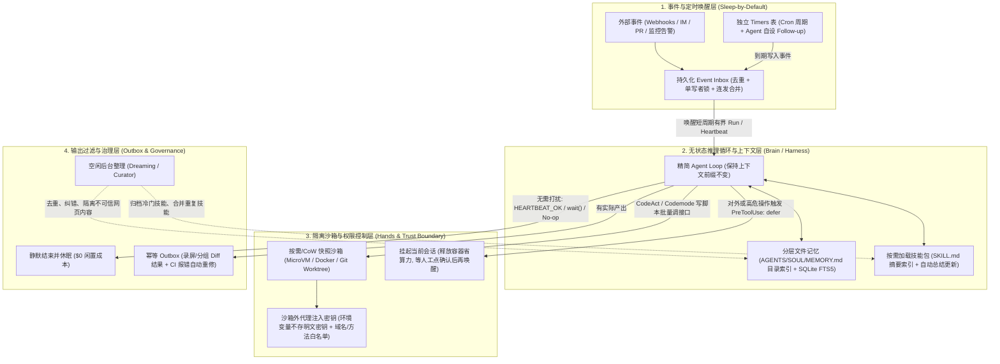

# 2026 热门 AI Agent 产品调研与底层工程共性

> [!IMPORTANT]
> **范围说明**：本文档基于各项目公开工程文档、GitHub 源码仓、安全审计与技术博客整理（时间基准：2026 年 11 月），重点拆解 **Anthropic《Building always-on agents》**、**Paperclip**、**Hermes Agent**，并横向对比 **OpenClaw、Pi、DeepSeek Harness、Poke、Perplexity Computer、Devin 2.2、Manus 2.0、OpenAI Codex Cloud、Cursor Automations、Google Antigravity / Jules、Factory Droids、Genspark Super Agent** 及 **Lindy / Dust / Relevance / Glean** 等产品。

---

## 一、核心结论：2026 热门 Agent 产品的十个底层工程共性

纵观 2025—2026 年跑出来的热门开源项目（如 39.5 万 Star 的 OpenClaw、26.3 万 Star 的 Hermes、11.4 万 Star 的 Paperclip、12.2 万 Star 的 Pi）与头部商业平台（Anthropic、OpenAI、Cognition、Manus、Cursor），大家已经不再靠“把提示词串成死板的流程图”或“拉几个角色在群里互相聊天”来做产品，工程实现上普遍收敛到了以下 **十个具体做法**：

### 1. 默认休眠、按事件唤醒，而不是 24 小时挂着死循环（Sleep-by-Default, Bounded Runs）
* **常见误区**：“24 小时在线的 Agent”并不是在后台挂一个一直跑的大模型轮询进程——用户感觉它“随时在线”，实际上 **99% 的时间它都处于休眠状态（闲置算力成本接近 `\$0`），只有收到消息或定时器到点时才唤醒跑几秒到几分钟（Bounded Run / Heartbeat），存好状态后立刻继续休眠**。
* **各家做法**：
  * **Anthropic《Building always-on agents》**：把 `Session`（持久化会话记录）和 `Run`（单次唤醒执行）拆开；Claude Managed Agents 只对活跃运行按毫秒计费（`\$0.08`/活跃小时，休眠期 `\$0`）。
  * **Paperclip**：提出 **“Memento Man（记忆碎片主角）”模型**——Agent 平时完全不跑，只靠 `timer`、`assignment`、`on_demand`、`automation` 四类触发器唤醒执行一次 8 步 **Heartbeat**。
  * **Devin / Cursor / Hermes**：Devin 用自研 Rust 快照引擎 `blockdiff`（基于宿主机 `XFS reflink` 写时复制）把 20GB 虚拟机的休眠和恢复压到了 **~200ms**；Cursor `Builds` 直接从内存热分叉运行中的虚拟机；Hermes 原生对接 **Modal / Daytona** 按需休眠容器。

### 2. 单会话串行锁、连发消息合并与工单原子抢锁（Single-Writer & Coalescing）
* **解决什么问题**：一旦同时接进 GitHub Webhook、群聊、邮件和定时任务，最容易出事的就是 **并发冲突**——用户连发 4 条消息或 CI 连续报警时，如果同时拉起多个进程，就会互相覆盖记忆文件、重复修同一个 Bug，甚至给客户重复发信或重复扣款。
* **各家做法**：
  * **Anthropic**：规定每个 Event Inbox **同一时刻最多只有 1 个活跃 Worker**，运行期间新进来的消息自动做 **Batching 合并**（一轮回复消化多条消息），并区分三种中途消息处理策略（排队等下一轮 / 在两次工具调用之间塞进当前轮 / 直接打断重跑）。
  * **Paperclip**：用数据库队列合并运行期内的重复唤醒，并用 **单条 PostgreSQL 条件 `UPDATE` 实现工单抢锁**（没抢到直接返回 `409 Conflict`，不依赖 Redis，也不白跑模型 Token）。
  * **OpenClaw & 企业级工作流**：OpenClaw 用分通道 FIFO 队列强制单会话 `concurrency: 1`（支持 `collect` 合并与 `steer` 打断转向）；Lindy / Dust / Sim 标配 Webhook HMAC 去重表和定时任务互斥锁。

### 3. 会话记录、推理循环与执行沙箱三者分离（Session / Brain / Hands Decoupling）
* **解决什么问题**：早期做法常把“聊天状态 + 推理控制代码 + 命令执行沙箱”塞在同一个容器里，容器一旦崩溃或超时，上下文就全丢了，而且每次冷启动都要重新拉代码装依赖。
* **各家做法**：
  * **Claude Managed Agents**：拆成三个彼此独立、随时可销毁重建的部分——**Session**（服务端只追加的事件日志 `getEvents`）、**Harness / Brain**（无状态推理循环，挂了随时拉起新实例从最后一条事件接着跑）、**Sandbox / Hands**（真正发起工具调用时才按需启动容器，把 p95 首字延迟降了 **90%+**）。
  * **OpenHands V1 & DeepSeek Harness (`dsh`)**：OpenHands V1 把不可变的 Agent 配置与只追加的事件日志 `ConversationState` 拆开（系统故障率下降 **61%**）；`dsh` 基于 Cordis 把 `agentLoop`、`sandbox`、`sessions` 都做成可独立替换的插件。

### 4. 严格保持上下文前缀不变，保住 KV-Cache 命中率（Prefix-Invariant Context）
* **解决什么问题**：长任务动辄连续调 30～100 次工具，**输入 Prefill 和输出 Decode 的 Token 比例经常达到 100:1**。只要中途改到了前面的历史内容或系统提示词，大模型 KV-Cache 就会失效，账单直接涨 5～10 倍、延迟也跟着明显变慢。
* **各家做法**：
  * **Manus 上下文实践**：System Prompt 里不放每秒变化的动态时间戳；历史消息严格 **只追加不修改（Append-Only）**；需要限制当前能调哪些工具时，**不增删工具定义列表**，而是靠 **输出 Token 前缀掩码（比如强制以 `browser_` 开头）** 来约束。
  * **OpenAI Codex**：不用服务端有状态的 `previous_response_id`，每次请求都保证前缀字节完全一致——哪怕中途换了目录或改了权限，也只是往消息数组末尾追加一条 `<environment_context>`；超长时再调 `/responses/compact` 做压缩。
  * **Hermes Agent**：会话刚开始时对 `MEMORY.md` 和 `USER.md` 拍一份 **固定快照（Frozen Snapshot）**，运行期间即使更新了磁盘上的记忆文件，也不去改动当前轮次的内存前缀，优先保证多轮对话的缓存命中率。

### 5. 基础工具尽量精简，复杂调用让模型写代码串起来（Minimal Primitives + Codemode）
* **解决什么问题**：一旦挂上五六个 MCP Server，光上百个工具的 JSON Schema 定义就要占掉 2 万多 Token；而且一步步串行调工具会把大量原始 JSON 塞回上下文。
* **各家做法**：
  * **精简基础工具**：**Pi** 只留 `read`、`write`、`edit`、`bash` **4 个工具 + 不到 1,000 Token 的系统提示词**，在 Terminal-Bench 2.0 依然排在前列；DeepSeek Harness 的 `Minimal` 模式甚至只留 `bash` 和 `str_replace_editor`。
  * **写代码调接口（Code-over-MCP）**：Anthropic《Code execution with MCP》把 MCP 接口映射成磁盘上的 TS/Python 模块供模型写脚本调用（Token 开销减少 **98.7%**）；**Pi 1.0 `Codemode`** 让模型写 JS 在无权限的 QuickJS WASM 沙箱里并发调 MCP 并过滤返回值（省约 40% Token）；**Hermes `execute_code`** 通过 Unix Domain Socket RPC 在一段 Python 脚本里串起 20 次工具调用，只把最后的 `print()` 输出带回给模型；**Manus** 全程用 Python `CodeAct` 代替零碎 JSON 工具；**Factory** 则采用 **按需加载工具目录（Deferred Tool Catalog）**。

### 6. 用文件和 Git 存记忆，趁空闲时间在后台整理（File/Git Memory + Offline Dreaming）
* **解决什么问题**：纯向量检索（RAG）查代码或精确状态很容易丢掉前因后果，人也没法直接打开改；反过来，如果任由模型不停往记忆文件里塞东西，很快就会塞满过时信息，甚至被网页里的恶意提示词写进长期记忆。
* **各家做法**：
  * **常驻小目录 + 按需细读 + 只存外部 ID 指针**：Anthropic `CLAUDE.md`/`MEMORY.md`（限制前 200 行当目录，遵循 *“外部系统能查到的内容只存 ID”*）、OpenClaw 工作区 Markdown（`AGENTS.md` / `SOUL.md` / `USER.md` / `MEMORY.md`）、Hermes 定长记忆文件（`2,200` 字符上限，超长时触发整理合并而不是直接截断）+ SQLite FTS5 全文检索、Manus 把大段输出存磁盘并用 `todo.md` 在上下文末尾提醒当前目标。
  * **直接用 Git 管版本**：Letta `MemFS`、GBrain 和 **Poke**（底层用 Pierre `Code.Storage` 给每个用户建独立 Git 仓库，峰值每分钟 4 万次 Git 操作）都直接用 Git 做记忆版本记录和回滚。
  * **空闲后台整理（Dreaming / Sleep-Time Compute）**：Anthropic（Managed Agents **Dreaming** 对照原始日志纠错笔记、整理成带链接的 Wiki）、OpenClaw 2.0（分三步整理，配合 SQLite 来源标记剔除联网回合的不可信内容，生成 `DREAMS.md`）、Letta 和 GBrain 都在空闲时段用后台任务做记忆去重和归并。

### 7. 用 `SKILL.md` 按需加载操作规范，做完任务自动总结更新
* **解决什么问题**：系统提示词塞不下几百个细分场景的操作手册（SOP），而纯自动生成的代码库时间长了又很难维护。
* **各家做法**：
  * **三级按需加载标准（`agentskills.io`）**：2026 年 10 月 Anthropic 把 **Agent Skills (`SKILL.md`)** 捐给了 Linux 基金会旗下的 **Agentic AI Foundation（AAIF，由 Anthropic、OpenAI、Block 联合发起）**，Claude、ChatGPT/Codex、Cursor、Antigravity、OpenClaw、Hermes、Paperclip、Genspark 等 70 多个平台都已支持——**第 1 级**只加载百字左右的 YAML `name/description`；**第 2 级**遇到对应任务时再去读 `SKILL.md` 详细步骤；**第 3 级**直接运行随附脚本，不占模型上下文。
  * **任务结束后自动总结**：**Hermes Agent** 在任务跑完后自动拉起复用热缓存的只读分支（`_spawn_background_review`），把刚踩过的坑总结成 `SKILL.md` 或更新旧技能，过一遍内置格式检查（Linter，拦住记流水账式的无效内容）后入库；空闲时再由 **Curator** 自动归档长期不用的技能、合并相似技能，并配合 **DSPy + GEPA** 做提示词优化。

### 8. 密钥不进沙箱、低风险操作自动过、高危操作挂起等人工确认（Unattended Permissions）
* **解决什么问题**：后台 Agent 往往同时沾了三件事——“能读内部私密数据 + 会读外部不可信网页/邮件 + 能跑命令或对外发消息”。如果每步都弹窗让人点同意，人很快就会麻木乱点（Anthropic 实测 1,053 名开发者连续点 50 轮后，只能拦住 **5%** 的危险命令，62% 的人干脆把权限检查关了）。
* **各家做法**：
  * **密钥不放进沙箱环境变量**：Anthropic Managed Agents、OpenAI Agents API Vaults、Cursor、Paperclip 网关、Lindy/Dust 都采用 **沙箱外代理注入密钥（Credential-Injecting Proxy）**——沙箱里拿不到真实 Token，出站请求经过边界代理核对白名单后才补上 OAuth 凭据；OpenAI Codex 还拆成 **两阶段容器**（环境准备阶段联网装完依赖后清掉密钥，Agent 真正干活时默认断网或只放行只读请求）。
  * **自动安全分类器（Auto Mode）**：Claude Code 默认用双层安全分类器 + 提示词注入检测（能拦下 **89%** 的高危操作，测试集中间接注入攻击成功率降到 **0%**），减少无意义的弹窗。
  * **挂起等待人工确认（Deferred Tool Calls）**：碰到转账、对外发邮件、删数据这类不可逆动作时，触发 `PreToolUse: defer`（Anthropic）或审批队列（Paperclip `approvals` / Lindy / Dust）——**把当前调用栈存盘后直接结束本次运行（等人工回复的几个小时里算力开销为 `\$0`，也不卡住队列里的其他事）**，等人在手机或群里点确认后，再作为一条新消息唤醒继续往下跑。

### 9. 没事少发通知打扰人，结果尽量直观好查，报错自动重修（Noise-Gating & Verifiable Outbox）
* **解决什么问题**：每隔半小时就发一条没营养汇报的助手很快会被用户关掉；而如果后台 Agent 只丢过来一万行终端日志，审查代码的负担又全压回了人身上。
* **各家做法**：
  * **允许直接静默结束**：OpenClaw 约定巡检无异常时输出 `HEARTBEAT_OK` 或 `NO_REPLY`，网关直接吞掉不发通知；**Poke** 把负责聊天的前台 Agent 和后台干活的子 Agent 拆开，专门提供 `wait()` 工具丢掉不重要的提醒；Anthropic 也把“打扰率”单独做成评测指标（Notification Evals）。
  * **输出好检查的交付物 + CI 报错自动重修**：Google Antigravity 输出可逐行批注的计划、截图和操作录屏；Cursor Cloud Agents 用 `recordScreen` 直接往 PR 里贴演示视频；Devin Review 把代码改动按逻辑分组展示，并且和 Cursor Bugbot Autofix、Google Jules CI Fixer 一样，遇到 CI 报错或有人提了评审意见时 **自动唤醒原沙箱接着改到测试通过**。

### 10. 子 Agent 上下文隔离、大小模型分级调用与预算硬上限（Isolation & Governance）
* **解决什么问题**：早期框架喜欢让“产品经理、开发、测试”几个 Agent 在同一个上下文里来回群聊，不仅上下文互相干扰，10 步每步 95% 成功率串下来整体成功率也会掉到 $0.95^{10} \approx 59.9\%$，一旦死循环还会刷爆账单。
* **各家做法**：
  * **子 Agent 隔离运行 + 独立验收（Generator-Evaluator）**：**Manus Wide Research** 同时拉起上百台独立 Linux 虚拟机，**禁止子 Agent 之间直接互相发消息**；Hermes `delegate_task` 不给子任务传完整父对话历史，也不给全局记忆写权限；Anthropic 和 Google Jules 单独安排跑 Playwright 实测验收的 **Evaluator / Critic Agent**；Paperclip 按上下级汇报关系（`reports_to`）切分上下文，开发做完转交独立 QA 角色验收。
  * **大小模型分工 + 纯脚本巡检**：DeepSeek Super Agent 先过一层不调模型的规则筛选；Hermes 定时任务支持 `no_agent` 纯脚本检查（零 Token 消耗）；OpenClaw 和 Poke 用便宜的小模型盯每分钟的邮件和心跳，真遇到复杂任务再调大模型。
  * **预算硬上限**：Paperclip（按团队/项目/单个 Agent 分别统计 `billed_cents`，到 80% 提醒、到 100% 自动暂停并停掉在途任务）、Dust（单轮额度上限）、Glean Protect（发现用户在源系统的文档权限被收回时，自动暂停对应的后台订阅任务）。

---

## 二、重点产品与前沿博客深度拆解

### 2.1 Anthropic：《Building always-on agents》与 2026 全栈长程体系
* **核心文献**：William Hu 于 **2026 年 11 月 13 日** 发布的官方最佳实践指南《[Building always-on agents](https://claude.com/resources/articles/building-always-on-agents)》，配合 11 月 6 日 Lance Martin 的《[The components of agent memory](https://www.anthropic.com/research/components-of-agent-memory)》及《[Scaling Managed Agents](https://www.anthropic.com/research/managed-agents)》。
* **五大构建积木（Five Building Blocks）**：
  1. **Event Inbox（事件收件箱）**：由轻量 HTTP 接收端（快速验签落库返回 `200`，防 Webhook 超时重发）、持久化事件表（按源事件 ID 幂等去重）与单活跃 Worker 组成，数据库表是唯一事实源。
  2. **Timers（定时器）**：与 Inbox 分表存储，分为 **Follow-ups**（Agent 在运行中给自己定的单次跟进闹钟，如“48 小时后对方没回邮件就叫醒我”）和 **Schedules**（固定 Cron 周期）。调度器到期后只做一件事：**往 Event Inbox 插入一条事件**，从而完全复用单写者锁与去重管线。
  3. **Memory（四分区虚拟文件记忆 + 离线 Dreaming）**：分为常驻加载的 `instructions.md`、按需索引读取的 `User Notes`、防止重复打扰用户的 `Past Messages` 以及跨轮次续跑的 `Task Progress`；配合离线 **Dreaming** 对照原始日志纠错并合成多页互链 Wiki（在 35 万文件语料库上把准确率从 13% 提升至 61%，单次查询省 2 万 Token）。
  4. **Unattended Permissions（无人值守权限三件套）**：沙箱外凭据注入代理 + Auto Mode 实时分类器 + `PreToolUse: defer` 零算力挂起恢复。
  5. **Outbox（幂等发件箱）**：每次 Run 只能以三种方式结束——**写入 Outbox 由独立 Dispatcher 限流/静默时段投递**、**静默完成（No-op）** 或 **挂起等待人工审批**。
* **产品落地矩阵**：**Claude Managed Agents**（支持公有云与 2026.11 私有化自托管 ZDR 部署）、**Claude Code Scheduled Tasks / Routines**（将外部不可信告警包裹在 `<routine-fire-payload>` 标签防注入）、**Claude Duet**（2026.10 发布的 24/7 主动式个人/商业助手，自带云 VM + 6,000+ 连接器 + 晨报与主动提醒）、**Claude Tag**（Slack 频道级常驻多人协作队友）。

### 2.2 Paperclip（“pepperclip”，`paperclipai/paperclip`）：零人类公司的组织控制面
* **定位与爆火原因**：2026 年 3 月由 Dotta 等发布，11 月突破 **11.4 万+ GitHub Stars**。口号是 **“如果 OpenClaw 是一名员工，Paperclip 就是整家公司（If OpenClaw is an employee, Paperclip is the company）”**，专门解决高阶用户同时开 20 个 Claude Code / Codex 终端导致的上下文丢失、改坏同一文件、账单失控和缺乏审计问题。
* **核心机制拆解**：
  * **异构适配器（“能收心跳就能入职”）**：TypeScript + Express 5 + PostgreSQL（本地零配置内嵌 `PGlite`）+ React 19 看板。通过统一 `execute / cancel / sessionCodec` 协议纳管 `claude_local`、`codex_local`、`hermes_local`、`openclaw_gateway`、`opencode_local`、`cursor` 乃至任意 Python 脚本/HTTP 服务。
  * **8 步确定性心跳协议（Heartbeat Protocol）**：Agent 被唤醒后依次执行：确认身份与剩余预算 → 处理审批回执 → 拉取优先级工单 → 恢复在途任务 → **单条 SQL 原子检出（`409` 防冲突）** → 注入 **Goal Ancestry（从公司使命 → 季度目标 → 父项目 → 当前工单的完整祖先链，让底层修 Bug 的 Agent 知道产品意图）** → 执行工作（若偷懒只写计划不干活，系统识别为 `plan_only` 自动追发续跑心跳） → 更新工单状态并刷盘 PARA 记忆。
  * **治理与可移植公司包**：内置董事会审批队列（招聘新 Agent、CEO 战略调整、超预算需人类拍板）、`git_worktree` 工作区隔离、双账本成本追踪，以及 **`paperclipai/companies` / Clipmart**（把整套组织架构、岗位 `AGENTS.md` 与 `SKILL.md` 打包成“AI 公司版 npm 包”一键导入，如 Garry Tan 的 `gstack` 或 Trail of Bits 安全审计团队模板）。

### 2.3 Hermes Agent（`NousResearch/hermes-agent`）：技能自动沉淀与多层记忆
* **定位**：Nous Research 于 2026 年 2 月开源（26.3 万+ Stars，MIT 协议），不绑定特定模型（支持 Claude、OpenAI、OpenRouter、本地 vLLM/llama-server 及 Hermes 3/4），主打 **“任务做完自动总结经验、越用越顺手的常驻 Agent”**。
* **核心机制拆解**：
  * **前后台双路径总结技能 + Curator 定期清理**：前台超过 5 步复杂调用会提醒保存成技能；后台每轮结束后异步拉起 **只读复盘分支**（默认与主会话前缀字节级对齐，直接命中刚跑完的热 Prompt Cache），自动新建或修改 `~/.hermes/skills/` 下的 `SKILL.md`。为防技能越积越乱，空闲满 2 小时且间隔满 7 天时触发 **Curator**，不调模型先归档长期不用的技能，再用模型合并重复技能，并用 SHA-256 记录支持随时回滚。
  * **五层记忆结构 + Honcho 用户偏好推断**：`SOUL.md` 基础规则 + 定长快照 `MEMORY.md`/`USER.md` + SQLite WAL **FTS5 BM25 跨会话全文搜索（`session_search`）** + **Honcho 三步推断**（推测意图 → 核对历史记录 → 处理用户前后习惯变化）+ 保留精确 Git SHA 与文件路径的上下文压缩。
  * **多渠道常驻服务**：`hermes gateway install` 一键注册系统后台服务，接入 Telegram、Discord、Slack、WhatsApp、飞书、企微、Home Assistant 等 **25+ 渠道**，支持在终端输入 `/handoff telegram` 带着当前 `session_id` 出门在手机上接着聊。

### 2.4 OpenClaw 与轻量 Harness 项目（Pi、DeepSeek Harness、OpenHands V1、Goose）
* **OpenClaw（`openclaw/openclaw`，39.5 万+ Stars）**：Peter Steinberger 基于 **Pi SDK** 做的本地常驻个人助手网关（`:18789`），接入 50+ 聊天软件、语音唤醒、动态交互界面 `Live Canvas (A2UI)` 与手机/树莓派硬件节点（摄像头、GPS、录屏）。它带火了 `SOUL.md` + `AGENTS.md` + `USER.md` + `MEMORY.md` + `HEARTBEAT.md` 纯文本目录结构，并在 2.0 版本加上了 **SQLite 来源标记（联网回合自动标为 `untrusted`，禁止直接写进长期记忆）**。
* **轻量编码内核代表**：
  * **Pi (`earendil-works/pi`)**：4 个基础工具 + 树状分支 JSONL 会话 + 支持 Agent 自己写 TypeScript 插件并 `/reload` 热加载 + QuickJS `Codemode`。
  * **DeepSeek Harness (`dsh`，27.9 万+ Stars)**：基于 Cordis 把所有模块做成可替换插件（连 `agentLoop` 都能随时换掉），在相同模型评测下把单任务平均成本从 **\$18.34 压到了 \$3.28**。
  * **Goose (`aaif-goose/goose`)**：Block 捐给 Linux 基金会 AAIF 的 Rust 单二进制工具，主打用 YAML Recipes 在团队内共享固定流程。

### 2.5 免运维主动型消费级产品：Poke 与 Perplexity Computer
* **Poke（`poke.com`，2026.07 被 Cognition 收购）**：首个拿到苹果官方批准接入 **Apple Messages for Business（原生 iMessage）** 的独立 AI Agent。不用自己配服务器，加好友就能用：前台是一个负责自然聊天的 **Interaction Agent**，配了 `wait()` 工具过滤无用提醒；后台是一组 **长期保留上下文的执行子 Agent**，配合每分钟扫 Gmail/日历的小模型分类器与 `Code.Storage` Git 记忆库，在后台默默把事办完。
* **Perplexity Comet & Computer**：Comet 在浏览器里跨标签页操作网页；Computer 调度十几种模型盯邮件、航班、日历和本地文件，提供 **云端沙箱 / 混合模式（本地读私密文件 + 云端推理） / 纯本地 Apple Silicon 离线运行** 三种部署方式。

### 2.6 云端工作台与企业级 SaaS 平台
* **云端研发 Agent（Devin 2.2 / OpenAI Codex / Cursor / Google Antigravity / Factory）**：到 2026 年 5 月，**Devin 由外部事件自动触发的任务量已经超过了人工手动发起的对话量**；Cursor 内部超过 **30%** 的合并 PR 由云虚拟机里的 Cloud Agents 完成；Factory 线上有 **14% 的任务连续运行超过 24 小时（最长 16 天）**。
* **通用云端工作台（Manus 2.0 / Genspark Super Agent）**：每个任务分配一台独立云端 Linux 电脑，关掉网页也能在后台继续跑或定时重跑（Manus Scheduled Tasks 2.0 支持在同一个持久目录里按周累加数据；Manus 2.0 `Cue` 还给 Agent 配了独立邮箱、手机号和限额付款卡）。
* **企业级 SaaS 平台（Lindy / Dust / Relevance / Fleece / Gumloop / Glean）**：主要拼 **1,000～4,000+ 现成 OAuth 连接器** + 没 API 时用云端浏览器兜底（Autopilot / Playwright）+ **实时同步源系统文档权限（ACL）**（Dust 区分团队共享凭据与个人凭据；Glean Protect 实时拦截越权访问）+ 幂等防重发与人工审批队列。

---

## 三、2026 Agent 生态分层与横向对比

### 3.1 五层分工：为什么不同开源项目经常搭在一起用？
市面上的热门项目并不是都在做同一层，放在一起看其实是 **上下游互补的五层**（所以社区里常把 `Paperclip + Hermes + OpenClaw + Claude Code` 串起来用）：

1. **L0 通用协议与文件约定（Linux 基金会 AAIF 等）**：`MCP`（工具连接）、`AGENTS.md`（项目说明）、`SKILL.md`（按需加载的操作规范）。
2. **L1 单机执行内核（Agent Harness）**：**Pi**、**DeepSeek Harness**、**OpenHands V1**、**Goose**、**Claude Code CLI / Codex CLI** —— 管单进程里的推理循环、上下文压缩和命令执行。
3. **L2 个人常驻网关与记忆层**：**OpenClaw**（强在多聊天软件接入和硬件节点）、**Hermes Agent**（强在自动沉淀技能和多层记忆）、**Poke**（免部署托管版）、**Claude Duet**。
4. **L3 云端沙箱电脑与垂直平台**：**Devin**、**Cursor Cloud Agents**、**Google Antigravity**、**Manus**、**Genspark**、**Claude Managed Agents**、**Lindy / Dust / Glean**。
5. **L4 多 Agent 团队调度与预算控制面（Control Plane）**：**Paperclip**、**Factory Mission Control**、**Linear for Agents**、**OpenAI Symphony** —— 不管单个 Agent 内部怎么推理，专门管任务分配、工单锁、目录隔离、总账单上限和人工审批。

### 3.2 十二款代表性产品横向对比

| 产品 / 项目 | 形态与定位 | 唤醒与并发控制 | 记忆与技能管理 | 沙箱与权限安全 | 主要特点 |
| :--- | :--- | :--- | :--- | :--- | :--- |
| **Anthropic Always-On / Managed Agents / Duet** | 官方工程指南 + 托管云服务 + 个人助手 | Event Inbox 单 Worker + 独立 Timers 表 + 连发合并 | 4 类记忆文件 + 200 行目录 + 后台 **Dreaming** Wiki + `SKILL.md` | 推理与容器分离按需启动 + **沙箱外代理注入密钥** + 安全分类器 + `defer` 挂起 | 体系最完整；按实际运行毫秒计费，休眠 `\$0`；支持私有化 ZDR |
| **Paperclip** (`paperclipai`) | 开源多 Agent 团队调度与控制面 | 4 类触发唤醒 **Heartbeat** + 队列合并 + 单条 SQL `409` 抢锁 | 工单 **Goal Ancestry** 目标背景注入 + PARA 文件记忆 + 团队模板包 | 外部适配器接入 + `git_worktree` + 网关三级权限 + 关键操作审批 | 把多 Agent 协作做成清晰的工单状态机、汇报关系与预算硬上限 |
| **Hermes Agent** (`NousResearch`) | 开源常驻网关与多沙箱运行时 | systemd/launchd 服务 + 60s 文件锁 Cron + 异步子任务 | 固定快照 `MEMORY/USER.md` + SQLite **FTS5** + **Honcho** 偏好推断 + **自动总结 `SKILL.md`** | 本地 / Docker / SSH / **Modal & Daytona** 休眠云沙箱 + 技能安全扫描 | 技能自动沉淀、格式检查、Curator 定期清理与 `/handoff` 换端续聊最成熟 |
| **OpenClaw** (`openclaw`) | 开源本地优先多渠道个人网关 | `:18789` 网关 + 30m 定时检查 (`HEARTBEAT_OK` 静默) + Webhook | 工作区 Markdown (`SOUL/AGENTS/MEMORY.md`) + 2.0 **来源标记 + 后台整理** | 分会话单写者队列 + 多层工具白名单 + 设备配对签名（早期默认配置偏宽松） | 50+ 聊天软件覆盖 + 语音唤醒 + Live Canvas 界面 + 手机/树莓派节点 |
| **Pi** (`earendil-works/pi`) | 轻量可自扩展编码内核与 SDK | 无固定步数上限循环 + 实时 `steer` 转向 + `Pi Durable` 恢复 | 本地 `AGENTS.md` / `PLAN.md` + 树状分支 JSONL | 默认本地运行（建议套容器）+ **QuickJS WASM `Codemode`** 隔离调 MCP | 不到 1k Token 提示词 + 4 个基础工具 + Agent 可自己写 TS 插件热加载 |
| **DeepSeek Harness** (`dsh`) | 全插件化开源编码内核 | 规则前置过滤 + 动态路由 + 隔离 Worker | zstd 压缩可重放 JSONL + Cordis 上下文管理 | `ctx.sandbox` 统一封装本地/远程进程与文件系统 | 连 `agentLoop` 都能热插拔；把工具转成 TS SDK 调用，成本控制极低 |
| **Poke** (Cognition) | 免运维主动式 iMessage/聊天助手 | 每分钟邮箱/日历小模型扫描 + 绑定子任务的 SQL 触发器 | 近期消息摘要 + 常驻子任务完整记录 + 邮箱检索 + **托管 Git (`Code.Storage`)** | 多租户托管 OAuth + 前台对话层与后台工具层隔离 | 原生接入 iMessage；靠 `wait()` 少打扰用户，前后台职责分明 |
| **Devin 2.2** (Cognition) | 云端软件工程 Agent 平台 | Slack/Linear/PR/Sentry/定时触发（自动触发量已超手动） | **DeepWiki** 仓库图谱 + 按需知识注入 + Playbooks + 历史问题去重 | 自研 **`otterlink` microVM**（支持嵌套 Docker）+ **`blockdiff` 200ms 快照** | 毫秒级整机休眠分叉；逻辑分组代码 Diff + CI 报错与评审意见自动重修 |
| **OpenAI Codex** (Cloud / App / CLI) | 多端编码 Agent 与云沙箱 | `background=true` 断点续传 SSE + 定时/Webhook 自动任务 | 层级 `AGENTS.md` + `Skills` + 只追加前缀 + `/responses/compact` 压缩 | **两阶段容器（装完依赖清密钥 + 运行期默认断网/只读白名单）** + 本地 Worktree | 安全隔离最严格；兼容无状态 ZDR，100% 保证前缀缓存命中 |
| **Cursor Cloud & Automations** | 云端带桌面环境的研发自动化 | Slack/PR/Sentry/PagerDuty/定时触发 + **`Builds` 热内存分叉虚拟机** | 跨次运行持久化记忆 + `BUGBOT.md` 团队规则沉淀 | 构建期与运行期密钥分离 + 出站域名控制 + `Cloud Doctor` 环境自检 | 热分叉启动快；`recordScreen` 自动录操作视频贴进 PR；Bugbot 自动修补 |
| **Manus 2.0** | 通用云端 Linux + 浏览器工作台 | 持久云电脑 + 跨日同目录定时任务 + 应用自动化 | 磁盘存原始大文件 + **上下文末尾更新 `todo.md` 防跑偏** + 保留报错栈 | 独立 Ubuntu 虚拟机 + Playwright + **输出前缀掩码限权** + 画面实时接管 | 支持 100+ 独立虚拟机并行调研（Wide Research）；可配独立邮箱/手机号/付款卡 |
| **企业级 SaaS 平台** (Lindy / Dust / Glean) | 连接上千业务系统的企业工作流 | HMAC 去重 Webhook + 定时任务锁 + 权限变更监听 | 团队文本记忆 / **企业知识图谱** | 上千个托管 OAuth + **实时同步源文档权限 (`Glean Protect`)** + 网络隔离 | 写操作默认走人工审批 + 幂等键防重发 + 用量上限控制 |

---

## 四、2026 线上真实踩过的四个大坑

翻看各项目的 GitHub Issues、CVE 漏洞通告和事故复盘，能看到常驻型 Agent 在落地上最容易栽在下面四件事上：

> [!WARNING]
> **坑 1：为了省事默认不鉴权、不隔离，直接酿成安全事故**
> * **控制面未授权远程执行（RCE）**：Paperclip 早期出过满分漏洞 **CVE-2026-41679（CVSS 10.0）**——默认开放注册且导入接口没校验权限，攻击者半分钟就能导入带恶意 `process` 适配器的模板包拿走宿主机权限；OpenClaw 早期也有 **13.5 万～22 万个 `:18789` 网关直接暴露在公网**（63% 没开鉴权），配合 **CVE-2026-25253** 点一下恶意链接就能被盗走网关 Token 执行命令。
> * **第三方技能包投毒（`ClawHavoc` 事件）**：2026 年初安全团队在 ClawHub 技能市场查出 **800 多个带毒 `SKILL.md` 包**，靠夹带脚本或伪造“前置安装命令”投递 macOS 木马（AMOS）；Cisco/Snyk 扫描 3.1 万个公开技能，发现 **36% 存在提示词注入隐患**。
> * **长期记忆被悄悄写进后门**：如果不像 OpenClaw 2.0 那样给联网回合标上 `untrusted` 隔离，也没开 Hermes 的 `memory.write_approval: true`，恶意网页就能靠间接提示词注入哄骗 Agent 把恶意指令写进 `MEMORY.md` / `SOUL.md`，以后每次新开对话都会中招。

1. **坑 2：定时巡检空转烧钱，以及包月账号的用量盲区**
   * **大上下文定时空转**：不少 OpenClaw 早期用户开了每 30 分钟一次的定时心跳，每次把 6 万多 Token 的工作区文件全塞进去调旗舰模型（比如 Claude Opus），只要哪次没正常返回 `HEARTBEAT_OK` 陷进工具重试，一觉醒来账单就是 **\$200～\$2,000/天**。
   * **包月 CLI 导致预算统计失灵**：2026 年 10 月有人排查 Paperclip 事故时发现，它的预算上限只看 `billed_cents`（美分金额）；结果底层接的是包月订阅 CLI（Claude Max / Codex Pro），返回的金额永远是 `\$0.00`，后台不知不觉跑掉近 10 亿缓存 Token 都没触发停机。
   * **无意义的“多角色开会”开销（Theater of Autonomy）**：在多 Agent 框架里输一句简单需求，CEO Agent 先拉 CTO、PM、设计师开会写规划、层层派单——本来两三个脚本或一个子任务就能干完的活，全耗在角色互相客套和状态死锁上了。
2. **坑 3：只给数据库工单加锁，没隔离本地代码目录**
   * 数据库抢锁只能保证两个 Agent 不领同一张工单，拦不住它们在同一个本地文件夹里同时 `git checkout` 不同分支互相覆盖文件。Paperclip 著名的 **Issue #3335（222 个共享目录踩踏事故）** 说明：**只要允许多个编码任务并行，`git worktree` 或独立容器就得是默认行为，不能藏在可选开关后面**。
3. **坑 4：给新模型定太死的记笔记规矩，反而帮倒忙**
   * Anthropic 在 2026 年 11 月《The components of agent memory》里做过对比：对早期能力偏弱的模型（如 Sonnet 4.6），手把手规定“怎么记笔记”确实能提分；但换成判断力更强的新模型（如 Opus 5 / 5.5）后，只交代一句 **“这份记忆文件是留着干嘛的”** 效果最好，硬塞一堆“只准记失败教训、按固定模板写”的死规矩，反而把收益全抵消了——也就是他们总结的：**脚手架里每一条死规则其实都是在弥补旧模型的短板，模型变强后要及时删掉多余约束**。

---

## 五、自己动手搭系统时的 8 条实用清单

把上面各家的经验和教训合在一起，自己搭一套靠谱的后台 Agent，抓住下面 8 条就够了：

1. **基础工具越少越好**：核心循环只留 `read / write / edit / bash + execute_code` 这几个基础工具，复杂的外部接口让模型在沙箱里写脚本调（Codemode / CodeAct），再配合 `SKILL.md` 按需读取，别一上来把提示词塞满。
2. **用事件队列和定时表代替后台死循环**：建好三张表——**Event Inbox（幂等去重 + 单写者锁 + 连发合并）**、**Timers（支持固定 Cron 与单次延迟提醒 Follow-up）**、**Outbox（幂等外发 + `NO_REPLY` / `wait()` 静默结束）**，平时休眠，有事才唤醒。
3. **把会话日志、推理循环和执行沙箱拆开**：会话状态存成只追加的事件日志，推理循环做成无状态的，执行沙箱用按需启动容器、写时复制快照或自动 `git worktree` 隔离。
4. **别破坏上下文前缀缓存**：上下文按 `固定规则 -> 会话启动时的记忆快照 -> 本轮追加对话` 排列，运行中途不改前面的内容，也不动态增删工具定义列表。
5. **热记忆只放小目录，联网内容先隔离**：常驻加载的 `MEMORY.md` / `USER.md` 控制在 200 行以内当索引，详细历史走本地 SQLite WAL + FTS5 全文搜索；读过外部网页的回合标上 `untrusted`，等空闲时再由后台任务清洗整理。
6. **做完复杂任务顺手沉淀 `SKILL.md`**：长任务跑完后拉一个复用热缓存的只读分支总结经验，过一遍格式检查拦住流水账，并用 Git 或哈希记录保留回滚能力。
7. **密钥放在沙箱外面，高危动作挂起等确认**：OAuth 和 API Key 统一由沙箱外的代理按白名单注入；常规操作交给安全分类器自动过，对外发信、合代码、花钱等动作走 `defer` 存盘挂起，不占算力等人工点确认。
8. **小模型盯日常，金额与 Token 流速一起设上限**：定时检查、消息初筛优先用纯脚本或便宜小模型；预算上限 **同时盯金额（`cents`）和每小时 Token 消耗量**，避免包月账号或异常重试把额度打穿。

---

## 六、核心一手参考资料索引

* **Anthropic 官方系列**：
  * [Building always-on agents (William Hu, 2026-11-13)](https://claude.com/resources/articles/building-always-on-agents)
  * [The components of agent memory (Lance Martin, 2026-11-06)](https://www.anthropic.com/research/components-of-agent-memory)
  * [Scaling Managed Agents: Decoupling the brain from the hands (2026-04-08)](https://www.anthropic.com/research/managed-agents)
  * [Effective harnesses for long-running agents](https://www.anthropic.com/research/effective-harnesses-for-long-running-agents) & [Harness design for long-running application development](https://www.anthropic.com/research/harness-design-long-running-apps)
  * [Code execution with MCP](https://www.anthropic.com/research/code-execution-with-mcp) & [Agent Skills Standard (`agentskills.io`)](https://agentskills.io/home)
* **Paperclip 生态**：
  * [paperclipai/paperclip GitHub](https://github.com/paperclipai/paperclip) | [Paperclip Docs](https://paperclip.ing/docs) | [paperclipai/companies](https://github.com/paperclipai/companies)
  * [Heartbeat Protocol Spec](https://github.com/paperclipai/paperclip/blob/master/docs/guides/agent-developer/heartbeat-protocol.md) | [GHSA-68qg-g8mg-6pr7 (CVE-2026-41679)](https://github.com/advisories/GHSA-68qg-g8mg-6pr7)
* **Hermes Agent & 记忆进化生态**：
  * [NousResearch/hermes-agent GitHub](https://github.com/NousResearch/hermes-agent) | [Hermes Agent Official Docs](https://hermes-agent.nousresearch.com/docs/) | [Hermes Self-Evolution (DSPy + GEPA)](https://github.com/NousResearch/hermes-agent-self-evolution)
  * [Letta — Towards Agents That Learn](https://www.letta.com/blog/towards-agents-that-learn/) | [garrytan/gbrain GitHub](https://github.com/garrytan/gbrain)
* **OpenClaw、极简 Harness 与消费级主动 Agent**：
  * [openclaw/openclaw GitHub](https://github.com/openclaw/openclaw) | [OpenClaw 2.0 Memory Architecture](https://docs.openclaw.ai/concepts/memory-architecture)
  * [earendil-works/pi GitHub](https://github.com/earendil-works/pi) & [Mario Zechner — Minimal Coding Agent](https://mariozechner.at/posts/2025-11-30-pi-coding-agent/)
  * [deepseek-ai/deepseek-harness GitHub](https://github.com/deepseek-ai/deepseek-harness) | [OpenHands Software Agent SDK](https://github.com/OpenHands/software-agent-sdk) | [aaif-goose/goose](https://github.com/aaif-goose/goose)
  * [OpenPoke Architecture Breakdown](https://www.shloked.com/openpoke) & [Poke `Code.Storage` Git Memory Case Study](https://code.storage/changelog/poke-case-study)
* **商业云端与企业级 Agent**：
  * [Cognition — `blockdiff` CoW Snapshot Engine](https://cognition.com/blog/blockdiff) | [Devin Review](https://cognition.com/blog/devin-review) | [Devin Auto-Triage](https://cognition.com/blog/auto-triage)
  * [OpenAI — Unrolling the Codex Agent Loop](https://openai.com/index/unrolling-the-codex-agent-loop/) | [AGENTS.md](https://agents.md/) | [Linux Foundation AAIF](https://aaif.io/)
  * [Cursor — Cloud Agents Start 3x Faster with Builds](https://cursor.com/blog/builds) & [Cursor Automations](https://cursor.com/blog/automations)
  * [Manus — Context Engineering for AI Agents](https://manus.im/blog/Context-Engineering-for-AI-Agents-Lessons-from-Building-Manus) & [Wide Research](https://manus.im/blog/introducing-wide-research)
