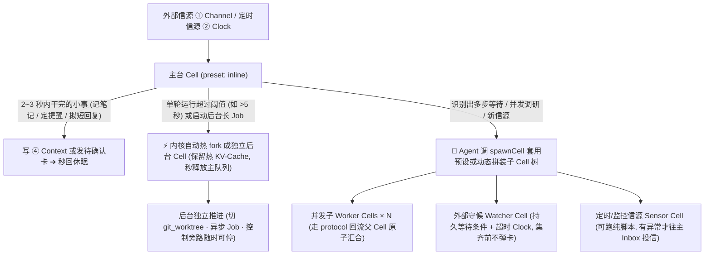

# Agent 核心架构拆解：1 条消息总线 + 8 个基础原语 + `Cell` 动态拼装

> [!IMPORTANT]
> **核心结论：既不需要为每种 Agent 产品单独设计一套架构，也不需要在内核里塞满定制业务实体。**
> 1. **数据面只需要 1 条统一消息流（`Envelope`）+ 8 个职责封闭的基础原语**：`① Channel`（渠道接入与能力声明）、`② Clock`（定时与唤醒）、`③ Inbox`（收件队列、租约锁与实时控制旁路）、`④ Context`（分层状态/记录/技能存储与带版本原子提交）、`⑤ Loop`（大模型推理或确定性处理器）、`⑥ Workspace`（隔离沙箱与异步 `Job` 句柄）、`⑦ Gate`（权限收紧、绑定版本的审批与预算控制）、`⑧ Outbox`（区分内部协议消息与对人通知的投递层）。
> 2. **控制面只需要 1 个组合容器 `Cell` + 运行在原语上的显式状态协议**：真实工作的粒度跨度极大（从 2 秒记条笔记，到跨天等三方回信、并发扒 15 家竞品、或定期跑监控脚本）。把“8 个原语怎么连在一起”封装成可动态创建的 **`Cell`**，配合 `Context + Loop` 上的状态与汇合协议——靠**预设模板**应付日常 90% 的场景，靠 **Agent 动态拼装**应付长尾复杂场景，再靠**长耗时自动热 `fork` 与异步 `Job`** 避免堵死主会话——就能在同一套底座上搭出 Pi、OpenClaw、Hermes、DeepSeek Super-agent、Poke、Devin、Manus、Paperclip 以及我们的 GTD 工作台。

---

## 一、为什么刚好是“8 个数据面原语 + 1 个 `Cell` 容器”？

拿真实场景去拆解，基础职责靠 8 个封闭模块就能完全覆盖，不同粒度任务的组织靠 `Cell` 容器把它们装在一起（具体业务规则如多子任务汇合、草稿版本校验，则作为状态协议跑在 `Context + Loop` 上，而不是光靠连上消息线就自动生效）：

| 序号 | 模块名称 | 层级 | 封闭职责（管什么 / 不越界管什么） | 如果少了它，会卡在哪儿？ |
| :--- | :--- | :--- | :--- | :--- |
| **①** | **`Channel`**（渠道与信源接入） | 数据面原语 | 外部协议（IM / 邮件 / Webhook / UI）与内部 `Envelope` 的双向转换、绑定真实发起人身份，并如实声明外部渠道能力（是否支持幂等、撤回、流式预览） | 少了它，Agent 只能跑在本地脚本里，接不进飞书、GitHub 或前端工作台 |
| **②** | **`Clock`**（定时与唤醒） | 数据面原语 | 把 **固定 Cron、单次延迟跟进（`at`）、按 `Cell` 作用域计算的空闲触发（`idle`）** 转成标准消息投进指定 `Inbox`，支持按组销钟与版本校验 | 光有 `Channel`，Agent 只能“问一句动一下”；加上 `Clock`，才能做定时信源、超时催问和空闲后台整理 |
| **③** | **`Inbox`**（队列、租约与控制旁路） | 数据面原语 | 消息落盘去重、单 `Cell` 串行合并锁 / 共享抢单锁 / 跑题退回（`handback`），以及**绕开普通排队锁的实时控制旁路（`cancel / pause / steer`）** | 少了它，连发消息会并发撞车；少了控制旁路，跑长任务时用户喊“快停下”只能排在队尾干等 |
| **④** | **`Context`**（分层状态、记录与技能） | 数据面原语 | 分层保存 **① 带 `revision` 版本的业务状态与草稿产物、② 原始对话与外部证据（支持 `Inline & Spill` URI 直读）、③ `SKILL.md` 与长期偏好**；提供**状态变更 + 待发意图的原子条件提交（CAS）**，以及前缀稳定的只读推理快照 | 少了分层与版本提交，人机同时改草稿会互相覆盖，进程重启会丢派单，上下文压缩还会误删活跃项目状态 |
| **⑤** | **`Loop`**（推理或确定性处理） | 数据面原语 | 无状态的单次有界执行（`Run`）：既可跑大模型推理，**也可跑已注册的确定性处理器/纯脚本**（处理审批回执、UI 改稿保存、子任务 `all/any` 汇合计数、零 Token 巡检） | 都调大模型既贵又慢还可能算错账；双模式兼顾了灵活生成与零 Token 精确状态流转 |
| **⑥** | **`Workspace`**（沙箱与异步 `Job`） | 数据面原语 | 与推理循环分离的隔离执行环境（`git worktree` / 容器 / MicroVM）：既支持短命令直跑，也支持**脱离单次 `Run` 生命周期的异步 `Job` 句柄（启动、查进度、流式交互、随时取消，跑完回投 `Inbox`）** | 若命令必须同步卡住 `Run`，跑 20 分钟编译就会死死占住会话锁且无法中途停掉 |
| **⑦** | **`Gate`**（权限、版本审批与预算） | 数据面原语 | 硬护栏：**沙箱外代理注入密钥、子权限单调收紧、绑定具体草稿/动作版本号的 `defer` 审批、撤销（`revoke`）、金额+Token 预留与树状结算**（覆盖模型、确定性处理器与沙箱出口） | 少了版本绑定，手机点确认可能误发刚被刷新的草稿；少了预算与代理边界，防不住越权操作和死循环账单 |
| **⑧** | **`Outbox`**（分类投递与静默过滤） | 数据面原语 | 严格区分 **内部协议消息（`protocol`）**、**对人通知（`notify`）** 与 **暂态流式预览（`preview`）**：可靠投递内部结果，对人通知支持 `silentDrop`、专注期免打扰暂存与真实投递回执（含 `unknown` 状态） | 若内外消息混为一谈，用户一开“免打扰”就会把子任务交上来的汇总结果也吞掉卡死 |
| **⑨** | **`Cell`**（原语拼装单元） | **控制面容器** | 把上面 8 个原语组装成有明确归属、版本与生命周期边界的运行实例：支持**预设模板、Agent 动态拼装、超 5 秒自动热 `fork`、完结/取消按版本级联回收** | 如果把连线写死在启动代码里，系统只能定死一种任务粒度；有了 `Cell`，才能随事情大小自然伸缩 |

> [!TIP]
> **坚持“内核只留通用原语，复杂行为靠显式状态协议组合”——不需要为每种功能往内核里塞定制组件：**
> * **“影子观察 / 试运行”（DeepSeek Super-agent `observe`）**：不用加内置观察模式——拼一个 `Channel(群消息过滤) → Inbox → Loop → Workspace(追加写进观察笔记) → Outbox(silentDrop)` 的 `Cell` 就行。
> * **“把重复的大模型巡检降本为零 Token 脚本”**：不用加专门的结晶引擎——Agent 在 `Workspace` 写好检查小脚本，把定时信源 `Cell` 的 `⑤ Loop` 切到 `{ kind: "script" }`（正常则 `silentDrop`，异常才往主 `Inbox` 发信）。
> * **“并发派单 / 等三方回信集齐再比价，48 小时没回催问”**：通信走 `Outbox(protocol) → 父 Inbox`，编排靠 `④ Context` 记录预期集合（如 `all({A, B, C})`）与等待条件 + `⑤ Loop` 确定性处理器做带版本的条件提交——保证 `3/3` 集齐时**恰好触发一次汇总**，迟到或重复回执不会重复触发或把已取消的父任务“诈尸”唤醒。
> * **“空闲整理记忆 / 自动总结 `SKILL.md`”（Anthropic Dreaming / Hermes）**：只是 `Clock(按 Cell 判定空闲)` 或主轮结束 → 唤醒只读复盘 `Cell`（复用刚热起来的上下文前缀缓存） → 更新长期知识库（不动活跃事项的权威状态） → `Outbox(silentDrop)`。

---

## 二、核心契约定义：1 条消息总线 + 8 个原语 + `Cell`（约 175 行 TypeScript）

把关键对象（会话线程 `threads`、运行单元 `Cell`、单轮推理 `Run`、后台长进程 `Job`、带版本草稿/产物 `Artifact`、受控动作 `Action`）拆清楚后，核心接口如下：

```typescript
// ==================== 0. 统一消息结构与权限边界 ====================
export type Address = `inbox:${string}` | `channel:${string}:${string}`;

export interface Envelope<T = unknown> {
  id: string;                           // 传输幂等 ID（同一重试保持不变，不替代业务事项或草稿 ID）
  from: Address | `clock:${string}` | `kernel:${string}`;
  to?: Address;                         // 外部入站可为空，由内核按在途订阅表路由到对应 Cell
  principalId: string;                  // 由可信 Channel 或内核绑定的发起方身份（禁止靠消息正文自报身份提权）
  kind: "event" | "command" | "result"; // 事件 | 业务命令(如保存改稿/审批回执) | 异步 Job 或子 Cell 结果
  type: string;                         // 已注册的 payload 类型（未知类型隔离，不靠模型盲猜控制含义）
  threads?: string[];                   // 关联外部会话/PR/邮件线程 ID（支持订阅直通绕过主路由）
  expectedRevision?: number;            // 可选版本前置条件（防过期定时器、旧卡片点击或迟到子结果误触发）
  delivery?: "wakeup" | "silent_inject";// 常规唤醒 | 仅写入背景供下次使用但不唤醒休眠实例
  payload: T;
  createdAt: number;
}

export interface PolicyBounds {         // 子 Cell 只能比父 Cell 更严格（child ⊆ parent），不可由 Agent 自行放宽
  tools: ReadonlySet<"read" | "write" | "edit" | "bash" | "code_rpc">;
  canSendTo: readonly string[];         // 例: 子 Worker 仅允许发往 ["inbox:parent"]，禁止直发外部渠道刷屏
  secretRefs: ReadonlySet<string>;      // 允许沙箱外代理注入的密钥白名单
  isolation: "none" | "shared_ro" | "git_worktree" | "container" | "cow_microvm";
  maxTokens: number;                    // 与 maxCents 一起沿父子 Cell 树预留并向上汇总结算
  maxCents: number;
  maxDepth: number;                     // 限制派生层级（如 <= 2），防止多角色层层开会空转
}

// ==================== ① Channel：外部协议适配与能力声明 ====================
export interface Channel {
  readonly id: string;
  readonly capabilities: {              // 如实声明外部能力边界（不支持撤回的邮件绝不伪造“可撤回”承诺）
    idempotentSend: boolean;
    withdrawOrEdit: boolean;
    streamingPreview: boolean;
  };
  onIngress(emit: (raw: Omit<Envelope, "to">) => Promise<void>): void; // 验签绑定 principalId，先落盘再回 200
  deliver(target: string, content: Deliverable, idempotencyKey: string): Promise<"sent" | "failed" | "unknown">;
}

// ==================== ② Clock：把定时与超时跟进转成普通消息 ====================
export interface Clock {
  schedule(ownerCellId: string, rule: { cron?: string; at?: number; idleSec?: number }, // idle 按 ownerCellId 作用域判定
           payload: { type: string; data: unknown; expectedRevision?: number }, cancelGroup?: string): Promise<string>;
  cancel(scope: { timerId?: string; ownerCellId?: string; cancelGroup?: string }): Promise<void>;
}

// ==================== ③ Inbox：落盘队列、租约锁与实时控制旁路 ====================
export interface Inbox {
  enqueue(cellId: string, env: Envelope): Promise<"accepted" | "deduped">;
  claimNextRun(cellId: string, workerId: string,
               mode: "serial_coalesce" | "competing_workers", leaseMs?: number): Promise<ClaimedBatch | null>;
  renewLease(claimId: string, leaseMs: number): Promise<boolean>;
  complete(claimId: string): Promise<void>;
  handback(claimId: string, envelopeId: string, reason: string): Promise<void>; // 无关新话题退回主台重新分拣
  // 独立控制旁路：无需等当前 Run 释放队列锁，经 Gate 鉴权后立即提交取消/暂停/转向并中断在途执行
  control(cellId: string, cmd: {
    action: "cancel" | "pause" | "resume" | "steer";
    principalId: string;
    steerMessage?: string;
    expectedRevision?: number;
  }): Promise<{ applied: boolean; cellRevision: number }>;
}

// ==================== ④ Context：分层存储（状态/产物 · 原始证据 · 技能）与原子提交 ====================
export interface VersionedArtifact {    // 草稿、方案、PR Diff 等带版本的交付物
  artifactId: string;
  revision: number;
  content: Deliverable;
  updatedBy: "agent" | "human";
}

export interface ContextStore {
  // 1. 业务真值读写：结构化状态、等待条件、VersionedArtifact 与待发意图在同一事务内按版本（CAS）原子提交
  readState<T = unknown>(cellId: string, key: string): Promise<{ value: T; revision: number } | null>;
  commit(cellId: string, tx: {
    expectedRevisions?: Record<string, number>; // 版本不匹配时整笔拒绝，绝不静默覆盖人工刚保存的草稿
    patches: StatePatch[];
    artifacts?: VersionedArtifact[];
    outboxIntents?: OutboundPacket[];           // Transactional Outbox：改状态与发消息原子落盘，崩溃可重放
  }): Promise<{ ok: true; revisions: Record<string, number> } | { ok: false; conflictKeys: string[] }>;

  // 2. 推理视图与原始记录：hydrate 仅生成前缀稳定的只读快照，上下文压缩绝不删除上面的权威业务状态
  hydrate(cellId: string, batch: ClaimedBatch, mode: "isolated" | "fork_prefix"): Promise<PromptSnapshot>;
  appendEvidence(cellId: string, record: StepOrExternalEvidence): Promise<void>;
  readResource(cellId: string, uri: string, page?: { offset: number; limit: number }): Promise<string>; // Inline & Spill
  searchHistory(cellId: string, query: string, engine: "fts5_bm25" | "wiki_graph" | "git_grep"): Promise<Snippet[]>;

  // 3. 长期偏好与 SKILL.md 维护（与业务状态表物理隔离）
  upsertSkillOrNote(cellId: string, patch: KnowledgePatch): Promise<void>;
}

// ==================== ⑤ Loop：有界单次执行（支持大模型推理与确定性处理器） ====================
export type ProcessorSpec =
  | { kind: "llm"; skills?: string[]; modelTier?: "fast" | "strong"; autoForkAfterMs?: number; maxSteps?: number }
  | { kind: "handler"; handlerName: string }    // 注册的确定性业务处理器（审批入账、改稿保存、all/any 汇合等，零 Token）
  | { kind: "script"; scriptPath: string };     // 零 Token 巡检脚本：无异常静默结束，有异常产出标准消息

export interface AgentLoop {
  run(snapshot: PromptSnapshot, ports: CellPorts, signal: AbortSignal): Promise<
    | "completed"
    | "yielded_waiting"         // 已持久化等待条件或启动异步后台 Job，释放本次 Run（休眠期 $0 算力）
    | "deferred_for_approval"   // 触发 Gate.defer 生成待确认卡，存盘释放 Run
    | "forked_to_background"    // 超过 autoForkAfterMs 热过户至后台子 Cell，立即释放主台锁
    | "cancelled"
    | "budget_stopped"
  >;
}

// ==================== ⑥ Workspace：隔离执行沙箱与脱离 Run 的异步 Job ====================
export interface Workspace {
  acquire(cellId: string, isolation: PolicyBounds["isolation"]): Promise<WorkspacePort>;
  hibernate?(cellId: string): Promise<string>;
  restore?(snapshotId: string): Promise<WorkspacePort>;
  destroy(cellId: string): Promise<void>;
}

export interface WorkspacePort {
  exec(tool: "read" | "write" | "edit" | "bash" | "code_rpc", args: unknown,
       signal?: AbortSignal): Promise<{ output: string }>;
  // 长耗时命令或交互式进程返回稳定 Job 句柄（可跨 Run 存活，跑完自动往所属 Cell 的 Inbox 投递 result 消息）
  startJob(spec: { command: string; streamPreview?: boolean }): Promise<{ jobId: string }>;
  observeJob(jobId: string): Promise<{ state: "running" | "succeeded" | "failed" | "cancelled"; tail: string }>;
  writeJobInput?(jobId: string, input: string): Promise<void>;
  cancelJob(jobId: string): Promise<void>;
}

// ==================== ⑦ Gate：权限收紧、绑定版本的审批与树状预算控制 ====================
export interface Gate {
  attenuate(parent: PolicyBounds, requested?: Partial<PolicyBounds>): PolicyBounds;
  authorize(action: ProposedAction, meta: {
    cellId: string;
    principalId: string;
    cellRevision: number;               // 与取消状态按同一版本串行校验：已取消任务绝不放行新动作
    artifactRevision?: number;          // 对外发送草稿时绑定具体版本号
  }): Promise<
    | { type: "allow"; actionToken: string; proxyInjectedSecretRef?: string }
    | { type: "deny"; feedback: string }
    | { type: "defer"; actionId: string; boundArtifactRevision?: number; approvalCard: Deliverable }
  >;
  // 人工点确认时核对当时看到的草稿版本；若后台刚刷新成新版，返回 version_mismatch 提示重审，防盲发新版
  approve(actionId: string, approverId: string, seenArtifactRevision?: number): Promise<
    "approved" | "version_mismatch" | "already_cancelled"
  >;
  revoke(cellId: string): Promise<void>;
  meter(cellId: string, usage: { tokens: number; billedCents: number }): "ok" | "warn" | "hard_stop";
}

// ==================== ⑧ Outbox：区分内部协议与对人通知的幂等投递 ====================
export type OutboundPacket =
  | { category: "protocol"; to: `inbox:${string}`; envelope: Envelope; idempotencyKey: string } // 跨 Cell 协作：不受免打扰影响
  | { category: "notify"; to: Address; content: Deliverable; idempotencyKey: string; actionToken?: string } // 对人通知/外发：受免打扰与审批令牌约束
  | { silentDrop: true; reason: string }; // 仅用于无需打扰人类的空轮次结束

export interface Outbox {
  send(packet: OutboundPacket): Promise<{ status: "sent" | "buffered_dnd" | "failed" | "unknown" }>;
  streamPreview(target: Address, chunk: string): Promise<void>; // 暂态流式输出（可丢弃重建，不充当业务状态或命令）
}

// ==================== ⑨ Cell：预设模板与 Agent 动态拼装的统一容器 ====================
export interface CellSpec {
  id?: string;
  parentId?: string;                    // 构成父子监督树，上层完结或取消时整棵子树按版本级联回收
  preset?: "inline" | "worker" | "watcher" | "sensor";
  watches?: Array<{ threadOrFilter: Record<string, unknown>; cancelGroup?: string }>;
  schedules?: Array<{ cron?: string; at?: number; idleSec?: number; cancelGroup?: string }>;
  contextMode?: "isolated" | "fork_prefix";
  processor: ProcessorSpec;
  bounds?: Partial<PolicyBounds>;
}

export interface CellPorts {            // 处理器在运行期可见的受控能力面（模型、确定性处理器与沙箱统一受 Gate 约束）
  workspace: WorkspacePort;
  send: Outbox["send"];
  streamPreview: Outbox["streamPreview"];
  context: Pick<ContextStore, "readState" | "commit" | "appendEvidence" | "readResource" | "searchHistory" | "upsertSkillOrNote">;
  spawnCell(spec: CellSpec, initialPayload?: unknown): Promise<`inbox:${string}`>;
  updateCell(cellId: string, patch: Partial<CellSpec>): Promise<void>;
  closeCell(cellId: string, reason?: "completed" | "cancelled"): Promise<void>;
}
```

---

## 三、如何适配不同粒度的工作：4 个预设模板 + 超时自动 `fork` + 动态拼装

为什么单一固定架构应付不了真实工作？因为进入系统的事情从“一句话备忘”到“跨周大项目”差了好几个数量级。我们不在系统里造复杂的档位概念，而是靠 **三条简单机制 + 四道运行硬护栏** 让架构随工作粒度自然伸缩：



### 1. 预设的 4 种基础拼装模板（覆盖日常 90% 的工作）
预设模板不需要在内核里写特殊逻辑，它们本身就是预先配好的 `CellSpec` 默认值（配合对应的确定性处理器与 `SKILL.md`）：
* **`inline`（主台快处理）**：单 `Cell` 串行锁 + 连发消息合并，专门接住日常输入。几秒内能搞定的小事当场办完，不建多余子队列。
* **`worker`（后台隔离执行）**：独立 `Context`（只带任务目标背景，不混入主聊天杂音）+ 独立 `Workspace`（如 `git_worktree`），`Gate` 锁死其 `Outbox` 只能以 `category: "protocol"` 向父 `Cell` 汇报，适合修代码、跑异步长测试 `Job` 或分头查资料。
* **`watcher`（外部跟进监听）**：在 `Context` 持久化具体等待条件（事件类型、匹配对象与截止时间），挂上 `Channel` 线程订阅与共享 `cancelGroup` 的 `Clock` 超时提醒；对方先回信就原子更新状态并销掉催问闹钟。
* **`sensor`（定时与条件信源）**：挂在入口侧充当“产生任务的信源”——由 `Clock` 或外部事件流触发一段轻量脚本或快速检查，平时没事直接 `silentDrop`（连待办都不产生），发现异常才往主 `Inbox` 投递一条标准 `Envelope`。

### 2. 长耗时任务自动热 `fork` 与异步 `Job`（边跑边聊、随时急刹）
DeepSeek 在实测中发现：如果只靠提示词劝单个 Agent“遇到重活请调子 Agent”，模型经常觉得顺手就自己在主会话里硬干，一旦跑起代码检查或编译，整个主会话就会堵死十几分钟。
* 我们的解法不是一刀切阉割主会话工具，而是结合 **`autoForkAfterMs`（如 5 秒）运行期热过户** 与 **`Workspace` 异步 `Job` 句柄**：
  1. 任务一开始直接在主台跑；2～3 秒搞定的小事当场结束。
  2. 一旦某轮耗时超过 5 秒，内核新建后台子 `Cell`，把当前无状态推理轮次（连同**已热起来的上下文快照前缀，100% 命中 KV-Cache**）及已启动的 `Job` 句柄、线程订阅原子过户给该后台 `Cell`（涉及改代码时分配独立 `git_worktree`），主台留下轻量关联记录后**立刻释放主 `Inbox` 锁**——用户接着问别的问题完全不排队。
  3. 遇到 20 分钟编译或长测试时，`Workspace.startJob` 返回异步句柄后当前 `Run` 即可 `yielded_waiting` 休眠（等待期 \$0 推理开销），跑完自动往 `Inbox` 回投结果唤醒；期间用户若喊“快停下”，命令直接走 `Inbox.control` 旁路秒级中断进程，绝不会排在队列后面干等。

### 3. Agent 动态拼装与四条运行硬护栏
遇到预设模板套不上的剩下 10% 复杂工作（例如：先并行派 10 个 `worker` 扒数据、按 `all` 协议集齐汇总后再挂 `watcher` 跟进审批；或把跑顺了的每日巡检改成零 Token `script` 信源），Agent 直接通过 `spawnCell / updateCell` 自由组合参数。内核在底下守住四条硬边界：
1. **权限单调收紧**：子 `Cell` 的工具集、可发送地址、密钥范围永远是父 `Cell` 的子集（`Gate.attenuate`），模型、确定性处理器与沙箱出口受同一套权限约束。
2. **状态与审批严格绑版本（CAS）**：人机改稿与状态流转均带 `expectedRevision` 原子提交（冲突时保留人工已存版本，绝不静默覆盖）；人工点确认绑定当时所见的草稿版本，防后台刚刷新草稿时误发新版；对外发信与改状态通过 `outboxIntents` 原子落盘，崩溃恢复不丢单。
3. **内外消息分流与真实回执**：子 `Cell` 协作走 `protocol` 通道，绝不被人类专注期的“免打扰”误吞；对外发送如实区分 `sent / failed / unknown`，外部渠道不支持幂等或撤回时绝不伪造成功状态。
4. **预算沿树共享、完结按版本级联回收**：父子 `Cell` 共享同一笔金额与 Token 预算上限；任务完成或取消时，`closeCell` 原子推进版本并销毁整棵子树名下的 `Clock`、`Channel` 订阅、未决 `Gate` 授权与异步 `Job`——迟到的旧子任务结果因版本过期只会归档，绝不会把已取消的任务重新唤醒。

---

## 四、用同一套底座支撑市面上的 8 类代表性产品

以这 **8 个封闭原语 + `Cell`** 为共同底座，配合各自的状态 schema 与处理规则，就能清晰搭出目前主流的各类产品形态：

### 1. Pi / Claude Code CLI（轻量本地命令行编程工具）
* **拼装方式**：只起 1 个本地 `Cell`（不配 `Clock`），核心放在精简 `⑤ Loop` 提示词（`<1k Token`）、`⑥ Workspace` 的基础工具 + `code_rpc`（QuickJS `Codemode`），以及流式终端 `streamPreview` 与 `Inbox.control` 实时打断转向（`steer / cancel`）。

### 2. Anthropic《Building always-on agents》/ Claude Duet（云端常驻个人助手）
* **拼装方式**：主台 `Cell` 配齐全部 8 个模块 + 空闲整理 `sensor`：外部 Webhook 与 `Clock` 汇入单写者 `Inbox` → `Context` 加载 200 行目录索引 → `Gate` 做代理密钥注入与绑定版本的 `defer` 零算力挂起确认 → 夜间空闲唤醒后台 `Cell` 整理 Wiki 记忆并 `silentDrop`。

### 3. DeepSeek Super-agent（`dsh-superagent`：Router-Worker 多任务协同研发助手）
* **拼装方式**：用 **1 个轻权限主路由 `Cell` + N 个订阅直通的工单 `worker` `Cell`** 拼装：
  * 主路由 `Cell` 通过 `PolicyBounds` 拿掉 `write / edit` 工具（物理强制它只管接话与派单，积压事件由 `Inbox` 自动合并批处理）。
  * 每接一单 `spawnCell({ preset: "worker", watches: [PR/话题线程] })`，分配独立 `git_worktree`。后续同线程的人类追问经 `watches` **直接绕过主路由进该 `worker` 的 `Inbox`**；万一用户聊起无关新事，`worker` 调 `Inbox.handback` 退回主路由重评。
  * 上下文采用 `Context.readResource` 实现 `Inline & Spill`（短卡片内联 + URI 链式直读）；新群聊规则可先拼成“写日志 + `silentDrop`”做试运行观察。

### 4. OpenClaw 2.0（本地多渠道个人网关）
* **拼装方式**：做厚 `① Channel`（50+ 聊天软件与硬件节点）与 `④ Context` 本地 Markdown 工作区索引；定时心跳无异常时直接走 `Outbox({ silentDrop: true })`。

### 5. Hermes Agent（带技能自动总结的常驻网关）
* **拼装方式**：主任务跑完后，通过 `protocol` 消息唤醒内部复盘 `Cell`（`contextMode: "fork_prefix"`，直接命中刚跑完的热缓存），总结经验调用 `upsertSkillOrNote` 更新 `SKILL.md`；纯例行检查则用 `processor: { kind: "script" }` 实现零 Token 巡检。

### 6. Poke（前后台分离的免运维聊天助手）
* **拼装方式**：前台接待 `Cell`（不挂重工具，只管自然聊天与过滤提醒） + 后台多个按事项常驻的 `worker/watcher` `Cell`（`canSendTo` 锁死只能以 `protocol` 发回前台 `Inbox`，没有直接给用户手机发通知的权限）。

### 7. Devin 2.2 / Cursor Cloud Agents / Manus（云端沙箱工作台）
* **拼装方式**：把 `⑥ Workspace` 换成毫秒级 CoW 快照虚拟机（`cow_microvm`）与异步 `Job`，工单 `Cell` 同时订阅 GitHub Actions Webhook（CI 挂了自动唤醒原沙箱重修，过程不弹通知烦人，全绿再发交付卡）；调研大任务则一次性派生几十个隔离 `worker` `Cell` 并发执行，经确定性 `all` 汇合协议收口汇总。

### 8. Paperclip（多 Agent 团队协作与预算控制面）
* **拼装方式**：自己不绑定单一 `⑤ Loop` 实现（通过适配器调外部 Claude Code / Hermes / OpenClaw），专注把 `Cell` 树的上下级目标背景注入（Goal Ancestry）、`Inbox(competing_workers)` 抢单锁、`git_worktree` 隔离和 `Gate` 层级预算上限做成可视化看板。

---

## 五、`ng-agents` 代码目录划分建议

后续在 `project-aoi/ng-agents` 动手写代码时，底层严格按 **1 套协议 + 8 个原子包 + 1 个 `cell` 调度包** 划分，业务编排收敛为预设配置与确定性状态处理器：

```text
ng-agents/
├── packages/
│   ├── protocol/          # Envelope 消息结构、PolicyBounds 权限预算、VersionedArtifact 与通用契约类型
│   ├── channel/           # ① CLI、Web UI、Webhook、飞书/Slack/Telegram、GitHub 接入适配与渠道能力声明
│   ├── clock/             # ② Cron 定时表、单次延迟唤醒（at）、按 Cell 空闲触发与 cancelGroup 联动销钟
│   ├── inbox/             # ③ SQLite WAL 幂等入队、租约合并锁/抢单锁、handback 退回与实时 control 控制旁路
│   ├── context/           # ④ 分层状态/证据/SKILL.md 存储、CAS 原子提交（含 Transactional Outbox）、前缀快照与 FTS5
│   ├── loop/              # ⑤ 有界大模型推理循环、确定性业务处理器注册表与零 Token 脚本执行驱动
│   ├── workspace/         # ⑥ 基础工具 + Codemode 脚本执行、异步 Job 进程句柄、Git Worktree / 容器隔离驱动
│   ├── gate/              # ⑦ 权限单调收紧、沙箱外密钥代理注入、绑定版本的 defer 审批与撤销、树状预算计量
│   ├── outbox/            # ⑧ 内部 protocol 与对人 notify 分流投递、免打扰缓冲、silentDrop 与流式 preview
│   └── cell/              # ⑨ Cell 监督树生命周期、动态订阅路由表、超 5 秒热 fork 与按版本级联销毁
├── presets/               # 标准 Cell 拼装模板与确定性编排处理器（如 all/any 汇合、等待匹配）
│   ├── inline-desk/       # 主台快处理（超 5 秒自动热 fork 转后台）
│   ├── isolated-worker/   # 独立沙箱后台执行单元
│   ├── thread-watcher/    # 外部回信监听 + 超时跟进单元
│   └── cron-sensor/       # 定时/条件检查信源单元
└── apps/
    └── gtd-desk/          # 面向用户的极简 GTD 工作台界面、草稿版本协同与视图投影层
```
