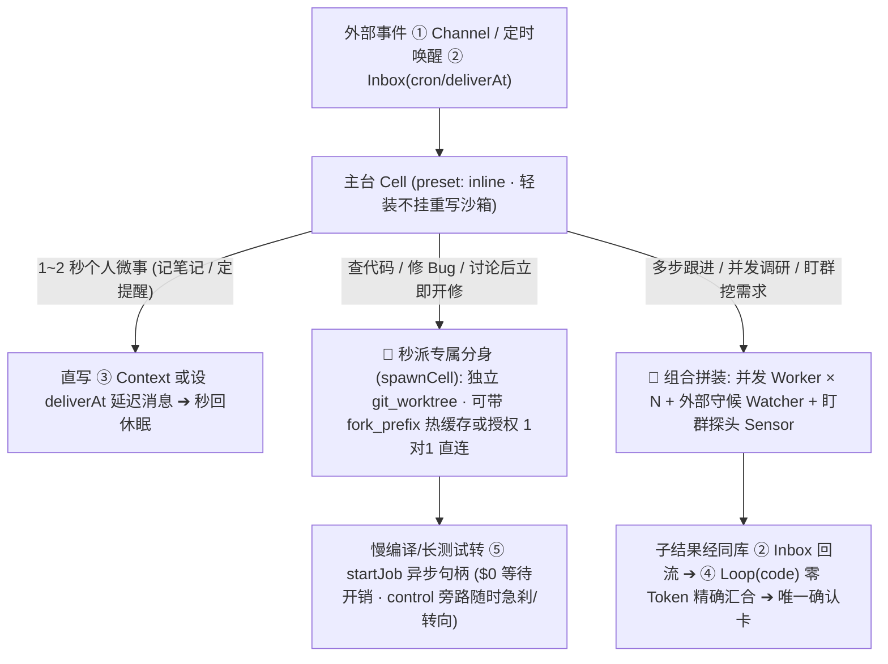

# Agent 核心架构拆解：6 个基础原语 + `Cell` 动态拼装

> [!IMPORTANT]
> **核心结论：既不需要为每种 Agent 产品单独造一套系统，也不需要把内核拆得过度细碎。**
> 1. **数据面收敛为 1 条异步消息流（`Envelope`）+ 6 个职责封闭的基础原语**：`① Channel`（外部通道进出、能力声明与免打扰缓冲）、`② Inbox`（落盘队列、`deliverAt` 延迟/Cron 唤醒、串行锁与实时 `control` 急刹）、`③ Context`（业务状态、带 `version` 的草稿 `Artifact`、前缀快照、`FTS5` 检索与 `SKILL.md`）、`④ Loop`（支持工具裁剪的 `llm` 推理或零 Token `code` 执行）、`⑤ Workspace`（隔离沙箱与跨轮次异步 `Job`）、`⑥ Gate`（单调递减权限 `child ⊆ parent`、密钥代理、绑定草稿版本的 `defer` 审批与双账本预算）。
> 2. **控制面只需要 1 个拼装容器 `Cell`（不做半路热搬家、不搞教条式全走队列）**：主台默认轻装秒回——个人微事 1 秒直办，查代码/修 Bug/多步调研第 0.5 秒直接 `spawnCell` 派专属分身下场（沙箱从生到死无需过户）；单 `Cell` 内部慢命令走跨轮次异步 `Job`；外部异步事件与内部协作走 `Inbox` 队列，而用户在界面上的勾选、改稿、点确认直接走同步事务接口毫秒级返回。

---

## 一、为什么收敛为“6 个数据面原语 + 1 个 `Cell` 容器”？

把真实场景里的冗余包装挤干后（例如单次提醒本质是 `Inbox` 的延迟投递、跨 `Cell` 交结果本质是同库写父 `Inbox`、对人外发与免打扰直接归入外部 `Channel`），6 个封闭原语 + `Cell` 就能干净覆盖全部职责：

| 序号 | 模块名称 | 层级 | 封闭职责（管什么 / 不越界管什么） | 如果少了它，会卡在哪儿？ |
| :--- | :--- | :--- | :--- | :--- |
| **①** | **`Channel`**（外部通道与外发缓冲） | 数据面原语 | 外部协议（IM / 邮件 / Webhook / UI）验签绑定真实 `principalId` 入站；如实声明渠道能力（幂等、撤回、流式）；承担对人外发、流式预览与**专注期免打扰暂存（`buffered_dnd`）**，返回真实回执（`sent / failed / unknown`） | 少了它，Agent 接不进飞书或 GitHub；把内部通信和外部 `Channel` 分开后，开“免打扰”也绝不会误吞子任务交回的内部结果 |
| **②** | **`Inbox`**（队列、延迟唤醒与控制旁路） | 数据面原语 | SQLite WAL 幂等入队、**原生 `deliverAt` 延迟投递与轻量 `cron / idleSec` 定时唤醒（支持 `cancelGroup` 销钟）**、单 `Cell` 串行合并锁 / 抢单锁、跑题退回（`handback`），以及**绕开排队锁的实时控制旁路（`cancel / pause / steer`）** | 少了它，连发消息会并发撞车、没法做超时催问；少了控制旁路，跑长任务时用户喊“停下”只能排在队尾干等 |
| **③** | **`Context`**（分层状态、草稿版本与技能） | 数据面原语 | 物理隔离三层：① 单写者事务读写的业务状态 + **带 `version` 乐观锁的人类可见草稿 `VersionedArtifact`**；② 只追加原始记录（支持 `Inline & Spill` 分页直读、前缀不变快照 `hydrate` 保缓存、SQLite `FTS5` 全文检索）；③ `SKILL.md` 与长期偏好 | 少了草稿 `version` 锁，后台汇总会静默覆盖人工刚改的段落；少了分层存储，上下文压缩会误删活跃项目状态 |
| **④** | **`Loop`**（有界推理或确定性代码） | 数据面原语 | 无状态的单次有界执行（`Run`）：统一为 **`llm` 大模型推理**（支持按 `allowedTools` 隐藏部分工具）与 **`code` 确定性执行**（零 Token 处理子任务 `all/any` 汇合记账或运行定时检查脚本）两种模式；空轮无事直接正常返回，无需发空包 | 全调大模型既贵又慢还可能算错账；双模式兼顾了灵活生成与零 Token 精确汇合、巡检 |
| **⑤** | **`Workspace`**（隔离沙箱与异步 `Job`） | 数据面原语 | 与推理循环解耦的隔离执行环境（`git_worktree` / 容器 / MicroVM）：提供基础读写命令、`code_rpc` 批量调接口与 `ripgrep` 搜代码，并支持**跨 `Run` 存活的异步长进程句柄（`startJob`）** | 少了隔离沙箱，多个编码分身会在同一目录互相覆盖文件；少了异步 `Job`，跑 15 分钟测试就会白占推理实例 |
| **⑥** | **`Gate`**（单调权限、版本审批与预算） | 数据面原语 | 硬安全护栏：**单套权限单调递减（`child ⊆ parent`）**、沙箱外代理按白名单注入密钥、**绑定 `Cell epoch` 与草稿 `version` 的 `defer` 挂起审批**，以及沿监督树共享的**金额 + Token 双硬上限** | 少了它，密钥会暴露在沙箱内，点确认瞬间若后台刚刷新草稿还会盲发未审过的新版，或因包月 `\$0` 盲区烧穿额度 |
| **⑦** | **`Cell`**（拼装容器与监督树） | **控制面容器** | 把上述 6 个原语组装成拥有单调递增纪元号 **`epoch`**（取消/完结时 `+1` 防迟到回执诈尸）与 `parentId` 上下级关系的运行单元：提供 **4 套预设模板、动态委派拼装（`spawnCell` / `updateCell`）与完结级联回收（`closeCell`）** | 把连线写死在启动代码里只能应付单一任务粒度；有了 `Cell`，才能按需派生探头、并发苦力或 1 对 1 直连专员 |

> [!TIP]
> **保持内核干净的三条实操铁律：**
> * **不做“跑满 5 秒半路热搬家”**：主台 `inline` `Cell` 天生不挂重型写代码沙箱（`Loop.allowedTools` 只暴露只读与 `spawnCell` 派单），记备忘 1 秒办完，遇到慢活第 0.5 秒直接派分身下场，彻底省去运行中沙箱过户与权限平移的复杂竞态；单机 CLI 禁派单场景下的慢命令直接走 `⑤ Workspace.startJob` 异步句柄即可。
> * **异步事件进 `Inbox`，UI 同步交互直走事务接口**：外部消息、定时到期和跨 `Cell` 汇报走 `Inbox` 队列；用户在工作台勾选速办项、编辑保存草稿、点确认或推迟卡片，直接调用 `Context / Gate / Inbox` 的同步事务方法毫秒级返回，不硬绕一圈 `Loop`。
> * **复杂策略靠拼装和 `SKILL.md` 长出来，不改内核代码**：比如“试运行观察模式”只是拼一个只写笔记不外发的 `sensor` `Cell`；“特定子模型汇报前先翻成中文”只是在父 `Cell` 出卡规则（`SKILL.md`）里加一条按来源模型的判断分支，其他模型零开销直通。

---

## 二、核心契约定义：1 条异步信封 + 6 个原语 + `Cell`（约 140 行 TypeScript）

全系统只保留两个清晰的版本号概念：**① `Cell.epoch`**（仅在取消/关闭时递增，拦截迟到的旧定时器或异步 `Job` 结果防诈尸）与 **② `VersionedArtifact.version`**（保护人类可见草稿不被后台覆盖、不盲发未审新版）；`Cell` 内部普通状态直接依赖 `Inbox` 单写者串行锁与 SQLite 事务读写：

```typescript
// ==================== 0. 统一消息信封与单调权限边界 ====================
export type InboxAddr = `inbox:${string}`;
export type ChannelAddr = `channel:${string}:${string}`;
export type Address = InboxAddr | ChannelAddr;
export type ToolKind = "read" | "write" | "edit" | "bash" | "code_rpc";

export interface Envelope<T = unknown> {
  id: string;                           // 传输幂等 ID（同一重试保持不变）
  from: Address | `timer:${string}` | `kernel:${string}`;
  to?: InboxAddr;                       // 外部入站可为空，由内核按在途 watches 订阅表路由到目标 Cell
  principalId: string;                  // 由可信 Channel 验签或内核绑定的真实发起方身份
  kind: "event" | "result";             // 外部/内部事件 | 异步 Job 或子 Cell 执行结果
  type: string;                         // 已注册的 payload 类型（未知类型隔离处理）
  threads?: string[];                   // 关联外部群帖/PR/邮件线程 ID（支持订阅直通绕过主台）
  expectedEpoch?: number;               // 目标 Cell 纪元前置条件（若 Cell 已取消/重开导致 epoch 推进，迟到信封自动丢弃）
  delivery?: "wakeup" | "silent_inject";// 唤醒执行 | 仅注入背景供下次唤醒读取
  producerModel?: string;               // 可选产出来源模型标识（便于父 Cell 按规则决定是否做翻译/格式后处理）
  payload: T;
  createdAt: number;
}

export interface PolicyBounds {         // 单套权限集合，派生子 Cell 时严格满足 child ⊆ parent
  tools: ReadonlySet<ToolKind>;         // 授权上限工具集（主台自身可通过 Loop.allowedTools 仅向模型暴露只读与派单）
  canSendTo: readonly Address[];        // 允许投递的目标地址（worker 默认仅含父收件箱，按需可授权直连用户 ChannelAddr）
  secretRefs: ReadonlySet<string>;      // 沙箱外代理可注入密钥白名单（child ⊆ parent）
  isolation: "none" | "shared_ro" | "git_worktree" | "container" | "cow_microvm";
  maxConcurrentChildren: number;        // 允许同时活跃的子任务/子沙箱上限（防连续慢问题无限裂变爆仓）
  maxTokens: number;                    // 与 maxCents 沿 Cell 监督树共享并向上汇总硬熔断
  maxCents: number;
  maxDepth: number;                     // 允许继续 spawnCell 的剩余层级（每派生一层减 1，0 表示禁止继续派生）
}

// ==================== ① Channel：外部协议接入、幂等外发与免打扰缓冲 ====================
export interface Channel {
  readonly id: string;
  readonly capabilities: {              // 如实声明外部渠道边界（如邮件不支持撤回则绝不伪造承诺）
    idempotentSend: boolean;
    withdrawOrEdit: boolean;
    streamingPreview: boolean;
  };
  onIngress(emit: (raw: Omit<Envelope, "to">) => Promise<void>): void; // 验签绑定 principalId，先落盘再回 200
  send(req: {
    target: string;
    content: Deliverable;
    idempotencyKey: string;
    actionToken?: string;               // 受控外发需携带 Gate 签发的令牌
    respectDnd?: boolean;               // 默认 true：人类处于 Engage 专注期时暂存并返回 buffered_dnd
  }): Promise<"sent" | "buffered_dnd" | "failed" | "unknown">;
  streamPreview?(target: string, chunk: string): Promise<void>;
}

// ==================== ② Inbox：SQLite 队列、延迟/定时唤醒与实时控制旁路 ====================
export interface ScheduleRule {
  deliverAt?: number;                   // 单次延迟投递时间戳（直接落为队列行字段，替代独立单次闹钟表）
  cron?: string;                        // 周期触发规则（适用于 sensor 定时巡检信源）
  idleSec?: number;                     // 当前 Cell 空闲满 N 秒触发（适用于后台整理）
  cancelGroup?: string;                 // 联动取消分组（如对方提前回信后一键清除未到期的超时催问）
}

export interface Inbox {
  enqueue(cellId: string, env: Envelope, schedule?: ScheduleRule): Promise<"accepted" | "deduped">;
  cancelScheduled(scope: { cellId: string; cancelGroup?: string; envelopeId?: string }): Promise<void>;
  claimNextRun(cellId: string, workerId: string, mode: "serial_coalesce" | "competing_workers", leaseMs?: number): Promise<ClaimedBatch | null>;
  complete(claimId: string): Promise<void>;
  handback(claimId: string, envelopeId: string, reason: string): Promise<void>; // 聊跑题的新事项退回主台重新分拣
  // 独立控制旁路：绕开普通排队锁，经 Gate 鉴权后立即中断在途 Run/Job（cancel 原子推进 Cell epoch）
  control(cellId: string, cmd: {
    action: "cancel" | "pause" | "resume" | "steer";
    principalId: string;
    steerMessage?: string;
  }): Promise<{ applied: boolean; epoch: number }>;
}

// ==================== ③ Context：业务状态、带 version 草稿 Artifact、FTS5 与技能 ====================
export interface VersionedArtifact {    // 人类可见的回复草稿、方案文档、PR 摘要等交付物
  artifactId: string;
  version: number;                      // 乐观锁版本号：防后台静默覆盖人工改稿、防点确认瞬间盲发新版
  content: Deliverable;
  updatedBy: "agent" | "human";
}

export interface ContextStore {
  // 1. 业务状态（依托单 Cell 串行锁直接事务读写）与草稿 Artifact 版本保护提交
  readState<T = unknown>(cellId: string, key: string): Promise<T | null>;
  commit(cellId: string, tx: {
    statePatches?: Record<string, unknown>;
    artifact?: { artifactId: string; content: Deliverable; updatedBy: "agent" | "human"; expectedVersion?: number };
    inboxOut?: Array<{ to: InboxAddr; envelope: Envelope; schedule?: ScheduleRule }>; // 同库事务内投递跨 Cell 消息
  }): Promise<{ ok: true; artifactVersion?: number } | { ok: false; currentArtifact: VersionedArtifact }>;

  // 2. 前缀稳定推理快照（含在途子分身摘要）与 SQLite FTS5 全文检索（搜代码/技能直接走 Workspace ripgrep）
  hydrate(cellId: string, batch: ClaimedBatch, mode: "isolated" | "fork_prefix"): Promise<PromptSnapshot>;
  appendEvidence(cellId: string, record: StepOrExternalEvidence): Promise<void>;
  readResource(cellId: string, uri: string, page?: { offset: number; limit: number }): Promise<string>; // Inline & Spill
  searchHistory(cellId: string, query: string): Promise<Snippet[]>;

  // 3. 长期偏好与 SKILL.md 维护（与业务状态表物理隔离）
  upsertSkillOrNote(cellId: string, patch: KnowledgePatch): Promise<void>;
}

// ==================== ④ Loop：有界单次执行（统一为 llm 推理与 code 确定性执行） ====================
export type ProcessorSpec =
  | { kind: "llm"; allowedTools?: readonly ToolKind[]; skills?: readonly string[]; modelTier?: "fast" | "strong"; maxSteps?: number }
  | { kind: "code"; entry: string };    // 零 Token 确定性处理器或本地巡检脚本（处理 all/any 汇合记账、定时检查等）

export interface AgentLoop {
  run(snapshot: PromptSnapshot, ports: CellPorts, signal: AbortSignal): Promise<
    | "completed"                       // 正常结束（若无外发动作则自然静默休眠，无需发送空包）
    | "yielded_waiting"                 // 已设好等待监听或启动异步后台 Job，释放本次 Run（等待期 $0 推理开销）
    | "deferred_for_approval"           // 触发 Gate.defer 生成待确认卡，存盘释放 Run
    | "cancelled"
    | "budget_stopped"
  >;
}

// ==================== ⑤ Workspace：隔离执行沙箱与跨 Run 异步 Job ====================
export interface Workspace {
  acquire(cellId: string, isolation: PolicyBounds["isolation"]): Promise<WorkspacePort>;
  hibernate?(cellId: string): Promise<string>;
  restore?(snapshotId: string): Promise<WorkspacePort>;
  destroy(cellId: string): Promise<void>;
}

export interface WorkspacePort {
  exec(tool: ToolKind, args: unknown, signal?: AbortSignal): Promise<{ output: string }>;
  // 慢编译/全量测试返回跨 Run 存活的 Job 句柄，跑完自动往所属 Cell 的 Inbox 投递带 expectedEpoch 的 result 信封
  startJob(spec: { command: string; streamPreview?: boolean }): Promise<{ jobId: string }>;
  observeJob(jobId: string): Promise<{ state: "running" | "succeeded" | "failed" | "cancelled"; tail: string }>;
  writeJobInput?(jobId: string, input: string): Promise<void>;
  cancelJob(jobId: string): Promise<void>;
}

// ==================== ⑥ Gate：单调权限收紧、密钥代理、绑定草稿 version 的审批与预算 ====================
export interface Gate {
  attenuate(parent: PolicyBounds, parentCellId: string, requested?: Partial<PolicyBounds>): PolicyBounds; // 强制 child ⊆ parent 且 maxDepth - 1
  authorize(action: ProposedAction, meta: {
    cellId: string;
    principalId: string;
    epoch: number;                      // 校验 Cell 未取消
    artifactVersion?: number;           // 对外发送/执行草稿时绑定具体版本号
  }): Promise<
    | { type: "allow"; actionToken: string; proxyInjectedSecretRef?: string }
    | { type: "deny"; feedback: string }
    | { type: "defer"; actionId: string; boundArtifactVersion?: number; approvalCard: Deliverable }
  >;
  // UI 同步确认接口：核对点击时所见的草稿版本，若后台刚刷新成新版则返回 version_mismatch 防盲发
  approve(actionId: string, approverId: string, seenArtifactVersion?: number): Promise<
    "approved" | "version_mismatch" | "already_cancelled"
  >;
  revoke(cellId: string): Promise<void>;
  meter(cellId: string, usage: { tokens: number; billedCents: number }): "ok" | "warn" | "hard_stop";
}

// ==================== ⑦ Cell：预设模板与动态拼装容器 ====================
export interface CellSpec {
  id?: string;
  parentId?: string;                    // 构成监督树，父级完结或取消时整棵子树级联回收
  preset?: "inline" | "worker" | "watcher" | "sensor";
  watches?: Array<{ threadOrFilter: Record<string, unknown>; cancelGroup?: string }>;
  schedules?: ScheduleRule[];
  contextMode?: "isolated" | "fork_prefix";
  processor: ProcessorSpec;
  bounds?: Partial<PolicyBounds>;
}

export interface CellPorts {            // Loop 运行期可见的受控能力面
  workspace: WorkspacePort;
  notifyChannel: Channel["send"];
  streamPreview: NonNullable<Channel["streamPreview"]>;
  context: Pick<ContextStore, "readState" | "commit" | "appendEvidence" | "readResource" | "searchHistory" | "upsertSkillOrNote">;
  cancelScheduled: Inbox["cancelScheduled"];
  spawnCell(spec: CellSpec, initialPayload?: unknown): Promise<InboxAddr>;
  updateCell(cellId: string, patch: Partial<CellSpec>): Promise<void>;
  closeCell(cellId: string, reason?: "completed" | "cancelled"): Promise<void>;
}
```

---

## 三、如何适配不同粒度的工作：4 套预设模板 + 轻装主台秒派 + 动态拼装

真实工作从“一句话备忘”到“跨周多方协同”跨度极大。去掉复杂的半路热搬家后，全靠 **主台轻装接待 + 4 套标准预设模板 + 按需动态拼装** 自然伸缩：



### 1. 出厂预设的 4 套标准模板（覆盖日常 90% 的场景）
Agent 平时不需要从零连线，只需调用 `spawnCell` 选择模板并填入目标群号、筛选提示词或命令参数：
* **`inline`（轻装主台接待）**：单 `Cell` 串行合并锁，持有顶层 `PolicyBounds`（以便合法向下派权），但自身 `Loop.allowedTools` 只暴露只读检索、记笔记、设延迟提醒与管理子分身工具——同时 `Context.hydrate` 自动在末尾附带**当前在途分身状态摘要**（知道自己有几个分身在跑、支持查进度或用 `steer` 精准传话，受 `maxConcurrentChildren` 防爆仓保护）。
* **`worker`（后台隔离执行）**：独占 `git_worktree` 或容器沙箱，默认 `canSendTo` 收紧为仅回传父级 `inbox:${parentId}`（防 15 个并发子任务刷屏打扰用户）；**若用户指定某专项分身直接向自己汇报，只需从父级 `canSendTo` 授权用户个人 `ChannelAddr` 并挂上话题 `watches`，即可打通无中间商的双向 1 对 1 专线**。
* **`watcher`（外部跟进监听）**：在 `Context` 记录等待集合与条件，挂上外部会话 `watches` 订阅直通与带 `cancelGroup` 的 `deliverAt` 超时提醒；对方提前回信即调用 `cancelScheduled` 销钟，聊跑题的新话题调 `Inbox.handback` 退回主台。
* **`sensor`（定时与条件信源探头）**：挂在入口侧充当产生事项的信源（如盯群挖有价值反馈、早 9 点查指标）——平时无价值消息或指标正常直接结束 `Run` 静默休眠（不产生任何待办），命中目标才往主台 `Inbox` 投信。

### 2. 动态拼装与四条安全硬边界
遇到剩下 10% 的复合或个性化需求（比如：聊完 Bug 带着刚讨论的热上下文 `fork_prefix` 立即开修；先派 15 个 `worker` 扒数据经 `code` 处理器收齐后再派 `watcher` 等报价；或在 `SKILL.md` 里立规矩“仅对某偏科英文模型的输出做中文转译后再出审批卡”），内核在底下守住四条底线：
1. **单调权限铁律（`child ⊆ parent`）**：子 `Cell` 的工具、可发送目标地址与密钥白名单永远不超过父级上限，`maxDepth` 逐层递减归零即止。
2. **双版本号精准防呆（`Cell epoch` + `Artifact version`）**：人工改稿保存与后台更新均校验草稿 `expectedVersion`，冲突时保留人工手写稿并将后台新增内容挂入参考区；点确认发送强制核对当时看到的 `seenArtifactVersion` 防盲发新版；任务取消推进 `epoch` 彻底杜绝迟到回执诈尸。
3. **内外通道天然分流**：跨 `Cell` 内部汇报走同库 `Inbox` 直投，对人通知走外部 `Channel`——用户在专注工作区开启免打扰只会缓冲外部 `Channel` 通知（`buffered_dnd`），后台子分身汇总推进丝毫不受阻塞。
4. **双账本预算与级联回收**：沿监督树同时计量美分金额（`maxCents`）与 Token 消耗（`maxTokens`），防包月 CLI 返回 `\$0` 烧穿额度；项目完结或取消时 `closeCell` 推进 `epoch` 并一键回收子树沙箱、运行中 `Job`、监听订阅与未到期延迟消息。

---

## 四、用同一套精简底座支撑市面上的 8 类代表性产品

收敛为 **6 个原语 + `Cell`** 后，支撑主流产品形态反而更直接：

1. **Pi / Claude Code CLI（轻量本地命令行工具）**：只起 1 个本地 `Cell`（设 `maxDepth: 0` 禁生子 Agent），核心放在 `<1k Token` 精简提示词、`⑤ Workspace` 基础工具 + `code_rpc` + 慢命令 `startJob` 异步句柄，配合 `Channel.streamPreview` 与 `Inbox.control` 实时打断转向。
2. **Anthropic《Building always-on agents》/ Claude Duet（云端常驻个人助手）**：外部 Webhook 与 `Inbox(deliverAt / cron)` 统一汇入单写者队列 → `Context` 加载 200 行目录索引 → `Gate` 做沙箱外密钥注入与绑定草稿 `version` 的零算力挂起确认 → 空闲 `idleSec` 触发后台整理。
3. **DeepSeek Super-agent（`dsh-superagent`：Router-Worker 协同研发助手）**：1 个轻装主台 `Cell`（`Loop.allowedTools: ["read"]` 不暴露写文件工具，积压事件自动合并批处理） + N 个独占 `git_worktree` 且挂 `watches` 线程直通的 `worker` `Cell`（聊跑题调 `handback` 退回）；长输出走 `Context.readResource` 分页直读。
4. **OpenClaw 2.0（本地多渠道个人网关）**：做厚 `① Channel` 多聊天软件与硬件节点适配 + 本地 Markdown 工作区记忆索引；定时心跳无异常直接空轮结束休眠。
5. **Hermes Agent（技能自动总结常驻网关）**：主任务完结后往内部复盘 `Cell`（`contextMode: "fork_prefix"` 命中热缓存）投一条 `Inbox` 消息，提炼经验调用 `upsertSkillOrNote` 更新 `SKILL.md`；固定例行检查直接配 `processor: { kind: "code" }` 零 Token 运行。
6. **Poke（前后台分离的免运维聊天助手）**：前台轻装接待 `Cell`（持有用户聊天 `ChannelAddr`） + 后台按事项常驻的 `worker/watcher` `Cell`（默认 `canSendTo` 仅回前台 `Inbox` 由前台统一把关润色，无权直接打扰用户手机）。
7. **Devin 2.2 / Cursor Cloud Agents / Manus（云端沙箱工作台）**：`⑤ Workspace` 切换为毫秒级 CoW 快照虚拟机（`cow_microvm`）与异步 `Job`；PR `worker` 挂 GitHub Actions `watches` 自动重修 CI，大调研派生几十个隔离 `worker` 经确定性 `code` 处理器完成 `all` 汇合。
8. **Paperclip（多 Agent 团队协作与预算控制面）**：`④ Loop` 对接外部 CLI 适配器，重点把 `Cell` 树目标背景注入、`Inbox(competing_workers)` 抢单锁、`git_worktree` 隔离与 `Gate` 双账本预算做成看板。

---

## 五、`ng-agents` 精简代码目录划分（MVP 可直接落地）

后续动手写第一版代码时，单 SQLite 数据库（`cells`、`inbox_messages`、`artifacts_and_approvals` 三张核心表）配合 **1 套协议 + 6 个原语包 + 1 个 `cell` 调度包** 即可干净落地：

```text
ng-agents/
├── packages/
│   ├── protocol/          # Envelope 信封、PolicyBounds 单调权限、VersionedArtifact 与通用契约类型
│   ├── channel/           # ① 外部渠道适配（CLI/Web/飞书/Slack/邮件/GitHub）、能力声明、外发与免打扰缓冲
│   ├── inbox/             # ② SQLite WAL 队列、deliverAt 延迟与 Cron/idle 唤醒、串行/抢单锁、handback 与 control 急刹
│   ├── context/           # ③ 业务状态事务读写、草稿 Artifact 版本保护、前缀快照、SQLite FTS5 检索与 SKILL.md
│   ├── loop/              # ④ 无状态单次执行环：LLM 推理（支持工具裁剪）与零 Token 确定性 code 执行驱动
│   ├── workspace/         # ⑤ 基础工具 + code_rpc + ripgrep、跨轮次异步 Job 句柄、git_worktree / 容器隔离驱动
│   ├── gate/              # ⑥ 单调权限收紧(child ⊆ parent)、沙箱外密钥代理、绑定草稿 version 的审批与双账本预算
│   └── cell/              # ⑦ Cell 监督树与 epoch 纪元管理、在途分身摘要、动态 watches 路由表与级联回收
├── presets/               # 标准 Cell 拼装模板与确定性 code 处理器（如 join_all 汇合、等待匹配）
│   └── src/
│       ├── inline-desk/   # 轻装主台接待（微事秒办、重活秒派分身、掌握在途分身花名册）
│       ├── isolated-worker/ # 独立沙箱后台执行单元（支持异步长 Job 与按需 1对1 直连授权）
│       ├── thread-watcher/  # 外部回信订阅直通 + deliverAt 超时催问单元
│       ├── cron-sensor/   # 定时/群聊条件探头信源单元（平时无事直接静默返回）
│       └── shared/        # 四个模板共用的 GTD 记账、卡片构造与 join_all 汇合
└── apps/
    └── gtd-desk/          # 面向用户的极简 GTD 工作台界面、UI 同步状态/改稿/审批接口与三视图投影
```
