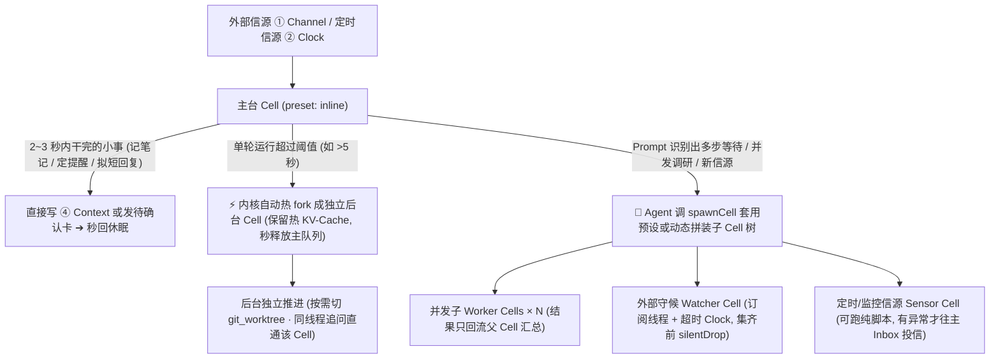

# Agent 核心架构拆解：1 条消息总线 + 8 个基础原语 + `Cell` 动态拼装

> [!IMPORTANT]
> **核心结论：既不需要为每种 Agent 产品单独设计一套架构，也不需要在内核里塞满定制业务实体。**
> 1. **数据面只需要 1 条统一消息流（`Envelope`）+ 8 个职责单一的基础原语**：`① Channel`（渠道与信源接入）、`② Clock`（定时与唤醒）、`③ Inbox`（收件队列与锁）、`④ Context`（上下文与记忆）、`⑤ Loop`（推理循环或确定性脚本）、`⑥ Workspace`（隔离执行沙箱）、`⑦ Gate`（权限拦截与预算控制）、`⑧ Outbox`（发送与静默过滤）。
> 2. **控制面只需要 1 个组合容器 `Cell`（预设模板 + Agent 动态拼装 + 超时自动热 `fork`）**：真实工作的粒度跨度极大（从 2 秒记条笔记、单轮回句话，到跨天等三方回信、并发扒 15 家竞品、或定期跑监控脚本）。把“8 个原语怎么连在一起”封装成可由 Agent 动态创建的 **`Cell`**，靠**少量预设拼装模板**应付日常 90% 的场景，靠 **Agent 动态拼装**应付长尾复杂场景，再靠**长耗时任务自动热 `fork`** 避免堵死主会话——就能在不增加多余概念的前提下，统一搭出 Pi、OpenClaw、Hermes、DeepSeek Super-agent、Poke、Devin、Manus、Paperclip 以及我们的 GTD 工作台。

---

## 一、为什么刚好是“8 个数据面原语 + 1 个 `Cell` 容器”？

拿真实场景去拆解，数据流转靠 8 个原子模块就能完全覆盖，而不同粒度任务的组织则靠 `Cell` 把它们装在一起：

| 序号 | 模块名称 | 层级 | 职责（每块只管一件事） | 如果少了它，会卡在哪儿？ |
| :--- | :--- | :--- | :--- | :--- |
| **①** | **`Channel`**（渠道与信源接入） | 数据面原语 | 负责外部协议（IM / 邮件 / Webhook / PR / CLI）与内部统一消息 `Envelope` 的双向转换 | 少了它，Agent 只能跑在本地测试脚本里，接不进飞书、Telegram、GitHub 或 iMessage |
| **②** | **`Clock`**（定时与唤醒） | 数据面原语 | 把 **固定 Cron、单次延迟跟进（`at`）、空闲触发（`idle`）** 转成标准消息投进指定 `Inbox`，支持按组自动销钟 | 光有 `Channel`，Agent 只能“问一句动一下”；加上 `Clock`，才能做定时信源、超时催问和空闲后台整理 |
| **③** | **`Inbox`**（收件队列与锁） | 数据面原语 | 消息落盘、幂等去重、**单会话串行与连发合并 / 共享队列抢锁 / 跑题消息退回（`handback`）** | 少了它，Webhook 重试或用户连发消息就会并发撞车、改坏记忆文件甚至重复发信扣费 |
| **④** | **`Context`**（上下文与记忆） | 数据面原语 | 组装前缀稳定的上下文快照、按 URI 直读关联记录（`Inline & Spill`）、检索历史（FTS5/Wiki）、按需加载 `SKILL.md` 并受控写回 | 少了它，每次新开会话都得从零交代背景，长对话还会打碎大模型 KV-Cache |
| **⑤** | **`Loop`**（推理或脚本处理） | 数据面原语 | 无状态的单轮处理步：既可以跑大模型推理循环，**也可以不调模型直接跑一段确定性检查脚本** | 既保留大模型的灵活判断，又允许高频巡检直接走零 Token 纯脚本通道 |
| **⑥** | **`Workspace`**（执行沙箱） | 数据面原语 | 与推理循环分离的执行环境（读写文件、跑命令、写代码批量调接口），支持按需切 `git worktree` / 容器及长命令转后台 | 光有 `Loop` 只是纯聊天机器人；加上可隔离、可恢复的 `Workspace`，才能并行改代码和跑复杂脚本 |
| **⑦** | **`Gate`**（权限与预算边界） | 数据面原语 | 硬安全护栏：**沙箱外代理注入密钥、子权限单调收紧、金额+Token 双上限控制、`defer` 挂起等待人工确认** | 只靠提示词防不住越权操作、不可信网页注入和死循环账单 |
| **⑧** | **`Outbox`**（发送与静默过滤） | 数据面原语 | 把结果幂等发往外部 `Channel` **或另一个 `Cell` 的 `Inbox`**；无需打扰时支持 **`silentDrop` 直接静默结束**及免打扰暂存 | 少了它，没法做父子协作和防重发，更没法拦住 24 小时没完没了的废话通知 |
| **⑨** | **`Cell`**（原语拼装单元） | **控制面容器** | 把上面 8 个原语组装成一个有明确归属边界的运行实例：支持**预设模板实例化、Agent 动态拼装、长耗时任务自动热 `fork`、完结一键级联销毁** | 如果把连线写死在启动代码里，系统只能定死一种任务粒度；有了 `Cell`，Agent 才能看菜下碟动态组织原语 |

> [!TIP]
> **坚持“原语组合优于造新实体”的原则——许多看似复杂的功能，其实只是这 8 个原子的拼装方式，不需要在内核里写专有概念：**
> * **“影子观察 / 试运行”（DeepSeek Super-agent `observe`）**：不用加内置观察模式——拼一个 `Channel(群消息过滤) → Inbox → Loop → Workspace(追加写进观察笔记) → Outbox(silentDrop)` 的 `Cell` 就行。
> * **“把重复的大模型巡检降本为零 Token 脚本”**：不用加专门的结晶引擎——Agent 在 `Workspace` 写好检查小脚本，把定时信源 `Cell` 的 `⑤ Loop` 切到直接跑该脚本（正常则 `silentDrop`，异常才往主 `Inbox` 发信）。
> * **“等三方回信集齐再比价，48 小时没回催问”**：不用造专门的等待屏障实体——项目 `Cell` 挂上这 3 个线程的监听和 48h `Clock`，前两家回信时记入 `Context` 后直接 `silentDrop`，第 3 家回齐时销掉闹钟、生成唯一一张比价确认卡。
> * **“空闲整理记忆 / 自动总结 `SKILL.md`”（Anthropic Dreaming / Hermes）**：只是 `Clock(空闲)` 或主轮结束 → 唤醒只读复盘 `Cell`（复用刚热起来的上下文前缀缓存） → 受控更新 `Context` → `Outbox(silentDrop)`。

---

## 二、最小接口定义：1 条消息总线 + 8 个原语 + `Cell`（约 130 行 TypeScript）

把这套底座写成 TypeScript 接口，核心定义加起来 **130 行左右**，不绑定任何具体业务概念：

```typescript
// ==================== 0. 统一消息结构与权限边界 ====================
export type Trust = "owner" | "internal" | "untrusted"; // 单调安全水位线: owner > internal > untrusted
export type Address = `inbox:${string}` | `channel:${string}:${string}`;

export interface Envelope<T = unknown> {
  id: string;                           // 全局幂等 ID（防 Webhook 重试、防重复发信）
  from: Address | `clock:${string}` | `kernel:${string}`;
  to?: Address;                         // 外部入站可为空，由内核按线程订阅表动态路由到对应 Cell
  threads?: string[];                   // 关联外部会话/PR/邮件线程 ID（支持订阅直通绕过主路由）
  delivery?: "wakeup" | "steer" | "silent_inject"; // 常规唤醒 | 步骤间打断 | 仅塞入下次背景但不唤醒休眠实例
  trust: Trust;                         // 内核强制打标并沿因果链传染（防不可信网页/群消息洗白）
  payload: T;
  createdAt: number;
}

export interface PolicyBounds {         // 子 Cell 只能比父 Cell 更严格，不可由 Agent 自行放宽
  tools: ReadonlySet<"read" | "write" | "edit" | "bash" | "code_rpc">;
  canSendTo: readonly string[];         // 例: 子 Worker 仅允许发往 ["inbox:parent"]，禁止直发外部渠道或刷屏
  secretRefs: ReadonlySet<string>;      // 允许沙箱外代理注入的密钥白名单
  isolation: "none" | "shared_ro" | "git_worktree" | "container" | "cow_microvm";
  maxTokens: number;                    // 与 maxCents 一起沿父子 Cell 树向上汇总扣减
  maxCents: number;
  maxDepth: number;                     // 限制派生层级（如 <= 2），防止多角色层层开会空转
}

// ==================== ① Channel：外部渠道与信源适配 ====================
export interface Channel {
  readonly id: string;
  onIngress(emit: (raw: Omit<Envelope, "to">) => Promise<void>): void;
  deliver(target: string, content: Deliverable, idempotencyKey: string): Promise<void>;
}

// ==================== ② Clock：把定时与超时跟进转成普通消息 ====================
export interface Clock {
  schedule(ownerCellId: string, rule: { cron?: string; at?: number; idleSec?: number },
           payload: unknown, cancelGroup?: string): Promise<string>;
  cancel(scope: { timerId?: string; ownerCellId?: string; cancelGroup?: string }): Promise<void>;
}

// ==================== ③ Inbox：消息落盘、合并锁与退回 ====================
export interface Inbox {
  enqueue(cellId: string, env: Envelope): Promise<"accepted" | "deduped">;
  claimNextRun(cellId: string, workerId: string,
               mode: "serial_coalesce" | "competing_workers"): Promise<ClaimedBatch | null>;
  complete(claimId: string): Promise<void>;
  handback(claimId: string, envelopeId: string, reason: string): Promise<void>; // 无关追问退回主收件箱重新分拣
}

// ==================== ④ Context：稳定前缀快照、链式直读与记忆技能 ====================
export interface ContextStore {
  hydrate(cellId: string, batch: ClaimedBatch, mode: "isolated" | "fork_prefix"): Promise<PromptSnapshot>;
  appendTrajectory(cellId: string, event: StepEvent): Promise<void>;
  readResource(cellId: string, uri: string, page?: { offset: number; limit: number }): Promise<string>; // Inline & Spill 按需细读
  searchHistory(cellId: string, query: string, engine: "fts5_bm25" | "wiki_graph" | "git_grep"): Promise<Snippet[]>;
  mutateKnowledge(cellId: string, op: KnowledgePatch, effectiveTrust: Trust): Promise<void>; // 自动拦截 untrusted 写入长期记忆
}

// ==================== ⑤ Loop：单轮处理步（支持大模型推理或零 Token 纯脚本） ====================
export type ProcessorSpec =
  | { kind: "llm"; skills?: string[]; modelTier?: "fast" | "strong"; autoForkAfterMs?: number }
  | { kind: "script"; scriptPath: string }; // 不调模型直接跑脚本：无输出静默结束，有输出转成消息发出

export interface AgentLoop {
  run(snapshot: PromptSnapshot, ports: CellPorts, signal: AbortSignal): Promise<
    "completed" | "silent_noop" | "deferred_for_approval" | "forked_to_background" | "budget_stopped"
  >;
}

// ==================== ⑥ Workspace：隔离执行沙箱 ====================
export interface Workspace {
  acquire(cellId: string, isolation: PolicyBounds["isolation"]): Promise<WorkspacePort>;
  destroy(cellId: string): Promise<void>;
}

export interface WorkspacePort {
  exec(tool: "read" | "write" | "edit" | "bash" | "code_rpc", args: unknown,
       signal?: AbortSignal): Promise<{ output: string; dataTrust: Trust }>;
}

// ==================== ⑦ Gate：权限收紧、密钥代理注入与挂起等待确认 ====================
export interface Gate {
  attenuate(parent: PolicyBounds, requested?: Partial<PolicyBounds>): PolicyBounds; // 强校验子权限 ⊆ 父权限
  authorize(action: ProposedAction, meta: { cellId: string; taint: Trust }): Promise<
    | { type: "allow"; proxyInjectedSecretRef?: string }
    | { type: "deny"; feedbackToModel: string }
    | { type: "defer"; approvalId: string; approvalCard: Deliverable } // 存盘停机省算力，点确认后再从 Inbox 唤醒
  >;
  meter(cellId: string, usage: { tokens: number; billedCents: number }): "ok" | "warn" | "hard_stop";
}

// ==================== ⑧ Outbox：幂等发送、跨 Cell 投递与静默过滤 ====================
export interface Outbox {
  send(packet: { to: Address; content: Deliverable; idempotencyKey: string }
             | { silentDrop: true; reason: string }): Promise<void>;
}

// ==================== ⑨ Cell：预设模板与 Agent 动态拼装的统一容器 ====================
export interface CellSpec {
  id?: string;
  parentId?: string;                    // 构成父子监督树，上层事项结束时整棵子树自动级联回收
  preset?: "inline" | "worker" | "watcher" | "sensor"; // 可直接套预设模板，也可由 Agent 按需覆盖下方配置
  watches?: Array<{ threadOrFilter: Record<string, unknown>; cancelGroup?: string }>;
  schedules?: Array<{ cron?: string; at?: number; cancelGroup?: string }>;
  contextMode?: "isolated" | "fork_prefix";
  processor: ProcessorSpec;
  bounds?: Partial<PolicyBounds>;
}

export interface CellPorts {            // Agent 在运行期可见的极简能力面（受内核 Gate 强约束）
  exec: WorkspacePort["exec"];
  send: Outbox["send"];
  context: Pick<ContextStore, "readResource" | "searchHistory">;
  proposeKnowledge(op: KnowledgePatch): Promise<void>;
  // 动态拼装接口：Agent 靠这 3 个动作就能按任务粒度自由组织原语
  spawnCell(spec: CellSpec, initialPayload?: unknown): Promise<`inbox:${string}`>;
  updateCell(cellId: string, patch: Partial<CellSpec>): Promise<void>;
  closeCell(cellId: string): Promise<void>; // 级联取消关联 Clock、Watch、子队列与临时 Worktree
}
```

---

## 三、如何适配不同粒度的工作：4 个预设模板 + 超时自动 `fork` + 动态拼装

为什么单一固定架构应付不了真实工作？因为进入系统的事情从“一句话备忘”到“跨周大项目”差了好几个数量级。我们不在系统里造复杂的档位概念，而是靠 **三条简单机制** 让架构随工作粒度自然伸缩：



### 1. 预设的 4 种基础拼装模板（覆盖日常 90% 的工作）
预设模板不需要在内核里写特殊逻辑，它们本身就是预先配好的 `CellSpec` 默认值（配合对应的 `SKILL.md` 说明）：
* **`inline`（主台快处理）**：单会话串行锁 + 连发消息合并，专门接住日常输入。几秒内能搞定的小事当场办完，不建多余子队列。
* **`worker`（后台隔离执行）**：独立 `Context`（只注入任务目标背景，不带主聊天杂音）+ 独立 `Workspace`（如 `git_worktree`），`Gate` 锁死其 `Outbox` 只能向父 `Cell` 汇报，适合修代码、跑测试或分头查资料。
* **`watcher`（外部跟进监听）**：挂上 `Channel` 特定会话/PR 的订阅与 `Clock` 超时提醒（共享同一个 `cancelGroup`，对方先回信就自动销掉催问闹钟），适合跨天等回音。
* **`sensor`（定时与条件信源）**：挂在入口侧充当“产生任务的信源”——由 `Clock` 或外部事件流触发一段轻量脚本或快速检查，平时没事直接 `silentDrop`（连待办都不产生），发现异常才往主 `Inbox` 投递一条标准 `Envelope`。

### 2. 长耗时任务自动热 `fork`（防止主会话被意外卡死）
DeepSeek 在实测中发现：如果只靠提示词劝单个 Agent“遇到重活请调子 Agent”，模型经常觉得顺手就自己在主会话里硬干，一旦跑起代码检查或编译，整个主会话就会堵死十几分钟。
* 我们的解法不是像 DeepSeek 那样一刀切阉割主会话的工具（否则办小事也得绕一圈派单），而是由内核提供 **`autoForkAfterMs`（例如 5 秒）运行期热剥离**：
  1. 任务一开始直接在主会话里跑；3 秒搞定的小事当场结束。
  2. 一旦某轮执行超过 5 秒，内核**不需要杀掉重跑**，而是直接把当前正在运行的推理循环连同**已经热起来的上下文前缀（100% 命中 KV-Cache）**原封不动过户给一个新建的后台 `Cell`（写文件时自动切到独立 `git worktree`），并在该线程挂上订阅直通。
  3. 主会话只留下一条“已转入后台继续处理”的轻量记录，**立刻释放主 `Inbox` 锁**，用户随时说下一件事完全不排队。

### 3. Agent 动态拼装与三条安全铁律
遇到预设模板套不上的剩下 10% 复杂工作（例如：先并行派 10 个 `worker` 扒数据，汇总后再挂一个 `watcher` 跟进审批；或者把跑顺了的每日大模型巡检改成零 Token 的 `script` 信源），Agent 直接通过 `spawnCell / updateCell` 自由组合原语参数。内核只在底下守住三条不可逾越的硬边界：
1. **权限与可信度单调收紧**：子 `Cell` 的工具集、可发送地址、密钥范围永远是父 `Cell` 的子集；一旦某轮读取了不可信外部网页/群消息（`trust: "untrusted"`），该回合派生的动作与记忆写入自动降级拦截。
2. **预算沿树共享扣减**：父 `Cell` 剩 \$2 预算，就算派生 10 个子 `Cell` 也是共同扣这 \$2（同时统计 Token 消耗量），绝不允许靠拆分子任务放大账单。
3. **随事项完结级联回收**：上层任务完成或取消时，`closeCell` 一次性销毁整棵子树名下的所有 `Clock` 闹钟、`Channel` 订阅、子 `Inbox` 和临时沙箱目录，绝不留后台僵尸进程。

---

## 四、用同一套底座还原市面上的 8 类代表性产品

把上面 **8 个原语 + `Cell`** 做不同的拼装，就能直接对应到目前主流的各类产品形态：

### 1. Pi / Claude Code CLI（轻量本地命令行编程工具）
* **拼装方式**：只起 1 个本地 `Cell`（不配 `Clock`，`maxDepth: 0` 或按需浅层子任务），核心放在精简 `⑤ Loop` 提示词（`<1k Token`）与 `⑥ Workspace` 的 4 个基础工具 + `code_rpc`（QuickJS `Codemode`）。

### 2. Anthropic《Building always-on agents》/ Claude Duet（云端常驻个人助手）
* **拼装方式**：主台 `Cell` 配齐全部 8 个模块 + 空闲整理 `sensor`：外部 Webhook 与 `Clock` 汇入单写者 `Inbox` → `Context` 加载 200 行目录索引 → `Gate` 做代理密钥注入与 `defer` 零算力挂起确认 → 夜间空闲唤醒后台 `Cell` 整理 Wiki 记忆并 `silentDrop`。

### 3. DeepSeek Super-agent（`dsh-superagent`：Router-Worker 多任务协同研发助手）
* **拼装方式**：用 **1 个轻权限主路由 `Cell` + N 个订阅直通的工单 `worker` `Cell`** 拼装：
  * 主路由 `Cell` 通过 `PolicyBounds` 拿掉 `write / edit` 工具（物理强制它只管接话与派单，积压事件由 `Inbox` 自动合并批处理）。
  * 每接一单 `spawnCell({ preset: "worker", watches: [PR/话题线程] })`，分配独立 `git_worktree`。后续同线程的人类追问经 `watches` **直接绕过主路由进该 `worker` 的 `Inbox`**；万一用户聊起无关新事，`worker` 调 `Inbox.handback` 退回主路由重评。
  * 上下文采用 `Context.readResource` 实现 `Inline & Spill`（短卡片内联 + URI 链式直读）；新群聊规则可先拼成“写日志 + `silentDrop`”做试运行观察。

### 4. OpenClaw 2.0（本地多渠道个人网关）
* **拼装方式**：做厚 `① Channel`（50+ 聊天软件与硬件节点）与 `④ Context` 不可信来源隔离；联网回合自动打上 `trust: "untrusted"` 禁止直写 `MEMORY.md`；定时心跳无异常时直接走 `Outbox({ silentDrop: true })`。

### 5. Hermes Agent（带技能自动总结的常驻网关）
* **拼装方式**：主任务跑完后，向内部复盘 `Cell`（`contextMode: "fork_prefix"`，直接命中刚跑完的热缓存）发一条消息，总结经验更新 `SKILL.md`；纯例行检查则用 `processor: { kind: "script" }` 实现零 Token 巡检。

### 6. Poke（前后台分离的免运维聊天助手）
* **拼装方式**：前台接待 `Cell`（不挂重工具，只管自然聊天与过滤提醒） + 后台多个按事项常驻的 `worker/watcher` `Cell`（`canSendTo` 锁死只能发回前台 `Inbox`，没有直接给用户手机发通知的权限）。

### 7. Devin 2.2 / Cursor Cloud Agents / Manus（云端沙箱工作台）
* **拼装方式**：把 `⑥ Workspace` 换成毫秒级 CoW 快照虚拟机（`cow_microvm`），工单 `Cell` 同时订阅 GitHub Actions Webhook（CI 挂了自动唤醒原沙箱重修，`silentDrop` 不烦人，全绿再发交付卡）；调研大任务则一次性派生几十个隔离 `worker` `Cell` 并发执行后回流汇总。

### 8. Paperclip（多 Agent 团队协作与预算控制面）
* **拼装方式**：自己不绑定单一 `⑤ Loop` 实现（通过适配器调外部 Claude Code / Hermes / OpenClaw），专注把 `Cell` 树的上下级目标背景注入（Goal Ancestry）、`Inbox(competing_workers)` 抢单锁、`git_worktree` 隔离和 `Gate` 层级预算上限做成可视化看板。

---

## 五、`ng-agents` 代码目录划分建议

后续在 `project-aoi/ng-agents` 动手写代码时，底层严格只按 **1 套协议 + 8 个原子包 + 1 个 `cell` 调度包** 划分，所有拼装方案都收敛成轻量的预设配置：

```text
ng-agents/
├── packages/
│   ├── protocol/          # Envelope 消息结构、Trust 水位线、PolicyBounds 权限与预算定义
│   ├── channel/           # ① CLI、HTTP Webhook、飞书/Slack/Telegram、GitHub 接入与发送适配
│   ├── clock/             # ② Cron 定时表、单次延迟唤醒（at）、按 cancelGroup 联动销钟
│   ├── inbox/             # ③ SQLite WAL 幂等入队、单会话合并锁、抢单锁与 handback 退回
│   ├── context/           # ④ 稳定前缀组装、Inline & Spill URI 直读、FTS5 检索、SKILL.md 与安全写回
│   ├── loop/              # ⑤ 无状态推理循环与零 Token 脚本执行器驱动
│   ├── workspace/         # ⑥ 基础文件/命令/脚本执行 + 本地 / Git Worktree / 容器隔离驱动
│   ├── gate/              # ⑦ 权限单调收紧校验、沙箱外密钥代理注入、金额+Token 树状计量、defer 挂起
│   ├── outbox/            # ⑧ 幂等外发、silentDrop 静默结束、专注期免打扰缓冲
│   └── cell/              # ⑨ Cell 生命周期管理、动态订阅路由表、超时热 fork 与完结级联销毁
├── presets/               # 预设的少量标准 Cell 拼装模板（纯配置 + SKILL.md，Agent 也可动态组合或新增）
│   ├── inline-desk/       # 主台快处理（超 5 秒自动热 fork 转后台）
│   ├── isolated-worker/   # 独立沙箱后台执行单元
│   ├── thread-watcher/    # 外部回信监听 + 超时跟进单元
│   └── cron-sensor/       # 定时/条件检查信源单元
└── apps/
    └── gtd-desk/          # 面向用户的极简 GTD 工作台界面与投影层
```
