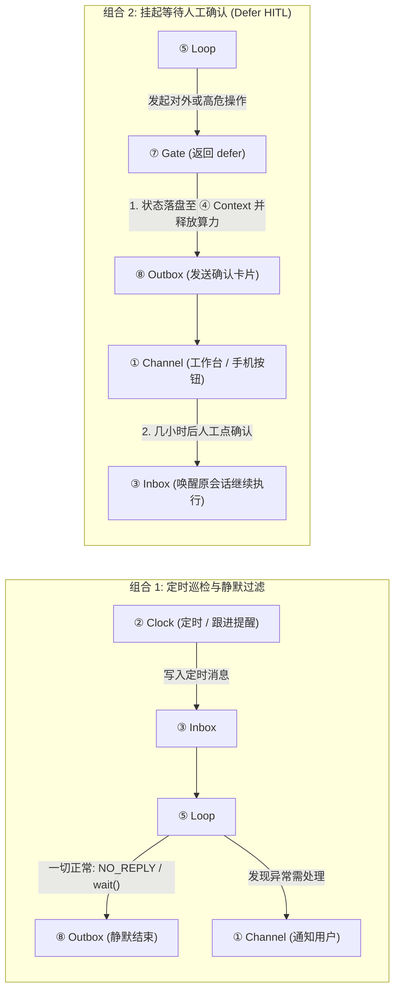
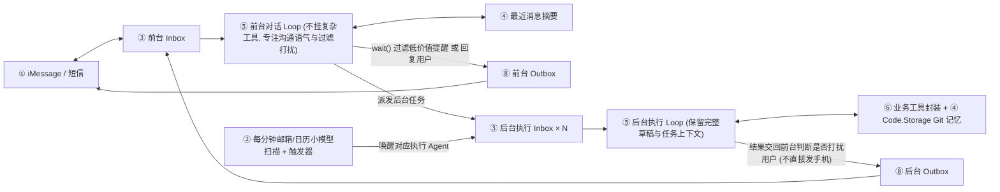
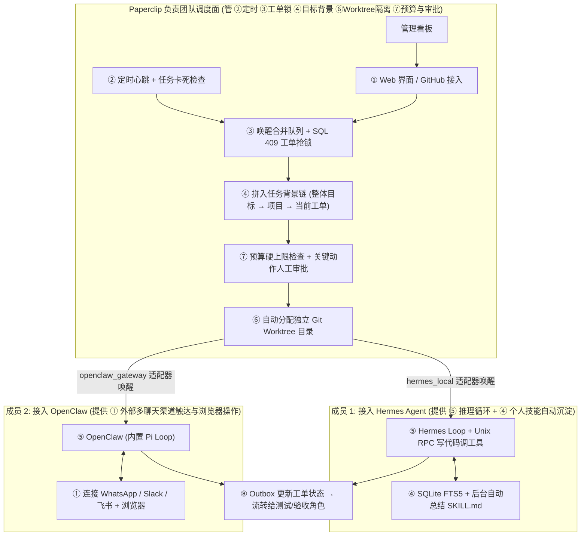

# Agent 核心架构拆解：1 条消息总线 + 8 个基础模块

> [!IMPORTANT]
> **核心结论：不需要为每种 Agent 产品单独设计一套架构。**
> 从最基础的 5 个信息流模块（`Channel` 渠道接入、`Inbox` 消息队列、`Context` 跨会话上下文、`Agent Loop` 推理循环、`Outbox` 消息发送）出发，只要再补上 **3 个实际落地绕不开的基础模块**——**`Clock`（把定时和延迟任务变成普通消息）**、**`Workspace`（与推理循环分离的代码/工具执行沙箱）**、**`Gate`（权限拦截、密钥代理注入与挂起等待确认）**——并约定 **“系统内一切触发与通信都用统一的 `Envelope` 消息格式，另一个 Agent 只是另一个 `Inbox` 地址”**，就能直接搭出市面上从 Pi、OpenClaw、Hermes 到 Poke、Devin、Manus 乃至 Paperclip 这类截然不同的产品。

---

## 一、为什么刚好是这 8 个模块？

拿最基本的 5 个模块去搭真实产品，很快就能看清每一块负责什么，以及为什么还得补上另外 3 块：

| 序号 | 模块名称 | 来源 | 职责（每块只管一件事） | 如果少了它，会卡在哪儿？ |
| :--- | :--- | :--- | :--- | :--- |
| **①** | **`Channel`**（渠道接入） | 基础 5 块 | 负责外部协议（IM / Webhook / PR / CLI）与内部统一消息 `Envelope` 的双向转换 | 少了它，Agent 只能跑在本地测试脚本里，接不进飞书、Telegram、GitHub 或 iMessage（如 OpenClaw / Poke） |
| **③** | **`Inbox`**（收件队列与锁） | 基础 5 块 | 消息落盘、幂等去重、**单会话串行锁 / 连发消息合并 / 共享工单抢锁** | 少了它，Webhook 重试或用户连发几条消息就会引发并发冲突、改坏记忆文件甚至重复发信扣费 |
| **④** | **`Context`**（上下文与记忆） | 基础 5 块 | 启动或恢复会话时加载记忆索引、检索历史记录（FTS5/Wiki）、按需读取 `SKILL.md`，并在结束后受控写回 | 少了它，每次新开会话都得从零交代背景（搭不出 Hermes / Letta / OpenClaw） |
| **⑤** | **`Agent Loop`**（推理循环） | 基础 5 块 | 无状态的单轮推理循环：读入拼好的上下文快照，调工具或生成回复，跑完即释放 | 少了它，系统就退化成了写死规则的传统脚本工作流 |
| **⑧** | **`Outbox`**（发送与静默过滤） | 基础 5 块 | 把结果幂等发往外部 `Channel` **或另一个 `Inbox`**；没事需要汇报时支持 **`NO_REPLY` / `wait()` 直接静默结束** | 少了它，没法做多 Agent 协作和防重发，更没法拦住 24 小时没完没了的废话通知 |
| **②** | **`Clock`**（定时与唤醒） | **补齐 #1** | 把 **固定 Cron、Agent 自己预约的跟进提醒（Follow-up）、系统空闲（Idle）** 转成标准消息塞进 `Inbox` | 光有 `Channel`，Agent 只能“问一句动一下”；加上 `Clock`，才能做定时巡检、超时催问和空闲后台整理 |
| **⑥** | **`Workspace`**（执行沙箱） | **补齐 #2** | 与推理循环分离的执行环境（读写文件、跑命令、写代码调接口、控制浏览器），支持 `git worktree` 或虚拟机快照 | 光有 `Loop` 只是纯聊天机器人；加上可隔离、可休眠恢复的 `Workspace`，才能搭出 Pi、Claude Code、Devin、Manus |
| **⑦** | **`Gate`**（权限与预算拦截） | **补齐 #3** | 挡在工具执行与对外发送前的硬检查：**沙箱外代理注入密钥、安全分类拦截、预算超限停机、`defer` 挂起等待人工确认** | 只靠提示词防不住越权操作和死循环账单；加上 `Gate`，才能安全地跑后台任务和团队审批 |

> [!TIP]
> **几个常被当成“独立大功能”、其实只是模块连线组合的能力：**
> * **“自动总结经验写 `SKILL.md`”（Hermes）** 不需要新加底层模块：只要在主会话结束时往后台复盘 `Inbox` 发一条消息，唤醒只读 `Loop` 把总结写回 `Context` 即可。
> * **“空闲时间后台整理记忆”（Anthropic / OpenClaw 2.0 Dreaming）** 不需要新加底层模块：只是 `Clock(空闲/夜间)` → `Inbox` → `Loop` 对照日志清理 `Context` → `Outbox(静默结束)`。
> * **“多 Agent 协作 / 子任务派发”（Paperclip / Poke / Manus）** 也不需要专门的编排引擎：只要允许 **`Outbox` 的收件地址填另一个 Agent 的 `Inbox`**，单 Agent 和多 Agent 用的就是完全同一套机制。

---

## 二、最小接口定义：1 条消息总线 + 8 个模块（约 100 行 TypeScript）

把这套结构写成 TypeScript 接口，核心定义加起来 **不到 110 行代码**，不绑定任何具体业务：

```typescript
// ==================== 0. 统一消息结构 (Envelope) ====================
// 基本规则：外部消息、定时触发、人工确认回执、子 Agent 汇报，在内部全都是同一种 Envelope
export type Address =
  | `inbox:${string}`                 // 发给某个 Agent（或共享工单池）的 Inbox
  | `channel:${string}:${string}`;    // 发给外部渠道（如 channel:telegram:chat_889）

export interface Envelope<T = unknown> {
  id: string;                         // 全局幂等 ID（防 Webhook 重试、防重复发信）
  from: Address | `clock:${string}`;  // 来源地址
  to: Address;                        // 目标地址
  sessionKey?: string;                // 会话键：决定续接已有会话还是新开会话
  trust: "owner" | "internal" | "untrusted"; // 数据可信度标记（防止外部网页/告警内容直接污染长期记忆）
  payload: T;
  createdAt: number;
}

// ==================== ① Channel：外部渠道接入与渲染适配 ====================
export interface Channel {
  readonly id: string;
  // 外部消息 -> 转成标准 Envelope 推入 Inbox（如 Webhook 验签落库后立即返回 200）
  onIngress(emitToInbox: (env: Envelope) => Promise<void>): void;
  // Outbox -> 发回终端界面、IM 聊天窗、GitHub PR 评论或确认卡片
  deliver(target: string, content: Deliverable, idempotencyKey: string): Promise<void>;
}

// ==================== ② Clock：把定时与空闲转成普通消息 ====================
export interface Clock {
  // 支持固定 Cron、单次延迟跟进（at）、以及空闲触发（idle）
  schedule(rule: { cron?: string; at?: number; idleSec?: number }, template: Omit<Envelope, "id" | "createdAt">): Promise<string>;
  cancel(timerId: string): Promise<void>;
  // 到点后不直接调 AgentLoop，而是统一往目标 Inbox 写入一条 Envelope
}

// ==================== ③ Inbox：消息持久化、串行锁与合并 ====================
export interface Inbox {
  enqueue(env: Envelope): Promise<"accepted" | "deduped">;
  // 两种常见取任务模式：单会话串行 + 连发消息合并，或多人共享队列抢锁（抢不到返回 409）
  claimNextRun(workerId: string, mode: "coalesce_per_session" | "atomic_ticket_checkout"): Promise<ClaimedBatch | null>;
  complete(claimId: string): Promise<void>;
}

// ==================== ④ Context：跨会话记忆、历史日志与技能加载 ====================
export interface ContextStore {
  // 新开或恢复会话时，拼出前缀稳定的上下文快照，尽量命中模型 KV-Cache
  hydrate(sessionKey: string, batch: ClaimedBatch): Promise<PromptSnapshot>;
  appendTrajectory(sessionKey: string, event: StepEvent): Promise<void>; // 只追加的事件日志
  // 受控更新记忆或 SKILL.md（自动拦截 untrusted 回合写入，超字数时触发合并整理而不是粗暴截断）
  mutateKnowledge(op: KnowledgePatch, sourceTrust: Envelope["trust"]): Promise<void>;
  searchHistory(query: string, engine: "fts5_bm25" | "wiki_graph" | "git_grep"): Promise<Snippet[]>;
}

// ==================== ⑤ AgentLoop：无状态推理循环 ====================
export interface AgentLoop {
  // 本身不保存状态：只读取上下文快照，通过受 Gate 保护的接口干活，跑完一轮即可释放
  run(snapshot: PromptSnapshot, ports: {
    workspace: WorkspacePort;   // 经 Gate 权限检查后的沙箱执行接口
    outbox: Outbox;             // 发消息 / 派子任务 / 静默退出
    clock: Clock;               // 允许 Agent 给自己预约后续跟进提醒
    context: ContextStore;      // 按需读取 SKILL.md 正文或检索历史记录
  }): Promise<"completed" | "silent_noop" | "deferred_for_approval" | "budget_stopped">;
}

// ==================== ⑥ Workspace：独立的代码与工具执行沙箱 ====================
export interface Workspace {
  acquire(sessionKey: string, isolation: "host" | "git_worktree" | "container" | "cow_microvm"): Promise<WorkspacePort>;
  // 可选支持写时复制快照休眠与快速恢复（如 Devin blockdiff / Modal / Daytona）
  hibernate?(sessionKey: string): Promise<string>;
  restore?(snapshotId: string): Promise<WorkspacePort>;
}

export interface WorkspacePort {
  // 少量基础工具 + 写代码批量调接口（Codemode / CodeAct，避免往提示词塞几十个 MCP JSON Schema）
  exec(tool: "read" | "write" | "edit" | "bash" | "code_rpc", args: unknown): Promise<Observation>;
}

// ==================== ⑦ Gate：权限校验、密钥注入与挂起等待确认 ====================
export interface Gate {
  // 1. 动作校验：放行并由沙箱外代理补上真实密钥 | 拒绝并把原因返回给模型 | defer 挂起等人工点确认
  authorize(action: ProposedAction, ctx: RunMeta): Promise<
    | { type: "allow"; proxyInjectedSecretRef?: string }
    | { type: "deny"; feedbackToModel: string }
    | { type: "defer"; approvalCard: Deliverable } // 保存状态后立即停机，人工点确认后再从 Inbox 唤醒
  >;
  // 2. 成本与用量监控：同时看实际金额（cents）和 Token 消耗速度，到上限立即暂停队列并停掉在途任务
  meter(usage: { inputTokens: number; outputTokens: number; billedCents: number }): "ok" | "warn" | "hard_stop";
}

// ==================== ⑧ Outbox：幂等发送与静默过滤 ====================
export interface Outbox {
  // 可发往外部用户渠道，也可发往另一个 Agent 的 Inbox，或者在无需打扰时直接静默结束
  send(packet: { to: Address; content: Deliverable; idempotencyKey: string } | { silentDrop: true; reason: string }): Promise<void>;
}
```

---

## 三、五种常见的模块组合方式

有了上面 8 个模块，不用再写新组件，靠不同的连线方式就能拼出日常最需要的 5 种工作流：



1. **组合 1：定时跟进与静默过滤** = `② Clock` → `③ Inbox` → `④ Context` → `⑤ Loop` → `⑧ Outbox(silentDrop | Channel)`
   * **例子**：发完邮件后，Agent 调 `Clock.schedule({ at: +48h })` 定个两天后的检查提醒，中间完全休眠不耗资源；48 小时后消息进 `Inbox`，如果查到对方已经回了，直接走 `Outbox({ silentDrop: true })` 静默结束；真没回才通过 `Channel` 提醒你。
2. **组合 2：不占算力的人工确认（Serverless HITL）** = `⑤ Loop` → `⑦ Gate(defer)` → 保存上下文到 `④ Context` 并停机 → `⑧ Outbox` → `① Channel` → 人点确认后回流 `③ Inbox`
   * **例子**：不用让容器干等人类八个小时白烧钱，当前 Worker 也能立刻腾出来去处理队列里的其他事。
3. **组合 3：空闲整理记忆与自动沉淀技能** = `主轮结束 / ② Clock(idle)` → `③ 后台复盘 Inbox` → `⑤ 只读 Loop`（复用刚跑完的缓存） → `④ Context.mutateKnowledge(SKILL.md / MEMORY.md)` → `⑧ Outbox(silentDrop)`
   * **例子**：把“总结经验”和“清理过期记忆”从正常对话路径里拆出去，放到后台异步做，不拖慢当前响应速度。
4. **组合 4：父子 Agent 分工与报错自动重修** = `父 ⑧ Outbox` → `子 ③ Inbox`（独立 `④ Context` + 隔离 `⑥ Workspace`） → `子 ⑧ Outbox` → `父 ③ Inbox`（或外部 CI 报错经 `① Channel` 重新塞回原 `③ Inbox`）
   * **例子**：子任务并发调研（Manus Wide Research）、前后台角色拆分（Poke），以及提完 PR 后 CI 挂了自动唤醒接着修（Devin / Cursor Autofix），底层都是这一种连线。
5. **组合 5：多人/多角色共享工单池与预算控制** = 多个 Agent 共享 `③ Inbox(atomic_ticket_checkout)` + 带上下级目标背景的 `④ Context(Goal Ancestry)` + 统一的 `⑦ Gate(预算上限 + 关键操作审批)`。

---

## 四、用同一套模块还原市面上的 7 类代表性产品

把上面 8 个模块做不同的取舍和连线，就能对应到目前主流的几类产品形态：

### 1. Pi / Claude Code CLI（轻量本地命令行编程工具）
* **取舍**：**不启用 `② Clock`**，把 `③ Inbox` 简化成内存单队列，主要精力放在 **精简 `⑤ Loop` 系统提示词（控制在 1k Token 以内）** 和 **`⑥ Workspace` 的 4 个基础工具 + QuickJS `Codemode`** 上。
* **链路**：`① CLI 终端` → `③ 内存队列(支持按键打断 steer)` → `④ 本地 AGENTS.md + JSONL 会话树` → `⑤ 轻量 Loop` ↔ `⑥ 本地 read/write/edit/bash + Codemode` → `⑧ 终端流式输出`。

### 2. Anthropic《Building always-on agents》/ Claude Duet（云端常驻个人助手）
* **取舍**：单 Agent 配齐全部 8 个模块，串起上面的 **组合 1 + 组合 2 + 组合 3**。
* **链路**：
  * `① Webhook 快速入库 + 手机端` + `② Schedules / Follow-up 定时表` → 汇入 **`③ 单用户单活跃 Worker 队列（连发消息自动合并）`**。
  * 唤醒无状态 `⑤ Loop`，从 `④ 四类记忆文件（前 200 行作目录索引，外部数据只存 ID 指针）` 按需读取上下文。
  * 调工具统一经过 **`⑦ Gate（沙箱外代理注入密钥 + Auto Mode 安全分类器 + PreToolUse: defer）`** → 按需启动 **`⑥ 云容器`**。
  * 结果走 **`⑧ 幂等 Outbox`**（免打扰时段合并发送 / 无事静默退出），夜间由 `② Clock` 触发后台整理记忆生成交叉链接 Wiki。

### 3. OpenClaw 2.0（本地多渠道个人网关）
* **取舍**：重点做厚 **`① Channel` 多平台接入** 和 **`④ Context` 外部不可信数据隔离**，内部 `⑤ Loop` 直接复用上面的 **Pi SDK**。
* **链路**：
  * `① 50+ 聊天软件桥接（WhatsApp/Telegram/iMessage）+ 语音唤醒 + 手机/树莓派硬件节点` + `② 30 分钟定时心跳` → `③ 按会话分桶的单写者 FIFO 队列`。
  * 只要 `⑥ 浏览器 / 网页搜索` 读到了外部网页内容，当前回合就标上 `trust: "untrusted"`，由 `④ SQLite 来源追踪` 拦住不让直接写进长期 `MEMORY.md`，只允许后台整理任务清洗后合入；没事时返回 `HEARTBEAT_OK` 由 `⑧ Outbox` 直接静默吞掉。

### 4. Hermes Agent（带技能自动总结的常驻网关）
* **取舍**：在单守护进程网关上，靠 **`⑧ Outbox` → 内部 `③ 复盘队列`** 把日常任务自动沉淀成可复用的 `SKILL.md`。
* **链路**：
  * 主路径：`① 25+ 渠道（支持 /handoff 换设备接着聊）` + `② 60s 定时检查（支持不调模型的纯脚本巡检）` → `③ SQLite WAL 队列` → `④ 冻结快照 MEMORY.md(2.2KB) + FTS5 全文检索 + Honcho 偏好推断` → `⑤ 主 Loop` ↔ `⑥ Unix Socket RPC 代码调工具 + Modal/Daytona 休眠沙箱`。
  * **后台总结支路**：主轮刚跑完，`⑧` 立即触发一个 **保持相同前缀的只读复盘 `⑤ Fork Loop`**（直接命中刚热起来的缓存），通过 `⑦ 技能格式检查（Linter）` 自动新建或更新 `④ ~/.hermes/skills/**/SKILL.md`；系统空闲满 2 小时后，`② Clock(idle)` 再唤醒整理进程归档冷门技能、合并重复技能。

### 5. Poke（前后台分离的免运维聊天助手）
* **取舍**：模块本身不变，只是拆成 **“1 个负责聊天的接待 Agent + N 个在后台干活的执行 Agent”** 两层：



* **这么拆的好处**：前台 `⑤ Loop` 不用塞几十个工具的 JSON 定义，回复快、说话自然；后台执行专员只管盯邮件和跑任务，**没有直接给用户发通知的权限**，所有消息都要先过一遍前台 `⑧ Outbox` 的 `wait()` 过滤。

### 6. Devin 2.2 / Cursor Cloud Agents / Manus（云端沙箱工作台）
* **取舍**：把 **`⑥ Workspace` 做成毫秒级写时复制（CoW）快照虚拟机 + 桌面录屏**，并把外部 CI 和代码评审评论接回 **`① Channel` → `③ Inbox`** 实现报错自动重修。
* **链路**：
  * Slack `@Devin`、Sentry 报错或 PR 评论经 `①` 进 `③` → `⑥` 在 **200ms** 左右从 `XFS reflink` 快照（Devin `blockdiff`）或热内存分叉（Cursor `Builds`）拉起完整开发环境。
  * `④ Context` 把大文件留在磁盘上，在上下文末尾反复更新 `todo.md` 提醒当前目标；`⑤ Loop` 用输出前缀掩码避免改动工具列表破坏缓存，或者一次向上百个隔离的 `③ 子队列 + ⑥ 子虚拟机` 分发任务（Manus Wide Research，由 `⑦ Gate` 禁止子虚拟机之间互相串消息）。
  * `⑧ Outbox` 输出按逻辑分组的代码 Diff 和操作录屏；如果 GitHub Actions 跑挂了，Webhook 自动经 `①` 唤醒原快照继续修到测试通过。

### 7. Paperclip（多 Agent 团队协作与预算控制面）—— 以及多开源项目混搭
* **取舍**：Paperclip 很有意思的一点是它 **自己不写 `⑤ Agent Loop`**（留成外部 Adapter 接口），专门把 **`② Clock + ③ Inbox + ④ Context + ⑥ Workspace + ⑦ Gate + ⑧ Outbox`** 做成管工单、管目录隔离和管账单的控制面。
* **为什么社区里常把 `Paperclip + Hermes + OpenClaw` 搭在一起用？** 因为它们刚好各自负责了这 8 个模块里自己最擅长的那几块：



从这张图能看得很明白：这些热门项目底层并没有跳出这 8 个模块，区别只在于是单实例运行还是多实例组合，以及把主要工程精力花在了哪几个模块上。

---

## 五、`ng-agents` 代码目录划分建议

后面在 `project-aoi/ng-agents` 动手写代码时，建议 **不要按具体业务场景（比如“客服助手”“写代码助手”“巡检机器人”）分目录**，而是直接按这 **1 套协议 + 8 个独立模块** 来拆包：

```text
ng-agents/
├── packages/
│   ├── protocol/          # Envelope 消息定义、Address 寻址、trust 可信度标记、StepEvent
│   ├── channel/           # ① CLI、HTTP Webhook、飞书/Slack/Telegram、GitHub PR 接入适配
│   ├── clock/             # ② Cron 定时表、Follow-up 单次跟进提醒、Idle 空闲触发
│   ├── inbox/             # ③ SQLite WAL / Postgres 幂等入队、单会话合并锁、工单 409 抢锁
│   ├── context/           # ④ 稳定前缀组装、MEMORY.md 索引、FTS5 全文检索、SKILL.md 按需加载与安全写回
│   ├── loop/              # ⑤ 精简无状态推理循环（保持上下文前缀稳定以命中缓存）
│   ├── workspace/         # ⑥ 4 个基础工具 + Codemode 脚本执行 + 本地 / Docker / Git Worktree 隔离驱动
│   ├── gate/              # ⑦ 沙箱外密钥代理注入、安全分类校验、金额+Token 双上限控制、defer 挂起恢复
│   └── outbox/            # ⑧ 幂等发送、NO_REPLY/wait() 静默过滤、跨 Agent Inbox 转发
└── recipes/               # 只做模块连线组装的配置层（不写底层逻辑，只把上面 8 个模块串起来）
    ├── cli-coder.ts       # 轻量本地命令行编码工具
    ├── gtd-desk.ts        # 个人 GTD 工作台（后台预处理 + 待确认卡片 + 周回顾沉淀 SKILL.md）
    ├── dual-agent.ts      # 前后台分离助手（类似 Poke）
    └── team-board.ts      # 多角色共享工单与预算控制面（类似 Paperclip）
```

这样底层始终只有 **8 个边界清晰、可以单独写测试的小包**，上层不管想试验哪种产品形态，都只是在 `recipes/` 里换一种连线组合。
