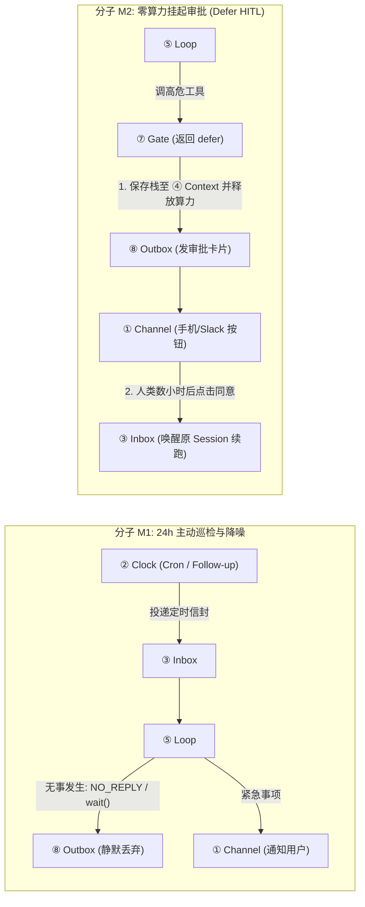
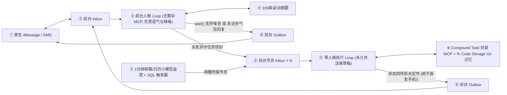
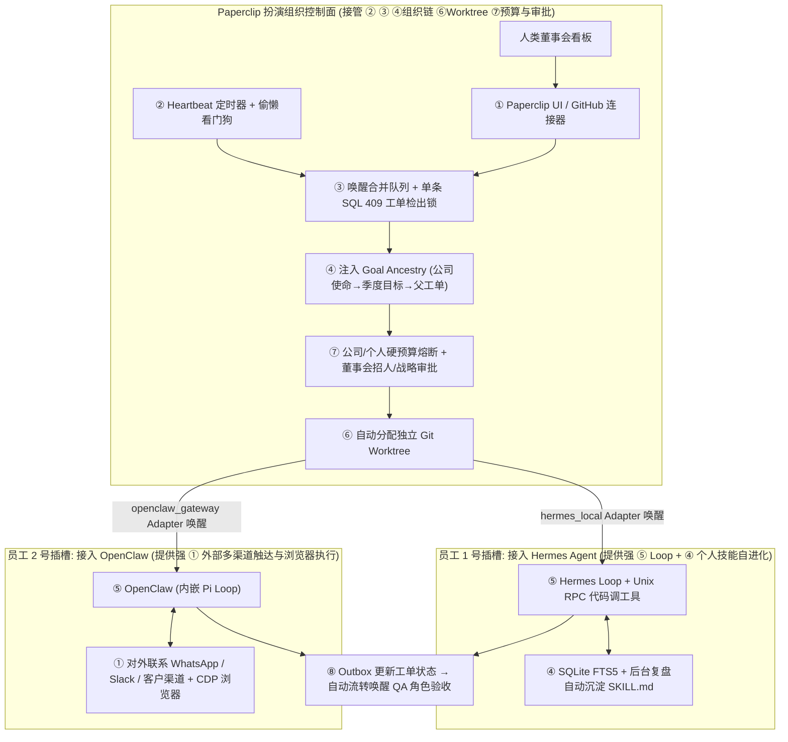

# Agent 微内核假说验证：八大原子拆解与全品类产品拼装蓝图

> [!IMPORTANT]
> **对你的假说的核心验证结论：完全成立，且比大多数人想象的还要干净。**
> 你直觉抓到的 **5 个要素**（`Channel` 投递接入、`Inbox` 消息队列、`Context` 跨会话上下文、`Agent Loop` 推理核、`Outbox` 发送能力）已经构成了 **Actor 模型的信息流闭环**。在此基础上，只需补齐 **3 个不可约简的物理边界原子**——**`Clock`（把时间变成消息）**、**`Workspace`（与大脑解耦的执行手脚）**、**`Gate`（确定性拦截、凭据注入与挂起阀门）**——再配上一条 **“万物皆信封（`Envelope`），另一个 Agent 只是另一个 `Inbox` 地址”** 的总线规则，就能 **零魔法、零特判** 地拼出市面上从 Pi、OpenClaw、Hermes 到 Poke、Devin、Manus 乃至 Paperclip 的全部产品。

---

## 一、假说推演：为什么是“你的 5 要素 + 3 补齐原子 = 8 原子微内核”？

我们可以像做线性代数“基向量正交性检验”一样，拿你提出的 5 个要素直接去拼真实产品，看看能拼到哪一步、卡在哪里：

| 序号 | 原子名称 | 来源 | 核心职责（只做一件事） | 如果缺了它，哪类产品拼不出来？ |
| :--- | :--- | :--- | :--- | :--- |
| **①** | **`Channel`**（通道边界） | **你已提出** | 外部世界协议（IM / Webhook / PR / CLI）与内部标准信封 `Envelope` 的双向转换器 | 缺了它，Agent 只能活在测试脚本里，接不进微信/Telegram/GitHub/iMessage（如 OpenClaw / Poke） |
| **③** | **`Inbox`**（收件箱与锁） | **你已提出** | 持久化缓冲信封、幂等去重、**单会话串行锁 / 突发消息合并 / 工单原子抢锁** | 缺了它，并发 Webhook 或连发消息会直接引发竞态踩踏、记忆覆写与重复扣费 |
| **④** | **`Context`**（跨会话装载器） | **你已提出** | 新开/恢复 Session 时装载冻结记忆索引、检索历史轨迹（FTS5/Wiki）与按需披露 `SKILL.md`，并在结束后受控写回 | 缺了它，每次新开 Session 都是失忆症患者（无法拼出 Hermes / Letta / OpenClaw） |
| **⑤** | **`Agent Loop`**（无状态大脑） | **你已提出** | 纯函数式单轮有界推理机：输入装载好的上下文快照，迭代产出工具意图或回复事件 | 缺了它，系统退化为传统死板 RPA / IFTTT 工作流 |
| **⑧** | **`Outbox`**（发送与降噪箱） | **你已提出** | 幂等投递产物至外部 `Channel` **或另一个 `Inbox`**，并提供 **`NO_REPLY` / `wait()` 静默吞吐** | 缺了它，无法实现多 Agent 通信、防重放投递，更无法阻止 24h 垃圾通知轰炸 |
| **②** | **`Clock`**（时间发生器） | **补齐 #1** | 把 **Cron 周期、Agent 自设的 Follow-up 闹钟、系统空闲（Idle）** 变成标准信封投递进 `Inbox` | 仅有 `Channel` 时 Agent 只能“戳一下动一下”；补上 `Clock`，瞬间解锁 **24h 主动巡检、超时催办与离线做梦** |
| **⑥** | **`Workspace`**（具身沙箱手脚） | **补齐 #2** | 与大脑解耦的状态化执行环境（`fs/bash/codemode/browser`），支持 `git worktree` 或 CoW 整机快照 | 仅有 `Loop` 只是纯聊天机器人；补上可休眠分叉的 `Workspace`，才能拼出 Pi、Claude Code、Devin、Manus |
| **⑦** | **`Gate`**（策略与挂起阀门） | **补齐 #3** | 横亘在执行与外发前的确定性关卡：**沙箱外注入密钥、安全分类器、预算硬熔断、`defer` 零算力挂起审批** | 把安全写在 Prompt 里防不住注入与死循环账单；补上 `Gate`，才能拼出无人值守权限与 Paperclip 董事会治理 |

> [!TIP]
> **最关键的降维洞察：哪些“高级卖点”根本不是新原子？**
> * **“自进化学习 / 自动写 `SKILL.md`”（Hermes）** $\neq$ 新原子，它只是把主会话结束事件路由进一个后台 `Inbox`，唤醒只读 `Loop` 往 `Context` 里写文件。
> * **“离线做梦整理记忆”（Anthropic / OpenClaw 2.0）** $\neq$ 新原子，它只是 `Clock(空闲/夜间)` $\rightarrow$ `Inbox` $\rightarrow$ `Loop` 对照日志清洗 `Context` $\rightarrow$ `Outbox(静默)`。
> * **“多智能体公司 / 子 Agent 编排”（Paperclip / Poke / Manus）** $\neq$ 新原子，只要规定 **`Outbox` 的收件地址可以是另一个 Actor 的 `Inbox`**，单智能体与多智能体在内核层完全同构！

---

## 二、“拆给你看”：1 条信封总线 + 8 大原子的最小代码契约

如果用 TypeScript 把这套微内核定义出来，全部核心接口加起来 **不到 110 行代码**，没有任何业务耦合：

```typescript
// ==================== 0. 通用信封总线 (Universal Envelope Bus) ====================
// 核心公理：外部消息、定时器触发、人工审批回执、子 Agent 汇报，在内核里全都是同一种 Envelope！
export type Address =
  | `inbox:${string}`                 // 投递给某个 Agent（或共享工单池）的 Inbox
  | `channel:${string}:${string}`;    // 投递给外部渠道（如 channel:telegram:chat_889）

export interface Envelope<T = unknown> {
  id: string;                         // 全局幂等键（防 Webhook 重试、防重复发信）
  from: Address | `clock:${string}`;  // 来源地址
  to: Address;                        // 目标地址
  sessionKey?: string;                // 路由键：决定续接已有 Session 还是开全新 Session
  trust: "owner" | "internal" | "untrusted"; // 污点标记（阻断网页/外部告警污染长期记忆）
  payload: T;
  createdAt: number;
}

// ==================== ① Channel：协议接入与表现层适配器 ====================
export interface Channel {
  readonly id: string;
  // 外部世界 -> 归一化为信封推入 Inbox（如 Webhook 验签后快速返回 200）
  onIngress(emitToInbox: (env: Envelope) => Promise<void>): void;
  // Outbox -> 渲染为终端 UI、IM 气泡、GitHub PR 评论或审批卡片
  deliver(target: string, content: Deliverable, idempotencyKey: string): Promise<void>;
}

// ==================== ② Clock：把“时间与空闲”转化为信封 ====================
export interface Clock {
  // 支持固定 Cron、Agent 给自己定的单次跟进闹钟（at）、以及系统空闲触发（idle）
  schedule(rule: { cron?: string; at?: number; idleSec?: number }, template: Omit<Envelope, "id" | "createdAt">): Promise<string>;
  cancel(timerId: string): Promise<void>;
  // 到期后绝不直接调 AgentLoop，而是统一往目标 Inbox 塞入一条 Envelope！
}

// ==================== ③ Inbox：持久化缓冲、串行锁与合并器 ====================
export interface Inbox {
  enqueue(env: Envelope): Promise<"accepted" | "deduped">;
  // 核心旋钮：单会话串行 + 突发合并（coalesce），或共享队列原子抢锁（atomic_checkout 409）
  claimNextRun(workerId: string, mode: "coalesce_per_session" | "atomic_ticket_checkout"): Promise<ClaimedBatch | null>;
  complete(claimId: string): Promise<void>;
}

// ==================== ④ Context：跨 Session 记忆、轨迹与技能装载器 ====================
export interface ContextStore {
  // 新开或恢复 Session 时，组装严格保护 KV-Cache 前缀一致性的快照
  hydrate(sessionKey: string, batch: ClaimedBatch): Promise<PromptSnapshot>;
  appendTrajectory(sessionKey: string, event: StepEvent): Promise<void>; // 只追加事件溯源日志
  // 受控写回记忆或 SKILL.md（自动拦截 untrusted 污点回合，超字数触发原子压缩而非截断）
  mutateKnowledge(op: KnowledgePatch, sourceTrust: Envelope["trust"]): Promise<void>;
  searchHistory(query: string, engine: "fts5_bm25" | "wiki_graph" | "git_grep"): Promise<Snippet[]>;
}

// ==================== ⑤ AgentLoop：纯无状态有界推理机 (Brain) ====================
export interface AgentLoop {
  // 纯无状态 Cattle：只消费快照并调受 Gate 保护的端口，跑完一轮即销毁/休眠
  run(snapshot: PromptSnapshot, ports: {
    workspace: WorkspacePort;   // 已被 Gate 包裹的执行手脚
    outbox: Outbox;             // 发送消息 / 派发子任务 / 静默退出
    clock: Clock;               // 允许 Agent 给未来的自己定闹钟
    context: ContextStore;      // 按需深读 SKILL.md 正文或历史检索
  }): Promise<"completed" | "silent_noop" | "deferred_for_approval" | "budget_stopped">;
}

// ==================== ⑥ Workspace：解耦的具身执行沙箱 (Hands) ====================
export interface Workspace {
  acquire(sessionKey: string, isolation: "host" | "git_worktree" | "container" | "cow_microvm"): Promise<WorkspacePort>;
  // 支持 200ms 写时复制休眠落盘与秒级唤醒恢复（Devin blockdiff / Modal / Daytona）
  hibernate?(sessionKey: string): Promise<string>;
  restore?(snapshotId: string): Promise<WorkspacePort>;
}

export interface WorkspacePort {
  // 极简 4 原语 + 编程式工具编排（Codemode / CodeAct，消灭数十个 MCP JSON Schema 膨胀）
  exec(tool: "read" | "write" | "edit" | "bash" | "code_rpc", args: unknown): Promise<Observation>;
}

// ==================== ⑦ Gate：确定性拦截、凭据注入与零算力挂起 ====================
export interface Gate {
  // 1. 动作拦截：放行并由沙箱外代理注入真实凭据 | 安全分类器拦截 | defer 序列化挂起等人工点同意
  authorize(action: ProposedAction, ctx: RunMeta): Promise<
    | { type: "allow"; proxyInjectedSecretRef?: string }
    | { type: "deny"; feedbackToModel: string }
    | { type: "defer"; approvalCard: Deliverable } // 立即停机省算力，审批结果未来从 Inbox 唤醒！
  >;
  // 2. 双指标计量熔断：同时盯死金额（cents）与 Token 流速，100% 立即暂停 Inbox 并中断在途 Run
  meter(usage: { inputTokens: number; outputTokens: number; billedCents: number }): "ok" | "warn" | "hard_stop";
}

// ==================== ⑧ Outbox：幂等路由与主动降噪出口 ====================
export interface Outbox {
  // 既可发给外部用户 Channel，也可发给另一个 Agent 的 Inbox，还可显式静默吞掉（NO_REPLY / wait）
  send(packet: { to: Address; content: Deliverable; idempotencyKey: string } | { silentDrop: true; reason: string }): Promise<void>;
}
```

---

## 三、从原子到“分子”：5 种连线拓扑涌现出的高阶能力

有了上面 8 块积木，我们不需要写任何新模块，光靠 **连线（Wiring）** 就能拼出 5 个标准的“二级分子电路”：



1. **分子 M1：24h 主动巡检与静默降噪回路** = `② Clock` $\rightarrow$ `③ Inbox` $\rightarrow$ `④ Context` $\rightarrow$ `⑤ Loop` $\rightarrow$ `⑧ Outbox(silentDrop | Channel)`
   * **原理**：Agent 在跟进客户邮件时调 `Clock.schedule({ at: +48h })`，48 小时内休眠零消耗；闹钟响后推入 `Inbox`，若检查发现客户已回复则直接走 `Outbox({ silentDrop: true })` 安静睡去，未回复才走 `Channel` 提醒人类。
2. **分子 M2：零算力人工审批回路（Serverless HITL）** = `⑤ Loop` $\rightarrow$ `⑦ Gate(defer)` $\rightarrow$ 存盘 `④ Context` 并停机 $\rightarrow$ `⑧ Outbox` $\rightarrow$ `① Channel` $\rightarrow$ 人类点击回流 `③ Inbox`
   * **原理**：彻底干掉了“容器傻等人类 8 小时白烧钱”的问题，也释放了当前 Worker 去处理队列里的其他事件。
3. **分子 M3：离线做梦与闭环技能进化回路** = `主轮结束 / ② Clock(idle)` $\rightarrow$ `③ 后台复盘 Inbox` $\rightarrow$ `⑤ 只读受限 Loop`（共享热缓存） $\rightarrow$ `④ Context.mutateKnowledge(SKILL.md / MEMORY.md)` $\rightarrow$ `⑧ Outbox(silentDrop)`
   * **原理**：把“经验总结”和“记忆纠错去重”从主交互热路径剥离到空闲异步回路。
4. **分子 M4：Actor 级联与自愈反馈回路** = `父 ⑧ Outbox` $\rightarrow$ `子 ③ Inbox`（独立 `④ Context` + 隔离 `⑥ Workspace`） $\rightarrow$ `子 ⑧ Outbox` $\rightarrow$ `父 ③ Inbox`（或外部 CI 报错经 `① Channel` 打回原 `③ Inbox`）
   * **原理**：一次连线同时解释了子 Agent 并发（Manus Wide Research）、前后台人格拆解（Poke）以及 PR 自动修 CI（Devin / Cursor Autofix）。
5. **分子 M5：共享工单竞争与组织治理回路** = N 个 Actor 共享 `③ Inbox(atomic_ticket_checkout)` + 分层 `④ Context(Goal Ancestry)` + 汇总 `⑦ Gate(预算账本 + 董事会审批)`。

---

## 四、“拼给你看”：现场用同一套 8 原子拼出 7 款热门产品

下面我们直接操作这 8 个原子的“开关与档位”，现场还原市面上最具代表性的 7 款产品：

### 拼装 1：Pi / Claude Code CLI（极简交互式编码核）
* **拼装动作**：**关掉 `② Clock`**，将 `③ Inbox` 退化为内存单槽队列，把全部工程精力砸在 **`⑤ Loop` 的提示词瘦身（`<1k` Token）** 和 **`⑥ Workspace` 的 4 原语 + QuickJS `Codemode`** 上。
* **连线公式**：`① CLI 终端` $\rightarrow$ `③ 内存单槽(支持按键 steer)` $\rightarrow$ `④ 本地 AGENTS.md + 树状 JSONL` $\rightarrow$ `⑤ 极简 Loop` $\leftrightarrow$ `⑥ 宿主 read/write/edit/bash + Codemode` $\rightarrow$ `⑧ 终端流式 Diff`。

### 拼装 2：Anthropic《Building always-on agents》/ Claude Duet（标准云端常驻助手）
* **拼装动作**：标准单 Actor 全开 8 原子，接上 **分子 M1 + M2 + M3**。
* **连线公式**：
  * `① Webhook 快速落库 + 手机端` + `② Schedules / Follow-up 独立表` $\rightarrow$ 汇入 **`③ 单用户单活跃 Worker Inbox（突发合并）`**。
  * 唤醒无状态 `⑤ Loop`，由 `④ 四分区虚拟文件目录（前 200 行索引 + 指针原则）` 供血。
  * 调工具必过 **`⑦ Gate（沙箱外凭据注入代理 + Auto Mode 分类器 + PreToolUse: defer）`** $\rightarrow$ 懒加载 **`⑥ 云容器 + 6000 连接器`**。
  * 出口走 **`⑧ 幂等 Outbox Dispatcher`**（安静时段合并 / No-op 静默），夜间由 `② Clock` 触发 **M3 Dreaming** 构建交叉链接 Wiki。

### 拼装 3：OpenClaw 2.0（39 万 Star 本地全渠道个人网关）
* **拼装动作**：重度放大 **`① Channel`** 与 **`④ Context` 防投毒染色**，内置 `⑤ Loop` 直接复用上面 **拼装 1 的 Pi SDK**！
* **连线公式**：
  * `① 50+ IM 桥接（WhatsApp/Telegram/iMessage）+ 语音唤醒 + 手机/树莓派硬件节点` + `② 30 分钟 Heartbeat` $\rightarrow$ `③ Lane FIFO 队列（按 dmScope 分桶单写者锁）`。
  * 一旦 `⑥ CDP 浏览器 / Web 搜索` 返回外部网页数据，当前回合信封立即打上 `trust: "untrusted"`，由 `④ SQLite 来源追踪器` 拦截其进入长期 `MEMORY.md`，仅允许三阶段离线 **Dreaming** 归并可信记忆；无事发生时吐出 `HEARTBEAT_OK` 由 `⑧ Outbox` 静默吞掉。

### 拼装 4：Hermes Agent（Nous Research 闭环自进化引擎）
* **拼装动作**：在单守护进程网关上，利用 **`⑧ Outbox` $\rightarrow$ 内部 `③ 复盘 Inbox`** 搭出业内最强的 **分子 M3 技能自进化闭环**。
* **连线公式**：
  * 主通路：`① 25+ 渠道（支持 /handoff 跨端接力）` + `② 60s Cron（支持零 Token 纯脚本巡检）` $\rightarrow$ `③ SQLite WAL 队列` $\rightarrow$ `④ 冻结快照 MEMORY.md(2.2KB) + FTS5 全文检索 + Honcho 辩证建模` $\rightarrow$ `⑤ 主 Loop` $\leftrightarrow$ `⑥ Unix Socket RPC 代码调工具 + Modal/Daytona 休眠沙箱`。
  * **自进化旁路**：主轮刚一结束，`⑧` 立即派发内部事件拉起 **字节级前缀对齐的只读复盘 `⑤ Fork Loop`**（100% 命中刚跑完的热缓存！），经 `⑦ 技能 Linter 校验` 自动新增或修补 `④ ~/.hermes/skills/**/SKILL.md`；每空闲满 2 小时，`② Clock(idle)` 再唤醒 **Curator** 自动归档冷门技能、聚类合并重复技能。

### 拼装 5：Poke（Cognition 收购的零打扰双层消费级助手）
* **拼装动作**：不改任何原子定义，而是实例化 **“1 个前台人格 Actor + N 个后台执行专员 Actor”** 串联！



* **为什么这样拼体验质变？** 前台 `⑤ Loop` 没有挂载 50 个臃肿的 JSON 工具 Schema，聊天情商与响应速度拉满；后台专员盯紧邮箱和任务但 **没有直连用户手机的权限**，一切上报必须经过前台 `⑧ Outbox` 的 `wait()` 噪音门控过滤。

### 拼装 6：Devin 2.2 / Cursor Cloud Agents / Manus（重装云端自主工作台）
* **拼装动作**：将 **`⑥ Workspace` 升级为亚秒级 CoW 快照虚拟机 + 录屏 GUI**，并把外部 CI / Code Review 重新接回 **`① Channel` $\rightarrow$ `③ Inbox`** 形成 **分子 M4 代码自愈闭环**。
* **连线公式**：
  * Slack `@Devin` / Sentry 崩溃告警 / PR 评论经 `①` 进 `③` $\rightarrow$ `⑥` 在 **200ms** 内从 `XFS reflink` 快照（Devin `blockdiff`）或热内存分叉（Cursor `Builds`）唤醒完整云电脑。
  * `④ Context` 把原始大文件留磁盘、在尾部反复刷新 `todo.md` 锚定注意力；`⑤ Loop` 用 Logit 掩码保护 **100:1 前缀缓存**，或者一键向 100 个隔离 `③ 子 Inbox + ⑥ 子 VM` 扇出任务（Manus Wide Research，由 `⑦ Gate` 严禁子 VM 横向群聊）。
  * `⑧ Outbox` 交付 **AST 逻辑分组 Diff + `recordScreen` 录屏视频**；一旦 GitHub Actions 跑红，Webhook 自动经 `①` 回流唤醒同一快照修到变绿（Autofix）。

### 拼装 7：Paperclip（“pepperclip”，多 Agent AI 公司控制面）—— 以及终极跨产品混搭！
* **拼装动作**：Paperclip 最神的地方在于它 **自己根本不实现 `⑤ Agent Loop`**（把它留作外部 Adapter 插槽），而是专门把 **`② Clock + ③ Inbox + ④ Context + ⑥ Workspace + ⑦ Gate + ⑧ Outbox`** 做成多角色组织操作系统！
* **真实世界的终极验证（社区最火的 `Paperclip + Hermes + OpenClaw` 组合拳）**：为什么这三个独立开源项目能像原生套件一样拼在一起？因为它们恰好各自占据了这 8 个原子的不同强项槽位：



看懂上面这张图，你就彻底看穿了 2026 年整个 Agent 赛道的本质：**没有哪个产品跳出了这 8 个原子；所有产品的差异，仅仅是“单实例还是多实例连线”以及“在哪个原子上堆重甲、在哪个原子上做极简退化”。**

---

## 五、直接用于你自研项目的“微内核骨架”建议

如果你接下来要在 `project-aoi/ng-agents` 里动手搭一套真正能演化出上述任意形态的底座，建议 **不要按“功能模块（如客服机器人、编程助手、定时巡检器）”建目录**，而是直接按这 **1 条总线 + 8 个正交原子** 划分微内核包结构：

```text
ng-agents/
├── packages/
│   ├── kernel-protocol/   # Envelope 信封定义、Address 寻址、污点等级 trust、StepEvent
│   ├── atom-channel/      # ① CLI、HTTP Webhook、Telegram/Slack/飞书、GitHub PR 适配器
│   ├── atom-clock/        # ② Cron 周期表、Agent 自预约 Follow-up 表、Idle 空闲检测器
│   ├── atom-inbox/        # ③ SQLite WAL / Postgres 幂等入队、单会话合并锁、工单 409 原子检出
│   ├── atom-context/      # ④ 冻结前缀组装、MEMORY.md 指针索引、FTS5 检索、SKILL.md 渐进加载与防投毒写回
│   ├── atom-loop/         # ⑤ <1k Token 极简无状态推理循环（严格保护 KV-Cache 前缀不变性）
│   ├── atom-workspace/    # ⑥ 4 基础原语 + Codemode 沙箱执行器 + Local / Docker / Git Worktree / 云快照驱动
│   ├── atom-gate/         # ⑦ 沙箱外凭据注入代理、AutoMode 安全分类器、Token+金额双熔断、PreToolUse:defer 挂起
│   └── atom-outbox/       # ⑧ 幂等分发器、NO_REPLY/wait() 静默门、跨 Actor Inbox 路由
└── recipes/               # 纯声明式连线配方（不写核心逻辑，只组装上面 8 个原子！）
    ├── cli-coder.ts       # 50 行拼出一个 Pi / Claude Code
    ├── always-on-duet.ts  # 80 行拼出一个带 Dreaming 和技能自进化的 Hermes / Duet
    ├── dual-persona.ts    # 100 行拼出一个前后台分离的 Poke
    └── company-plane.ts   # 120 行拼出一个多角色抢单 + 预算治理的 Paperclip
```

这样一来，你的核心代码库永远只有 **8 个高内聚、可独立单测的正交包**，而任何市面上的新爆款形态，对你来说都只是 `recipes/` 目录下一份几十行的拓扑组装配置。
