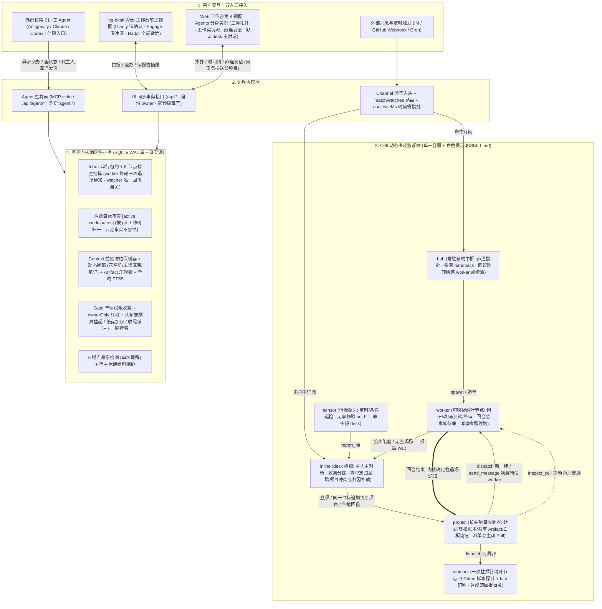
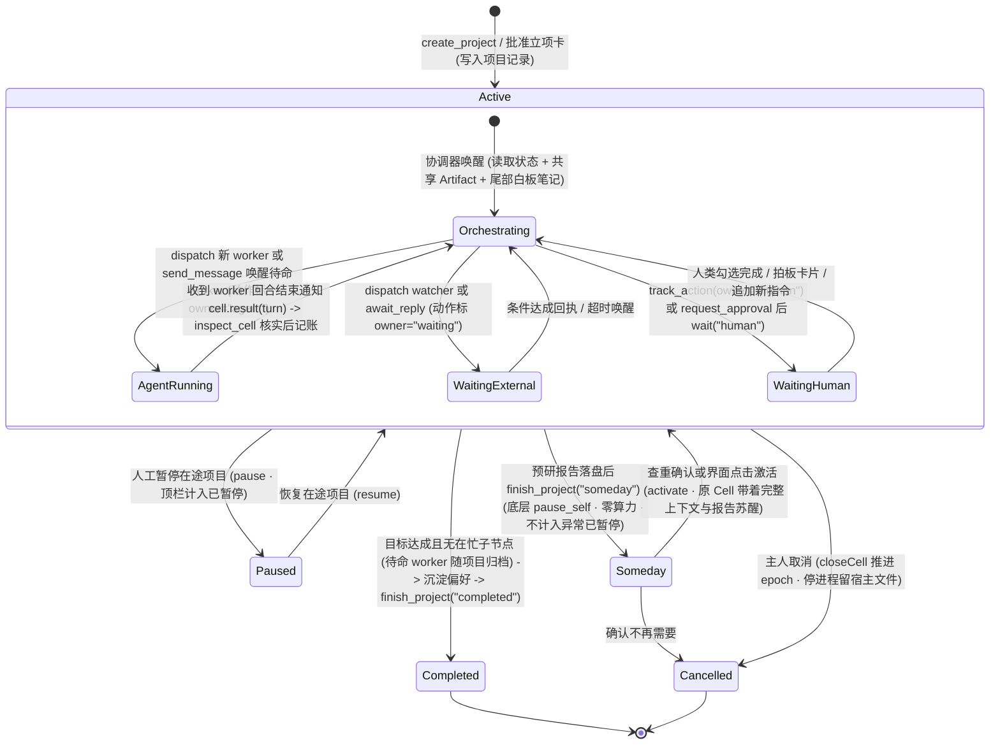
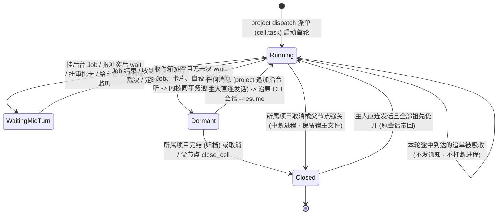

# 产品理想运行机制与状态流转总纲

> [!IMPORTANT]
> 本层文档属于**第二层：产品理想工作方式与用例推导（行为契约，严禁 Break）**。
> 本文档汇总全系统共用的角色拓扑、双层生命周期状态机、GTD 四视图投影规则与内核关键事务机制；具体业务场景的逐步推导详见同目录下的 `uc01` ～ `uc08`。

---

## 一、全链路系统拓扑：双入口 $\times$ 六类角色预设 $\times$ 六原语内核

### 六类内置 `Cell` 角色职责对照

| 预设名 (`preset`) | 生命周期 | 目录 / 模型档位 | 核心职责与行为边界（源码见 [presets/src/index.ts](../../presets/src/index.ts)） |
| :--- | :--- | :--- | :--- |
| **`inline` (`desk`)** | 全局常驻单例（树根） | 只看不改（提示词契约） / `strong` | 主人的常驻主对话；接待随手记、微事秒办、拟单次回复草稿；先查已有项目的交付目标再定归属（同一目标追加给原项目，独立目标才立项）；集中裁决跨项目工作区冲突与公共阻塞；**绝不亲自下场跑慢活或改文件** |
| **`project`** | 随项目持久存活（可停靠 `someday`） | 只看不改（提示词契约） / `strong` | 掌管单一结果的目标、分阶段计划、`gtd:action:*` 球权账本、环境事实、共享 `Artifact` 与白板笔记；重活派 `worker`（同一件事的后续优先发给原 `worker` 唤醒续做），等外部派 `watcher`；派单前看 `[active workspaces]` 决定谁在哪干；收到退场通知后用 `inspect_cell` 核实再记账 |
| **`worker`** | **可唤醒纯叶节点**（`lifetime: "wakeable"`，`maxDepth: 0`）：回合结束即待命，随项目归档 | 继承父节点 `cwd`，可读可改（动刀前必验现场） / `strong` | 在指定目录专注完成一块工作；改动前跑 `git status`，遇意外现场停手上报父节点（或 `desk`）并 `wait`；慢命令挂后台 `Job`，长文存 `Artifact`；回合末用平实文字交代做了什么（`report_to_parent` 可选）；主人直连发话即照办并直接回答 |
| **`watcher`** | **一次性探针纯叶节点**（`lifetime: "one_shot"`，`maxDepth: 0`）：条件达成或终态失败回报即关 | 继承项目 `cwd`，只看 / 零 Token 脚本或 `fast` | 每次唤醒先查当前事实状态；未达成则设提醒休眠（零算力驻留），识别在途自动重跑不误自毁，临近完成自适应缩短间隔，达成即回报父级并连同定时与监听一并关闭 |
| **`sensor`** | 常驻周期/事件信源 | 私有目录（`inheritCwd: false`），只看（提示词红线） / 零 Token 脚本或 `fast` | 挂在收件箱上游做巡检或周期草稿准备；99% 无异常时 `no_hit` 静默结束，命中才调 `report_hit` 投主台，绝不自建待办或对外发信 |
| **`hub`** | 常驻领域路由中枢（`desk` 子节点） | 只看不改（提示词契约） / `strong`（或轻量路由） | 承接匹配 `watches` 的高频直通消息（带 `coalesceMs` 攒批）；维护 `hub:topics` 台账，合并同类请求、退回无关噪音（`handback`）、把追单转给在跑或待命的原 `worker`，仅当它已被关闭时才续派新 `worker` |

---

## 二、双层解耦状态机：持久 `Project` 管资产 $\times$ 纯叶节点按回合结算

### 2.1 项目级生命周期（`Project` `Cell`）

主人对项目名下 `worker` 的直连发话以 `cell.direct_chat` 静默抄送进项目收件箱：不触发状态迁移，在项目下一次因任何原因被唤醒时（最迟是该 `worker` 本轮的退场通知）一并摆在眼前（见 [uc08](./uc08-direct-worker-chat-and-pull-sync.md)）。

### 2.2 可唤醒 `worker`：待命（Dormant）$\times$ 退场通知 $\times$ 父节点主动 Pull

内核在 [dispatcher.ts](../../packages/cell/src/dispatcher.ts) 的结算事务 `settleRun` 中对可唤醒叶节点执行以下确定性步骤（另见 [readmodel.ts](../../packages/cell/src/readmodel.ts)、[inspect.ts](../../packages/cell/src/inspect.ts)，契约见 [payloads.ts](../../packages/protocol/src/payloads.ts) 的 `CellResultPayload.turn`）：

1. **先出运行表，再单事务结算**：本轮 `Loop` 返回后，`Dispatcher` 先把该 `Run` 从内存活跃表摘除，再在一个 `withTx` 事务里完成认领（`completeSync`）并裁决：
   - **`step_limit`**：排一条 `kernel.continue` 续跑（连续超过上限改为出卡问主人），**不算结算**；
   - **仍有待领唤醒消息或另一认领在途**（本轮最后一次吸收之后又到了追单）：什么都不发，下一轮 `--resume` 处理追单，通知只覆盖回答了追单的那一轮；
   - **本轮留下了未决 `wait`、运行中 `Job`、待批卡片或自设的定时/监听**：回合未结束（`WaitingMidTurn`），不发通知；
   - **否则即为待命**：同事务投递退场通知、推进本节点的回合游标，节点保持 `active`。模型拒答（`refused`）同样结算为一轮（结局 `refused`、状态 `failed`），节点照常待命。
2. **退场通知的内容全部取自记录，不靠模型**：类型仍是 `cell.result`（`childState: "dormant"`），幂等键 `${cellId}:${runId}:settled`——按轮次而非按生命，被唤醒第 2、3 次后的回合同样各通知一次。`summary` 取本轮 `report_to_parent` 的结果候选，否则取它最后说的话；`turn` 携带：
   - `fromSeq / toSeq`：本轮覆盖的证据区间（`inspect_cell` 以 `afterSeq: fromSeq - 1` 恰好看到这一段）；
   - `hadDirectUserChat / directChats`：本轮期间是否有人（主人或其外部主 Agent）绕过父节点直接对它说话、说了几次；
   - `artifactIds`、`steps`（工具调用数，原生 CLI 工具与内核工具同计）、`outcome`（`completed / failed / refused`）、`preview`（最后一段话的截短）。

   通知投递后清空本轮的结果候选与直连计数，下一轮从零开始。项目的确定性记账（`prepareRun`）据此把该 `worker` 承接的动作在 `completed` 时销账，失败时保留敞口（`worker` 仍在，可直接告诉它改什么）。
3. **父节点主动 Pull**：协调器唤醒尾部的花名册把该子节点标为待命，并给出自己尚未检视的证据区间（「new since your last inspect_cell: #a–#b」）；协调器调用 `inspect_cell(cellId, afterSeq?, detail?)` 拉取这段记录——收到的消息（人的直连单独标出）、说过的话、每一步工具调用的命令/路径与结局、触碰的 `Artifact`。`summary` 每步一行，`full` 展开完整输入输出（超长输出给 `res://` 链接），超过字数上限时 `more: true` 并给出续读位置。游标 `pull:<cellId>` 记在检视者自己的状态里，且只在检视者是目标的祖先时推进：`desk` 看一眼项目的 `worker` 不会让项目以为自己看过，控制面读取不推进任何人的游标。`inspect_cell` 只提供给能派生子节点的协调器。
4. **待命零开销、不挡路**：待命节点没有进程、定时或监听，内核绝不主动唤醒它；它不占 `maxConcurrentChildren` 槽位（槽位只计在跑、有待领消息、有 `Job`、有等待 / 卡片 / 定时的叶节点），不构成 5 锚点中的任何一个，也不阻止父项目结项或停靠——父项目以 `completed` 关闭时，待命 `worker` 随子树以 `completed` 归档，仍在干活的则被取消。
5. **被关闭的叶节点可被人带回**：父节点显式 `close_cell` 后，`send_message` 对它同步返回 `closed`（不存储任何东西）；但人（主人或其外部主 Agent）直接对它发话时，只要全部祖先仍开，同一事务内恢复为 `active`、恢复授权、沿原 CLI 会话续跑；随已关闭项目归档的节点拒收（详见 [uc08](./uc08-direct-worker-chat-and-pull-sync.md)）。

### 2.3 一次性探针 `watcher`：「候选暂存 + 单事务排空自关（Drain-then-Close）」

`watcher` 必须在条件达成时干净离场——带定时器的探针不得滞留。为了消灭「刚调汇报工具，父级在毫秒差内发来追单被吞掉」或「崩溃重启导致双发/漏发回执」的经典竞态，内核对 `lifetime: "one_shot"` 的叶节点走以下确定性闭环（源码见 [dispatcher.ts](../../packages/cell/src/dispatcher.ts) 与 [comms.ts](../../packages/loop/src/tools/comms.ts)）：

1. **候选暂存不抢发**：`report_to_parent(result)` 只把结果写入该节点自身状态（结果候选），**不在工具内部直接往父收件箱发信**；叶节点的 `cell.result` 只由内核在结算时发出。
2. **先摘除运行句柄**：本轮 `Loop` 结束后，`Dispatcher` 先从内存活跃表摘除该 `Run`。
3. **单一 SQLite 事务原子裁决**：
   - **分支 A（运行期间有新到的可唤醒追单 `wakeup > 0`，或另一认领在途）**：仅提交当前批次 `completeSync`，**不发旧回执、不关闭**，下一轮 `--resume` 消化追单并刷新结果候选；
   - **分支 B（收件箱已排空）**：同一事务内提交 `completeSync`、以固定幂等键 `${cellId}:${epoch}:cell.result` 向父 `Cell` 投递**唯一最终结果**（`childState: "closed"`），并将自身连同其监听与定时一并关闭。模型拒答时投递 `failed` 结果后同样关闭。
4. **运行态清场**：异步执行 `workspace.stopRuntime`，确认残留后台进程组退净（退净前活跃目录事实仍显示该 `Job`）。
5. **关后追单同步明拒**：节点已置 `closed` 后上级才发来 `send_message(to: "inbox:<watcherId>")`，内核在同一事务内检测到 `closed` 并同步返回明确的未送达状态，上级凭手头台账另派新探针。

持久协调器经 `complete_self` 结项时同样先排空：有待领唤醒消息则先处理；名下仍有在忙子节点（仍开着的持久子节点，或不处于待命的叶节点）时不关闭，并在记录里写明未执行的原因。

---

## 三、GTD 表层四视图与同步事务映射

| 视图 / 入口 | 人类看到与操作什么 | 底层投影与同步事务保证 |
| :--- | :--- | :--- |
| **顶栏状态与模型面板** | 活跃后端（`claude/codex/agy/api/demo`）、主力/轻量模型档位切换、运行中分身数、静默归档数 | 模型清单运行时动态向 CLI 查询；切换写入 `models.json`，从各 `Cell` 下一轮生效不中断在途工作；`auto` 模式下 `strong` 取旗舰高推理档、`fast` 取轻量/低推理档 |
| **`Clarify`（待确认收件箱）** | 单卡片逐张拍板（外部回复确认卡、复杂立项卡、阻塞/超限升级卡）；零副作用微事不进此处 | 单事项同一时刻至多 1 张活跃卡；点击确认直调同步事务核对 `seenArtifactVersion` 防盲发；`ownerOnly` 卡仅放行人类 `owner` |
| **`Engage`（专注工作区）** | 线下 `@Human` 速办一键勾选；重文档左 8（初稿编辑）右 4（参考资料包）双栏 | 勾选直走同步事务销账并投递唤醒信封；手改保存置 `updatedBy: "human"` 递增版本，后台旧版本更新自动 `park` 绝不覆盖手写稿；仅停留在此视图期间外部 `Channel` 非紧急通知暂存为 `buffered_dnd` |
| **`Radar`（项目全局与周回顾）** | 左栏：活跃项目行（球权徽章 + 一句话进展 + 报告抽屉 + 悬空标红 + 分身实况入口）与 `Someday` 停靠区（带**完整报告阅读抽屉**）；右栏：15 分钟周回顾与技能提议 | 5 锚点全空标 `stalled` 并仅发单次 `kernel.stalled_check`；`Someday` 独立展示不混入异常“已暂停”计数；周回顾只展示项目级完结成果与人类完结项，过滤在途项目内部子步骤 |
| **`Agents`（分身实况）** | 左栏三层拓扑（运行中 / 等待外部 / 等你拍板 / 已待命 / 已暂停 / 已归档；「未汇总 +N」、等待虚线、同目录高亮）；右栏选中节点的工作实况流（精简实况 / 全量步骤 / 纯对话）与按状态自适应的发话框；默认选中 `desk` 即主对话 | `GET /api/agents/topology`、`/api/cells/:cellId/timeline`、`/api/resources` 由 `evidence` 与读模型 0-Token 投影：运行时词汇不出界，路径/分支/命令/输出原样透传；`POST /api/cells/:cellId/messages` 一个同步事务完成拒绝判断（脚本节点、归档节点）→ 必要时带回被关闭的叶节点 → 按 `mode` 入箱（`enqueue`）或实时打断（`steer`）→ 抄送父协调器 `cell.direct_chat`（默认静默，可选唤醒），`clientId` 幂等；SSE `cell_tail` 按 `cellId` 去抖推送增量，只为右栏打开的节点拉取 `timeline?afterSeq=`；契约见 [api.ts](../../apps/gtd-desk/src/shared/api.ts)「分身实况 Agents」一节 |

---

## 四、全局基础不变量（全系统任何改动不得破坏）

- **`INV-SYS-01`（单会话串行锁）**：任意时刻同一个 `cellId` 最多只有 1 个活跃 `Run` 持有认领租约。
- **`INV-SYS-02`（五锚点防悬空且不自激）**：活跃未暂停项目失去全部 5 类锚点时必被检出，且 `kernel.stalled_check` 绝不构成伪锚点引发无限唤醒死循环（回归测试：[packages/cell/test/docs05-anchors.test.ts](../../packages/cell/test/docs05-anchors.test.ts) / [apps/gtd-desk/test/projections.test.ts](../../apps/gtd-desk/test/projections.test.ts)）。
- **`INV-SYS-03`（排空才结算、结算唯一）**：任何叶节点在尚有待领 `wakeup` 消息或另一认领在途时绝不结算（不发退场通知、不关闭），追单必先被处理；一次性探针至多向父节点投递一份最终 `cell.result`（固定幂等键 `${cellId}:${epoch}:cell.result`），且投递与关闭在同一事务提交（回归测试：[packages/cell/test/docs05-settle.test.ts](../../packages/cell/test/docs05-settle.test.ts) / [packages/cell/test/dispatch.test.ts](../../packages/cell/test/dispatch.test.ts) / [packages/cell/test/wakeable.test.ts](../../packages/cell/test/wakeable.test.ts)）。
- **`INV-SYS-04`（认领前预算挂起、零吞信封与单次联调续费）**：预算限制开启时（`P-SAFE-7`），自身或任一祖先处于预算硬上限的 `llm` `Cell` 在认领任何信封之前即被挂起——不启动 `Run`、不认领，没有任何入站信封会在未被模型看到时被标为已处理；首次计量前即被拦停且未产出任何文本或工具调用的 `Run`，其批次原样退回队列；人类点一次续费即解开当前受阻的整条祖先链（回归测试：[packages/cell/test/wakeable.test.ts](../../packages/cell/test/wakeable.test.ts) / [packages/gate/test/ledger.test.ts](../../packages/gate/test/ledger.test.ts)）。
- **`INV-SYS-05`（每个回合恰好一次退场通知）**：可唤醒 `worker` 的每个结算回合，都由内核在结算事务内向父节点投递恰好一份退场通知（`cell.result`，`childState: "dormant"`，幂等键 `${cellId}:${runId}:settled`）——不依赖 `worker` 调用 `report_to_parent`，被主人唤醒的回合与项目派发的回合一视同仁；相邻两份通知覆盖的证据区间首尾相接、互不重叠，`worker` 在通知后保持 `active`（回归测试：[packages/cell/test/wakeable.test.ts](../../packages/cell/test/wakeable.test.ts)）。
- **`INV-SYS-06`（直连发话与抄送同事务）**：人（`owner` 或 `agent:*`）对挂在协调器下的叶节点发话——无论 `enqueue` 还是 `steer`、经工作台还是控制面——投递与给父协调器的 `cell.direct_chat` 抄送在同一 SQLite 事务提交，不存在 `worker` 已知而项目无从得知的时刻；同一 `clientId` 重试既不重复投递也不重复抄送；`Cell` 之间的消息不产生抄送（回归测试：[packages/cell/test/wakeable.test.ts](../../packages/cell/test/wakeable.test.ts)）。
- **`INV-SYS-07`（待命零开销、不挡路）**：待命 `worker` 不占 `maxConcurrentChildren` 槽位、不构成 5 锚点中的任何一个、不阻止所属项目结项或停靠，内核与定时器绝不主动唤醒它；项目以 `completed` 关闭时它随之以 `completed` 归档（回归测试：[packages/cell/test/wakeable.test.ts](../../packages/cell/test/wakeable.test.ts)）。
