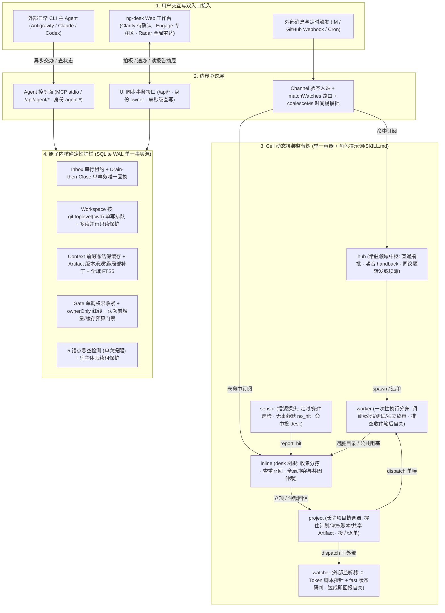
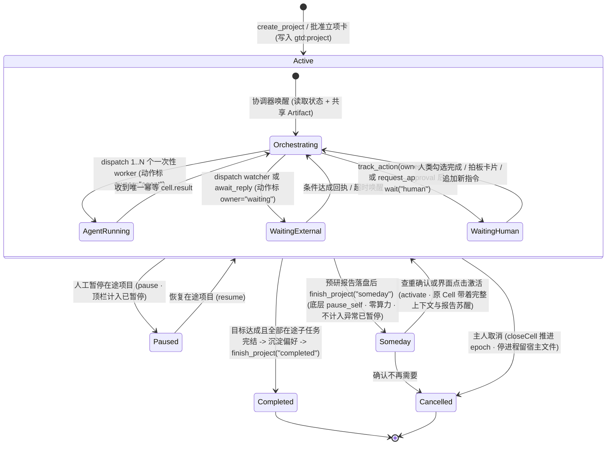

# 产品理想运行机制与状态流转总纲

> [!IMPORTANT]
> 本层文档属于**第二层：产品理想工作方式与用例推导（行为契约，严禁 Break）**。
> 本文档汇总全系统共用的角色拓扑、双层生命周期状态机、GTD 三视图投影规则与内核关键事务机制；具体业务场景的逐步推导详见同目录下的 `uc01` ～ `uc07`。

---

## 一、全链路系统拓扑：双入口 $\times$ 六类角色预设 $\times$ 六原语内核

### 六类内置 `Cell` 角色职责对照

| 预设名 (`preset`) | 生命周期 | 默认 `cwdMode` / 模型档位 | 核心职责与行为边界（源码见 [presets/src/index.ts](../../presets/src/index.ts)） |
| :--- | :--- | :--- | :--- |
| **`inline` (`desk`)** | 全局常驻单例（树根） | `read` / `strong` | 接待随手记、微事秒办、拟单次回复草稿、查重立项、集中裁决跨项目工作区冲突与公共阻塞；**绝不亲自下场跑慢活或改文件** |
| **`project`** | 随项目持久存活（可停靠 `someday`） | `read` / `strong` | 掌管单一结果的目标、分阶段计划、`gtd:action:*` 球权账本、`relay:context` 环境事实与共享 `Artifact`；重活一律派 `worker`，等外部一律派 `watcher` |
| **`worker`** | **一次性短命**（做完一棒即关） | 改码默认 `write`，调研/评审显式 `read` / `strong`（纯文本回写可用 `fast`） | 在指定目录专注完成一棒任务；动刀前验 `git status`，慢命令挂后台 `Job`，长文存 `Artifact`，调 `report_to_parent` 经排空检查后原子交卷关闭 |
| **`watcher`** | **一次性短命**（条件达成或终态失败即关） | `read` / 零 Token 脚本或 `fast` | 启动首轮即查当前事实状态；未达成则设提醒休眠（零算力驻留），识别在途自动重跑不误自毁，临近完成自适应缩短间隔，达成即回报父级 |
| **`sensor`** | 常驻周期/事件信源 | `read` / 零 Token 脚本或 `fast` | 挂在收件箱上游做巡检或周期草稿准备；99% 无异常时 `no_hit` 静默结束，命中才调 `report_hit` 投主台，绝不自建待办或对外发信 |
| **`hub`** | 常驻领域路由中枢（`desk` 子节点） | `read` / `strong`（或轻量路由） | 承接匹配 `watches` 的高频直通消息（带 `coalesceMs` 攒批）；维护 `hub:topics` 台账，合并同类请求、退回无关噪音（`handback`）、转发在途或续派新 `worker` |

---

## 二、双层解耦状态机：持久 `Project` 管资产 $\times$ 一次性 `Worker` 排空自关

### 2.1 项目级生命周期（`Project` `Cell`）

### 2.2 一次性 `Worker` 的「候选暂存 + 单事务排空自关（Drain-then-Close）」推导

为了彻底消灭「子分身刚调汇报工具，父级在毫秒差内发来追单被吞掉」或「崩溃重启导致双发/漏发回执」的经典分布式竞态，内核强制走以下确定性五步闭环（源码见 [dispatcher.ts](../../packages/cell/src/dispatcher.ts) 与 [comms.ts](../../packages/loop/src/tools/comms.ts)）：

1. **候选暂存不抢发**：`worker` 调用 `report_to_parent(result)` 时，工具仅把结果写入该 `worker` 自身状态（候选交付）并标记本轮结束，**不在工具内部直接往父收件箱发信**。
2. **先摘除运行句柄**：本轮 `Loop` 结束后，`Dispatcher` 先从内存活跃表摘除该 `Run`。
3. **单一 SQLite 事务原子裁决**：在同一个 `withTx` 数据库事务内检查该 `worker` 的收件箱与子树：
   - **分支 A（运行期间有新到的可唤醒追单 `wakeup > 0`，或名下仍有未关子分身）**：仅提交当前批次 `completeSync`，**不发旧回执、不关闭 `worker`**，立即拉起下一轮 `--resume` 消化新追单并刷新完整交付结果！
   - **分支 B（收件箱已排空且无未关下级）**：同一事务内提交 `completeSync`、以固定幂等键 `${cellId}:${epoch}:cell.result` 向父 `Cell` 投递**唯一最终结果**、并将自身状态置为 `closed`。
4. **运行态清场释放写锁**：异步执行 `workspace.stopRuntime` 确认残留后台进程退净后，释放该工作树的 `write` 调度槽位并唤醒下一位排队写者。
5. **关后追单同步明拒**：若 `worker` 已置 `closed` 后上级才发来 `send_message(to: "inbox:<workerId>")`，内核在同一事务内检测到 `closed` 并同步返回明确的未送达状态，上级凭手头完整的项目/议题台账无缝派生下一棒新 `worker`。

---

## 三、GTD 表层三视图与同步事务映射

| 视图 / 入口 | 人类看到与操作什么 | 底层投影与同步事务保证 |
| :--- | :--- | :--- |
| **顶栏状态与模型面板** | 活跃后端（`claude/codex/agy/api/demo`）、主力/轻量模型档位切换、运行中分身数、静默归档数 | 模型清单运行时动态向 CLI 查询；切换写入 `models.json`，从各 `Cell` 下一轮生效不中断在途工作；`auto` 模式下 `strong` 取旗舰高推理档、`fast` 取轻量/低推理档 |
| **`Clarify`（待确认收件箱）** | 单卡片逐张拍板（外部回复确认卡、复杂立项卡、阻塞/超限升级卡）；零副作用微事不进此处 | 单事项同一时刻至多 1 张活跃卡；点击确认直调同步事务核对 `seenArtifactVersion` 防盲发；`ownerOnly` 卡仅放行人类 `owner` |
| **`Engage`（专注工作区）** | 线下 `@Human` 速办一键勾选；重文档左 8（初稿编辑）右 4（参考资料包）双栏 | 勾选直走同步事务销账并投递唤醒信封；手改保存置 `updatedBy: "human"` 递增版本，后台旧版本更新自动 `park` 绝不覆盖手写稿；外部 `Channel` 非紧急通知暂存为 `buffered_dnd` |
| **`Radar`（项目全局与周回顾）** | 左栏：活跃项目行（球权徽章 + 一句话进展 + 报告抽屉 + 悬空标红）与 `Someday` 停靠区（带**完整报告阅读抽屉**）；右栏：15 分钟周回顾与技能提议 | 5 锚点全空标 `stalled` 并仅发单次 `kernel.stalled_check`；`Someday` 独立展示不混入异常“已暂停”计数；周回顾只展示项目级完结成果与人类完结项，过滤在途项目内部子步骤 |

---

## 四、全局基础不变量（全系统任何改动不得破坏）

- **`INV-SYS-01`（单会话串行锁）**：任意时刻同一个 `cellId` 最多只有 1 个活跃 `Run` 持有认领租约。
- **`INV-SYS-02`（五锚点防悬空且不自激）**：活跃未暂停项目失去全部 5 类锚点时必被检出，且 `kernel.stalled_check` 绝不构成伪锚点引发无限唤醒死循环（回归测试：[packages/cell/test/docs05-anchors.test.ts](../../packages/cell/test/docs05-anchors.test.ts) / [apps/gtd-desk/test/projections.test.ts](../../apps/gtd-desk/test/projections.test.ts)）。
- **`INV-SYS-03`（排空唯一交卷）**：一次性 `worker` 绝不在尚有待领 `wakeup` 消息时提前关闭丢单，也绝不向父节点重复投递两份最终 `cell.result`（回归测试：[packages/cell/test/docs05-settle.test.ts](../../packages/cell/test/docs05-settle.test.ts) / [packages/cell/test/dispatch.test.ts](../../packages/cell/test/dispatch.test.ts)）。
- **`INV-SYS-04`（预算零吞信封与单次联调续费）**：触及预算硬上限时不得吞没未送达模型的入站信封，且人类点一次续费即可打通当前受阻祖先链（*注：当前存在待修偏差，详见 `BUG-001` ～ `BUG-003`*）。
