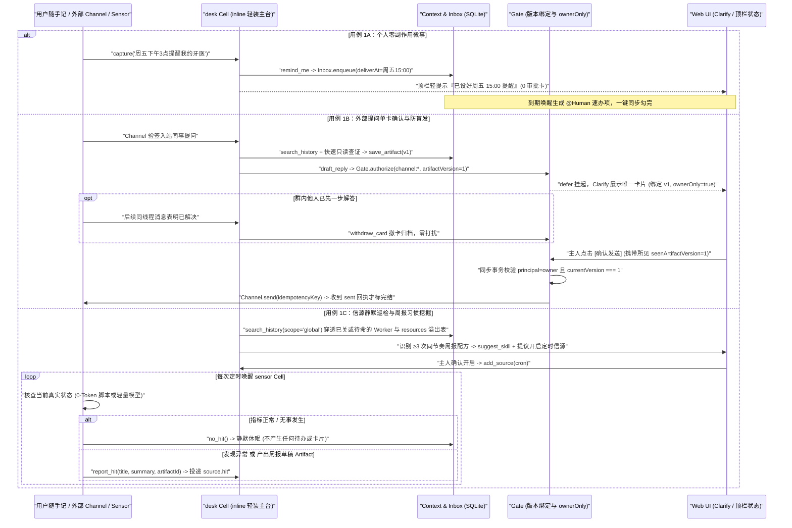

# 用例 1：随手记微事直办、外部提问单卡回复与定时/习惯信源

> **遵循原则**：`P-UX-1`（极简无黑话）、`P-UX-3`（信源与待办分离）、`P-UX-4`（微事免卡、正事备初稿）、`P-SAFE-4`（外发锁死人类 `owner`）、`P-SAFE-5`（草稿版本号防盲发）

---

## 一、覆盖的真实用户用例

1. **用例 1A（零副作用个人微事）**：
   - 用户随手输入：*“把 `https://opentelemetry.io/docs/languages/js/` 存进阅读清单，APM 选型要看”* 或 *“周五下午 3 点提醒我给牙医打电话”*。
   - **理想体验**：1～2 秒内办妥，顶栏给一句轻提示；到周五下午 3 点准时浮出一条 `@Human` 速办项。**全程绝不在 `Clarify` 弹确认卡逼用户再点一次“同意保存”**。
2. **用例 1B（外部同事提问与单卡版本保护回复）**：
   - 飞书/IM 收到同事提问：*“上周网关限流阈值最后定的是多少？为啥这么定？”*
   - **理想体验**：工作台先在后台检索历史记录与代码，拟好带依据的回复初稿 `v1`，在 `Clarify` 挂出 **1 张**确认卡。若用户口述“语气再客气点，补上压测链接”，原卡就地升为 `v2`；若等待期间群里别人已经替你答了，卡片自动撤下归档；若点击发送瞬间后台刚收到补充消息刷新了 `v3`，系统拦截提示重看一眼，绝不盲发未审过的新版。
3. **用例 1C（定时巡检信源与历史周报习惯挖掘）**：
   - **日常巡检**：挂一条“每周一 9:00 检查核心错误率指标”信源——指标正常时彻底无感，不占项目列表一行位置；指标异常才投递事件。
   - **周报习惯自动发现**：用户每周固定写周报，曾在多个历史会话里拉过代码提交、飞书文档与看板数据。工作台穿透检索全局历史与长工具输出，定位固定数据源与结构，**先向用户提议**固化为 `SKILL.md` 与周会前定时信源；获准开启后，每周会前自动备好周报初稿出卡待审。

---

## 二、一步一步推导如何实现功能

### 逐步推导细节

1. **为什么用例 1A 能做到秒回且免卡？**
   - `desk` 预设默认不挂载重型写代码沙箱，收到随手记直接走 `capture_note`（写 `Context` 笔记）或 `remind_me`（按主人所在时区换算时间戳，写入 `Inbox` 原生 `deliverAt` 列）。
   - `Gate` 授权策略明确区分「内部个人状态更新」与「对外副作用」：前者直接 `allow`，因此零审批卡、2 秒内结束回合进入休眠。
2. **为什么用例 1B 不会发重、不会盲发、也不会被外部 Agent 越权代点？**
   - **单事项单卡**：`draft_reply` 将回复正文存入 `VersionedArtifact`（`v1`），卡片记录绑定该 `artifactId`；口述微调时更新同一份 `Artifact` 为 `v2` 并复用同一张卡片。
   - **版本防盲发**：前端渲染卡片时记录当前看到的 `version`；点击确认调用同步事务 `Gate.approve(actionId, "owner", seenVersion)`——若数据库里版本已变成 `v2` 而用户刚看到的是 `v1`，事务立即返回 `version_mismatch` 拒绝外发并刷新界面。
   - **身份硬隔离与诚实回执**：目标为外部 `channel:*` 的卡片标记 `ownerOnly: true`，外部主 Agent 调 `decide_card` 会被硬拒；`Channel.send` 若遇到网络超时返回 `unknown`，卡片如实保留并提示核实，绝不伪造“发送成功”也不盲目重发造成群聊刷屏。
3. **为什么用例 1C 能从历史会话里捞出周报配方，且平时不污染待办？**
   - **全域含溢出表检索**：早期会话查询飞书/Git 的长输出往往超过内联阈值溢存至 `resources` 表，且执行拉数的 `worker` 早已结束（待命或随项目归档）。`Context.searchHistory(scope: "global")` 同时建立对所有子孙（含已关闭的）`evidence`、`artifacts`、`cell_state` 与 `resources` 正文的 `FTS5` 索引，再用 `read_resource` 还原完整命令与数据结构。
   - **先请示后挂信源**：按 `habit-and-routine-discovery` 技能规范，未满 3 次只记笔记观察；满 3 次先拟好技能并弹卡请示主人，绝不私自开启定时推送。
   - **信源隔离**：`sensor` 只有 `no_hit` 与 `report_hit` 出口，没有创建项目或外发消息权限，从架构上根除了“定时巡检变成勾不完的僵尸待办”。

---

## 三、不可破坏的不变量（MUST NOT BREAK）

- **`INV-UC01-01`（个人微事零卡片）**：主人本人的零外部副作用操作（存笔记/链接、设个人提醒、静默归档纯通知）严禁产生待确认审批卡。
- **`INV-UC01-02`（信源静默不建待办）**：`sensor` 信源未命中目标时（`no_hit`）不得往 `desk` 投递消息，更不得在 `Radar` 项目列表或 `Engage` 待办列表中留下任何条目。
- **`INV-UC01-03`（外发版本一致与人类专属放行）**：任何发往非主人外部地址的消息必须经 `Gate` 审批、由 `owner` 身份放行，且 `seenArtifactVersion` 不匹配时必须拦截返回 `version_mismatch`。
- **`INV-UC01-04`（全域检索穿透已关分身与长输出）**：`search_history(scope: "global")` 必须能命中已关闭或待命 `worker` 的轨迹及溢存至 `resources` 表中的超长工具输出中间段落。

---

## 四、源码落点与回归测试锚点

- **核心源码**：
  - 主台分拣与微事工具：[presets/src/inline-desk/toolset.ts](../../presets/src/inline-desk/toolset.ts)、[presets/src/inline-desk/items.ts](../../presets/src/inline-desk/items.ts)
  - 信源预设与习惯发现技能：[presets/src/shared/sensor.ts](../../presets/src/shared/sensor.ts)、[presets/src/shared/skills.ts](../../presets/src/shared/skills.ts)
  - 版本审批与全域检索：[packages/gate/src/gate.ts](../../packages/gate/src/gate.ts)、[packages/context/src/search.ts](../../packages/context/src/search.ts)
- **自动化回归测试（修改相关代码必跑）**：
  - [presets/test/sources-and-quick-items.test.ts](../../presets/test/sources-and-quick-items.test.ts)（信源静默与命中、微事直办免卡）
  - [presets/test/replies.test.ts](../../presets/test/replies.test.ts)（单卡回复、口述改稿、他人已答撤卡、版本校验外发）
  - [packages/gate/test/authorize.test.ts](../../packages/gate/test/authorize.test.ts)、[packages/context/test/search.test.ts](../../packages/context/test/search.test.ts)
