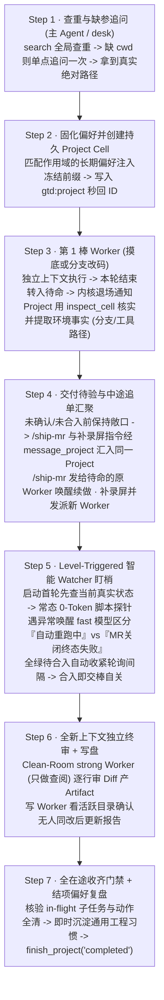

# 用例 2：`/todo` 代码交付、多棒接力、零算力盯梢 CI 与独立终审闭环

> **遵循原则**：`P-UX-2`（双入口异步秒回）、`P-UX-7`（偏好即时沉淀）、`P-KERN-1`（持久 `Project` $\times$ 可唤醒叶节点 `Worker`）、`P-KERN-3`（Level-Triggered 状态监听）、`P-KERN-4`（`0-Token / fast / strong` 算力分级）、`P-KERN-6`（独立无偏见终审）

---

## 一、覆盖的真实用户用例

### 用例 2A：日常特性修改与中途连续追单（TUI 表格复制场景）
1. 用户输入 `/todo 修改 markdown 表格复制时复制 markdown 源码格式而不是 Unicode 制表符`（未提供仓库路径）。
2. 主 Agent / 主台查重确认无重复项目后，因缺本地代码库绝对路径**先简短追问一次**（绝不瞎猜路径）。
3. 用户给出路径后立即立项，后台第 1 棒 `worker` 在新特性分支完成修改与本地测试，本轮结束转入待命（内核通知项目）；项目核实其足迹后生成 `验收` 待办通知用户，**保持项目敞口不提前关单**。
4. 用户看后追加：*“继续用 `/ship-mr` 跟进，以后改完代码都这样”* $\rightarrow$ 规则即时存为长期偏好，项目把这一步发给第 1 棒那个已熟悉分支的待命 `worker`（沿原会话唤醒，复用本机 CLI 环境推分支提 MR），并挂上 `watcher` 盯 MR 合入。
5. MR 等待合入期间，用户又追加：*“觉得验证不够充分，补录个屏”* $\rightarrow$ 同一项目并发派一个新 `worker` 补录屏。
6. 哪怕 MR 在录屏跑完前就合入了，项目也必须**等补录屏 `worker` 本轮结束**后，才统一汇总结项。

### 用例 2B：跨机重型研发 5 棒接力与独立铁面终审（`trae-x !5408` 尾补丁收官场景）
1. 后台项目跟进远端开发机正在收尾的补丁：第 1 棒只读 `worker` 摸清远端在途门禁进程与工具绝对路径，沉淀进项目上下文。
2. 第 2、3 棒 `watcher` 接力盯梢本地门禁完成与云端 23 项 CI 合入：常态用**零 Token 脚本探针**轮询；遇单轮历史抖动失败时由 **`fast` 轻量模型**识别出“发布方已在自动重跑/推新版”而继续保持监听（绝不误报失败断链）；23 项全绿进入合入窗口时**自动从 300s 缩短至 60s 紧盯**，合入后 1 分钟内交棒。
3. 第 4 棒派生**全新无历史包袱的 `strong` 只读终审 `worker`**，对照团队五项硬清单逐行审计合入 Diff，揪出隐蔽边界缺陷如实报告（拒绝盲签 `PASS`）。
4. 第 5 棒派一个写分身（派单前看 `[active workspaces]`，确认无人正在改本机文档目录），非破坏性更新本地报告并同步项目级终审 `Artifact`，圆满结项。

---

## 二、一步一步推导如何实现功能

### 关键环节机制推导

1. **单点追问契约（防主台与项目双重提问）**：
   - 涉及代码修改的任务必须有宿主机真实存在的目录路径 `cwd`。
   - 若外部主 Agent 在立项前追问，则拿到路径后再调 `create_project`；若经 `capture` 由 `desk` 追问，在收到答复前不拉起 `project`（或已交棒后只由 `project` 追问）——遵守 `One asker per question`，绝不让两个角色同时问用户同一句话。
2. **接力棒里的「环境事实传递」（消除子分身重复盲搜）**：
   - 新派出的 `worker` 与 `watcher` 看不到父协调器的历史对话（被唤醒的原 `worker` 只记得它自己那几轮）。
   - 第 1 棒查明的分支名、提交 SHA、远端 CLI 路径（如 `/home/.../.local/bin/codebase`）、证据目录与 `artifactId` 由 `project` 协调器经 `inspect_cell` 核实后提炼进自身状态与白板笔记，并在后续每次 `dispatch` 的「现场 / 材料」栏显式下发（`watcher` 继承项目目录，仓库、远端与工具就在手边），使后续各棒零 `find / which` 试错直奔主题；同一件事的下一步（如 `/ship-mr`）则直接发给熟悉现场的原 `worker`。
3. **Watcher 的三级省算力与防误毁状态机**：
   - **首轮先看事实（Level-Triggered）**：哪怕 MR 在 `watcher` 启动前 3 秒已经闪电合入，第 1 轮检查 `mergedAt` 立即命中回报，零时序死角。
   - **单一定时源 + 零算力探针**：常态轮询优先由零 Token 脚本探针执行轻量检查，未就绪直接按单一计划重置下次唤醒（避免 `schedules.idleSec` 与 `set_reminder` 双定时器互抢空转）；全绿可合入时自动收紧检查间隔。
   - **瞬态重跑免死判定**：CI 单项挂红但 MR 仍 `open` 且重跑已在途或新 commit 已推送时，属于「自愈进行中」，`watcher` 必须更新快照继续守候；仅当 MR 被关闭不合入、目标分支被删或超过明确截止时间才报 `status: "failed"`。
4. **为什么“先合入后录完屏”不会提前把录屏任务杀掉？**
   - `closeCell(projectId)` 会推进 `epoch` 并级联终止整棵子树。
   - 因此 `project` 协调器在调 `finish_project("completed")` 前必须执行**完结门禁核查**：同时检查客观终点已达成 **且** `[in-flight child cells]` 中没有在忙的子节点、未完结动作全部清零——只要补录屏 `worker` 仍在跑，协调器先销掉“等 MR 合入”动作并继续等它本轮结束的通知，再统一结项。已待命的 `worker` 不算在途：它们不挡结项，随项目以 `completed` 归档；内核在结算 `complete_self` 时同样只拦在忙的子节点。
5. **结项即时偏好沉淀（不等周五）**：
   - 收尾前协调器回看本轮用户是否补提了通用流程（如“用 `/ship-mr` 提 MR”、“提完补录屏”），先搜已有偏好去重合并，再将剥离具体任务名的纯规则存入长期偏好，下一个代码项目首轮即自动照办。

---

## 三、不可破坏的不变量（MUST NOT BREAK）

- **`INV-UC02-01`（无路径不盲开代码单）**：代码修改类任务未获得宿主机真实目录路径前，严禁臆造路径启动写代码 `worker`。
- **`INV-UC02-02`（本地提交不等于结项）**：代码仅提交在本地分支或刚提 MR 尚未合入/验收时，`project` 严禁调 `finish_project` 关闭自身，必须保留项目承接后续追单。
- **`INV-UC02-03`（在途子任务未清禁结项）**：只要项目名下仍有在忙的 `worker`（运行中、有待领消息、有 `Job`、在等待或挂卡）、仍在监听的 `watcher`，或已承接未完成的并行动作，严禁提前结项触发子树级联误杀；已待命的 `worker` 不在此列（见 `INV-SYS-07`）。
- **`INV-UC02-04`（Watcher 先看当前状态且不因在途重跑误自毁）**：监听启动首轮必查当前事实（秒合入亦能捕获）；MR 仍处于活跃重跑/更新中时不得误报终态 `failed`。
- **`INV-UC02-05`（轻量监听不占旗舰高推理档）**：`watcher` 状态研判与简单回写声明 `modelTier: "fast"` 时，底层必须路由至轻量/低推理档而非旗舰 `@xhigh`。

---

## 四、源码落点、回归测试与当前待修偏差

- **核心源码**：
  - 项目协调与接力工具：[presets/src/project/toolset.ts](../../presets/src/project/toolset.ts)、[presets/src/shared/prompts.ts](../../presets/src/shared/prompts.ts)、[presets/src/shared/skills.ts](../../presets/src/shared/skills.ts)
  - 模型档位与 CLI 执行循环：[packages/cell/src/models.ts](../../packages/cell/src/models.ts)、[packages/loop/src/cli/loop.ts](../../packages/loop/src/cli/loop.ts)
- **自动化回归测试（修改相关代码必跑）**：
  - [presets/test/scenario-code-change.test.ts](../../presets/test/scenario-code-change.test.ts)（`/todo` 缺路径追问 $\rightarrow$ 改码 $\rightarrow$ 追加 `/ship-mr` 与录屏 $\rightarrow$ MR 早合入等录屏完再结项 $\rightarrow$ 存偏好）
  - [presets/test/watchers.test.ts](../../presets/test/watchers.test.ts)
  - [packages/cell/test/wakeable.test.ts](../../packages/cell/test/wakeable.test.ts)（待命 `worker` 不挡结项、随项目归档，在忙的 `worker` 挡结项）
- **当前待修实现偏差（详见 [03-bugs](../03-bugs/README.md)）**：
  - `BUG-005` 子项 1 余项（零 Token 脚本探针已落地，但探针结果变化或异常时唤醒 `fast` 模型研判未做：命令判定不了的情况一律以失败结果交回项目，由项目协调器自行决断）。
