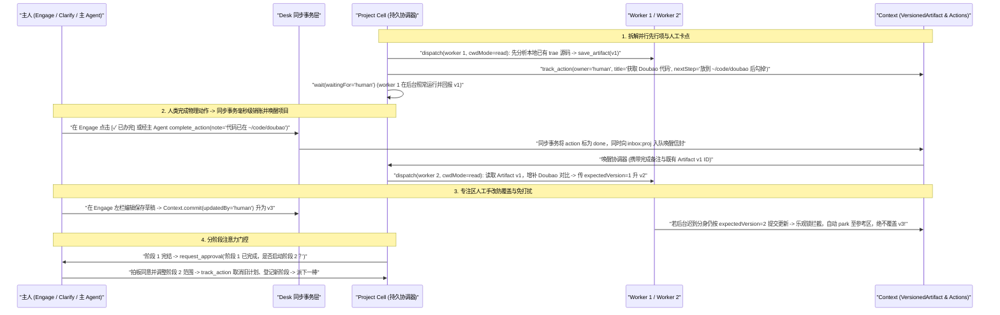

# 用例 3：人机接力卡点、专注工作区双栏防覆盖与分阶段注意力门控

> **遵循原则**：`P-UX-5`（动作球权三分明晰）、`P-UX-6`（专注工作区防覆盖与免打扰）、`P-KERN-2`（UI 勾选/改稿直走同步事务）、`P-KERN-5`（共享版本化 `Artifact` 与局部修订）、`P-SAFE-5`（人工手改稿零覆盖）

---

## 一、覆盖的真实用户用例

1. **用例 3A（部分可先行、部分等主人拿外部材料 + 多轮升版报告）**：
   - 会议纪要要求做「`trae` 与 `Doubao work` 的 Harness 架构对比报告」：本机已有 `trae` 源码，但 `Doubao work` 源码需要主人向同事索取。
   - **理想体验**：立项后**不等全部材料备齐**——后台立即派只读 `worker 1` 先把本地 `trae` 分析完写成报告 `Artifact v1`；同时在主人待办列表挂一条清晰的 `🔵 我来处理` 动作（*“向同事要到 Doubao work 代码放到 `~/code/doubao` 后勾掉”*）。等主人勾掉该动作（或放到指定目录被探针发现），项目立即自动苏醒，派 `worker 2` 在 `v1` 基础上增补 `Doubao` 对比章节升为 `v2`。主人审阅后提补充要求，继续在同一份报告上升为 `v3`。
2. **用例 3B（专注工作区左 8 右 4 深度改稿与免打扰保护）**：
   - 主人在 `Engage` 专注区打开一份技术方案初稿手动修改核心取舍段落，期间外部群聊不断有非紧急通知进来，且后台某分身刚好跑完补充数据尝试更新这份草稿。
   - **理想体验**：外部非紧急通知被 `Channel` 静默缓冲（顶栏提示暂存数，绝不弹窗打断思路），而后台父子 `Cell` 内部消息照常流转；主人保存手改稿升为 `v2 (human)`，后台分身基于旧版 `v1` 的写入绝不覆盖主人手写文字，而是安全旁路暂存到右侧参考区。
3. **用例 3C（大型多阶段项目的人类注意力门控）**：
   - 一个拆成 3 个阶段推进的大改造项目：机器算力明明可以一口气并发改完 3 个阶段，但人类一次只能审得过来 1 个阶段。
   - **理想体验**：跑完阶段 1 后，协调器主动弹卡汇报阶段 1 成果并询问是否开启阶段 2；若主人此时调整了后续范围（砍掉阶段 3、改写阶段 2），协调器当场同步更新动作账本，严格按主人新计划推进。

---

## 二、一步一步推导如何实现功能

### 关键环节机制推导

1. **为什么主人勾掉 `@Human` 动作不调大模型就能秒级响应，同时又能唤醒后台项目？**
   - Web UI 的勾选按钮与 MCP 的 `complete_action` 都直调 `notifyProjectOfOwnerChangeSync`（见 [sync.ts](../../presets/src/shared/sync.ts) 与 [desk.ts](../../apps/gtd-desk/src/server/desk.ts)）：在单个 SQLite 同步事务里把 `gtd:action:<id>` 标为 `done`（前端毫秒级刷新），并往所属 `project` 的 `Inbox` 写入一条带备注的事件信封。
   - `project` 原本挂在 `(cellId, "human")` 上的内部等待锚点收到目标事件自动销账，下一拍被 `Dispatcher` 唤醒续派 `worker 2`。
   - **双保险探针**：若外部材料落地路径已知（如 `~/code/doubao`），协调器可同时挂一个检查 `test -d ~/code/doubao` 的轻量 `watcher`——就算主人拿回代码忘了点网页勾选，项目也能自动感知继续推进。
2. **多棒协作更新同一份报告为什么不会丢标题、丢前文或引发分页风暴？**
   - `Artifact` 已解除“创建者 `Cell` 独占”限制，任何后续 `worker` 只要传入读取时的 `expectedVersion` 即可合法修订升版；未重传 `title` 时内核自动继承上一版标题（`COALESCE`）。
   - 对于数万字长报告的局部增补，分身调用局部修订工具 `patch_artifact(artifactId, expectedVersion, patches)` 按章节锚点打补丁，无需分几十页通读全文再重吐一遍。
3. **专注期免打扰（DND）为什么不会把后台项目自己的子任务卡死？**
   - 内核物理隔离了 **`Channel`（对外对人通信）** 与 **`Inbox`（同库跨 `Cell` 内部通信）**：专注模式开启时，仅外部 `Channel.send(respectDnd: true)` 返回 `buffered_dnd` 暂存非紧急通知；`worker -> project` 的 `cell.result` 走 SQLite `Inbox` 直投，0 延迟推进。

---

## 三、不可破坏的不变量（MUST NOT BREAK）

- **`INV-UC03-01`（局部缺材料不阻塞已就绪分支）**：当项目仅有部分前置条件依赖人类时，不依赖该条件的可执行分析/准备工作必须先行启动，不得全盘干等。
- **`INV-UC03-02`（人工动作销账必唤醒所属项目）**：无论通过 Web UI 勾选还是通过外部主 Agent 调 `complete_action` 修改项目动作账本，必须可靠唤醒对应持久 `Project` `Cell`。
- **`INV-UC03-03`（人工改稿绝对优先，零静默覆盖）**：对已有 `Artifact` 的任何 Agent 更新必须强制校验 `expectedVersion`；遇到人工修改版本冲突时必须保留人工版本并将后台更新旁路 `park`，且更新未传标题时严禁抹空原标题。
- **`INV-UC03-04`（分阶段项目单阶段在途门控）**：声明多阶段（`phases`）的项目，未经主人确认当前阶段卡片，严禁自行启动下一阶段；主人变更计划后同轮必须将废弃旧动作标为 `cancelled`。
- **`INV-UC03-05`（专注期免打扰仅缓冲外部通知）**：开启专注模式只缓冲外部 `Channel` 非紧急通知，严禁阻塞内部 `Inbox` 跨 `Cell` 消息投递。

---

## 四、源码落点、回归测试与当前待修偏差

- **核心源码**：
  - 人工动作同步唤醒：[presets/src/shared/sync.ts](../../presets/src/shared/sync.ts)、[apps/gtd-desk/src/server/desk.ts](../../apps/gtd-desk/src/server/desk.ts)
  - 版本化产物存储与乐观锁：[packages/context/src/artifacts.ts](../../packages/context/src/artifacts.ts)、[packages/loop/src/tools/context.ts](../../packages/loop/src/tools/context.ts)
  - 免打扰缓冲：[packages/channel/src/](../../packages/channel/src)
- **自动化回归测试（修改相关代码必跑）**：
  - [presets/test/scenario-human-step.test.ts](../../presets/test/scenario-human-step.test.ts)（部分先行 + `@Human` 等待 + 勾完续跑升版报告 + 补充要求迭代）
  - [presets/test/scenario-someday.test.ts](../../presets/test/scenario-someday.test.ts)（分阶段门控与中途改计划同步账本）
  - [packages/context/test/artifacts.test.ts](../../packages/context/test/artifacts.test.ts)
- **当前待修实现偏差（详见 [03-bugs](../03-bugs/README.md)）**：
  - `BUG-006`（`save_artifact` 升版省略 `title` 时误抹成 `NULL`；尚缺局部锚点修订工具 `patch_artifact` 导致超长报告分页读写风暴）。
