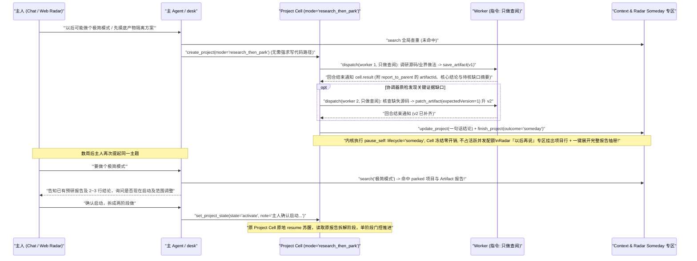

# 用例 4：远期想法预研停靠（`research_then_park`）、协调器质检补证与跨周查重唤醒

> **遵循原则**：`P-UX-4`（消灭中长期技术债空白页）、`P-UX-6`（`Someday` 独立展示与报告抽屉）、`P-KERN-1`（持久 `Project` 上下文冻结保留）、`P-KERN-5`（精炼报告与局部修订）、`P-SAFE-2`（「只做查阅」是协调器下达的指令，查阅不等于禁止 `git fetch`）

---

## 一、覆盖的真实用户用例

1. **用例 4A（随口远期想法 $\rightarrow$ 免追问预研停靠 $\rightarrow$ 数周后重提查重召回）**：
   - 用户最近在意 Token 开销，随手输入 `/todo 以后可能要做个极简模式，先记一下`。
   - **理想体验**：系统识别出这是暂不开工的远期想法，**不追问代码路径**，立即以 `mode: "research_then_park"` 启动后台项目：派只读 `worker` 调研业界做法写成结构化方案报告 `Artifact`，随后自动停靠进 `以后再说（Someday）`（零驻留开销，网页上随时可点开阅读抽屉看全文）。
   - 两周后用户忘了这事，又说 `/todo 要做个极简模式`。系统全域检索命中停靠项，**绝不静默重复立项，也绝不未经确认直接开写代码**——而是先用两三句话告诉用户已有报告核心结论，询问是否现在按该方案或调整后分阶段开工；获确认后原地激活原 `Project` `Cell`，无缝进入分阶段执行。
2. **用例 4B（重型技术债摸底 + 协调器质检两棒补证：`trae-x` 产物隔离与回迁雷达场景）**：
   - 晚间把「公开版与企业版发行二进制内部信息隔离方案」和「重算 12 模块上游数千笔提交回迁雷达」两项技术债设为 `research_then_park`。
   - **理想体验**：只读 `worker` 正常执行远端只读 `git fetch`、部分克隆按需取对象与三方合并探针，写出高密度结构化报告（对上千条测试命中仅输出聚合统计与分类规则，绝不往报告末尾倾倒百 KB 原始测试路径垃圾）。若协调器审阅摘要发现某几处关键分支尚缺源码实证，精准加派第 2 棒补证 `worker` 用 `patch_artifact` 增量补齐升 `v2`，再干净归入 `someday`。

---

## 二、一步一步推导如何实现功能

### 关键环节机制推导

1. **为什么 `someday` 底层必须用“暂停保留原 `Cell`”而不是“关闭销毁重建”？**
   - 早期若在停靠时 `closeCell`，再次激活就只能删状态另起炉灶，前置调研沉淀的推理脉络与状态全断。
   - 现在 `finish_project({ outcome: "someday" })` 触发内核回合末钩子 `pause_self`：将 `gtd:project.lifecycle` 设为 `"someday"` 并将 `cells.status` 置为 `"paused"`（且内核明确将停靠容器排除在 `maxConcurrentChildren` 活跃配额之外，攒 100 个停靠想法也不会堵死新立项）。
   - 同时保留向后兼容：若遇到旧数据库里已 `closed` 的历史停靠项，`activate` 自动新建持久 `Project` 并完整继承旧提案与全部历史 `Artifact` 列表，绝不删除历史记录。
2. **为什么 Web UI 和控制面必须把 `someday` 与普通 `paused` 严格区分，并直接透出报告抽屉？**
   - **语义分离**：「在途项目被主人临时点暂停」（`lifecycle === "active" && status === "paused"`）是需要留意的挂起态；而「预研完停靠进车位」（`lifecycle === "someday"`）是正常的长期储备态——前端不能给停靠项同时贴上「已暂停 + 以后再说」两个徽章，顶栏也不应把停靠项算进异常暂停计数；控制面激活停靠项统一走 `activate` 动作。
   - **打通阅读闭环**：`research_then_park` 不弹审批卡也不建 `@Human` 动作，唯一交付物就是项目的 `Artifact` 报告——因此 `Radar` 投影 DTO 必须携带项目的 `artifacts` 元数据并在项目行提供一键展开的报告阅读抽屉，不能让用户看着两行截断摘要干瞪眼。
3. **只读调研指令为什么严禁异化为“禁止 `git fetch` 与 `GIT_NO_LAZY_FETCH=1` 自虐”？**
   - 只读原则保护的是**主人工作树与分支现场不被篡改**，而非禁止 Git 正常读取远端元数据。
   - 提示词契约明确：只读调研允许执行只读 `git fetch` 更新跟踪引用、允许部分克隆（promisor）按需拉取缺失对象、允许写 `/tmp` 临时分析文件；报告正文坚持“结论与关键路径先行，海量测试/快照命中只给聚合统计与规则”，杜绝百 KB 附录倾倒。

---

## 三、不可破坏的不变量（MUST NOT BREAK）

- **`INV-UC04-01`（预研停靠保上下文且零配额占用）**：`research_then_park` 完成后必须将项目置为 `someday` 停靠态，保留原持久 `Project` `Cell` 与全部 `Artifact`，且停靠期间零定时唤醒、不占用活跃子并发配额。
- **`INV-UC04-02`（重提停靠项必先告知询问，严禁静默双开或盲目直跑）**：主人再次提及已有 `someday` 项目的主题时，必须先检索召回旧报告核心结论并向主人确认，严禁直接新建第二个重复项目，也严禁在模糊提及时不经确认直接激活改代码。
- **`INV-UC04-03`（网页端停靠报告直读可达）**：停靠在 `Radar`「以后再说」专区的项目必须在 Web UI 上直接提供完整 `Artifact` 报告阅读入口，且状态展示与在途人工暂停严格区分。
- **`INV-UC04-04`（旧库停靠项无损迁移）**：激活历史已关闭的旧版停靠记录时，必须完整继承原提案与报告启动新项目，严禁清空旧记录。

---

## 四、源码落点、回归测试与当前待修偏差

- **核心源码**：
  - 项目启停与旧库兼容：[apps/gtd-desk/src/server/desk.ts](../../apps/gtd-desk/src/server/desk.ts)、[presets/src/project/launch.ts](../../presets/src/project/launch.ts)
  - 雷达视图投影与前端组件：[apps/gtd-desk/src/server/projections/radar.ts](../../apps/gtd-desk/src/server/projections/radar.ts)、[apps/gtd-desk/src/web/views/Radar.tsx](../../apps/gtd-desk/src/web/views/Radar.tsx)
- **自动化回归测试（修改相关代码必跑）**：
  - [presets/test/scenario-someday.test.ts](../../presets/test/scenario-someday.test.ts)（预研停靠 $\rightarrow$ 重提先告知询问 $\rightarrow$ 原项目恢复分阶段推进）
  - [apps/gtd-desk/test/projects.test.ts](../../apps/gtd-desk/test/projects.test.ts)（停靠激活与旧库已关闭停靠项无损迁移）
- **当前待修实现偏差（详见 [03-bugs](../03-bugs/README.md)）**：
  - 无待修条目（原列条目已于 2026-11-19 修复）；`BUG-010` 的 `Radar` 报告阅读抽屉尚未在真实浏览器中目视验证（构建环境无浏览器）。
