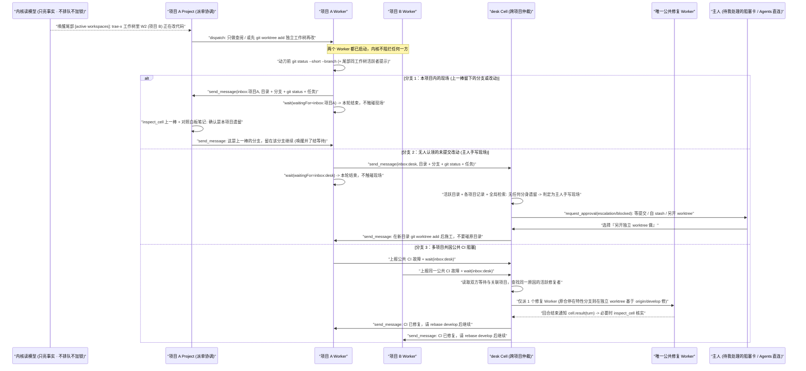

# 用例 5：同工作树 AI 目录协同、冲突上报停手、主人脏现场保护与共因阻塞集中仲裁

> **遵循原则**：`P-SAFE-1`（真实目录零误删）、`P-SAFE-2`（内核只亮活跃目录事实，谁在哪干由协调器决定）、`P-SAFE-3`（动刀前验现场、冲突上报等待、主人未提交现场神圣不可侵犯）、`P-KERN-1`（父节点主动 Pull 核实）

---

## 一、覆盖的真实用户用例

1. **用例 5A（同一仓库多路并发：查阅照常并行，改动由协调器分工）**：
   - 三个后台项目同时指向 `/Users/ar8327/dev/trae-x`：前两路做跨模块源码调研与独立代码审计，第三路要改代码，随后第三路所在项目又要求在同一仓库的子目录改另一处代码。
   - **理想体验**：内核不排队，所有分身派出即启动。每个协调器派单前都在唤醒尾部看到 `[active workspaces]`——谁此刻在哪棵工作树里、属于哪个项目、在做什么：调研与审计照常派出，指令写明「当前有人在这个仓库改代码：只做查阅，不要改文件、不要切分支」；第二处改动若与在跑的那一棒相关，就发给那个 `worker` 顺手做（或等它本轮结束再派下一棒），若确需并行，就让新 `worker` 用 `git worktree add` 在独立工作树里改。两处改动分属不同项目时，由 `desk` 在两份任务书里定分工或先后。
2. **用例 5B（撞见主人正在手写的一半未提交改动）**：
   - `worker` 准备改代码，一跑 `git status` 发现工作树里躺着主人半小时前手写但还没 commit 的代码。
   - **理想体验**：分身**绝对不碰这批改动**（不 `stash`、不 `checkout -f`、不 `reset`），立即把现场发给 `desk`（无人认领的改动明显不属于本项目）并 `wait` 结束本轮；`desk` 核查全局记录确认不是任何分身留下的，向主人弹出一张清晰的阻塞选择卡（*等你提交完再继续 / 你自己 stash 后继续 / 让分身另开独立 worktree 做*），按主人拍板答复该分身。主人也可以直接在 `Agents` 视图里对这个分身说「另开 worktree 做」——这句话本身就是答复。
3. **用例 5C（多项目同时被同一公共 CI / 共享依赖挂死——共因单点修复与批量唤醒）**：
   - 项目 1（做新特性）和项目 2（修历史 Bug）各自的 `worker` 在跑门禁时，同时撞上主干 `develop` 公共 lint 检查坏了。
   - **理想体验**：两个分身不各自乱改公共配置互踩，而是双双上报 `desk` 并等待；`desk` 识别出是同一个公共阻塞因，按共同原因及各自等待标识关联两个项目，**只派 1 个公共修复 `worker`**（若原目录停在特性分支，指示其在独立临时 worktree 基于远端主干修复）；修复者本轮结束的通知到达后，`desk` 必要时用 `inspect_cell` 核实，再逐一发信唤醒两个等待中的分身执行 `rebase develop` 继续完活。

---

## 二、一步一步推导如何实现功能

### 关键环节机制推导

1. **为什么内核只亮事实、不为工作树排队加锁？**
   - 主人随时可能直接让一个原本只查日志的分身「顺手把这行修了」，待命的 `worker` 随时会被消息唤醒：事先声明读写并在内核排队，要么挡住主人的直接指令，要么让排队者带着过时的假设开工。锁也代替不了判断——两个分身改不同文件可以并行，改同一处即使排队也会在语义上互相覆盖。
   - 内核能确定性做到的是**把事实亮出来**（源码见 [readmodel.ts](../../packages/cell/src/readmodel.ts) 的 `activeWorkspaces` 与 [workdir.ts](../../packages/cell/src/workdir.ts) 的 `workTreeKey`）：有在跑 `Run` 或运行中后台 `Job` 的 `Cell`，按 `git rev-parse --show-toplevel` 归入工作树（`/repo` 与 `/repo/packages/ui` 是同一棵，同一仓库的两个独立 `git worktree` 是两棵；非仓库目录取真实路径），附带所属项目、标题与状态行；被关闭 `Cell` 的 `Job` 在进程组确认退净前仍计入。协调器的唤醒尾部看到全部工作树，叶节点只看到「与你同一工作树里还有谁在干活」——它是信息，不是锁。
2. **协调器怎么分（提示词契约，见 [prompts.ts](../../presets/src/shared/prompts.ts) 的 `project` §2 与 `hub` §2）**：
   - 本项目已有 `worker` 在该仓库做相关的事 → 交给它（`send_message`，在跑则本轮吸收，待命则被唤醒），或等它本轮结束再派下一棒；
   - 有人在改而新任务只需查阅 → 照常派，指令写明「只做查阅，不要改文件、不要切分支」；查阅仍可 `git fetch`、按需取对象、构建、跑测试、在临时目录写中间文件，协调器不得额外加码禁止；
   - 确需同仓并行改两处 → 指令让新 `worker` 用 `git worktree add <新目录> <基线分支>` 在独立工作树里改，并在白板笔记里记下谁在哪个目录；
   - 他项目的分身挡路而本项目无法裁定 → 问 `desk`。
3. **为什么叶节点还要自己验现场？**
   - 尾部事实只是唤醒那一刻的快照，而主人在 IDE 里的手改内核根本看不见。因此 `worker` 在第一次改动文件、分支或索引前跑 `git status --short --branch`，与任务说明一致才动手；否则停手上报（本项目的事报父节点，公共阻塞与无人认领的改动报 `desk`），并以同一地址 `wait` 结束本轮。
   - 这个等待是它所在项目的内部等待锚点（`INV-SYS-02`），项目不会被误判悬空；答复（或主人直接发给它的话）唤醒它后，它重新检查现场再照办。
4. **为什么跨项目仲裁收口到树根 `desk`？**
   - 单个 `project` 只看得见自己名下的分身，看不见兄弟项目是否也撞上了同一个公共 CI，更不知道陌生分支是不是隔壁项目上一棒留下的。
   - `desk` 的花名册覆盖整棵活树，尾部看得到全部活跃工作树，并拥有跨子树的 `read_state / inspect_cell / search_history / send_message`，因此能区分三种情况：**① 隔壁或前序分身遗留（直接指路续接）**、**② 多项目共因故障（单开一修、统一广播唤醒）**、**③ 主人手写现场（弹卡请示）**——详细步骤见内置技能 `workspace-arbitration`（[skills.ts](../../presets/src/shared/skills.ts)）。

---

## 三、不可破坏的不变量（MUST NOT BREAK）

- **`INV-UC05-01`（同工作树单写者互斥、独立 worktree 并行）**：*已由 05-proposals 取代*——内核不再按工作树排队写者；继任条款见 `INV-UC05-05`。
- **`INV-UC05-02`（休眠让槽零死锁，强停退净才放行）**：*已由 05-proposals 取代*——不再有写槽位可让；「后台进程退净前仍算占用」并入 `INV-UC05-05`。
- **`INV-UC05-03`（主人未提交改动零触碰铁律）**：任何分身发现非自身任务产生的未提交改动、陌生分支或进行中的 rebase / merge 时，严禁执行 `reset / clean / stash / checkout -f / restore` 或“顺手修好”，必须停手上报（父节点或 `desk`）并 `wait`；无人认领的改动只能经主人的阻塞卡裁决，任何角色都不得指示覆盖。
- **`INV-UC05-04`（共因阻塞单点修复与全员唤醒）**：多个分身上报同一公共基础设施/主干 CI 故障时，`desk` 只允许派出唯一修复任务，并在修复者本轮结束后通知全部仍未关闭的等待分身（无任何求助分身被静默晾死）。
- **`INV-UC05-05`（内核只亮事实，不排队不加锁）**：被派发的 `Cell` 只受常规并发上限约束立即启动，内核任何路径都不得因工作树占用或 `cwdMode` 推迟、拒绝或降级它；`[active workspaces]` 必须如实列出每个有在跑 `Run` 或运行中 `Job` 的 `Cell` 及其工作树（子目录归一到所属工作树、独立 `git worktree` 分列、被关闭 `Cell` 的 `Job` 在进程组确认退净前仍计入），协调器看到全部工作树，叶节点看到与自己同一工作树里的其他活跃者。
- **`INV-UC05-06`（求助必有回音）**：任何上报冲突并在等待的分身，在受理它的协调器（父 `project` 或 `desk`）本轮结束时，要么已得到答复，要么已列入某个公共阻塞的等待名单，要么已有主人的阻塞卡覆盖（卡片裁决后再转告它）。

---

## 四、源码落点、回归测试与当前待修偏差

- **核心源码**：
  - 活跃目录事实与工作树解析：[packages/cell/src/readmodel.ts](../../packages/cell/src/readmodel.ts)（`activeWorkspaces`、尾部占用提示）、[packages/cell/src/workdir.ts](../../packages/cell/src/workdir.ts)、[packages/cell/src/dispatcher.ts](../../packages/cell/src/dispatcher.ts)（只按 `maxConcurrentRuns` 启动）、[packages/workspace/src/jobs.ts](../../packages/workspace/src/jobs.ts)
  - 协调、自查与仲裁契约：[presets/src/shared/prompts.ts](../../presets/src/shared/prompts.ts)、[presets/src/shared/skills.ts](../../presets/src/shared/skills.ts)（`workspace-arbitration`）
- **自动化回归测试（修改相关代码必跑）**：
  - [packages/cell/test/wakeable.test.ts](../../packages/cell/test/wakeable.test.ts)（同一工作树两个 `worker` 同时运行、后到者在尾部看到前者、内核无排队）
  - [presets/test/scenario-blockers.test.ts](../../presets/test/scenario-blockers.test.ts)（多项目共因 CI 挂死 $\rightarrow$ 单修广播唤醒；以及主人脏改动弹卡保护）
  - [packages/workspace/test/git-worktree.test.ts](../../packages/workspace/test/git-worktree.test.ts)、[packages/workspace/test/jobs.test.ts](../../packages/workspace/test/jobs.test.ts)
- **当前待修实现偏差（详见 [03-bugs](../03-bugs/README.md)）**：无本用例专属条目（`BUG-008` 中的 `worker` 只读沙箱子项随 `cwdMode` 取消一并作废）。
