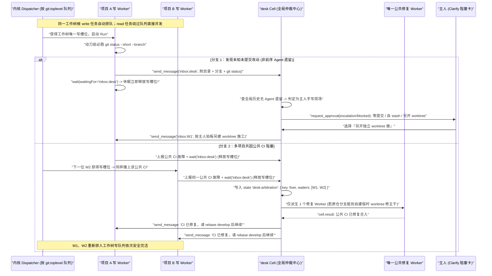

# 用例 5：同工作树并发读写调度、主人脏现场保护与共因阻塞集中仲裁

> **遵循原则**：`P-SAFE-1`（真实目录零误删）、`P-SAFE-2`（同树单写排队 $\times$ 多读零锁并行）、`P-SAFE-3`（主人未提交现场神圣不可侵犯与 `desk` 集中仲裁）

---

## 一、覆盖的真实用户用例

1. **用例 5A（同一仓库混合并发：多路只读分析零排队 $\times$ 多路改码自动串行）**：
   - 三个后台项目同时指向 `/Users/ar8327/dev/trae-x`：前两路做跨模块源码调研与独立代码审计（`cwdMode: "read"`），第三路准备回写报告或改代码（`cwdMode: "write"`），随后第四路也要改同一仓库下的子目录代码（`cwdMode: "write"`）。
   - **理想体验**：所有只读分身 **0 毫秒锁等待全速并行**（底层挂 OS 只读沙箱防止手滑改坏本地工作树）；两个写分身无需协调器猜锁，由内核按 Git 工作树根自动排成单写者 FIFO 队列依次执行（若各自建了独立 `git worktree`，则两个 worktree 天然并行）。
2. **用例 5B（撞见主人正在手写的一半未提交改动）**：
   - 写分身轮到写槽位准备改代码，一跑 `git status` 发现工作树里躺着主人半小时前手写但还没 commit 的代码。
   - **理想体验**：分身**绝对不碰这批改动**（不 `stash`、不 `checkout -f`、不 `reset`），立即发信给 `desk` 求助并进入休眠（当场让出目录写槽位）；`desk` 核查全局记录确认不是前序分身留下的后，向主人弹出一张清晰的阻塞选择卡（*等你提交完再继续 / 你自己 stash 后继续 / 让分身另开独立 worktree 做*），按主人拍板安全推进。
3. **用例 5C（多项目同时被同一公共 CI / 共享依赖挂死——共因单点修复与批量唤醒）**：
   - 项目 1（做新特性）和项目 2（修历史 Bug）各自的写分身在跑门禁时，同时撞上主干 `develop` 公共 lint 检查坏了。
   - **理想体验**：两个分身不各自乱改公共配置互踩，而是双双上报 `desk` 并休眠让出写锁；`desk` 识别出是同一个公共阻塞因，在 `desk:arbitration` 台账记下两个等待者，**只单开 1 个公共修复分身**（若原目录停在特性分支，指示其在独立临时 worktree 基于远端主干修复）；修好合入后，`desk` 逐一发信唤醒两个等待中的分身执行 `rebase develop` 继续完活。

---

## 二、一步一步推导如何实现功能

### 关键环节机制推导

1. **为什么写互斥必须下沉到 `Dispatcher` 按工作树根排号，而不是让 Agent 自己抢锁？**
   - 让模型在规划层手动查询锁状态再派单，一旦两个协调器同一毫秒看状态都是空闲就会撞车；且同一个 Git 仓库下的 `/repo` 与 `/repo/packages/ui` 字符串不同但共享同一棵工作树。
   - 内核 `Dispatcher.pump()` 直接按 `git.toplevel(cwd) ?? realpath(cwd)` 聚合排队：任何 `cwdMode: "write"` 的 `Cell` 随时免报错入队，前一个写者的 `Run` 及其后台 `Job`（含 `cancelling` 进程组退出确认）彻底退净后才发下一班车；而一旦分身调 `wait` 进入休眠且无在跑 `Job`，槽位**零延迟自动释放**，绝不会出现“受阻分身抱着目录锁睡觉，导致来救火的修复分身进不去”的死锁！
2. **为什么仲裁权统一收口到树根 `desk`，而不是让 `project` 协调器各自处理？**
   - 单个 `project` 协调器只看得见自己名下的子任务，看不见兄弟项目是否也撞上了同一个公共 CI，更不知道目录里陌生的分支是不是隔壁项目上一棒留下的。
   - 树根 `desk` 拥有全工作台 `[active workspaces]` 视野与跨子树 `read_state / search_history / send_message` 权限，因此能精准区分三种情况：**① 隔壁/前序分身遗留（直接指路续接）**、**② 多项目共因故障（单开一修、统一广播唤醒）**、**③ 主人手写现场（弹卡请示）**。

---

## 三、不可破坏的不变量（MUST NOT BREAK）

- **`INV-UC05-01`（同工作树单写者互斥、独立 worktree 并行）**：同一 `git.toplevel(cwd)` 任意时刻至多允许 1 个 `cwdMode: "write"` 的活跃 `Run` 或在途 `Job`；不同独立 `git worktree` 与任意数量的 `cwdMode: "read"` 任务必须零阻塞并行。
- **`INV-UC05-02`（休眠让槽零死锁，强停退净才放行）**：写分身进入 `wait` 休眠（无活跃 `Job`）时必须立即释放工作树写槽位；取消任务时必须确认残留后台进程组彻底退出（`cancelling -> cancelled`）后才放行下一位写者。
- **`INV-UC05-03`（主人未提交改动零触碰铁律）**：任何分身发现非自身任务产生的未知未提交改动时，严禁执行 `reset / clean / stash / checkout -f`，必须停手报 `desk` 并经主人审批卡裁决。
- **`INV-UC05-04`（共因阻塞单点修复与全员唤醒）**：多个分身上报同一公共基础设施/主干 CI 故障时，`desk` 只允许派生唯一修复任务，并在修复完结后通知全部未关闭的等待分身（无任何求助分身被静默晾死）。

---

## 四、源码落点、回归测试与当前待修偏差

- **核心源码**：
  - 工作树根解析与单写排队：[packages/workspace/src/git.ts](../../packages/workspace/src/git.ts)、[packages/workspace/src/jobs.ts](../../packages/workspace/src/jobs.ts)、[packages/cell/src/dispatcher.ts](../../packages/cell/src/dispatcher.ts)
  - 现场自检与主台仲裁契约：[presets/src/shared/prompts.ts](../../presets/src/shared/prompts.ts)、[presets/src/shared/skills.ts](../../presets/src/shared/skills.ts)（`workspace-arbitration`）
- **自动化回归测试（修改相关代码必跑）**：
  - [presets/test/scenario-blockers.test.ts](../../presets/test/scenario-blockers.test.ts)（多项目共因 CI 挂死 $\rightarrow$ 单修广播唤醒；以及主人脏改动弹卡保护）
  - [packages/workspace/test/git-worktree.test.ts](../../packages/workspace/test/git-worktree.test.ts)、[packages/workspace/test/jobs.test.ts](../../packages/workspace/test/jobs.test.ts)
- **当前待修实现偏差（详见 [03-bugs](../03-bugs/README.md)）**：
  - `BUG-008`（`cwdMode: "read"` 目前仅作调度声明，尚未在 CLI 适配层挂载底层 OS 级只读沙箱以物理阻断意外写本地工作树）。
