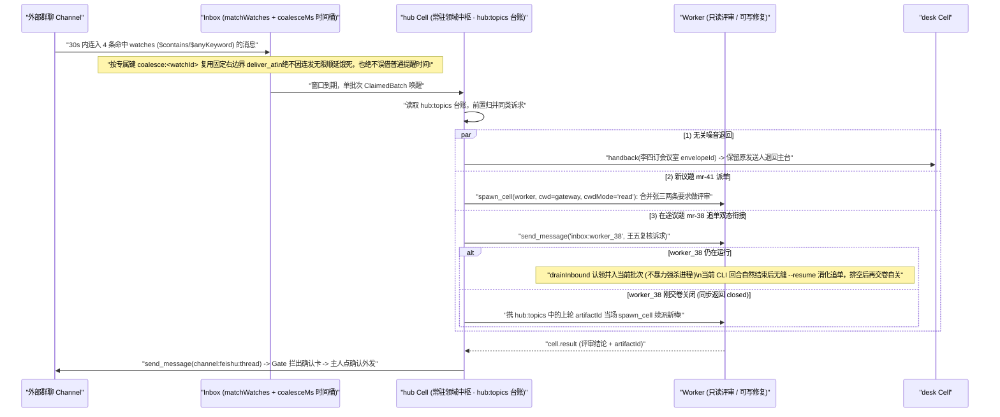

# 用例 6：领域直通中枢（`domain-hub`）、时间桶攒批与在途追单无损续接

> **遵循原则**：`P-UX-1`（高频流不刷爆主收件箱）、`P-KERN-1`（常驻中枢路由 $\times$ 短命 `Worker` 执行）、`P-SAFE-2`（只读评审并发、修复排队）、`P-SAFE-4`（回群消息必经确认卡）

---

## 一、覆盖的真实用户用例

### 用例 6：研发群高频直通模式（Code Review / 线上排障 / 领域小需求）
团队飞书研发群里每分钟都有消息滚动，其中带有 `@review-bot` 或特定仓库关键词的消息需要专门承接：
1. **直通不扰主台 + 时间窗前置攒批**：在 30 秒内，张三连发两条 *“@bot 看下网关 MR !41”*、*“@bot !41 补充：重点看下高并发锁竞争”*，李四顺嘴发了一条 *“@bot 帮我订个下午茶会议室”*，王五发了一条 *“@bot !38 我按上次意见改好了，再复核一眼”*。
2. **理想体验**：
   - 这批消息**绕过全局主台 `desk` 与 `Clarify`**，经 30 秒固定时间桶聚合成**单次唤醒**送达常驻的「网关评审中枢（`hub`）」；
   - `hub` 将张三的 1+2 合并为同一议题 `mr-41`，立即派只读 `worker`（`cwdMode: "read"`）在网关仓库用 `git diff` 审查代码；
   - 李四的订会议室与代码评审无关，`hub` 调 `handback` 原封不动退回给 `desk` 处理，既不越俎代庖也不静默吞消息；
   - 王五的 `mr-38` 若上一棒 `worker` 还在跑，直接把补充消息塞进在跑 `worker` 的收件箱让它在收尾前顺手消化；若上一棒 `worker` 刚好在 10 毫秒前关单退出了，系统明确返回 `closed`，`hub` 当场带着台账里的上一轮报告 `artifactId` 派生新一棒 `worker` 复核；
   - 评审结论备好后，在 `Clarify` 出唯一确认卡，主人扫一眼点确认即发回飞书群线程。

---

## 二、一步一步推导如何实现功能

### 关键环节机制推导

1. **为什么时间桶攒批必须用「按订阅键隔离的固定右边界（Tumbling Window）」？**
   - 如果每次来新消息都把 `deliver_at` 往后推 30 秒（滑动窗口），热闹的研发群会让 `hub` 永远处于推迟饥饿态；而如果混用普通提醒列，又可能误借明天下午的定时提醒时间戳导致消息卡一天。
   - 内核按 `coalesce:<watchId>` 独立查询未到期桶：第 1 条消息设 `now + 30s`，窗口内后续消息直接复用这个固定的到期时刻，到点准时打包发车；若 `hub` 当前正在跑，新消息直接设 `now` 走运行期 `drainInbound` 同轮吸纳。
2. **为什么运行期追加追单（`drainInbound`）绝对禁止强杀 CLI 子进程（与 `steer` 紧急打断双轨分离）？**
   - 当子 `worker` 正在跑编译或写评审脚本时，同事补一句“顺便看下第 80 行”是**温和补充**而非方向错误——若此时暴力 `killNow()` 杀掉 CLI 进程，刚跑了一半的构建就全白费了。
   - 因此内核严格分两轨：只有明确调 `control_cell(action: "steer")` 纠偏才中断当前回合；普通 `send_message` 入队由 `drainInboundSync` 原子认领为 `claimed`（支持随时 `handback` 且崩溃安全回队），等当前 CLI 回合自然结束后立即用同一 `sessionId` 调 `--resume` 无损续跑！
3. **拓扑上为什么 `hub` 必须挂在 `desk` 树下（`parentId = "desk"`）？**
   - 入站路由直投 `inbox:<hubId>` 绕过了 `desk` 推理（零延迟开销）；但监督树归属让 `desk` 天然保有对所有 `hub` 及其子 `worker` 的工作区冲突与公共阻塞仲裁权，整棵树不存在法外孤岛。

---

## 三、不可破坏的不变量（MUST NOT BREAK）

- **`INV-UC06-01`（固定窗口不饿死、不串钟）**：`coalesceMs` 攒批必须在首次创建窗口后的固定右边界准时触发，严禁因后续消息连发无限顺延，且严禁与 `set_reminder` 等普通延迟调度互相借用时间戳。
- **`INV-UC06-02`（跑题消息原样退回不静默丢弃）**：不属于本 `hub` 职责范围的消息必须通过 `handback` 保留原始 `principalId` 退回 `desk`，严禁吞没或越界乱答。
- **`INV-UC06-03`（在途追单不杀进程，刚关追单无缝续派）**：向活跃 `worker` 转发普通补充消息必须在当前回合自然结束后无损 `--resume` 消化（严禁 `killNow` 强杀），且在排空前不提前关单；向已 `closed` 的 `worker` 发信必须同步返回明确未送达信号以触发续派。
- **`INV-UC06-04`（只读评审可用工具看 Diff 但不占写队列）**：`hub` 派出的代码评审分身声明 `cwdMode: "read"`，必须能正常调用读取与只读 Git 命令（如 `git diff / log / show`）且不进入工作树写锁排队。

---

## 四、源码落点与回归测试锚点

- **核心源码**：
  - 订阅匹配与时间桶入队：[packages/cell/src/spec.ts](../../packages/cell/src/spec.ts)、[packages/cell/src/routing.ts](../../packages/cell/src/routing.ts)、[packages/inbox/src/inbox.ts](../../packages/inbox/src/inbox.ts)
  - 运行期无损吸纳与 `hub` 预设：[packages/loop/src/cli/loop.ts](../../packages/loop/src/cli/loop.ts)、[presets/src/hub/preset.ts](../../presets/src/hub/preset.ts)、[presets/src/shared/skills.ts](../../presets/src/shared/skills.ts)（`domain-hub`）
- **自动化回归测试（修改相关代码必跑）**：
  - [presets/test/scenario-hub.test.ts](../../presets/test/scenario-hub.test.ts)（直通攒批、无关退回主台、只读分身看 `git diff` 评审、在途追单与刚关续派、确认卡外发）
  - [packages/inbox/test/](../../packages/inbox/test)
