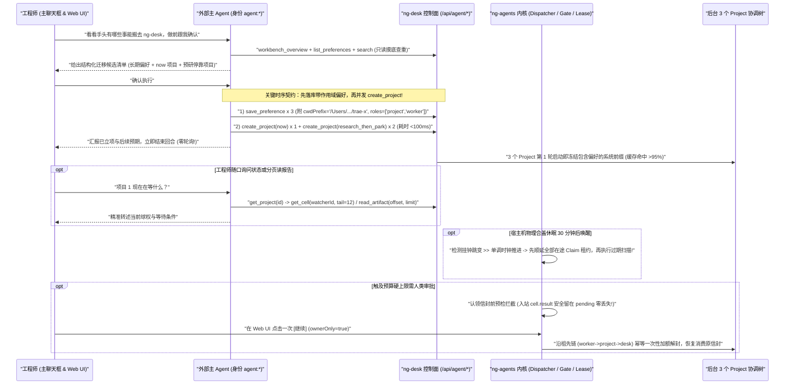

# 用例 7：外部主 Agent 协同控制流与跨夜多战线无人值守托管

> **遵循原则**：`P-UX-2`（日常主 Agent 对话秒回解耦）、`P-UX-7`（带作用域的长期偏好）、`P-KERN-4`（前缀冻结 95%+ 缓存命中）、`P-SAFE-4`（`agent:*` 与 `owner` 权限边界）、`P-SAFE-7`（精准增量预算、认领前预检与宿主休眠保护）

---

## 一、覆盖的真实用户用例

### 用例 7：晚间 10 分钟通过日常 CLI 主 Agent 托管三条重型研发战线过夜（`trae-x` 全链路实战）
晚上 21:45，工程师不想再开十几个终端窗格熬夜盯门禁和审计，对正在聊天的外部主 Agent（Antigravity / Claude Code / Codex）说：
> *“看看用 `ng-desk` 这个工具，咱们手头有哪些事能搬到那边去？你先看看，做之前跟我确认下。”*

**理想端到端体验**：
1. **盘点与确认（3 分钟）**：主 Agent 只读调 `workbench_overview`、`list_preferences` 与本地看板文档，识别出「3 条跨项目复用的团队红线偏好 + 1 个立即收官终审的在途单（`mode: "now"`）+ 2 个趁热摸底停靠的中期技术债（`mode: "research_then_park"`）」，清晰列出清单供工程师拍板。
2. **严控时序秒级立项（1 分钟）**：获准后，主 Agent **先按仓库与角色作用域存好 3 条偏好，等落库返回后再并发创建 3 个项目**（每次 `<100ms` 即回），随即把清爽的聊天框还给工程师，绝不在对话里死等轮询。
3. **途中随口查球权（10 秒）**：22:00 工程师瞄了一眼网页上的 `等待外部` 标签问“这在等谁？”，主 Agent 两级下钻（`get_project -> get_cell`）一秒答清“远端正在跑请求锁测试，挂了监听器每 3 分钟看一眼，不用你操作”。
4. **跨夜稳健自治与笔记本合盖自愈**：工程师合上笔记本盖子休息了半小时又打开；后台自动扛住电源休眠跳变（零误判超时重跑），持久化会话保持 **96%+ 前缀缓存命中率**，按真实单轮增量与缓存折扣精准记账；真遇到超大调研触顶需续费时，既不吞没在途 `cell.result` 信封，在网页点一次「继续」即可一次性解封整条祖先链。
5. **次日清晨清爽验收**：项目 1 已完成独立五项硬 Diff 终审并回写报告结项；项目 2、3 带着结构清晰的完整报告安静停靠在 `以后再说` 专区，点开抽屉即可直接阅读。

---

## 二、一步一步推导如何实现功能

### 关键环节机制推导

1. **外部主 Agent 的服务生命周期与防越位边界**：
   - **不私自启停服务**：工作台服务由主人手动管理；若 `127.0.0.1:8790` 未启动，主 Agent 如实告知主人，绝不私跑 `pnpm start` 或悄悄在当前对话里硬干原本属于后台项目的重活（若会话启动时工作台离线导致 MCP 仅挂载占位工具，待工作台上线后支持直调本地 `/api/agent/tools/*` 回退）。
   - **不抢后台写锁**：主 Agent 自己在终端动任何代码仓库前，必先看 `list_workspaces` 确认无后台写分身正在改该工作树。
2. **为什么必须「先存带作用域的偏好，再建项目」，且已内联技能要从待读列表剔除？**
   - 持久 `Cell` 在第 1 轮 `hydrate` 时冻结系统提示词前缀以命中大模型 KV-Cache：先存偏好再建项目，使协调器从第 1 轮起就拿到完整规范且后续前缀字节不变。
   - 给偏好加上 `cwdPrefix` 与 `roles` 过滤，保证特定仓库的严苛改码红线只注入该仓库下的 `project / worker`，既不塞给轻量 `watcher`，也不污染其他无关项目。
   - `Context.hydrate` 对已全文内联进系统提示词的技能（如 `project` 角色的 `project-relay`）自动从 `# Skills` 按需读取索引中过滤掉，消除协调器开局白花一轮调 `read_resource` 重复搬运同一份文本。
3. **跨夜无人值守的四道账本与电源防线推导**：
   - **防线 A（认领前预检 + 收尾免死缓冲）**：在把收件箱消息标为 `claimed/done` 并写入 CLI 会话证据**之前**先做零成本预算检查——若已超限则直接挂起出卡，子分身刚交回的长篇 `cell.result` 完好留在 `pending` 队列，续费后原样送达模型，绝不蒸发；若协调器名下所有子任务已完结、仅剩最后一步调 `finish_project` 收尾，给予极小额免死缓冲直接完结，不让跑完马拉松的项目卡死在终点线前。
   - **防线 B（会话增量与缓存折算）**：CLI `resume` 返回会话累计总用量时，驱动层严格记录 `lastReportedTokens` 只向 `Gate.meter` 报单轮差值，并将 95%+ 命中的缓存输入按真实折扣计入预算（不再按 1:1 原价虚扣或把美元记成 `$0`）。
   - **防线 C（祖先链一键联调续费 + 动态继承余额）**：派生子 `Cell` 时不把父节点瞬时余额静态焊死为子上限；当子项目与根 `desk` 同时超限时，点击一次 `continue` 沿祖先链幂等解除所有卡住节点，杜绝几十毫秒内背靠背连弹两张预算卡。
   - **防线 D（防空闲休眠 + 合盖唤醒续租）**：有活跃运行任务时自动持有系统防空闲休眠断言（macOS `caffeinate -i`）；遇到强制物理合盖休眠唤醒时，内核对比 `Date.now()` 与 `performance.now()` 识别出休眠时长 $\Delta_{\text{sleep}}$，**先为所有活跃租约顺延 $\Delta_{\text{sleep}}$，再跑过期回收**，确保活着的 CLI 进程绝不被误杀重发。

---

## 三、不可破坏的不变量（MUST NOT BREAK）

- **`INV-UC07-01`（主 Agent 异步交办零阻塞与服务手动边界）**：外部主 Agent 严禁自行启停工作台进程、严禁在立项后循环轮询进度、严禁与后台活跃写分身并发修改同一工作树。
- **`INV-UC07-02`（`ownerOnly` 双红线全入口硬拒 `agent:*`）**：外部主 Agent 凭证在 HTTP 与 MCP 任何入口均不得放行对外发送卡片或超预算续费卡片。
- **`INV-UC07-03`（`resume` 单轮增量精准记账）**：多轮复用同一 CLI 会话的持久 `Cell`，其账本累计 Token 必须严格等于各轮真实新增消耗之和，严禁将历史累计值重复叠加。
- **`INV-UC07-04`（预算拦截零丢信封）**：因预算触顶触发 `budget_stopped` 时，尚未真正送入模型推理的入站信封（特别是子分身汇报的 `cell.result`）严禁被标记为已消费或从续跑输入中丢失。
- **`INV-UC07-05`（合盖休眠唤醒零误判租约过期）**：宿主机跨越物理休眠唤醒瞬间，不得将休眠前仍在正常存活的 `Run` 误判为租约超时而重复投递。

---

## 四、源码落点、回归测试与当前待修偏差

- **核心源码**：
  - 外部主 Agent 控制面与插件：[apps/gtd-desk/src/agent/guide.ts](../../apps/gtd-desk/src/agent/guide.ts)、[apps/gtd-desk/src/agent/tools.ts](../../apps/gtd-desk/src/agent/tools.ts)、[apps/gtd-desk/bin/ng-mcp.mjs](../../apps/gtd-desk/bin/ng-mcp.mjs)、[apps/gtd-desk/main-agent/](../../apps/gtd-desk/main-agent)
  - 调度、计量与预算审批：[packages/cell/src/dispatcher.ts](../../packages/cell/src/dispatcher.ts)、[packages/cell/src/approvals.ts](../../packages/cell/src/approvals.ts)、[packages/gate/src/gate.ts](../../packages/gate/src/gate.ts)、[packages/loop/src/cli/adapters/codex.ts](../../packages/loop/src/cli/adapters/codex.ts)
  - 上下文前缀组装与队列租约：[packages/context/src/hydrate.ts](../../packages/context/src/hydrate.ts)、[packages/inbox/src/inbox.ts](../../packages/inbox/src/inbox.ts)
- **自动化回归测试（修改相关代码必跑）**：
  - [apps/gtd-desk/test/agent.test.ts](../../apps/gtd-desk/test/agent.test.ts)（`agent:*` 控制面全工具与 `ownerOnly` 硬拦截）
  - [packages/gate/test/ledger.test.ts](../../packages/gate/test/ledger.test.ts)、[packages/gate/test/control-revoke.test.ts](../../packages/gate/test/control-revoke.test.ts)
- **当前待修实现偏差（详见 [03-bugs](../03-bugs/README.md)）**：
  - `BUG-001`（`budget_stopped` 吞信封）、`BUG-002`（`CodexDriver` 累计 Token 重复记账）、`BUG-003`（预算四连环：无收尾缓冲、缓存 1:1 计费、连弹双卡、派生锁死余额）、`BUG-007`（已内联技能重复提示读取、偏好缺作用域）、`BUG-009`（宿主机休眠防空闲断言与唤醒续租）、`BUG-012`（`get_project` / `read_artifact` 排障与分页缺口）。
