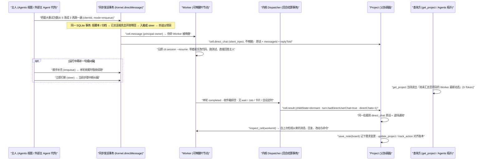

# 用例 8：主人直连 `Worker` 对话、父项目零滞后同步与退场主动 Pull

> **遵循原则**：`P-UX-1`（实况流零运行时黑话、工程名词原样）、`P-UX-2`（两个入口都带归属）、`P-UX-6`（第四视图「分身实况 · Agents」）、`P-KERN-1`（纯叶节点回合结束即待命、父节点主动 Pull）、`P-KERN-2`（发话走同步事务）、`P-KERN-4`（花名册与白板笔记走动态尾部）、`P-SAFE-4`（`owner` 与 `agent:*` 身份）

---

## 一、覆盖的真实用户用例

1. **用例 8A（直连唤醒待命 `worker` 改需求）**：
   - 项目「支付重试改造」的分身「核心退避编码」已在 `~/dev/pay-core` 的 `feat/retry` 分支实现指数退避、提交 `9f2c1`、单测 14/14 通过，本轮结束转入待命。主人在 `Agents` 视图点开它，读完实况流（派单任务书、折叠成一行的 6 步操作、分身回复），在发话框写：*“把最大重试次数从 5 改成 3 再跑一遍”*。
   - **理想体验**：这句话沿原 CLI 会话唤醒该分身，它带着全部前文直接改、跑测试、回答主人；项目协调器**不被空唤醒**，但主人的原话已在同一事务里抄送进它的收件箱。分身本轮结束时内核通知项目，并标出「本轮有主人直连 1 次」；项目醒来时眼前同时有主人原话与退场通知，用 `inspect_cell` 拉取这一轮的真实足迹，更新白板笔记与动作账本。
2. **用例 8B（运行中：顺手补充 vs 立即打断）**：
   - 分身正在跑 `pnpm test`。主人想补一句 *“顺便把日志级别调成 debug”*——默认「顺手补充」：消息入箱，不打断在跑的命令，本轮收尾时吸收续跑。随后主人发现方向错了 *“停掉迁移，方向错了”*，点「立即打断」——实时 `steer` 中断当前步骤纠偏。两种方式都抄送项目；勾选「同时立即唤醒项目」时抄送改为唤醒式，项目当场醒来调整计划。
3. **用例 8C（经外部主 Agent 代传）**：
   - 主人在 IDE 里对 Claude Code 说 *“告诉支付项目那个退避分身，最大重试改成 3”*。外部主 Agent 经控制面以自己的 `agent:<id>` 身份直连该 `worker`（不冒充 `owner`），效果与 8A 相同；抄送与实况流都显示是它代传的。
4. **用例 8D（随时查状态零滞后）**：
   - 8A 发出后几秒，主人问外部主 Agent *“支付项目现在什么情况”*，此时项目还没来得及跑模型。`get_project` 当场 0-Token 读出单列的 **「尚未汇总至项目的 Worker 最新动态」**——该分身自项目上次检视以来的新记录：主人的原话、它的回复与操作——外部随时查到的都是最新现场；`Agents` 拓扑在父子连线上同样标出「未汇总 +N」。
5. **用例 8E（被关闭的分身带回、脚本与归档节点拒收）**：
   - 项目早先 `close_cell` 了一个它认为不再需要的分身，项目本身仍在进行；主人点开它发话——同一事务内恢复并沿原会话续跑，不存在「晚了 3 秒发不进去」。
   - 随已完结或已取消项目归档的分身、零算力脚本节点（`processor.kind: "code"`）：发话框只读，并给出替代入口（「重新启动所属项目」「去总助理另起新事项」「立即触发一次检查」）。

---

## 二、一步一步推导如何实现功能

### 关键环节机制推导

1. **发话为什么必须与抄送同事务（`INV-SYS-06`）？**
   - 若先投递、再另起一步抄送，中间一次崩溃就会留下「`worker` 已经知道、项目永远不知道」的需求变更。`Kernel.directMessage`（[messages.ts](../../packages/cell/src/messages.ts)）在一个事务里依次完成：身份检查（只接受 `owner` 与 `agent:*`；`Cell` 之间用 `send_message`，不产生抄送）→ 拒绝判断（脚本节点 `code`、随已关闭祖先归档的节点 `archived`）→ 必要时带回被单独关闭的叶节点 → 按 `mode` 入箱（`cell.message`）或实时打断（`inbox.control` 的 `steer`）→ 记录该节点的直连计数与已见消息标识 → 向父协调器写入 `cell.direct_chat`。
   - **幂等**：同一 `clientId` 重试返回 `duplicate`，既不重复投递也不重复抄送。
   - **抄送保留归属**：信封的 `principalId` 是原发言者（`owner` 或 `agent:<id>`，不是内核），载荷带 `childCellId / childTitle`、原话、`mode`、`messageId`、`replyToId`、`conversationId`、`projectCellId`；项目渲染时附带提示「这是主人直接对你名下某个分身说的，已经在它那里，不要转发」。
   - **默认静默**：抄送为 `silent_inject`——主人连说 5 句，项目不陪着空转 5 轮；它下一次因任何原因被唤醒时（最迟是该分身本轮的退场通知）一次看到全部原话。发话时选 `notifyParent: "wakeup"`（界面「同时立即唤醒项目」）则抄送为唤醒式。
   - 对树根 `desk` 发话即主对话：投递为带 `sender`、`replyToId / replyToText`、`conversationId` 的 `user.message`，按事项分拣，没有父节点可抄送；对 `project / hub` 等持久协调器发话同样不抄送给上级。
2. **待命与运行中的投递差异**：
   - **待命**：消息入箱即构成唤醒，`Dispatcher` 认领后 CLI 驱动命中记录在案的 `cli:session` 执行 `--resume`，分身带着完整前文继续。
   - **运行中 · 顺手补充**：绝不杀进程。叶节点会在 CLI 回合收尾时把途中到达的消息吸收进同一个 `Run`（同一认领，`handback` 与崩溃回队同样覆盖它）；晚于最后一次吸收到达的，结算事务看到待领消息便不发通知，由下一轮处理——退场通知永远覆盖回答了追单的那一轮。
   - **运行中 · 立即打断**：`steer` 走控制旁路实时注入当前会话，记为一条系统注记，同样抄送父项目。
   - **主人的话就是答复**：人（主人或其外部 Agent）发出的直连消息——无论「顺手补充」还是「立即打断」——同时了结该分身对父节点或 `desk` 的未决等待（[waits.ts](../../packages/cell/src/waits.ts)）——它在 `wait` 里等的冲突裁决，主人一句话即可给出；其他 `Cell` 发来的 `steer` 只纠偏，不了结等待。
3. **退场通知标出直连**：回合结算（[00-system-mechanics §2.2](./00-system-mechanics.md)）时，内核从该分身的直连计数读出本轮条数，写入 `turn.hadDirectUserChat / directChats`，随后清零；`summary` 是它最后说的话（或可选的 `report_to_parent` 摘要），`fromSeq / toSeq` 给出本轮证据区间。项目的确定性记账据此把该分身承接的动作在 `completed` 时销账；若主人加了新要求，由项目自己决定是否重开动作（`track_action`）。
4. **项目主动 Pull 并写进白板**（提示词契约见 [prompts.ts](../../presets/src/shared/prompts.ts) `project` §1、§3）：
   - 通知标出主人直连时，项目**必须**先 `inspect_cell` 再信任分身的自述：拿到的记录把人的直连消息单独标为 `the owner, directly (owner)` / `(agent:<id>)`，并给出每一步命令、路径与结局；需要原样输出时用 `detail: "full"`，超长输出经 `read_resource` 读 `res://` 链接。
   - 游标 `pull:<workerId>` 推进到本次读到的位置，下次尾部花名册只显示其后的新区间；`desk` 或控制面读同一分身不推进项目的游标。
   - 项目把「主人直接让它把最大重试从 5 次改成 3 次」写进白板笔记 `board`（`save_note`，`kind: "note"`，`scope: "cell"`），并用 `update_project / track_action` 对齐账本——白板挂在每次唤醒的动态尾部，不进冻结前缀，会话压缩或重建后依旧在眼前。
5. **查询零滞后**：任何查询方（外部主 Agent 的 `get_project`、`Agents` 拓扑与项目节点的时间线头部）都以「子分身最新证据序号 − 项目的 Pull 游标」判断是否有未汇总动态，并当场从 `evidence` 读出这段尾部（主人原话、分身回复、关键操作）——不跑任何模型，也不推进任何游标。
6. **带回与拒收**：父节点 `close_cell` 关掉的叶节点，`Cell` 之间 `send_message` 对它同步返回 `closed`；人直连时由 `reopenLeafSync`（[lifecycle.ts](../../packages/cell/src/lifecycle.ts)）在同一事务内判定：全部祖先仍开 → 恢复 `active`（停在关闭时推进后的纪元）、恢复授权、保留 CLI 会话记录，此前的监听与定时不恢复，由这条消息唤醒它；任一祖先已关闭 → 以 `archived` 拒收。脚本节点不接受自然语言对话，以 `code` 拒收。拒收不留下任何投递或抄送。

---

## 三、不可破坏的不变量（MUST NOT BREAK）

- **`INV-UC08-01`（直连必达或明拒）**：人对 `llm` 叶节点的直连消息只有三种结果：送达（待命则唤醒、沿原会话续跑；运行中 `enqueue` 不中断进程，并在该轮或紧接的下一轮被处理，先于覆盖它的退场通知；被单独关闭而祖先全开则同事务带回后送达）、明确拒收（脚本节点、随已关闭祖先归档的节点、非人身份），或 `not_found`；拒收与 `not_found` 不留下任何投递或抄送。
- **`INV-UC08-02`（抄送默认静默、一字不落）**：给父协调器的 `cell.direct_chat` 默认不唤醒它，且必须在它下一次被唤醒时（最迟是该分身本轮的退场通知所在批次）以原发言者身份、原话呈现；`notifyParent: "wakeup"` 时立即唤醒。原子性与幂等性见 `INV-SYS-06`。
- **`INV-UC08-03`（退场通知如实标出直连）**：本轮期间有人直连时，退场通知的 `turn.hadDirectUserChat` 必须为 `true` 且 `directChats` 等于本轮直连条数；计数在通知投递时清零，下一轮从零计起。
- **`INV-UC08-04`（Pull 游标只属于祖先检视者）**：`inspect_cell` 只在检视者是目标的祖先时推进检视者自己的游标，绝不推进其他节点的游标；控制面读取不推进任何游标；返回的记录必须标出人的直连消息，且对 `api / claude / codex / agy` 四套引擎形状一致。
- **`INV-UC08-05`（查询零滞后、零 Token）**：`get_project` 与 `Agents` 视图必须把子分身中晚于项目 Pull 游标的记录当场读出并单列展示，不依赖项目先跑一轮模型，也不因读取而推进游标。
- **`INV-UC08-06`（主人的话即答复）**：人发给某分身的直连消息（`enqueue` 或 `steer`），必须了结它当时的全部未决等待（无论原本等的是父节点还是 `desk`）；其他 `Cell` 的 `steer` 不了结等待。

---

## 四、源码落点与回归测试锚点

- **核心源码**：
  - 直连发话、抄送与带回：[packages/cell/src/messages.ts](../../packages/cell/src/messages.ts)（`directMessage`、`ccDirectChat`、`sendCellMessage`）、[packages/cell/src/kernel.ts](../../packages/cell/src/kernel.ts)（人的 `steer` 抄送）、[packages/cell/src/lifecycle.ts](../../packages/cell/src/lifecycle.ts)（`reopenLeafSync`）、[packages/cell/src/waits.ts](../../packages/cell/src/waits.ts)
  - 回合结算与退场通知：[packages/cell/src/dispatcher.ts](../../packages/cell/src/dispatcher.ts)（`settleRun`、`notifySettled`）、[packages/protocol/src/payloads.ts](../../packages/protocol/src/payloads.ts)（`CellResultPayload.turn`、`CellDirectChatPayload`）、[packages/protocol/src/contract/cell.ts](../../packages/protocol/src/contract/cell.ts)（`CELL_TURN_KEY`、`CELL_DIRECT_CHAT_KEY`、`pullCursorKey`）
  - 主动 Pull 与动态尾部：[packages/cell/src/inspect.ts](../../packages/cell/src/inspect.ts)、[packages/cell/src/readmodel.ts](../../packages/cell/src/readmodel.ts)（花名册未读区间、`tailNotes`）
  - 第四视图与控制面契约：[apps/gtd-desk/src/shared/api.ts](../../apps/gtd-desk/src/shared/api.ts)（「分身实况 Agents」一节）、[apps/gtd-desk/src/server/app.ts](../../apps/gtd-desk/src/server/app.ts)、[apps/gtd-desk/src/agent/tools.ts](../../apps/gtd-desk/src/agent/tools.ts)
  - 角色契约：[presets/src/shared/prompts.ts](../../presets/src/shared/prompts.ts)（`worker` §2–§3、`project` §1、§3）
- **自动化回归测试（修改相关代码必跑）**：
  - [packages/cell/test/wakeable.test.ts](../../packages/cell/test/wakeable.test.ts)（待命唤醒与静默抄送、`wakeup` 抄送与 `steer` 抄送、`agent:*` 身份保留、`clientId` 幂等、带回被关闭的分身与拒收脚本/归档节点、`desk` 主对话带 `replyToId`、`inspect_cell` 游标只属于祖先检视者）
  - [apps/gtd-desk/test/api.test.ts](../../apps/gtd-desk/test/api.test.ts)、[apps/gtd-desk/test/agent.test.ts](../../apps/gtd-desk/test/agent.test.ts)（`/api/cells/:cellId/messages`、拓扑与时间线投影、控制面直连与未汇总动态）
