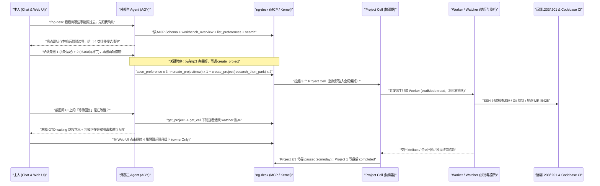

# `ng-desk`（`ng-agents`）真实端到端用法全记录、运行轨迹与全维度系统审计报告

> **压测时间窗口**：2026-11-18 21:44 ～ 2026-11-19 00:16（东八区 `UTC+8`，端到端挂钟跨度 **2h 32m**）  
> **审计覆盖范围**：①「主人 $\leftrightarrow$ 外部主 Agent（Antigravity）$\leftrightarrow$ `ng-desk` 工作台」完整协同操作流；② SQLite 状态库 [ng.db](../../../apps/gtd-desk/data/ng.db) 全表与 14 条底层 `~/.codex/sessions/*.jsonl` 原始模型轨迹、系统电源日志 `pmset` 交叉核验；③ 3 份最终产出报告（含 1,319 行 / 148 KB 产物隔离报告）一字不落全文审阅；④ [ng-agents](../../../README.md) 内核、CLI 驱动、提示词、Web UI 与 MCP 桥接层源码级根因定位。

---

## 一、端到端实战用法全记录（我们是怎么把活搬进工作台并跑通的）

这次测试并不是跑合成 Demo，而是把 [dashboard.md](file:///Users/ar8327/dev/trae-x/dashboard.md) 里原本靠「人工维护 Markdown 看板 + 远端 `.233`/`.201` 开多窗格 tmux + 手动复制粘贴八大防整活后缀 + 人肉盯 CI 与派独立审计」推进的真实重型研发流，整体迁移到了 `ng-desk`。

### 1.1 任务拆解与工作台原语映射

面对真实研发积压池，我们没有一股脑全调同一种接口，而是按**信息生命周期**切成了三类原语：

| 原始事项形态 | 选用的 `ng-desk` 原语 | 具体落地项 | 为什么要这么映射？ |
| :--- | :--- | :--- | :--- |
| **跨项目复用的工程铁律与环境约定** | `save_preference`（×3） | `traex-engineering-redlines` `traex-remote-worktree-workflow` `traex-audit-five-checks` | 替代以往每次开 tmux 会话都要手动粘贴 [dashboard.md](file:///Users/ar8327/dev/trae-x/dashboard.md#L240-L251) §6.3 防整活后缀的做法，一次落库让后续后台分身自动继承。 |
| **有明确终点、需跨步盯梢闭环的在途活** | `create_project` （`mode: "now"`） | **Project 1**：「`!5408` 后台子智能体冷恢复尾补丁收官与终审」 | 涉及「远端摸底 $\rightarrow$ 等本地门禁与 MR $\rightarrow$ 盯云端 23 项 CI 合入 $\rightarrow$ 独立五项硬 Diff 终审 $\rightarrow$ 更新本机报告」多棒接力，天然契合 `project-relay` 的 `worker + watcher` 组合。 |
| **暂不改代码、先把底账摸清备查的中期事项** | `create_project` （`mode: "research_then_park"`，×2） | **Project 2**：「公开版与企业版完整产物隔离方案摸底」 **Project 3**：「重构收官后重算 12 模块上游回迁雷达」 | 趁上下文温热先派只读 `worker` 扫清源码与 Git 探针、存成工作台 Artifact 报告，再自动 `pause` 停靠进 `someday`（消除传统待办的“空白页”，且停靠后零驻留开销）。 |

### 1.2 外部主 Agent 驱动 `ng-desk` 的五步标准操作流

在实操过程中，有 **3 个非常关键的配合手法** 直接决定了本轮能否顺畅跑通：
1. **严格卡住「先 `save_preference`、等返回后再 `create_project`」的时序**：`ng-desk` 的偏好从各 Cell 的下一轮开始注入系统提示词；先落库偏好再建项目，保证了 3 个项目协调器从诞生的**第 1 轮推理**起就拿到了完整工程红线。
2. **显式用 `cwdMode: "read"` 化解「本机文档目录 vs 远端多开发机」的排队假冲突**：3 个项目的 `cwd` 都指向本机 `/Users/ar8327/dev/trae-x`，若默认走 `write` 模式，内核单写者锁会让 3 个互不相干的远端分析任务在本机排长队。显式声明只读后，前 9 个子分身在 `/Users/ar8327/dev/trae-x` 上实现 **0 毫秒锁等待真并行**，只有最后一棒改写本机 Markdown 报告的 `worker` 才申请写锁。
3. **主 Agent 严守「发完即退 + 按需两级下钻」**：立项后不在主会话轮询或越俎代庖跑 SSH；当你在 Web UI 对「等待回复」产生疑惑时，主 Agent 通过 `get_project` 定位当前承接动作的 `cellId`，再调 `get_cell(tail=8)` 精确读出 `watcher` 的 `watch_snapshot` 与 `set_reminder(180s)` 原因；而遇到 `ownerOnly` 的预算续费卡片时，则交由你在 Web UI 亲自拍板。

---

## 二、全系统运行大盘与三项目完整执行轨迹

### 2.1 全局算力、缓存与记账总盘点（14 个 Cell 真实消耗 vs `ng.db` 账本对照）

> [!IMPORTANT]
> **交叉核验核心发现**：对比 [ng.db](../../../apps/gtd-desk/data/ng.db) 的 `usage_log`/`ledger` 与本机 `~/.codex/sessions/2026/11/1[89]/rollout-*.jsonl` 的 448 次真实 API 请求记录后证实——
> 1. **执行后端**：14 个活跃 Cell（`desk` + 3 个 `project` + 7 个 `worker` + 3 个 `watcher`）**100% 运行在 `codex` CLI 的旗舰档 `gpt-6.2-sol@xhigh`**（哪怕 3 个 `watcher` 和收尾写入 `worker` 显式声明了 `modelTier: "fast"`，原因见第四节 `[P1-1]`）。
> 2. **真实 Token vs 虚增记账**：全晚真实消耗 **`40,390,220` tokens**（输入 `40,143,645`，其中**前缀缓存命中 `38,733,056`，总缓存命中率高达 `96.49%`**；未缓存输入仅 `1,410,589`；输出 `246,575` 含推理 `42,275`）。但因 `CodexDriver` 在 `resume` 时把会话历史累计总 Token 当成单轮增量重复累加（见 `[P0-2]`），`ng.db` 记账高达 **`51,675,224` tokens**（凭空虚增 **`+11.29M` 幽灵 Token**）！
> 3. **宿主机合盖休眠断档**：系统 `pmset` 电源日志与全库 `evidence` 时间戳共同证实，本机 MacBook 在 **`22:16:38` ～ `22:48:08` 处于电池合盖休眠（`Clamshell Sleep`，长达 `31m 30s`）**，解释了为何两个摸底 Worker 挂钟时长看似高达 53～56 分钟（纯活跃时长实为 22.4 分钟与 25.1 分钟）。

| Cell ID | 角色 (`preset`) | 所属项目 / 标题 | 声明 Tier / `cwdMode` | Runs (`总/实跑/熔断`) | API 步数 | 挂钟时长 (活跃时长) | `ng.db` 记账 Token (虚增倍率) | 真实总 Token (缓存命中率) | 真实输出 Token | 工具调用 (`MCP/原生` + 隐藏 JS `exec`) |
| :--- | :--- | :--- | :--- | :---: | ---: | :--- | ---: | ---: | ---: | :--- |
| `desk` | `inline` | 主台（结项唤醒） | `strong` / `read` | `1 / 1 / 0` | 4 | `24.3s` (`24.3s`) | `151,177` (1.00x) | **151,177** (83.1%) | `184` | `3 (3/0)` + `0` |
| `proj_...64af` | `project` | **P1：!5408 尾补丁收官与终审** | `strong` / `read` | `11 / 8 / 3` | 35 | `2h24m15s` (`7m29s`) | **`7,241,912` (4.13x)** | **1,752,712** (94.0%) | `11,851` | `35 (35/0)` + `0` |
| `cell_...jz0g` | `worker` | ↳ P1-1 只读核查远端会话与合入进度 | `strong` / `read` | `1 / 1 / 0` | 16 | `5m25s` (`5m25s`) | `864,701` (1.00x) | **864,701** (92.6%) | `9,746` | `25 (1/24)` + `0` |
| `cell_...72ha` | `watcher` | ↳ P1-2 跟踪尾补丁本地门禁与合并请求 | `fast`* / `read` | `2 / 2 / 0` | 15 | `6m07s` (`3m18s`) | **`982,710` (1.45x)** | **679,128** (93.4%) | `5,575` | `31 (5/26)` + `0` |
| `cell_...kzx1` | `watcher` | ↳ P1-3 跟踪 !5425 云端门禁与合入 | `fast`* / `read` | `3 / 3 / 0` | 33 | `48m33s`† (`~5m30s`) | **`4,120,526` (1.90x)** | **2,168,348** (93.8%) | `15,005` | `71 (6/65)` + `0` |
| `cell_...47rm` | `worker` | ↳ P1-4 核验 !5425 云端门禁与合入结果 | `strong` / `read` | `1 / 1 / 0` | 17 | `3m47s` (`3m47s`) | `1,067,429` (1.00x) | **1,067,429** (92.5%) | `7,180` | `34 (14/20)` + `0` |
| `cell_...hwq2` | `watcher` | ↳ P1-5 等 !5425 最新云端检查与合入 | `fast`* / `read` | `4 / 4 / 0` | 41 | `41m37s` (`12m03s`) | **`4,573,651` (2.19x)** | **2,091,405** (97.1%) | `25,129` | `38 (13/25)` + `0` |
| `cell_...cpcs` | `worker` | ↳ P1-6 独立终审 !5425 最终合入改动 | `strong` / `read` | `1 / 1 / 0` | 46 | `16m30s` (`16m30s`) | `5,798,010` (1.00x) | **5,798,010** (96.7%) | `28,562` | `68 (4/64)` + `0` |
| `cell_...e8bs` | `worker` | ↳ P1-7 合入证据和终审写入尾补丁报告 | `fast`* / `write` | `1 / 1 / 0` | 24 | `9m35s` (`9m35s`) | `1,173,124` (1.00x) | **1,173,124** (94.6%) | `22,698` | `31 (8/23)` + `0` |
| `proj_...ydrf` | `project` | **P2：公开版与企业版产物隔离方案摸底** | `strong` / `read` | `3 / 3 / 0` | 19 | `1h12m20s` (`2m46s`) | **`1,822,076` (1.97x)** | **925,784** (94.4%) | `4,606` | `20 (20/0)` + `16` |
| `cell_...tkm9` | `worker` | ↳ P2-1 核查发行链路并编写隔离方案 (v1) | `strong` / `read` | `1 / 1 / 0` | 80 | `53m25s`† (`22m25s`) | `10,211,420` (1.00x) | **10,211,420** (98.0%) | `38,481` | `73 (4/69)` + **`73`** |
| `cell_...2vd3` | `worker` | ↳ P2-2 补齐安装/登录/遥测源码证据 (v2) | `strong` / `read` | `1 / 1 / 0` | 53 | `16m19s` (`16m15s`) | `5,418,121` (1.00x) | **5,418,121** (97.5%) | `29,720` | `70 (43/27)` + **`42`** |
| `proj_...6zm1` | `project` | **P3：重构收官后重算 12 模块回迁雷达** | `strong` / `read` | `3 / 2 / 1` | 11 | `1h03m05s` (`2m19s`) | **`592,510` (1.37x)** | **431,004** (86.3%) | `3,236` | `12 (12/0)` + `9` |
| `cell_...kazh` | `worker` | ↳ P3-1 实测十二模块回迁雷达并存报告 | `strong` / `read` | `1 / 1 / 0` | 54 | `56m06s`† (`25m07s`) | `7,657,857` (1.00x) | **7,657,857** (97.4%) | `44,602` | `68 (6/62)` + **`53`** |
| **合计** | **14 Cells** | **3 个项目全闭环 / 停靠** | — | **`34 / 30 / 4`** | **448** | **端到端 `2h24m`** | **`51,675,224` (1.28x)** | **`40,390,220` (96.5%)** | **`246,575`** | **`579` 入库 + `193` JS `exec`** |

*(注：`†` 表示跨越 `22:16:38–22:48:08` 本机休眠窗口；`*` 表示声明为 `fast` 但实际退化为 `gpt-6.2-sol@xhigh`；按公开 API 标价折算，扣掉 96.5% 缓存折扣后的真实 API 成本约 `$17～$32`，但 `ng.db` 因未解析缓存与单价而全记为 `$0.00`。)*

---

### 2.2 项目一轨迹：「!5408 后台子智能体冷恢复尾补丁收官与终审」（`mode: "now"`）

```mermaid
flowchart LR
    R1["Coord Run 1 (21:50)<br/>dispatch 只读摸底"] --> W1["Worker 1: qet3q8 (5m25s)<br/>查明 .233 正跑双图请求锁"]
    W1 --> R2["Coord Run 2 (21:56)<br/>dispatch Watcher 1 (180s)"]
    R2 --> WA1["Watcher 1: qf51qz (2 polls)<br/>22:02 捕获 !5425 创建"]
    WA1 --> R3["Coord Run 3 (22:03)<br/>dispatch Watcher 2 (300s)"]
    R3 --> WA2["Watcher 2: qfh5ay (3 polls)<br/>遇休眠+首轮PTY挂但已重跑<br/>22:52 误报 failed 退出"]
    WA2 --> B1["Coord Run 4 (22:52:24)<br/>2ms budget_stopped!<br/>吞没 seq=39 报告!"]
    B1 --> R5["人工加额 -> Coord Run 5 (22:58)<br/>失忆盲派核验 Worker 2"]
    R5 --> W2["Worker 2: qjntc0 (3m47s)<br/>查明已推 v3 (1c0ed7de)"]
    W2 --> R6["Coord Run 6 (23:02)<br/>dispatch Watcher 3 (600s)"]
    R6 --> WA3["Watcher 3: qjxxt5 (4 polls)<br/>23:32 合入，滞后12m汇报"]
    WA3 --> R7["Coord Run 7 (23:44)<br/>dispatch 独立终审 Worker 3"]
    R7 --> W3["Worker 3: qnbvat (16m30s)<br/>抓出 3 项 P2，存 Artifact v2"]
    W3 --> B2["Coord Run 8 & 9 (00:02-00:03)<br/>59ms 背靠背连弹两张预算卡!"]
    B2 --> R10["Coord Run 10 (00:03:41)<br/>捞回状态，派写入 Worker 4"]
    R10 --> W4["Worker 4: qpe30d (9m35s)<br/>两轮 apply_patch 更新本地报告"]
    W4 --> R11["Coord Run 11 (00:14)<br/>send_message + finish_project"]
```

**关键交互节点与工具调用实录**：
1. **`21:50:44` ～ `21:56:41`（第一棒精准防撞）**：协调器 `Run #1` 先调 `read_resource("skill://project-relay")`，再 `dispatch` 只读 `worker` `qet3q8` 并 `wait`。`qet3q8` 用 24 次 `shell` 查清 `.233` 上原 `w11:0.1` 已不在，但独立 SSH 进程链正在跑 `just test-request-lock` 第二图，且纠正了简报里的证据目录路径，调 `report_to_parent` 建议等待现有门禁结束。
2. **`21:56:41` ～ `22:03:20`（Watcher #1 捕获建单）**：协调器 `Run #2` 派生 `watcher` `qf51qz`（同时传了 `schedules: [{idleSec: 180}]`）。`qf51qz` 第 1 轮确认测试在跑后调 `set_state` + `set_reminder(180)` + `wait("external")` 休眠；`22:01:33` 闹钟唤醒跑第 2 轮，发现双图请求锁已全绿退出且原会话刚在 `21:59:25` 建出 **`!5425`**（`75a34d22`），立刻 `report_to_parent("completed")` 交棒。
3. **`22:03:20` ～ `22:58:49`（Watcher #2 误自毁 + 2ms 预算熔断吞信封事故！）**：
   - 协调器 `Run #3` 派生 `watcher` `qfh5ay`（`300s` 轮询）。`qfh5ay` 首轮花 16 次调用满世界找 `bytedcli` 路径；跨越宿主机休眠后在 `Run #3`（`22:48` 恢复）查明第 2 版 `79caf04d` 首轮 PTY 挂了 2 条历史等待用例，**且发布方已在 `22:49:54` 启动同源重跑**，却仍机械按 `status="failed"` 调 `report_to_parent` 自毁关闭（投递 `inbox seq=39`）。
   - **`22:52:24.011` 发生全晚头号内核 Bug**：`qfh5ay` 结账使根 `desk` 突破 `20M` 上限；协调器 `Run #4` 唤醒仅 **2ms** 即因 `budget_stopped` 中止（未启动 Codex），但内核已将 `inbox seq=39` 标为 `done` 并清空了动作上的 `cellId`！
   - `22:58:17` 你在界面点击续费后，协调器 `Run #5` 以 `codex exec resume` 醒来，**只收到了 `approval.resolved`，完全没看到被吞掉的 `seq=39` 报告**！它自救调 `read_state(cellId=qfh5ay, prefix="gtd:")` 又因传错前缀（结果其实在 `"cell:result"` 下）扑空，被迫多派一棒核验 `worker` `qjntc0`（白烧 `1.07M` tokens）。
4. **`22:58:49` ～ `23:44:52`（核验接力 + Watcher #3 合入后滞后 12m 19s）**：
   - `qjntc0` 查明发布方已同步 `!5422` 推出第 3 版 `1c0ed7de`（并在汇报中主动提醒某次 `bytedcli -j` 原始输出含临时调试凭据）。
   - 协调器 `Run #6` 派生 `watcher` `qjxxt5`（`600s` 轮询，严令禁止输出原始凭据）。`qjxxt5` 第 3 轮在 **`23:29:29`** 已看到 23 项检查全绿可合入，却仍死板设 `600s` 闹钟睡到 `23:39:42`（而 `!5425` 早在 **`23:32:33`** 就合入了，白睡 **7m 09s**）；第 4 轮醒来 50 秒就确认已合入，却又因“严禁带凭据”指令连续写了 **9 个过度脱敏 Python 脚本** 折腾日志 URL，把正常 query 参数全删空了，再拖 **5m 10s** 才交棒。
5. **`23:44:52` ～ `00:14:59`（独立终审抓出 3 项 P2 + 59ms 双弹窗 + 10 分钟写盘闭环）**：
   - 终审 `worker` `qnbvat`（`16m 30s`，`5.80M` tokens）逐行核查 14 个改动文件与 175 份 `Cargo.toml`、内存重跑注册表核对 126 条云端用例，揪出 **3 项真实源码级 P2 问题**，存成 `art_01m7qp83jt00001ke2qpjd` v2。
   - `00:02:18` 协调器 `Run #8` 再次 2ms `budget_stopped`（卡在项目自身 `17.9M` 上限）；`00:03:37.579` 你刚点完同意，协调器 `Run #9` 醒来 **仅隔 59ms（`00:03:37.636`）立刻撞上根 `desk` `45M` 上限二次熔断**，逼你在 4 秒内连点两张预算卡！
   - `Run #10` 协调器学聪明了，用 `read_state(prefix="")` 捞回被吞掉的终审 `cell:result`，派出唯一写锁分身 `qpe30d`（`cwdMode: "write"`）。`qpe30d` 因上游 Watcher 把链接参数删没了，花 `3m 45s` 重新 SSH `.233` 拼回干净深链，再花近 5 分钟打了**两轮** `apply_patch` + Python 校验脚本更新 [subagent-cold-resume-followup-20261118.md](file:///Users/ar8327/dev/trae-x/output/subagent-cold-resume-followup-20261118.md)。`00:14:51` 协调器 `Run #11` 调 `finish_project("completed")` 圆满收官。

---

### 2.3 项目二 & 项目三轨迹（两个 `research_then_park` 为什么跑了近 1 小时？）

把两边时间轴拆到底层毫秒级记录后，两个项目的来龙去脉非常清晰：

1. **Project 2（「公开版与企业版完整产物隔离方案摸底」：挂钟 `72m 20s`，纯活跃 `41m 26s`）**：
   - **Coordinator Run 1 (`65.5s`)**：开局先冗余调了一次 `read_resource("skill://project-relay")`（其实已在系统提示词内联），随后 `dispatch` 只读 `worker` `qf4zww`——**并在派单指令里自行加码：「不要 `git fetch`、不要建临时文件、静态检查已持有对象」**。
   - **Worker 1 `qf4zww`（活跃 `22m 25s` + 休眠 `31m 30s` = `53m 25s`，`10.21M` tokens）**：死守 `GIT_NO_LAZY_FETCH=1` 扫描 `0043de48` 整棵树 `13,920` 个路径，因 `.233` 是 `blob:none` 部分克隆且禁了延迟拉取，在双机拼凑后仍差 **40 个缺失 blob**；接着调了 **73 次未写入 `evidence` 表的隐藏 Code Mode JS `exec`**，把包括 1,796 条品牌词匹配在内的清单拼成 **`140.7 KB`** 的 `art_01m7qj5r4t0000pbbt5rn2` v1。
   - **Coordinator Run 2 (`84.5s`) 的质量把关**：读附录 D 发现缺失的 40 个文件里恰恰包含 `!5401` 刚改的 `trae_installation.rs`、`login_routing.rs`、`otel_init.rs` 等核心隔离文件！于是果断加派 **Worker 2 `qj8y8t`（`16m 19s`，`5.42M` tokens）**：先连发 **19 次 `read_resource`** 分页读入 140 KB v1 $\rightarrow$ 用只读 `git archive --remote` 补齐 40 个 blob 达成 `13,920/13,920` 覆盖并修正侧车/遥测结论 $\rightarrow$ `save_artifact` 覆盖写入 `148.4 KB` v2 $\rightarrow$ 又强迫症并发打了 **19 次 `read_resource`** 全文回读核对！
   - **Coordinator Run 3 (`31.8s`)**：调 `update_project` + `finish_project({ outcome: "someday" })`，底层 `settleRun` 将项目置为 `cells.status = 'paused'` 停靠。

2. **Project 3（「重构收官后重算 12 模块上游回迁雷达」：挂钟 `63m 05s`，纯活跃 `27m 26s`）**：
   - **为什么现成 10 秒脚本跑了 56 分钟？**
     - **系统休眠占 `31m 30s`**（`22:16:38` 刚清理完内存库正要写报告时你合上了电脑盖子，到 `22:48:08` 才开盖）。
     - **自我设限的「无盘内存黑科技」占 `19m 03s`**：尽管咱们立项 `brief` 明确允许在 `.201` 只读 fetch，Coordinator Run 1 却擅自升级成「普通 `git fetch` 会写仓库，严禁执行，且原生探针会写 Git 对象库，请用纯内存隔离方式」！Worker `qf5kyj` 先在 `GIT_NO_LAZY_FETCH=1` 下撞了 **5 次百秒级慢失败**，随后被迫在 `.233` 的 `/dev/shm` 手搓临时内存 Git 对象库（跨机从 `.201` 串流 202 个对象 + 从服务器抓 40 个对象），并用 Python `memfd` 逐文件改写 `git merge-file -p` 算完三套基线；偏偏 `22:11` 收尾核对时 `develop` 刚合入一笔 `!5427`（`c74fab4755`），它又杀掉卡死进程、补抓 2 个 blob 把整套 12 模块矩阵重算了一遍！
     - **开盖后 JS 拼稿与回读占 `5m 00s`**：单轮耗时 `237s` 生成 `8,779` output tokens 的 JS 报告拼装代码，存下 `25.6 KB` 的 `art_01m7qjb1s300004xjk8bbd` v1。
   - **临门一脚被熔断 `4m 41.5s`**：Worker 交卷记账 `7.66M` tokens 击穿 `desk` 限额后，原本只需几秒钟调 `finish_project("someday")` 就能停靠的 Coordinator `Run #2` 在 **28ms** 内被 `budget_stopped` 当场拦停，白等人工点完续费才在 `Run #3` 完成停靠（且 `Run #3` 明明已有完整结构化 `cell.result`，仍分 6 次把 25.6 KB 报告重读了一遍）。

---

## 三、全维度效果评价（不只看轨迹：交付物全文 × 协同体验 × UI 交互）

### 3.1 三份最终交付物全文审阅评价（硬核度拉满，但暴露三大文风与结构通病）

我把本地 [subagent-cold-resume-followup-20261118.md](file:///Users/ar8327/dev/trae-x/output/subagent-cold-resume-followup-20261118.md)（141 行）以及工作台里的 `art_01m7qp83jt00001ke2qpjd`（65 行）、`art_01m7qjb1s300004xjk8bbd`（315 行）、`art_01m7qj5r4t0000pbbt5rn2`（1,319 行）**一字不落全读完了**。客观评价如下：

- **工程深度与诚实度：95 分（远超普通单轮 Agent 水准）**
  - **Project 1 终审报告**：不仅无损保留了原文档全部 5 张表格与终端框、自动校准了合入提交 `785ff0ad` 的行号偏移、纠正了原发布报告漏算 1 项 CI 检查的笔误（22 $\rightarrow$ 23 项），而且**拒绝橡皮图章式签收 `PASS`**——独立抓出的 3 个 P2（非规范 SQLite 旧游标不回填被覆盖完成卡、Claude 前台转后台后冷恢复按旧启动模式把 `NoResult` 误染成绿点 `Done`、`subagent_replay_pty.rs` 握手超时 `skipping assertion` 返回 `Ok`）个个都有精确源码调用链支撑！
  - **Project 3 回迁雷达报告**：主动抓出了旧全景图 §5 脚本里 `codex-rs/exec` 前缀误吞 `exec-server*` 与 `execpolicy*` 的统计 Bug 并予以修正；精准对齐新增的 10 个解耦 Crate（157 $\rightarrow$ 167）；筛出的首批 4 个并行包（5 笔提交 / 11 个互异文件）经过了逐提交与顺序内存三方合并零冲突实证，拿来就能直接派单。
  - **Project 2 产物隔离报告（正文前 136 行）**：一针见血定位到了真病根——`trae_guide.rs` 无条件 `include_dir!` 嵌入三套目录导致运行时选外场也救不了二进制字符串扫描；`install.sh.in` 外部清单只认 `internal/tob` 拒绝 `public`；公开版与旧在线企业版落盘同一个 `public` 侧车值导致身份混淆；`public` 默认 `zijieapi.com` 撞扫描规则而 `tob` 注入 `https://unavailable.invalid` 绕过了非空字符串判断。

- **但读完全文才暴露出来的 3 个明显问题（光看轨迹绝对漏掉！）**：
  1. **「禁用内部术语」提示词误伤技术专有名词，导致全篇“加密通话式中文”**：
     你在 [prompts.ts](../../../presets/src/shared/prompts.ts#L19) 第 19 行写了一句全局禁令：`Everything a person reads ... is plain Chinese without internal terms (no "cell", "run", "queue", "epoch", "token")`。本意是别对主人冒出 `ng-desk` 自己的内核黑话，但模型严格字面执行，在写 `trae-x` 架构报告时把源码里的标准工程概念全给强行意译了——`code_cell.rs` 被翻成 **「代码单元追踪」**、`deferred_sub_agent_completions` 队列被翻成 **「待冲刷引用」**、Auth token generation / epoch 被翻成 **「令牌代际」**、`turn` / `run` 被翻成 **「父回合/子回合」**，技术阅读体验非常别扭！
  2. **148 KB 巨无霸报告的「原始日志倾倒」反模式**：
     产物隔离报告正文精华只有 24 KB（前 136 行），后面 **1,180 多行（123 KB，占全文 84%！）全是附录路径罗列**——尤其是附录 C 把全仓包含 `"codex"` 或 `"trae"` 字样的 **808 个测试/快照文件**（甚至包括请求锁夹具 `turn-1.body.txt〔T〕` 和几十个 `Cargo.toml〔T〕`）逐一列了近 600 行，不仅人没法读，还直接把 Worker 2 拖进了 38 次分页读取泥潭。
  3. **全局偏好跨场景溢出污染文风**：
     两份明明只做静态调研的报告，结尾都在一板一眼背诵「未挂 `Upstream-Commit` 尾注、未跑连续三轮零重试终端二进制、不建镜像结构体、不加生产双跑门卫」——因为全局偏好不分角色、不分阶段硬塞进了每一个 Cell。

### 3.2 Web UI 与外部主 Agent 协同体验评价

> [!WARNING]
> **体验侧头号断头路：停靠在「以后再说（`someday`）」的调研报告，在 Web UI 上竟然完全打不开！**  
> `research_then_park` 按 [SKILL.md](../../../apps/gtd-desk/data/skills/project-relay/SKILL.md#L43) Pattern C 只把结论存成 `artifact` 并直接停靠，不弹审批卡、也不建人工动作；但前端 [Radar.tsx](../../../apps/gtd-desk/src/web/views/Radar.tsx#L97-L192) 与后端 [api.ts](../../../apps/gtd-desk/src/shared/api.ts#L556-L589) 的 `ProjectRowDTO` **压根没有投影项目的 `artifacts` 列表或阅读抽屉**！结果后台辛辛苦苦跑了一个小时存下的两份报告，你在网页上只能看到两行截断摘要，点不开全文，只能回头找我调 MCP `read_artifact` 才能看。

除此之外，UI 与外部主 Agent 控制面还有四处明显摩擦：
- **状态文案错位**：GTD 球权 `waiting` 在 [gtd.ts](../../../packages/protocol/src/gtd.ts#L73) 与 [chrome.tsx](../../../apps/gtd-desk/src/web/components/chrome.tsx#L118) 硬编码为 **「等待回复 / 在等外部回复」**，盯 CI 和等本地测试锁时让人误以为在等某人回消息。
- **内部流水线动作污染「15 分钟周回顾」**：[review.ts](../../../apps/gtd-desk/src/server/projections/review.ts#L64-L70) 无条件捞取所有 `status === "done"` 的 Action，导致在途项目内部派出的 9 个 `worker`/`watcher` 中间步骤全堆进了右侧「本周完结」栏。
- **`someday` 与 `paused` 状态混淆**：因为 `someday` 底层调 `pause`，[radar.ts](../../../apps/gtd-desk/src/server/projections/radar.ts#L156) 没排除 `lifecycle === "someday"`，导致停靠项目在网页上同时挂着 **「已暂停」+「以后再说」** 两个徽章，顶栏还虚报「2 项已暂停」；`get_project` 输出 `状态：someday；paused` 也极易误导主 Agent 调错 `set_project_state("resume")`（实际必须传 `"activate"`）。
- **主 Agent 排障视野受限**：`get_project` 过滤掉了已关闭子 Cell 且不展示 Token 预算进度（`subtreeTokens / limitTokens`）；`read_artifact` 无分页/版本参数（一调直接把 148 KB 拍进主会话）；`get_cell` 每条记录截断在 200 字符且 MCP 未暴露 `read_resource`。

---

## 四、底层系统缺陷与工程瓶颈总账单（附精确源码行号）

我们将 4 路子智能体在数据库与源码中抓实的底层问题去重归并，按优先级汇总如下：

| 级别 | 编号与问题定性 | 精确源码位置 | 触发证据与机理简述 |
| :---: | :--- | :--- | :--- |
| **P0** | **`P0-1`：`budget_stopped` 黑洞吞没状态化 CLI 会话的入站信封** | [dispatcher.ts](../../../packages/cell/src/dispatcher.ts#L448-L490) [loop.ts](../../../packages/loop/src/cli/loop.ts#L186-L233) | `dispatcher` 在调 `loop.run` **前**就把入站信封写入 `evidence` 并执行 `prepareRun`，且在 `loop.ts:186` 零 Token 短路返回 `budget_stopped` 后仍把 `inbox_messages` 标为 `done`。等人工加额后，`codex exec resume` 只发送新一批 `approval.resolved`，导致前一次唤醒的 `cell.result`（如 `seq=39` 3,401 字报告、`seq=52` 终审回执）在 CLI 会话里永久蒸发，直接引发 P1 协调器失忆盲派冗余 Worker `qjntc0`。 |
| **P0** | **`P0-2`：`codex exec resume` 会话累计 Token 被当成单轮增量重复记账（$O(K^2)$ 虚增）** | [codex.ts](../../../packages/loop/src/cli/adapters/codex.ts#L135-L140) [gate.ts](../../../packages/gate/src/gate.ts#L746-L776) | Codex 在 `resume` 结束时 `turn.completed.usage` 返回的是**整条会话自创建以来的历史累计总 Token**，而非本轮增量。`CodexDriver` 原样传给 `meter()` 累加，导致 8 轮唤醒的 P1 协调器被记账 **4.13 倍**（实耗 `1.75M` 记成 `7.24M`），全晚虚增 **`+11.29M` 幽灵 Token**，直接加速引爆预算熔断。 |
| **P0** | **`P0-3`：预算门禁四连环缺陷（回合末报账、缓存 1:1 计费、58ms 双弹窗、出生锁死余额）** | [gate.ts](../../../packages/gate/src/gate.ts#L359-L364) [gate.ts](../../../packages/gate/src/gate.ts#L577-L583) [approvals.ts](../../../packages/cell/src/approvals.ts#L303-L311) | ① `codex exec` 跑 50～80 步只在退出时结一次账，运行途中超支 226% 拦不住，反在 Worker 刚交完卷后 28ms 把正要调 `finish_project` 的 P3 协调器卡死近 5 分钟；② 96.5% 的廉价缓存命中 Token 按 1:1 扣减 `20M` 上限，且 `cents` 硬编码 `0`；③ `effectiveLedger` 与 `approvals.ts` 每次只给最内层超限节点续费，子项目与 `desk` 同时超限时，点完第一张卡 **58ms 后** 立刻再弹第二张卡（而并排点两张兄弟卡又会把 `desk` 重复加额两次）；④ `gate.attenuate` 在派生瞬间把父节点瞬时剩余额度静态焊死进子 Cell `bounds.maxTokens`。 |
| **P1** | **`P1-1`：`auto` 模式下 `modelTier: "fast"` 完全失效，全员跑 `gpt-6.2-sol@xhigh`** | [models.ts](../../../packages/cell/src/models.ts#L94-L132) [models.ts](../../../packages/loop/src/cli/models.ts#L50-L65) | 默认 `strong` 和 `fast` 均为 `{ mode: "auto" }`，`choiceOf` 完全忽略 `tier` 参数一律返回 `catalog.recommended`（最高推理档 `@xhigh`）。导致 3 个简单 CI 轮询 `watcher` 用 `@xhigh` 烧掉 `4.94M` 真实 Token（记账 `9.68M`，占 P1 预算 37.5%），写报告 `worker` 也因 `@xhigh` 陷入近 3 分钟长思考与完美主义二次返工。 |
| **P1** | **`P1-2`：Watcher 轮询过重 + 双定时器竞态 + 瞬态重跑误自毁 + 缺工作目录上下文** | [prompts.ts](../../../presets/src/shared/prompts.ts#L155-L160) [toolset.ts](../../../presets/src/project/toolset.ts#L78-L109) [preset.ts](../../../presets/src/thread-watcher/preset.ts#L16) | ① `dispatch` 不支持派零 Token 的确定性 `script`（`code` processor）监听，每次轮询都拉起完整 LLM 会话重发递增历史；② `dispatch` 挂了 `idleSec` 计划而提示词又让 Watcher 调 `set_reminder`，后者总早 8～11 秒触发导致 `inbox_schedules` 100% 空转；③ 未区分「MR 关闭/终态失败」与「CI 挂但正在自动重跑」，导致 Watcher 2 自毁；④ `inheritCwd: false` 把 Watcher 丢进空目录，6 个子分身累计浪费 40+ 次 `shell` 重复找远端 `codebase` 路径；⑤ 23 项全绿待合入时无自适应缩短轮询，白睡 7 分多钟。 |
| **P1** | **`P1-3`：Artifact 修订丢标题 Bug + 缺局部 `patch` 工具引发 38 次分页读写风暴** | [artifacts.ts](../../../packages/context/src/artifacts.ts#L112-L114) [context.ts](../../../packages/loop/src/tools/context.ts#L44-L101) [evidence.ts](../../../packages/context/src/evidence.ts#L141-L159) | ① `save_artifact` 更新版本未传 `title` 时，`UPDATE artifacts SET title = ?` 直接把原版标题抹成 `NULL`（`art_01m7qp83jt00001ke2qpjd` v2 实锤中招）；② 只有全量覆盖 `save_artifact` 没有 `patch_artifact`，且 `read_resource` 单页限 `8,000` 字，迫使 P2 Worker 2 前后连打 **38 次 `read_resource`** 搬运 148 KB 巨无霸报告。 |
| **P1** | **`P1-4`：提示词组装重复注入 + 全局偏好无作用域 + 只读指令异化自虐** | [hydrate.ts](../../../packages/context/src/hydrate.ts#L84-L133) [tools.ts](../../../apps/gtd-desk/src/agent/tools.ts#L635-L642) [prompts.ts](../../../presets/src/shared/prompts.ts#L19-L28) | ① `hydrate.ts` 已内联 `project-relay` 全文却仍在 `# Skills` 提示去 `read_resource`，导致 3 个协调器开局全部白调一次读取重复塞入 4.4 KB；② `save_preference` 无 `cwd`/标签/角色作用域，把 Rust 改码门禁塞进所有 `watcher` 和未来无关项目；③ 协调器把「零改盘」层层加码成禁 `git fetch` 与 `GIT_NO_LAZY_FETCH=1`，逼出 19 分钟 `/dev/shm` 手搓对象库和二次派单补 40 个文件。 |
| **P1** | **`P1-5`：CLI 适配层漏记 193 次 Code Mode `exec`、`jobs` 100% 闲置、只读未挂沙箱** | [codex.ts](../../../packages/loop/src/cli/adapters/codex.ts#L41-L45) [codex.ts](../../../packages/loop/src/cli/adapters/codex.ts#L186-L199) [loop.ts](../../../packages/loop/src/cli/loop.ts#L627-L678) | ① `codex.ts` 未解析 `custom_tool_call`（JS `exec`），导致 193 次内存计算与拼稿在 `evidence` 中隐身且绕过 `maxSteps`；② `kernelSystem` 提示词让 CLI 优先用原生工具，导致异步原语 `jobs` 表 0 记录；③ `capabilitiesOf` 只看 `bounds.tools` 不看 `cwdMode`，导致所有 `cwdMode: "read"` 分身仍以 `-s danger-full-access` 裸奔启动（P1 Worker 1 首轮就意外往远端 `.git/objects/pack` 拉了一个包）。 |
| **P2** | **`P2-1`：宿主机休眠无感知与租约过期竞态风险** | [inbox.ts](../../../packages/inbox/src/inbox.ts#L841-L935) [kernel.ts](../../../packages/cell/src/kernel.ts#L372) | 有活跃任务时未持 `caffeinate -i` 防空闲休眠；更危险的是 `leaseMs = 10m`，当电脑盒盖休眠 31.5 分钟唤醒时，若 `inbox.backgroundTick` 先于 `heartbeat` 执行 `expireClaims(Date.now())`，会把活着的 `codex` 进程判为过期并重复投递任务！ |

---

## 五、高性价比整改路线图建议

> [!TIP]
> 今晚这轮压测含金量极高——**主干架构（单流消息 + Cell 接力 + 乐观锁 Artifact + 声明式读写队列）一次跑通了如此复杂的真实研发闭环**，暴露出来的几乎全是边界处的「计量精度、默认档位、局部工具与投影细节」，改起来非常干净利落。

### 第一批：止血必改（半天内可清零所有 P0 与算力黑洞）
1. **修 `CodexDriver` 增量记账与缓存拆分**（[codex.ts](../../../packages/loop/src/cli/adapters/codex.ts#L135-L140)）：在 `CliSessionRecord` 记录 `lastReportedTokens`，`resume` 时只传差值 `cumulative - lastReportedTokens`；同时提取 `cached_input_tokens` 与 `output_tokens` 按真实价格表折算 `cents` 或有效预算权重（如缓存 Token 按 `0.1x` 计入上限）。
2. **修 `budget_stopped` 吞信封 Bug**（[dispatcher.ts](../../../packages/cell/src/dispatcher.ts#L448-L490) / [loop.ts](../../../packages/loop/src/cli/loop.ts#L186-L233)）：进 `appendEvidence` / `prepareRun` 之前先做零成本 `gate.meter(0)` 预检，超限则挂起批次不标 `done`（或在 `cli:session` 维护 `lastDeliveredSeq`，`resume` 时补齐未送达 CLI 的 `inbound` 信封）。
3. **修多级预算续费连环弹窗与收尾免死缓冲**（[approvals.ts](../../../packages/cell/src/approvals.ts#L303-L311)、[gate.ts](../../../packages/gate/src/gate.ts#L577-L583)）：点 `continue` 时沿 `chainOf(affected)` 一次性解除所有处于 `hard_stop` 的祖先（已解除则幂等跳过）；去掉 `attenuate` 派生时静态写死父节点瞬时余额的逻辑；给只剩收尾动作的 `project` 协调器留小额收尾缓冲。
4. **修 `fast` 模型档位映射**（[models.ts](../../../packages/cell/src/models.ts#L128-L132)）：把 `tier` 传入 `choiceOf(tier, sel)`，`auto` 下 `fast` 自动选轻量模型或 `low`/`medium` 推理强度，绝不再拿 `@xhigh` 跑轮询和简单文本搬运。

### 第二批：打通体验断头路与工具效率（1 天内显著提速降耗）
5. **补齐 Artifact 局部修订与 Web UI 展示**：
   - 修复 [artifacts.ts](../../../packages/context/src/artifacts.ts#L112-L114) `title = COALESCE(?, title)` 防丢标题；
   - 新增 `patch_artifact`（或将项目共享 Artifact 映射为本地受管文件供 CLI 原生 `rg`/`apply_patch`），调高大上下文模型的 `EXPLICIT_READ_INLINE_CHARS`；
   - 在 [Radar.tsx](../../../apps/gtd-desk/src/web/views/Radar.tsx#L97-L192) 项目行（尤其是 `以后再说` 停靠行）挂出报告标题抽屉入口，给 MCP `read_artifact` 加上 `{ version, offset, limit }`。
6. **给 `dispatch` 增配零 Token 脚本 `watcher` 并收敛双定时器**：允许项目直接派确定性 shell 检查脚本（退出码 `0` 才唤醒协调器，等待期 0 Token）；已有 `idleSec` 时不再让提示词重复调 `set_reminder`；在 [prompts.ts](../../../presets/src/shared/prompts.ts#L158) 区分「MR 仍在自动重跑」与「终态失败」。

### 第三批：精细化提示词、作用域与宿主健壮性
7. **提示词与偏好治理**：
   - [hydrate.ts](../../../packages/context/src/hydrate.ts#L122-L133) 过滤掉已内联的技能，消除协调器首轮重复 `read_resource("skill://project-relay")`；
   - 为 `save_preference` 增加可选 `cwdPrefix` / `roles` 过滤，避免把特定仓库的改码门禁灌进 `watcher` 和无关项目；
   - 修正 [prompts.ts](../../../presets/src/shared/prompts.ts#L19) 禁词表述（仅禁暴露 `ng-desk` 运行时概念，保留被分析代码库的 `token`/`cell`/`queue`/`turn` 等技术专有名词），并澄清「Git 只读核查允许正常 `git fetch`、promisor 按需拉取对象与 `/tmp` 临时文件」。
8. **GTD 视图与宿主守护打磨**：将 `等待回复` 改为 `等待外部`；周回顾「本周完结」过滤掉在途项目的内部 `agent`/`waiting` 子步骤；区分 `paused` 与 `someday` 徽章统计；补齐 `codex.ts` 对 Code Mode `exec` 事件的采集；在 macOS 有活跃 Run 时自动挂 `caffeinate -i` 并在时钟跳变时先续租再扫过期 Claim。
