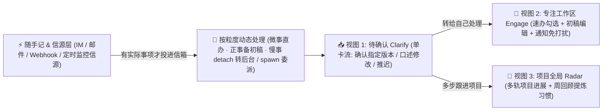

# 用 GTD 的思路设计工作辅助 Agent

> **核心想法**：好用的工作辅助 Agent，**不该只是一个问一句答一句的聊天框**，**也不该是一个让人天天填字段的待办软件**，**更不该是替人乱做决定的全自动黑盒**——它更像一个和你共用同一套极简清单的得力助手：对外给你看到的永远只有干净直观的 GTD 界面，对内则根据事情大小自己拼装底层原语，替你收拢杂事、查好背景、写好初稿、盯着外部回音，把最后的判断和拍板留给你。

---

## 一、为什么 GTD 想法很好，但大多数人坚持不下来？

David Allen 在《Getting Things Done (GTD)》里有一句很实在的话：

> **“大脑是用来想点子和做判断的，不是用来记杂事和盯进度的（Your mind is for having ideas, not holding them）。”**

人觉得累和焦虑，往往不是因为手头正在干的这一件事有多难，而是脑子里同时挂着几十件没着落的事（Open Loops）——这一点和 DeepSeek 在 Super-agent 研究里观察到的现象完全一致：**单件事做得好不好看模型能力，但同时推进十几件事的上限卡在人的注意力（人通常只能同时盯住 3～5 个对话窗口）**。

GTD 用五个步骤（**收集 Capture → 理清 Clarify → 整理 Organize → 回顾 Reflect → 执行 Engage**）帮人把悬着的事清出大脑。但纯靠人工维护时，绝大多数人两三周就会放弃，因为**人既要当拍板的人，又要当整理表格的清洁工**：

| GTD 步骤 | 纯靠人工维护时卡在哪儿 | 引入 Agent 后怎么省力 |
| :--- | :--- | :--- |
| **1. 收集（Capture）** | 事情散在微信/飞书、邮件、GitHub、口头沟通里，手动抄进待办软件太烦，忙两天就断了。 | **统一信源自动接住**：转发一条消息、说半句语音，或挂一个定时监控信源就算接进来了，当时不用选分类、填日期。 |
| **2. 理清（Clarify）** | 下班面对几十条未处理消息，逐条想“下一步具体干嘛”非常耗神，看着就让人不想点开。 | **小事直办、正事先备好初稿**：纯个人备忘/提醒直接落好；需要对外回应或拍板的事，Agent 先在后台查清背景、写好初稿等你点确认。 |
| **3. 整理（Organize）** | “等别人回复（Waiting For）”没人替你盯着；项目和下一步动作之间的状态更新全靠手改。 | **自动挂监听盯进度**：每条等待项自动挂上会话监听和超时闹钟，对方回了自动更新（多方回信还能等收齐再叫你），超时没回帮你拟好催问的话。 |
| **4. 回顾（Reflect）** | 每周五花一两个小时核对所有项目、清理长期不动的僵尸任务，很少有人能一直坚持。 | **自动准备周回顾**：核对代码提交、日历和聊天记录勾掉已完成项，挑出卡住没动的项目，并把改稿习惯与高频重复检查沉淀成 `SKILL.md` 或轻量脚本。 |
| **5. 执行（Engage）** | 就算知道下一步是“给客户回技术方案”，翻找五份旧文档 + 面对空白页面，还是很容易拖延。 | **带着资料和初稿直接开工**：点开任务时，相关资料、上下文链接和初稿已经摆在手边；专注期间自动压住不紧急的通知。 |

---

## 二、现有三类 AI 工作工具各自差在哪儿？

拿日常真实工作的体验去看现在主流的三类产品，短板都很明显：

1. **纯聊天框形态（ChatGPT / OpenClaw / 纯 IM 助手）—— 聊过几屏之后，全局还有哪些事就找不到了**
   * 聊天记录是一条按时间往下滚的流水账，**留不住全局状态**。手头十几个并行事项各自卡在哪儿、在等谁回话，聊上二十屏就彻底沉底了，还得人自己在多个会话窗口之间来回切。
2. **传统待办/看板 + AI 按钮（Notion AI / Motion / Jira）—— 把 1 条待办拆成 10 条待办，活还是得自己从头干**
   * 这类工具里的 AI 最擅长把一句目标拆成八条子任务塞进列表。**待办变多了，概念和字段变复杂了，但点开每一条依然是一张白纸**。
3. **激进的“全自动无人公司”黑盒 —— 替人乱拍板，最后还得人去收拾烂摊子**
   * 真正重要的工作（技术方案取舍、产品细节、对外商务沟通、人事安排），**怎么定调、发不发出去必须由人自己决定**。如果 Agent 没分寸地直接对外发消息或改线上东西，人反而要时刻提防它闯祸，比自己干还累。

---

## 三、两条底层铁律与四个产品设计原则

在动手设计功能之前，我们先定死两条最根本的边界，防止系统越做越臃肿：

> [!IMPORTANT]
> 1. **用户看到的表层必须极其简单**：界面上只保留最直觉的 GTD 概念（信箱与信源、待确认卡片、事项推进状态），绝不把底层的队列、子进程、档位或技术名词暴露给用户。
> 2. **系统底层不堆砌定制业务实体**：内核只固定 **8 个基础原语 + `Cell` 拼装容器**；项目结构、草稿版本校验与多任务汇合通过运行在 `Context + Loop` 上的状态协议与预设模板实现，长尾复杂场景再由 **Agent 在权限边界内动态拼装原语** 适配。

在这两条边界之上，工作台守住下面四个具体产品原则：

### 原则 1：定时监控是“信源”而不是“待办”，GTD 列表只放真正要推进的事
* 日常工作里常有一类需求，比如“每周一早 9 点看一眼核心指标有没有掉”、“盯着研发群里有没有人反馈支付报错”。
* **千万别把这类长期监控当成“待办项目”塞进任务列表**——平时指标正常、没人报错的时候，根本没有事要办；硬塞进项目列表只会制造一堆永远勾不完的假任务。
* 正确的摆法是：**它们本身是为了“发现和产生任务”而存在的，因此和邮箱、飞书、GitHub Webhook 一样，属于信箱的“信源（Mailbox Source）”**。平时在信源层跑轻量脚本或规则检查，没事就直接静默结束；只有真正触发异常时，才往信箱投一封信，生成一条具体的待办或项目。

### 原则 2：小事秒办不烦人，正事提前备好初稿，慢事自动转后台且随时能喊停
日常进信箱的事情大小差得极远，不能用同一条死板的重型流水线去套所有事：
* **零外部副作用的个人微事（如“把这篇链接存进阅读清单”、“周五下午 3 点提醒我约牙医”）**：主循环 2 秒内直接存好或定好闹钟，给个轻提示就完事，**绝不在待确认箱里再弹一张卡逼你审批自己刚说的话**。
* **需要对外回应或拿主意的事**：凡是不产生对外副作用的准备工作（查代码、翻历史纪要、拉数据、在隔离目录跑测试、起草回复或方案初稿），Agent 在叫你之前**先在后台做完**，让你打开看到的永远是带依据、带版本号的半成品初稿，而不是空白页。
* **做着做着变慢的事（超时执行迁移 `detach` + 异步 `Job` + 实时急刹）**：如果一件事超过 5 秒没跑完，内核直接将原任务连同原执行权与原沙箱迁移到后台运行槽（标为 `🟢 Agent 处理中`，不消耗子任务派生层数，同时收回前台对该执行槽的旧占用），主聊天框立刻腾出来接你下一句话；后台跑长测试时挂载异步 `Job` 不占会话锁，你随时说“改需求”或“停下”都能经控制旁路立即生效；遇到“并发查 15 家竞品”或“催 3 家供应商集齐再比价”，则通过 `spawnCell` 委派子任务并按确定性汇合协议**收拢成唯一一张结果卡再来找你**。

### 原则 3：每个动作标清楚“当前球在谁脚下”，用三个极简视图代替流水账
每个进行中的项目（`Project`，独立记录进行中 / 已完成 / 已取消 / 以后再说生命周期）底下可以同时有多个并行动作，每个动作明确标出当前推进责任（项目视图按优先级聚合展示，不把项目硬压成互斥三选一）：
* **`🟢 Agent 处理中`（`@Agent`）**：查资料、复现 Bug 提 PR、盯 CI 自动重修、跑数据等交出去的活。Agent 在隔离环境里推进，做完了或遇到需要授权的动作（`Gate: defer`），再生成单张卡片找你确认。
* **`🔵 我来处理`（`@Human`）**：需要你亲自做取舍、写核心段落或线下出面的事。Agent 提前把背景摘要、参考链接和底稿备在手边；你改稿保存会推进草稿版本号，不怕被后台消息覆盖。
* **`🟡 等待回复`（`@Waiting`）**：球在同事、客户或外部流程那儿。后台持久化具体等待条件并挂上会话监听和超时提醒，没齐或没到期时不占视线，回齐了或超时未回才浮出来。

顺着人一天工作的节奏，界面只拆成 **1 个随手记/信源入口 + 3 个日常视图**：

1. **视图 1：`待确认收件箱（Clarify）`** —— 一次只看一张卡，同一个项目同一时刻最多只出 **1 张卡**，几分钟快速拍板清掉收件箱。
2. **视图 2：`专注工作区（Engage）`** —— 按当下时间和精力挑一件事干（简单线下小事一键勾完，重文档左栏改初稿、右栏看配齐的参考资料），期间 `Outbox` 自动暂存面向人的非紧急通知（`notify`），而后台子任务的内部推进与汇合（`protocol`）照常运行不中断。
3. **视图 3：`项目全局与周回顾（Radar）`** —— 一屏看清手头 5～12 个**真正有终点的活跃项目**卡在哪一步，防项目停滞；每周五汇总已完成项，并把你改稿的习惯或重复执行的检查提炼成 `SKILL.md` 规范或零成本脚本。

### 原则 4：权限随信任慢慢放开
* 刚接手某类对外动作时，默认拦在待确认收件箱里（`Gate: defer`），点过确认才真正发出去；如果刚配了一条没把握的新群聊信源，也可以直接让 Agent “前两天先记进观察笔记别弹卡”，看准了再放开。
* 当某类固定事项（比如常规格式修复或固定模板催问）你已经连续多次一字未改直接点确认，系统在周回顾时再顺口问一句要不要改成有预算上限的自动执行——用熟了自然省心，没把握的事绝不自作主张。

---

## 四、不同粒度的工作怎么在同一套原语底座上跑起来？

整套产品基于 [8 个基础原语 + `Cell` 容器](./02-atomic-kernel-architecture.md) 与对应的状态/汇合协议运行，无需额外发明定制底层组件：

| 日常不同粒度的工作 | 表层 GTD 看到的样子（始终一致） | 底层 `Cell` 与 8 原语怎么自动适配 |
| :--- | :--- | :--- |
| **定时巡检 / 群报错监控** | 平时无感（在信源列表里显示运行正常），出异常时才进 `Clarify` | 套用 **`sensor` 信源模板**：`② Clock / ① Channel` → 跑脚本或轻量检查 → 正常直接 `⑧ silentDrop`，异常才往主 `③ Inbox` 投信 |
| **随手存资料 / 定个人提醒** | 顶部轻提示“已存入资料库 / 已设好周五提醒”，到点出现速办项 | 在主台 **`inline` `Cell`** 里 2 秒直写 `④ Context` 或注册单次 `② Clock(at)`，不拉重沙箱、不弹多余审批卡 |
| **回复同事提问 / 单次审批** | `Clarify` 里出现 1 张查好出处的回复草稿卡 | 主台或短 `worker` 查清背景生成带版本的 `Artifact`，经 `⑦ Gate(defer)` 绑定草稿版本挂起出卡；确认时校验版本防误发新版，群里若他人已答则自动撤卡 |
| **复杂问题跑久了 / 中途喊停** | 自动变成 `🟢 Agent 处理中` 事项，主输入框不卡顿，随时可点停止 | 超 5 秒触发原任务执行迁移（`detach`）：保留原执行权与原沙箱迁往后台并撤销前台旧槽（无需派单权限）；喊停走 `③ Inbox.control` 旁路秒级终止 |
| **催 3 家报价 / 扒 15 家竞品** | `Radar` 里只占 1 行项目（如 `报价已回 2/3`），收齐后 `Clarify` 只出 1 张汇总卡 | 项目根 `Cell` 派生监听/`Clock` 或 15 个隔离 `worker` 子 `Cell`；结果经 `⑧ protocol` 通道回流，由 `④ Context + ⑤ 确定性处理器` 按版本完成 `all` 原子汇合，收齐才弹唯一结果卡，完结按版本级联销毁 |

---

## 五、小结

> **传统待办软件让你自己维护复杂的表格字段；纯聊天 Agent 让你在十几个会话窗口里陪它来回说；**
> **我们要做的，是表层只给你最清爽的 GTD 收件箱与球权视图，底层让 Agent 自己用 8 个原子拼装出恰当的执行结构——小事不折腾、大事不堵车、没事不打扰。**
