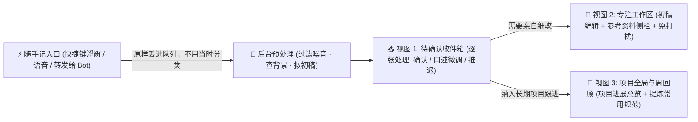

# 用 GTD 的思路设计工作辅助 Agent

> **核心想法**：好用的工作辅助 Agent，**不该只是一个问一句答一句的聊天框**，**也不该是一个让人天天填字段的待办软件**，**更不该是替人乱做决定的全自动黑盒**——它更像一个和你共用同一套任务清单的得力助手：平时替你收拢杂事、查好背景、写好初稿、盯着别人回信，把最后的判断和拍板留给你。

---

## 一、为什么 GTD 想法很好，但大多数人坚持不下来？

David Allen 在《Getting Things Done (GTD)》里有一句很实在的话：

> **“大脑是用来想点子和做判断的，不是用来记杂事和盯进度的（Your mind is for having ideas, not holding them）。”**

人觉得累和焦虑，往往不是因为手头正在干的这一件事有多难，而是脑子里同时挂着几十件没着落的事（Open Loops）。GTD 用五个步骤（**收集 Capture → 理清 Clarify → 整理 Organize → 回顾 Reflect → 执行 Engage**）帮人把这些悬着的事清出大脑。

但现实里，绝大多数人自己用 GTD 两三周就会放弃。原因很简单——**人既要当拍板的人，又要当整理表格的清洁工**，维护成本太高了：

| GTD 步骤 | 纯靠人工维护时卡在哪儿 | 引入 Agent 后怎么省力 |
| :--- | :--- | :--- |
| **1. 收集（Capture）** | 事情散在微信/飞书、邮件、GitHub、口头沟通里，手动抄进待办软件太烦，忙两天就断了。 | **多渠道直接丢进来**：转发一条消息、说半句语音就算收进来了，当时不用选分类、填日期。 |
| **2. 理清（Clarify）** | 下班面对几十条未处理消息，逐条想“下一步具体干嘛”非常耗神，看着就让人不想点开。 | **后台先查背景、写初稿**：Agent 先过滤掉纯通知噪音，把需要处理的事项查好相关背景，甚至**先把初稿写好等你确认**。 |
| **3. 整理（Organize）** | “等别人回复（Waiting For）”没人替你盯着；项目和下一步动作之间的状态更新全靠手改。 | **自动盯进度**：每条“等待回复”都挂上渠道监听和超时提醒，对方回了自动更新，超时没回帮你拟好催问的话。 |
| **4. 回顾（Reflect）** | 每周五花一两个小时核对所有项目、清理长期不动的僵尸任务，很少有人能一直坚持。 | **自动准备周回顾**：自动核对 Git、日历和聊天记录勾掉已完成项，挑出卡住没动的项目，并把你平时改稿的习惯总结成新规则。 |
| **5. 执行（Engage）** | 就算知道下一步是“给客户回技术方案”，翻找五份旧文档 + 面对空白页面，还是很容易拖延。 | **带着资料和初稿直接开工**：点开任务时，相关资料、上下文链接和初稿已经摆在手边；专注期间自动压住不紧急的通知。 |

---

## 二、现有三类 AI 工作工具各自差在哪儿？

拿日常真实工作的体验去看现在主流的三类产品，短板都很明显：

1. **纯聊天框形态（ChatGPT / OpenClaw / Poke 纯 IM 界面）—— 聊过几屏之后，全局还有哪些事就找不到了**
   * 聊天记录是一条按时间往下滚的流水账，**留不住全局状态**。手头十几个并行项目各自卡在哪儿、在等谁回话，聊上二十屏就彻底沉底了，最后还得靠人脑记着。
2. **传统待办/看板 + AI 按钮（Notion AI / Motion / Jira）—— 把 1 条待办拆成 10 条待办，活还是得自己从头干**
   * 这类工具里的 AI 最擅长把一句目标拆成八条子任务塞进列表。**待办变多了，心理压力更大了，但点开每一条依然是一张白纸**。
3. **激进的“全自动无人公司”黑盒 —— 替人乱拍板，最后还得人去收拾烂摊子**
   * 真正重要的工作（技术方案取舍、产品细节、对外商务沟通、人事安排），**怎么定调、发不发出去必须由人自己决定**。如果 Agent 没分寸地直接对外发消息或改线上东西，人反而要时刻提防它闯祸，比自己干还累。

---

## 三、四个核心设计原则

要把“待办清单”做成真正帮上忙的工作台，核心是守住下面四条原则：

### 原则 1：能提前准备的先在后台做完，别让人面对空白页
* 传统 GTD 有条“两分钟原则”：*两分钟内能干完的事，理清的时候顺手干掉。*
* 有了 Agent 之后，凡是进入收件箱的事项，只要**不产生对外副作用**（比如只读查代码、翻历史纪要、拉数据、在隔离沙箱里跑测试、起草回复或方案初稿），Agent 在提醒你之前**先在后台做完**。
* **实际体验的区别**：你打开收件箱看到的不再是一排干巴巴的任务标题（还得你自己从零开始干），而是 **“背景已经查清、初稿已经拟好”的待确认卡片**——你花十几秒扫一眼，没问题就点发送，不满意就说一句让它改。

### 原则 2：每件事标清楚“当前归谁推进”
每个进行中的项目（`Project`），下一步动作在同一时刻都明确归到下面三种状态之一，一眼就能看出卡在谁那儿：
* **`🟢 Agent 处理中`（`@Agent`）**：查资料、复现 Bug 提 PR、整理表格、跑数据等可以交出去的活。Agent 在独立沙箱里异步跑，做完了或者遇到需要你授权的操作（`Gate: defer`），再生成卡片找你确认。
* **`🔵 我来处理`（`@Human`）**：需要你亲自想清楚、做取舍或出面沟通的事。Agent 不越界代劳，但会提前把一页纸背景摘要、相关文档链接和初稿提纲备好，减少进入状态的时间。
* **`🟡 等待回复`（`@Waiting`）**：球在同事、客户或外部流程那儿。后台自动挂上消息监听和超时提醒，没动静时不占你的视线，对方回了或者超时没回才重新浮出来。

### 原则 3：界面分成“随手记入口 + 三个日常视图”，不靠单一聊天框硬撑
前端不需要做成密密麻麻的表格，也不该只有一个聊天窗口，而是顺着人一天工作的自然节奏，拆成 **1 个随手记入口 + 3 个工作视图**：

1. **视图 1：`待确认收件箱（Clarify）` —— 几分钟快速清掉收件箱**
   * 参考 Superhuman / Linear Triage 的**单卡片视图**（一次只看一张卡，不摆满屏未读列表制造焦虑）。
   * 每张卡片只讲清楚三件事：**① 发生了什么（一句话摘要 + 原始消息来源）**、**② Agent 已经替你查明/写好了什么（初稿内容或变更 Diff）**、**③ 你怎么处理（`[确认执行]`、`[按住说话让它改]`、`[推迟到稍后]`、`[转到工作区自己改]`）**。
2. **视图 2：`专注工作区（Engage）` —— 按当下时间和精力挑一件事专心干**
   * 顶部提供简单的场景筛选：`[15 分钟碎片时间]` / `[大块专注时间]` / `[低精力杂事]`。
   * 挑中一件事进入编辑界面后，**自动开启 `Outbox` 免打扰缓冲**（把非紧急通知先攒起来，等退出专注状态再集中处理），避免一边写方案一边被群消息打断。
3. **视图 3：`项目全局与周回顾（Radar）`**
   * **防项目停滞检查**：一屏看清手头 5～12 个活跃项目的当前推进状态。如果某个项目既没有 `Agent 处理中` 的任务，也没有 `等待回复` 的跟进项，更没有明确的 `我来处理` 下一步动作，系统直接标出来提醒你拆下一步，或者挪进“以后再说（`Someday/Maybe`）”。
   * **15 分钟周回顾**：每周五汇总本周做完的事、超时未回的跟进项，并把 Agent 从你本周改稿记录里观察到的偏好整理成 **`SKILL.md` 草稿**供你确认（例如：“发现你审阅故障复盘时每次都会追问‘监控为什么没提前报警’，要不要加进你的复盘检查清单？”）。

### 原则 4：权限随信任慢慢放开
* 刚接手某类任务时，默认拦在待确认收件箱里（`Gate: defer`），草稿必须你点过确认才会真正发出去。
* 如果某类固定事项（比如“整理每日竞品动态入库”或“常规 Lint 修复 PR”）你已经连续 10 次一字未改直接点确认，系统再主动问一句：**“这类事项你已经连续 10 次原样放行，要不要改成自动执行、只在周报里汇总告诉你？”**——用熟了自然省事，没把握的事绝不擅自做主。

---

## 四、这套产品怎么直接跑在 8 个基础模块上？

这套 GTD 工作台不需要在底层的 [8 个基础模块](./02-atomic-kernel-architecture.md) 之外新造特殊组件，每个产品环节刚好对应到底层现成的模块：

| GTD 工作台环节 | 对应的底层模块 | 实际怎么跑 |
| :--- | :--- | :--- |
| **多渠道随手收集** | **`① Channel`** | 桌面快捷键浮窗、手机语音、IM 转发、邮件/GitHub Webhook 统一转成标准 `Envelope` 入队。 |
| **推迟唤醒、超时催问与周五回顾** | **`② Clock`** | 推迟项（Snooze）到期重新入队、`Waiting For` 超时检查、每日晨报与周五后台复盘定时触发。 |
| **收件队列** | **`③ Inbox`** | 幂等去重、连发消息合并、单会话串行锁，保证后台预处理不会并发撞车。 |
| **项目、偏好、参考资料与检查清单** | **`④ Context`** | `Projects`（活跃项目状态）、`USER.md`（个人职责与偏好）、`Reference`（SQLite FTS5 全文检索）、**各类固定检查清单 = `SKILL.md`**。 |
| **分拣消息与后台起草** | **`⑤ Agent Loop`** | 收到新消息先判断是不是噪音，需要处理的事项自动调沙箱查背景、写初稿，生成待确认卡片，或在后台推进 `@Agent` 任务。 |
| **查资料与写初稿的执行环境** | **`⑥ Workspace`** | 隔离沙箱（读写文件、跑命令、写脚本调接口），把空白任务做成带依据的半成品初稿。 |
| **对外动作拦截与人工确认** | **`⑦ Gate`** | 只读查询和本地写草稿直接放行（`allow`）；发消息、合代码、花钱等对外操作一律挂起（`defer`），释放算力等你在收件箱点确认。 |
| **可靠发送与免打扰缓冲** | **`⑧ Outbox`** | 点确认后幂等发送到外部渠道；纯噪音直接 `NO_REPLY` 静默结束；人处在 `Engage` 专注状态时自动暂存非紧急通知。 |

---

## 五、小结

> **传统待办软件让你自己维护任务表；纯聊天 Agent 让你在对话框里陪它来回说；**
> **我们要做的，是一个替你接住日常杂乱输入、提前在后台查好资料写好初稿、替你盯着外部回音、并在你专心干活时少添乱的工作助手。**
