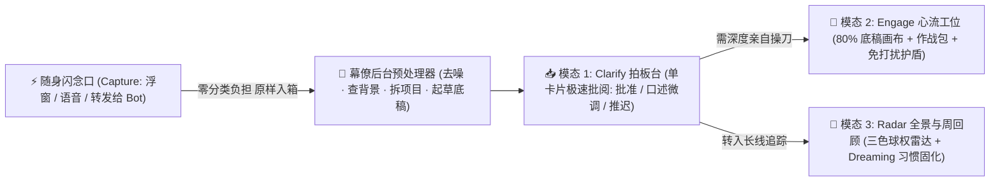

# GTD × Agent 微内核：最佳“Agent 辅助工作”产品形态推演

> **核心命题**：最好的工作辅助 Agent，**既不是一个被动回答问题的“聊天框”（Chatbot）**，**也不是一个让人天天填卡片的“AI 待办表”（Todo App）**，**更不是彻底剥夺人类判断权的“全自动黑盒”**——而是一台**与你共享同一套 GTD 状态机的“认知协处理器 / 幕僚长（GTD Co-Processor）”**。

---

## 一、第一性原理：GTD 为什么伟大？又为什么 95% 的人坚持不下来？

David Allen 在《Getting Things Done (GTD)》中提出的核心洞察至今没有过时：

> **“你的大脑是用来产生想法和做判断的，不是用来记事和盯进度的（Your mind is for having ideas, not holding them）。”**

焦虑与低效的根源，不在于事情太多，而在于大脑后台挂着几十个**未闭环的悬念（Open Loops）**。GTD 设计了经典的五步流水线（**Capture 捕捉 → Clarify 理清 → Organize 组织 → Reflect 回顾 → Engage 执行**）来实现“心如止水（Mind Like Water）”。

但现实中，绝大多数知识工作者在自己跑 GTD 时都会在第 2～3 周崩盘，原因恰恰出在 **“人类既当决策者、又当清洁工”** 的反人性负担上：

| GTD 阶段 | 传统人类手跑 GTD 的崩溃点 | 引入 Agent 后的根本性重构 |
| :--- | :--- | :--- |
| **1. Capture（捕捉）** | 信息散落在微信/飞书、邮件、GitHub、会议口头承诺里，手动搬运到待办软件太累，三天就断更。 | **全渠道自动收口 + 零格式随手丢**：转发一条消息、说半句语音即入箱，无需选分类、填日期。 |
| **2. Clarify（理清）** | 下班面对 50 条杂乱消息，逐条想“下一步具体物理动作是什么”极度耗费脑力（前额叶罢工）。 | **预澄清 + “预跑底稿”**：Agent 先按 GTD 决策树分拣噪音、查好背景、拆出子步骤、甚至**先把前 80% 草稿做出来等你拍板**。 |
| **3. Organize（组织）** | `Waiting For`（等别人回）没人替你盯；`Projects` 和 `Next Actions` 状态同步沦为沉重的“表单维护税”。 | **状态机活体化**：每条 `Waiting For` 都是一个挂着定时器和通道监听的休眠 Agent 猎犬，有回音自动唤醒、超时拟好催办稿。 |
| **4. Reflect（回顾）** | 每周五花 2 小时做 Weekly Review 核对所有项目、清理僵尸任务，极少有人能长期自律坚持。 | **离线 Dreaming 周回顾仪式**：Agent 自动交叉比对 Git/日历/邮件勾掉已完成项、揪出停滞项目、并从你的修改习惯里提炼新 `SKILL.md`。 |
| **5. Engage（执行）** | 就算知道下一步是“回客户技术方案”，翻找 5 份文档 + 面对空白页的**启动摩擦力（Activation Energy）**依然导致拖延。 | **带“作战包”直接进心流**：点开任务时，相关资料、历史上下文与 80% 初稿已铺在画布上，同时开启免打扰护盾拦截外部噪音。 |

---

## 二、为什么现有三类 AI 产品形态都差一口气？

用 GTD 的视角审视当前市面上的主流产品，能立刻看清它们的结构性缺陷：

1. **纯聊天流形态（ChatGPT / OpenClaw / Poke 纯 IM 界面）——“时间流冲垮了全局视野”**
   * 聊天框是一条按时间滚动的河流，**天生留不住结构化状态**。十几个并行项目的进度、等谁回复的卡点，聊过 20 屏就彻底沉底，未闭环悬念（Open Loops）重新回到人类脑子里。
2. **传统 Todo / 看板 + AI 按钮（Notion AI / Motion / Jira）——“AI 帮倒忙，把 1 条待办裂变成 10 条待办”**
   * 传统工具里的 AI 只会帮你把一句模糊目标拆成 8 条子任务塞进列表，**不仅没帮你干活，反而让待办列表膨胀 8 倍**，你依然要自己从零开始做每一条。
3. **激进“零人类公司”黑盒形态（无约束 Swarm）——“夺走了主权，留下了擦屁股债”**
   * 在真实高价值工作（架构取舍、产品审美、商务分寸、人事沟通）中，**意图定义与最终拍板是人类不可让渡的主权**。Agent 越俎代庖直接对外发信或合并大改，带来的不是轻松，而是时刻担心它闯祸的失控焦虑——恰恰违背了 GTD “100% 可信外部系统”的前提。

---

## 三、理想产品形态：GTD 认知协处理器的四大核心法则

最好的 Agent 辅助工作产品，应该把 **“待办清单（To-Do List）”升级为“幕僚预制流水线（Pre-Flight Pipeline）”**：

### 法则 1：将 GTD 的“两分钟原则”升级为 **“Agent 预跑原则（Zero-Blank-Page Rule）”**
* 传统 GTD 规定：*“2 分钟内能做完的事，在理清阶段当场做掉。”*
* 在 Agent 时代，任何进入 `Inbox` 的事项，只要**不产生外部不可逆副作用**（只读查代码、拉日志、搜资料、在沙箱跑验证、起草回复或方案初稿），Agent 在唤醒你的注意力之前**必须先在后台预跑完**！
* **体验质变**：你每天打开工作台看到的不再是一堆冷冰冰的“待办标题（你得从 0% 开始干）”，而是一叠 **“幕僚批件夹（Agent 已干完 0%→80%，附带依据和草稿，你只需花 15 秒审阅、微调一句或点 `[批准执行]`）”**。

### 法则 2：双轨 `Next Actions` —— `@Agent` 后台异步流与 `@Human` 心流保护区严格分道
每个活跃 `Project` 下的下一步动作（Next Action）必须明确归属球权（同一时刻球在谁脚下）：
* **`🟢 @Agent`（委派跑道）**：写调研报告、复现 Bug 提 PR、清洗表格、跟进常规数据。Agent 在独立沙箱异步推进，只有撞到权限红线（`Gate: defer`）或产出阶段交付物时，才生成一张待决卡进入你的拍板台。
* **`🔵 @Human`（心流跑道）**：深度思考、关键决策、高敏感沟通。Agent 绝不越权代劳，但会提前为你备好 **Context Pack（一页纸背景卡 + 关联文件指针 + 结构骨架）**，让你坐下 10 秒即入戏。
* **`🟡 @Waiting`（猎犬跑道）**：球在外部同事、客户或审批流脚下。绑定后台监听与跟进闹钟，没消息时不占你的视觉空间，有回音或逾期才浮出水面。

### 法则 3：三明治交互界面（放弃“单一聊天框”，采用 **Capture 浮窗 + 三模态工作台**）
产品前端不应是一个聊天窗口，也不应是密密麻麻的表格，而应贴合人类一天真实的认知节律，设计为 **1 个随身入口 + 3 个极简工作模态**：

1. **模态 1：`Clarify & Decide`（收件与拍板台 —— 5 分钟清空悬念）**
   * 借鉴 Superhuman / Linear Triage 的**单卡片专注流**（一次只看一张卡，杜绝视觉淹没）。
   * 每张卡只有三个清晰要素：**① 发生了什么（1 句话摘要 + 原始出处）**、**② 我已经替你查明/准备好了什么（草稿 Diff / 选项建议）**、**③ 你的决策动作（`[Enter 批准并发送]`、`[按住说话让它改]`、`[Snooze 推迟到下周]`、`[转入心流工位亲自改]`）**。
2. **模态 2：`Engage / Focus`（当下心流工位 —— 尊重时间与精力）**
   * 顶部仅有 GTD 经典的场景/精力过滤器：`[⏱ 15分钟碎片]` / `[🔥 2小时深度心流]` / `[🔋 低精力行政杂事]`。
   * 选定一件事后全屏进入共创画布，**自动激活 `Outbox` 心流护盾**（压制所有非 P0 通知，全部攒到下一批拍板时段），彻底终结“一边写方案一边被 10 个群消息切碎注意力”。
3. **模态 3：`Radar & Horizon`（全景雷达与 Weekly Review）**
   * **反僵尸项目铁律**：一屏看清手头 5～12 个活跃 `Projects` 的球权状态；任何一个 Project 如果既没有在跑的 `@Agent` 任务、也没有 `@Waiting` 猎犬、更没有明确的 `@Human` 下一步动作，系统立即高亮提醒拆解或归档至 `Someday/Maybe`。
   * **15 分钟交互式周回顾**：每周五自动汇总本周已闭环战果、未回音跟进项，并展示 Agent 从你本周批改记录里学到的 **新偏好 / 新 `SKILL.md` 提案**（如：“发现你审阅故障复盘必问‘监控为何没提前报警’，已加入你的复盘检查清单，是否保留？”）。

### 法则 4：渐进式信任阶梯（Earned Autonomy —— 从“学徒”长成“老搭档”）
* 新接手某类工作时，默认拦截在拍板台（`Gate: defer`），草稿必须你点确认才外发。
* 当某张 `SKILL.md`（例如“整理每日竞品动态入库”或“常规 PR Lint 修复”）连续 10 次被你零修改一键放行后，系统主动提示：**“该类事项你已连续 10 次原样批准，是否将其升级为自动放行（仅在周报汇总告知）？”**——让自动化边界随着真实信任自然生长。

---

## 四、架构闭环验证：这套 GTD 产品形态与“8 大原子微内核”严格 1:1 同构！

最美妙的地方在于：**这套 GTD 产品形态不需要在我们的 8 原子微内核之外增加哪怕一个新底层组件**——GTD 的每一个概念，恰好就是微内核中某几个原子的自然投影：

| GTD 核心构件 | 微内核原子映射 | 具体运行机制 |
| :--- | :--- | :--- |
| **多源 Stuff 捕捉口** | **`① Channel`** | 全局快捷键、手机语音、IM 转发、邮件/GitHub Webhook 统一转为标准 `Envelope` 入箱。 |
| **Tickler 唤醒夹 & 回顾节律** | **`② Clock`** | 推迟项（Snooze）到期重入箱、`Waiting For` 超时探针、每日晨报与周五离线 Dreaming 触发器。 |
| **In-Basket 收集篮** | **`③ Inbox`** | 幂等去重、突发消息合并、单会话串行锁，保证后台预处理绝不撞车。 |
| **Projects / Areas / Reference / Checklists** | **`④ Context`** | `Projects`（活跃结果树）、`Areas/USER.md`（长期职责与偏好）、`Reference`（SQLite FTS5 全文库）、**GTD 标准检查清单 = `SKILL.md`**。 |
| **Clarify 分拣与幕僚预跑** | **`⑤ Agent Loop`** | 收到新信封先跑 GTD 分拣与无副作用预执行，生成结构化“拍板卡（Decision Card）”或后台推进 `@Agent` 任务。 |
| **预执行与作战包准备间** | **`⑥ Workspace`** | 隔离沙箱（文件读写、Bash、Codemode 调 API/浏览器），把空白任务加工成 80% 半成品底稿。 |
| **主权边界与拍板台挂起** | **`⑦ Gate`** | 无副作用读取/本地起草直接 `allow`；一切外发消息、合并代码、花钱动作触发 **`defer` 零算力挂起**，生成拍板台卡片等人类拍板。 |
| **受控外发 & 心流免打扰护盾** | **`⑧ Outbox`** | 批准后幂等投递至外部渠道；噪音直接 `NO_REPLY` 吞掉；人类处于 `Engage 心流模式` 时自动缓冲非紧急提醒。 |

---

## 五、一句话总结产品定位

> **传统工具让你管理任务（Manage Tasks）；纯聊天 Agent 让你陪它对话（Chat with AI）；**
> **而基于 GTD 的新一代工作 Agent，是“替你接住一切杂乱输入、在后台把待办预制成半成品批件、替你盯紧所有外部等待、并誓死守护你心流时间”的数字幕僚长。**
