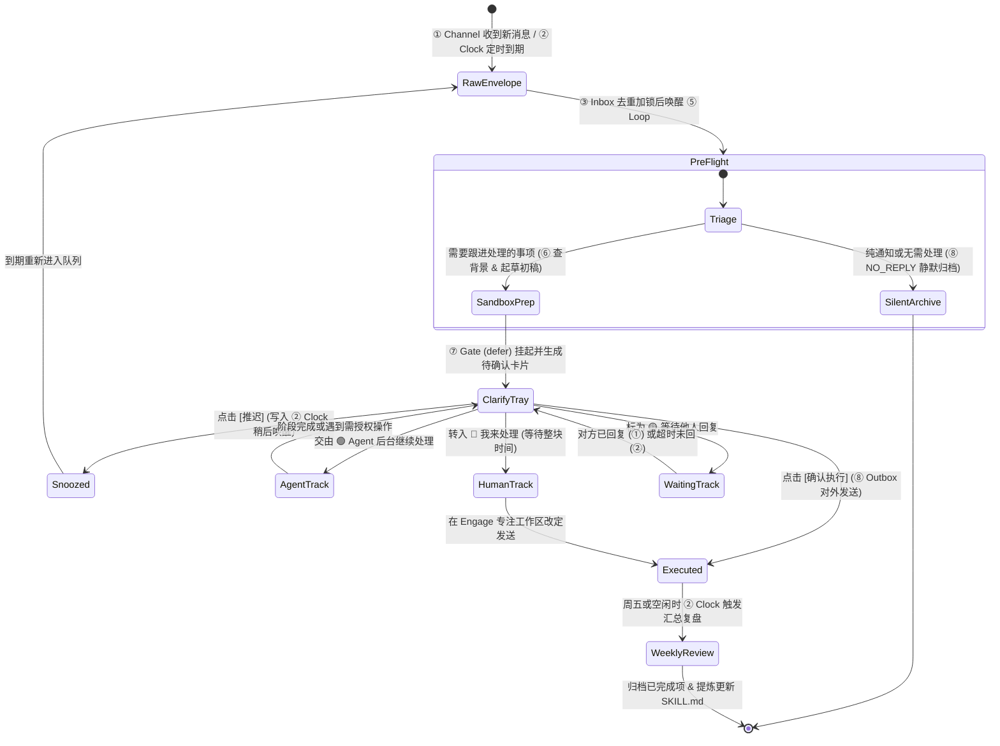

# GTD 工作台界面交互与状态流转设计

本文档把 [03-gtd-agent-product-vision.md](./03-gtd-agent-product-vision.md) 里的思路落成具体的 **页面布局、卡片结构与底层模块状态流转**，方便后续前后端照着对齐实现。

---

## 一、整体布局：顶部三个视图切换 + 运行状态提示

主界面不搞传统软件“左边几十个文件夹 + 中间几百条未读列表”的拥挤布局，顶栏只保留 **3 个日常视图切换键** 和 **1 个简短的后台状态提示**：

```text
┌─────────────────────────────────────────────────────────────────────────────────────┐
│ [📥 1. 待确认 Clarify (3)]   [🎯 2. 专注工作区 Engage]   [🧭 3. 项目全局 Radar]       │
│                                           [后台已过滤 14 条纯通知，剩 3 件事待你确认] │
├─────────────────────────────────────────────────────────────────────────────────────┤
│                                                                                     │
│                                  主内容区 (Main Stage)                               │
│                    （随顶部切换：单卡片视图 / 左右分栏编辑区 / 项目与周回顾）           │
│                                                                                     │
├─────────────────────────────────────────────────────────────────────────────────────┤
│ 底部快捷键提示 / 当前任务关联的底层状态                                               │
└─────────────────────────────────────────────────────────────────────────────────────┘
```

* **右上角状态提示**：让用户一眼知道后台干了什么、有没有漏事，不用反复点进去检查：
  * **在 `待确认（Clarify）` 时**：显示后台已经自动归档了多少条无需回复的通知（对应 `⑧ Outbox` 的静默过滤）。
  * **在 `专注工作区（Engage）` 时**：显示 **`免打扰已开启：已暂存 N 条非紧急通知`**（退出专注后再统一看）。
  * **在 `项目全局（Radar）` 时**：显示 **`所有活跃项目均有明确的下一步`**，以及下次周回顾的时间。

---

## 二、视图 1：`待确认收件箱（Clarify）`（单卡片处理流）

### 2.1 交互规则
* **一次只看一张卡**：不展示让人头大的长列表，右上角只标 `剩余 N 张`；处理完最后一张就展示清爽的 **`收件箱已清空（Inbox Zero）`** 页面（同时说明后台任务都已进入休眠，不跑无谓的开销）。
* **每张卡片固定分四块，扫一眼就能做决定**：
  1. **来源与状态栏**：消息从哪来的、什么时候来的（比如 `飞书转发 · 12 分钟前`），以及当前状态标签（如 `已拟好初稿 · 等待确认`）。
  2. **原始消息（Raw Input）**：灰底折叠或简短展示原始语音转写、转发过来的消息或超时的等待项，方便随时核对原文。
  3. **Agent 预处理结果与初稿**：交代 Agent 刚才在后台查了哪些代码、文档或数据，并在编辑框里直接给出 **改完就能发的回复草稿，或者拆好的项目步骤建议**。
  4. **操作按钮栏**：1 个最常用的主按钮 + 2 个调整按钮 + `下一张 →` 暂时跳过。

### 2.2 三种最常见的卡片类型

| 卡片类型 | 怎么触发的 | Agent 在后台提前做了什么 | 按钮与点击后的底层动作 |
| :--- | :--- | :--- | :--- |
| **A. 外部提问 / 协作回复草稿卡**<br>*(处于 `Gate: defer` 挂起态)* | `① Channel` 收到同事/客户提问，或收到外部 Webhook | 自动调 `④ Context`（FTS5）查历史纪要 + `⑥ Workspace` 读相关代码配置，拟好带出处的回复草稿，必要时顺手备好文档修改 PR | • **`[✓ 确认发送并提 PR]`** → 往 `③ Inbox` 发一条确认回执唤醒挂起任务，由 `⑧ Outbox` 对外发送<br>• **`[🎙 按住口述修改意见]`** → 按你说的意见让 `⑤ Loop` 重写草稿<br>• **`[⏱ 推迟到下午]`** → 写入 `② Clock(at)`，卡片暂时收起，到点再出现 |
| **B. 随手记转项目拆解卡**<br>*(Capture → Project)* | `① Channel` 收到随口录的语音备忘，或快捷键浮窗输入的一句话想法 | 自动拉取关联现状数据（比如近 7 天转化数据），建议是否新建一个 `Project`，并拆好第一步交给 `Agent 处理` 的任务和后续由 `我来处理` 的步骤 | • **`[✓ 确认立项并让 Agent 先跑第一步]`** → 在 `④ Context` 记录新项目，同时往后台执行队列 `③ Inbox` 投递第一步任务<br>• **`[✎ 手动改一下步骤]`** → 直接在卡片上改步骤或改负责人<br>• **`[📦 先放进“以后再说”]`** → 归入 `Someday/Maybe` 列表，不占当前精力 |
| **C. 等待回复超时提醒卡**<br>*(到点自动唤醒)* | `② Clock` 里设好的单次跟进闹钟（Follow-up）到期 | 先查 `①/④` 聊天与邮件记录，确认对方确实还没回，再结合上下文拟好一条得体的催问消息，并备好下一次检查时间 | • **`[✓ 发送催问并继续跟进]`** → `⑧ Outbox` 发出消息 + `② Clock` 设好下次检查时间<br>• **`[⏱ 再等 1 天]`** → 只把 `② Clock` 提醒往后延一天<br>• **`[✓ 线下已经聊过了，直接归档]`** → 把这条 `Waiting For` 标为已完成 |

---

## 三、视图 2：`专注工作区（Engage）`（左 8 右 4 双栏布局）

遇到归在 `🔵 我来处理（@Human）` 名下的事，可以通过顶部的场景筛选（`15m 碎片时间` / `45m 整块时间` / `低精力杂事`）挑一件进入全屏工作区：

1. **左栏（占 8/12 宽）：初稿编辑区**
   * **点开就有底稿**：直接展示 Agent 根据前期调研铺好的方案初稿、提纲或相关代码改动，不用对着空白文档发呆。
   * **标出真正要人拿主意的地方**：客观数据和背景由 Agent 先填上，**需要人做取舍和判断的段落单独高亮标出来**（比如：“第 2.3 节有两个方案需要你二选一”）。
   * **做完顺手收尾**：底部可以勾选定稿后的连带动作（例如“定稿后自动发到评审群并归档”）。
2. **右栏（占 4/12 宽）：自动找齐的参考资料（Context Pack）**
   * 由 `④ Context` 自动把相关链接和摘要挂在手边，省得开十几个浏览器标签页来回翻：
     * **相关历史结论或会议纪要**（一句话摘要 + 点击看原文）
     * **关联代码文件 / PR / 数据快照**
     * **当前适用的检查清单**（例如 `arch-rfc-checklist/SKILL.md`）
3. **专注期间免打扰**：停留在专注工作区时，`⑧ Outbox` 自动把非紧急的外部提醒暂存起来，等你退出工作区或切回 `待确认收件箱` 时再集中看。

---

## 四、视图 3：`项目全局与周回顾（Radar）`（左 7 右 5 布局）

用来解决纯聊天界面“聊着聊着忘了手头一共铺开了哪几摊事”的问题，页面分左右两栏：

1. **左栏（占 7/12 宽）：进行中项目列表（按当前谁在推进标记）**
   * 列表只放当前真正推进中的活跃项目（通常控制在 5～12 个以内），每一行右边清楚标出**当前卡在哪一步、归谁推进**：
     * `🟢 Agent 处理中`：显示后台沙箱正在跑哪一步（比如 `正在复现漏斗数据问题 · 约 65%`）。
     * `🔵 我来处理`：写出需要你动手的**那一个具体下一步动作**（点一下就能跳进 `专注工作区` 开干）。
     * `🟡 等待回复`：写清楚在等谁、上次什么时候联系的、下次什么时候提醒。
   * **防停滞检查**：如果任何一个活跃项目上面三种状态全都是空的（既没 Agent 跑、也没定你下一步干嘛、也没在等谁），直接标红推回待确认区，提醒你补上下一步或移到“以后再说（`Someday/Maybe`）”。
2. **右栏（占 5/12 宽）：周回顾与个人习惯提炼**
   * 后台在空闲或周五复盘时，对比你这一周对 Agent 草稿做了哪些修改（比如你每次都会把周报按某个固定顺序重排，或者删掉某类客套话）。
   * 页面上直接列出总结出来的规律和拟生成的 `SKILL.md` 内容，你点一下 **`[✓ 保存为常用规范]`**，以后再写同类内容就会直接按你的习惯来，越用需要手改的地方越少。

---

## 五、整体状态流转图（State Machine）


