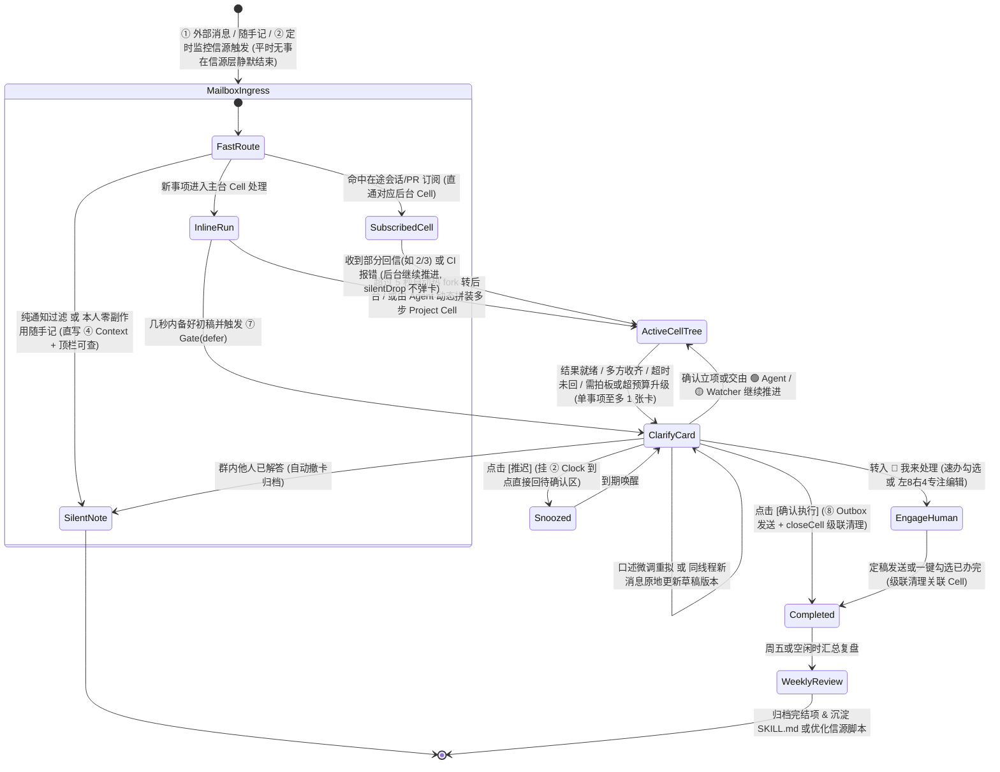

# GTD 工作台界面交互与状态流转设计

本文档把 [03-gtd-agent-product-vision.md](./03-gtd-agent-product-vision.md) 里的思路落成具体的 **页面布局、卡片规则与双层状态流转**。整体严格遵循 **“表层界面极简恒定，底层 `Cell` 动态伸缩”** 的原则——不管后台是 2 秒内联跑完，还是动态派生了十几个并发沙箱，前端呈现给用户的概念始终只有最纯粹的 GTD 三视图。

---

## 一、整体布局：随手记与信源入口 + 顶部三视图切换

主界面不搞传统软件“左边几十个文件夹 + 中间几百条未读列表”的拥挤布局，顶栏只保留 **3 个日常视图切换键**、**随手记/信源入口** 和 **1 个简短的状态提示**：

```text
┌─────────────────────────────────────────────────────────────────────────────────────┐
│ [📥 1. 待确认 Clarify (3)]  [🎯 2. 专注工作区 Engage]  [🧭 3. 项目全局 Radar]  [⚡ 随手记 / 信源] │
│                                       [后台已静默归档 14 条通知 · 2 项转后台处理中 ▾] │
├─────────────────────────────────────────────────────────────────────────────────────┤
│                                                                                     │
│                                  主内容区 (Main Stage)                               │
│                    （随顶部切换：单卡片视图 / 专注工作区 / 活跃项目与周回顾）           │
│                                                                                     │
├─────────────────────────────────────────────────────────────────────────────────────┤
│ 底部快捷键提示 / 快速输入栏（发一句话随时收集，超过 5 秒的任务自动转后台不卡当前操作）  │
└─────────────────────────────────────────────────────────────────────────────────────┘
```

* **`[⚡ 随手记 / 信源]` 轻量抽屉**：
  * 平时随手敲一句话或发段语音就能丢进信箱。
  * 点开信源设置，统一管理 **外部渠道（飞书、邮件、GitHub Webhook）** 和 **定时/监控信源（Cronjob，比如每周一查指标脚本、群报错监听）**。这些信源只负责在有事发生时往信箱投信，平时安静运行，绝不混进项目列表充当假待办。
* **右上角可点开的状态提示**：让用户一眼知道后台干了什么、不怕漏事：
  * **在 `待确认（Clarify）` 时**：显示后台自动归档了多少条纯通知、自动存好了几条随手笔记（点击 `▾` 可随时展开看一眼历史记录并支持一键移回待确认）。
  * **在 `专注工作区（Engage）` 时**：显示 **`免打扰已开启：已暂存 N 条非紧急提醒`**（退出专注后再统一看）。
  * **在 `项目全局（Radar）` 时**：显示活跃项目推进概况，以及下次周回顾时间。

---

## 二、视图 1：`待确认收件箱（Clarify）`（单卡片处理流）

### 2.1 四条核心交互规则
1. **一次只看一张卡**：不摆满屏未读列表制造焦虑，右上角只标 `剩余 N 张`；处理完最后一张就展示清爽的 **`收件箱已清空（Inbox Zero）`** 页面（后台无事时全部处于休眠态，零闲置开销）。
2. **个人零副作用微事免二次审批**：你自己随手记的纯收藏（“把文章存进阅读清单”）或纯个人提醒（“周五下午 3 点提醒我打电话”），系统办妥后只在顶栏轻提示一句（到点再唤醒提醒），**不会立刻弹一张确认卡逼你再点一次同意**。
3. **同一事项至多一张卡 + 原地热刷新**：哪怕后台为一个项目动态拼装了 15 个并发子 `Cell` 或连修了 3 轮 CI，子任务也绝不允许直接往 `Clarify` 弹卡刷屏——同一个事项在 `Clarify` 里**同一时刻最多只有 1 张卡片**。如果卡片等待确认期间，原群聊里同事已经先一步解答了问题，卡片会自动撤下归档；如果有新消息补充，卡片会原地刷新草稿版本（防止误点发出过期回复）。
4. **每张卡片固定分四块，扫一眼就能拍板**：
   * **来源与状态栏**：消息从哪个信源来的、什么时候来的（如 `飞书转发 · 12 分钟前`），以及当前状态（如 `已备好初稿 · 等待确认`）。
   * **原始消息（Raw Input）**：灰底简短展示原始消息、语音转写或触发异常的监控摘要，方便核对原文。
   * **Agent 预处理结果与初稿**：交代 Agent 在后台查了哪些代码、文档或数据，并在编辑框里直接给出改完就能发的草稿，或拆好的执行建议。
   * **操作按钮栏**：1 个主确认按钮 + 2 个微调/推迟按钮 + `下一张 →` 暂时跳过。

### 2.2 三种最常见的卡片类型

| 卡片类型 | 怎么触发的 | Agent 在后台提前做了什么 | 按钮与点击后的底层动作 |
| :--- | :--- | :--- | :--- |
| **A. 外部回应 / 交付确认卡**<br>*(处于 `Gate: defer` 挂起态)* | 信源收到同事/客户提问，或后台 `Cell` 跑完了 PR / 多方比价汇总 | 自动调 `④ Context` 查历史记录 + `⑥ Workspace` 读代码或跑完子任务汇总，拟好带出处的回复草稿或交付结果 | • **`[✓ 确认发送 / 合入]`** → 解锁挂起动作，由 `⑧ Outbox` 幂等对外发送<br>• **`[🎙 按住口述修改意见]`** → 让 `⑤ Loop` 按你的话原地重拟草稿<br>• **`[⏱ 推迟到下午]`** → 写入 `② Clock(at)`，卡片收起，到点原样回到待确认区 |
| **B. 复杂事项立项卡**<br>*(Capture → Project `Cell`)* | 收到一段需要多步推进的想法、跨方协调或大块调研需求 | 自动拉取关联现状背景，建议新建一个 `Project`，并给出初步推进安排（哪部分交 `Agent 处理`、哪部分留给 `我来处理`） | • **`[✓ 确认立项并让 Agent 开工]`** → 创建项目根 `Cell`（按需动态派生后台 `worker` 或 `watcher`）<br>• **`[✎ 手动改一下安排]`** → 直接在卡片上增删调整<br>• **`[📦 先放进“以后再说”]`** → 归入 `Someday/Maybe` 列表，暂停一切后台资源 |
| **C. 等待超时 / 受阻升级卡**<br>*(到点或异常熔断唤醒)* | `watcher` 里的跟进闹钟到期对方仍未回，或后台自动修 CI 达到重试/预算上限 | 先核实渠道记录确认对方确实未回并拟好得体的催问草稿；若是任务受阻则附上前因后果与卡点说明 | • **`[✓ 发送催问并继续跟进]`** → `⑧ Outbox` 发出消息 + `② Clock` 设好下次检查<br>• **`[⏱ 再等 1 天 / 追加额度继续]`** → 更新该 `Cell` 的定时器或 `⑦ Gate` 预算上限<br>• **`[✓ 线下已解决，直接完结]`** → 标为已完成并调用 `closeCell` 级联回收监听与沙箱 |

---

## 三、视图 2：`专注工作区（Engage）`（速办勾选 + 左 8 右 4 深度编辑）

遇到归在 `🔵 我来处理（@Human）` 名下的事，可以通过顶部的场景筛选（`15m 碎片时间` / `45m 整块时间` / `低精力杂事`）挑一件开干：

1. **轻量线下动作：一键速办**：像“给牙医回电话”“签线下快递”这类不需要写文档的小事，直接点 **`[✓ 已办完]`** 即可干净结项，不会强迫打开全屏编辑器。
2. **深度创作与决策：左 8 右 4 双栏工作区**：
   * **左栏（占 8/12 宽）：初稿编辑区** —— 点开就有 Agent 提前铺好的方案底稿、数据表格或代码改动，**需要你亲自拍板做取舍的段落单独高亮标出**（比如：“第 2.3 节有两个迁移方案需你二选一”）；底部可勾选定稿后的连带收尾动作。
   * **右栏（占 4/12 宽）：自动配齐的参考资料（Context Pack）** —— 由 `④ Context`（含 `Inline & Spill` 关联记录与 `SKILL.md` 检查清单）自动挂在手边，省得开十几个标签页来回翻找。
3. **专注期间免打扰**：停留在专注工作区时，`⑧ Outbox` 自动把非紧急的外部提醒暂存起来，等你退出工作区或切回 `待确认收件箱` 时再集中看。

---

## 四、视图 3：`项目全局与周回顾（Radar）`（左 7 右 5 布局）

用来解决纯聊天界面“聊着聊着忘了手头一共铺开了哪几摊事”的问题，页面分左右两栏：

1. **左栏（占 7/12 宽）：进行中项目列表（只放真正有终点的活跃项目）**
   * 列表控制在 5～12 个活跃项目以内（周期巡检已经在信源层管理，不在这里添乱）。
   * **支持多轨并行的清爽进度展示**：底层如果同时有子 `Cell` 在跑、又在等外部回信，表层按阻塞优先级展示一个最核心的球权标签（`🔵 我来处理` > `🟢 Agent 处理中` > `🟡 等待回复`），后面跟一句简短的聚合进度：
     * `🟢 Agent 处理中`：如 `正在并发整理竞品资料 11/15` 或 `PR #108 自动修复 CI 测试中 (第 1 轮)`。
     * `🔵 我来处理`：写出需要你动手的那一个具体下一步（点一下直达 `专注工作区`）。
     * `🟡 等待回复`：如 `等待供应商报价回信 (已回 2/3 · 剩 C 明天到期)`。
   * **防停滞检查**：如果任何一个活跃项目底下既没有运行中的 `Cell`、没有挂着的等待监听、也没有明确的下一步动作，系统直接标红提醒你补上下一步，或者移进“以后再说（`Someday/Maybe`）”。项目一旦完结或移出，底层对应的整棵 `Cell` 树自动级联清理。
2. **右栏（占 5/12 宽）：15 分钟周回顾与能力沉淀**
   * 自动汇总本周完结事项与超时未决的跟进项。
   * **从日常使用里自然长出新技能与轻量脚本**：后台对比你本周对 Agent 草稿的修改习惯（仅从本人亲手修改记录中提炼，防外部内容污染），拟好 `SKILL.md` 草稿供你一键保存；如果发现某个定时信源每次都在用大模型跑完全固定的检查逻辑，也会顺手提议帮你换成零 Token 的检查小脚本。

---

## 五、表层与底层解耦的状态流转图

把 **用户看到的极简 GTD 状态** 和 **底层 `Cell` 的动态原语拼装** 分开后，多粒度事项的流转就非常清晰了：


