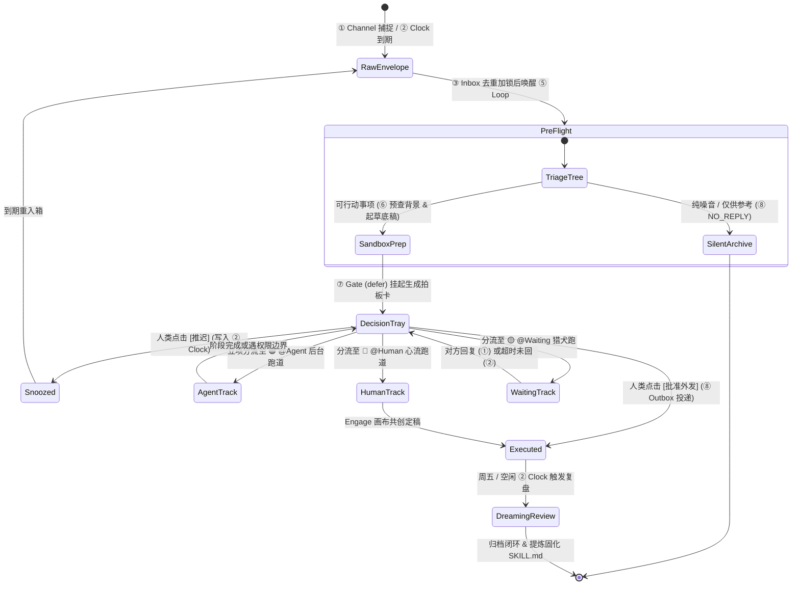

# GTD 幕僚工作台（GTD Co-Processor Desk）交互与状态流转规范

本文档将 [03-gtd-agent-product-vision.md](./03-gtd-agent-product-vision.md) 中的产品理念固化为具体的 **UI 界面结构、卡片交互规格与底层 8 原子状态流转契约**，作为前端工作台与微内核对接的基准设计稿。

---

## 一、整体桌面框架：三模态导航 + 实时心智护盾栏

整个工作台拒绝传统“左侧几十个文件夹 + 中间长列表”的焦虑布局，顶栏仅保留 **3 个工作模态切换键** 与 **1 个动态幕僚状态胶囊**：

```text
┌─────────────────────────────────────────────────────────────────────────────────────┐
│ [📥 1. Clarify 拍板台 (3)]  [🎯 2. Engage 心流工位]  [🧭 3. Radar 全景与周回顾]     │
│                                      [⚡ 幕僚预跑完成：14 条噪音已静默归档，仅剩 3 张] │
├─────────────────────────────────────────────────────────────────────────────────────┤
│                                                                                     │
│                             主交互舞台 (Main Stage)                                  │
│                  （随当前模态切换：单卡片流 / 8:4 共创画布 / 7:5 全景雷达）            │
│                                                                                     │
├─────────────────────────────────────────────────────────────────────────────────────┤
│ 底层微内核链路回显 / 快捷键提示 bar                                                  │
└─────────────────────────────────────────────────────────────────────────────────────┘
```

* **右侧动态状态胶囊（Mental Shield Pill）**：持续向用户提供“系统100%受控”的安全感反馈：
  * **`Clarify` 态**：显示后台已自动过滤/归档的噪音数量（体现 `⑧ Outbox` 静默降噪价值）。
  * **`Engage` 态**：显示 **`🛡 ⑧ Outbox 心流护盾已开启：已静默拦截 N 条低优通知`**（待退出心流后再批量入箱）。
  * **`Radar` 态**：显示 **`🔄 零僵尸项目校验通过`** 与下次 `Dreaming` 周回顾触发时间。

---

## 二、模态 1：`Clarify 拍板台` 交互规格（单卡片专注流）

### 2.1 核心交互原则
* **一次只看一张卡（Single-Card Triage）**：不展示压迫感极强的未读长列表，右上角仅提示 `剩余 N 张`，处理完最后一张直接进入 **`🌊 Inbox Zero · 心如止水`** 空状态页（提示后台全部 Agent 已转入 `\$0` 成本休眠监听）。
* **标准四段式卡片解剖结构**：
  1. **元信息头**：来源通道与时间（如 `① Channel: 飞书消息转发 · 12 分钟前`） + 卡片性质徽章（如 `已预跑草稿 · Gate: defer`）。
  2. **原始输入区（Raw Stuff）**：灰底折叠/精简展示原始语音转写、转发消息或超时等待项，保留溯源真相。
  3. **幕僚预跑成果区（Pre-Flight Work）**：说明 Agent 已经在后台查了哪些代码、纪要或数据，并在等宽文本框内直接给出 **可一键生效的回复草稿 / 立项拆解方案**。
  4. **拍板动作栏（Decision Bar）**：1 个高亮主动作 + 2 个辅助调整动作 + `下一张 →` 跳过键。

### 2.2 三大核心决策卡片模板（Card Archetypes）

| 卡片模板 | 触发源原子 | 幕僚后台预跑内容（Pre-Flight） | 拍板按钮组与点击后底层流转 |
| :--- | :--- | :--- | :--- |
| **A. 外部询问/协作预答复卡**<br>*(Gate `defer` 挂起态)* | `① Channel` 收到同事/客户提问或外部 Webhook | 自动调 `④ FTS5` 查历史纪要 + `⑥ Workspace` 读代码配置，拟好带链接的答复草稿甚至顺手备好文档 PR | • **`[✓ 批准发送并提 PR]`** → 投递回执进 `③ Inbox` 唤醒挂起会话，经 `⑧ Outbox` 幂等外发<br>• **`[🎙 按住口述修改]`** → 语音指令驱动 `⑤ Loop` 重写草稿<br>• **`[⏱ 推迟到下午]`** → 写入 `② Clock(at)`，原卡暂离收件箱 |
| **B. 模糊闪念立项拆解卡**<br>*(Capture → Project)* | `① Channel` 收到随口语音备忘或快捷浮窗输入 | 自动预拉关联现状数据（如近 7 天转化漏斗），按 GTD 决策树提议新建 `Project`，并拆好首步 `@Agent` 动作与后续 `@Human` 动作 | • **`[✓ 确认立项并派 Agent 开跑]`** → 在 `④ Context` 写入活跃 Project，同时向后台子 Agent `③ Inbox` 投递首步任务信封<br>• **`[✎ 调整拆解方案]`** → 行内微调步骤球权<br>• **`[📦 移入 Someday/Maybe]`** → 归入低频孵化池，不占活跃视野 |
| **C. `Waiting For` 猎犬催办卡**<br>*(超时主动唤醒)* | `② Clock` 单次跟进闹钟（Follow-up）到期 | 扫描 `①/④` 通信记录确认对方确实未回复，结合当前时间节点拟好得体催办话术，并预设下一轮兜底闹钟 | • **`[✓ 一键发送并续挂闹钟]`** → `⑧ Outbox` 发催办消息 + `② Clock` 自动续约下次检查点<br>• **`[⏱ 再等 1 天 (Snooze)]`** → 仅延后 `② Clock`<br>• **`[✓ 线下已沟通，直接闭环]`** → 标记该 `Waiting For` 完成归档 |

---

## 三、模态 2：`Engage 心流工位` 交互规格（8:4 双栏共创台）

当用户需要亲自处理 `🔵 @Human` 球权任务时，通过顶部场景/精力标签（如 `15m 碎片` / `45m 高精力` / `低精力杂事`）切入**单任务全屏工作台**：

1. **左栏（占 8/12 宽）：80% 预制底稿共创画布**
   * **拒绝空白文档**：打开即展示 Agent 基于前期调研铺好的方案初稿或代码变更上下文。
   * **决策焦点高亮**：客观事实与数据由幕僚填齐，**真正需要人类做价值判断与架构取舍的段落显式高亮**（例如：“仅需你拍板的 2 个取舍点已标在 §2.3”）。
   * **闭环出口绑定**：底部预设完成后衔接动作（如“定稿后自动通知评审群并归档纪要”）。
2. **右栏（占 4/12 宽）：自动装载的作战包（Context Pack）**
   * 由 `④ Context` 按指针原则动态挂载，无需用户去十几个网页标签里翻找：
     * **关联历史红线/纪要**（一句话结论 + 原文跳转）
     * **关联代码/PR/数据快照**
     * **当前激活的检查清单技能**（如 `arch-rfc-checklist/SKILL.md`）
3. **心流保护联动**：进入该模态期间，`⑧ Outbox` 自动将非 P0 级别的外部通道唤醒转为静默排队，直到用户退出心流或主动切回 `Clarify 拍板台`。

---

## 四、模态 3：`Radar 全景与周回顾` 交互规格（7:5 治理布局）

解决纯聊天界面“聊着聊着忘了全局还有哪几摊事”的痛点，分左右两栏：

1. **左栏（占 7/12 宽）：活跃 `Projects` 三色球权雷达**
   * 列表仅展示当前活跃项目（建议控制在 5～12 个以内），每行右侧强制显示**唯一球权胶囊**：
     * `🟢 @Agent`：显示后台沙箱当前执行阶段与进度百分比（如 `沙箱复现漏斗中 65%`）。
     * `🔵 @Human`：显示球在你脚下的那**唯一一个具体物理动作**（点击直接跳入 `Engage 心流工位`）。
     * `🟡 @Waiting`：显示猎犬正在盯谁、何时发过催办、下次唤醒时间。
   * **反僵尸校验**：任何活跃 Project 若三轨皆空，立即标红推入拍板台要求补齐下一步或降级去 `Someday/Maybe`。
2. **右栏（占 5/12 宽）：`Dreaming` 周回顾与个人习惯固化卡**
   * 对应底层 **分子电路 M3（离线复盘自进化）**：后台异步对比用户本周对 Agent 草稿的增删改 Diff（例如连续多次把周报按特定维度重排、或删掉某种客套话）。
   * 向用户展示提炼出的规律摘要与拟生成的 `SKILL.md` 路径，用户点击 **`[✓ 确认固化为永久习惯]`** 后，正式写入个人受信任技能库，实现“越用越顺手、越用改得越少”的正反馈飞轮。

---

## 五、端到端状态流转全图（State Machine）


