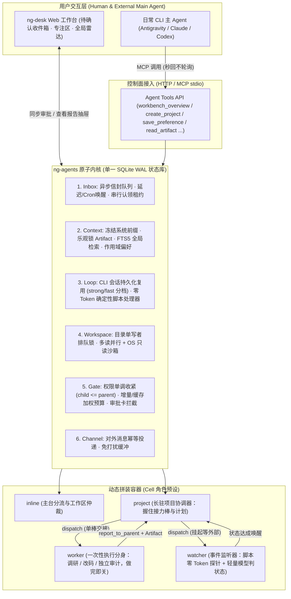
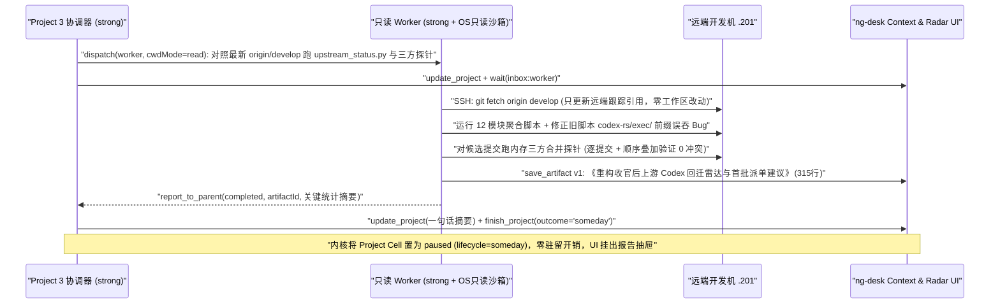
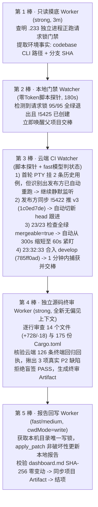

# 当 CLI 编程智能体拥有「后台工作台」：`ng-desk`（`ng-agents`）架构设计与真实工程流全解

> **阅读指南**：本文面向熟悉现代软件工程与 AI 编程工具（如 Claude Code、Codex CLI、Antigravity、MCP、Git Worktree、CI/CD 流水线），但此前从未接触过 `ng-agents` 或文中示例项目 `trae-x` 的技术读者。我们将先拆解系统的核心抽象，再用一次**真实发生的多线并发研发托管实战（以理想完备态呈现）**，完整还原从对话派单、跨机接力、零算力盯梢 CI、独立代码终审到后台技术债预研停靠的全过程。

---

## 一、我们要解决什么工程痛点？

今天，单会话交互式 CLI Agent（Claude Code、Codex CLI 等）在「单点写代码、查源码、修单测」上已经非常强悍。但一旦进入真实的日常重度研发，工程师很快就会沦为**「人肉 tmux 路由器与进程保姆」**：

1. **会话生命周期与真实任务生命周期错配**：一个真实工程交付往往跨越数小时甚至数天——「核查远端环境 $\rightarrow$ 跑完本地门禁提 MR $\rightarrow$ 等 25 分钟云端 CI 与自动重跑 $\rightarrow$ 合入后做独立代码审计 $\rightarrow$ 归档报告」。交互式聊天框一旦关掉或切走，后续状态推进全靠人自己惦记。
2. **上下文污染与重复贴“小抄”**：每次开新窗口，工程师都得手动粘贴几十行团队红线（分支规范、远程开发机地址、禁止破坏的架构约束）；如果把调研、改码、轮询 CI、独立审计全塞进同一个长会话，不仅上下文迅速膨胀，还会因为「自己审自己写的代码」产生严重的确认偏误（Confirmation Bias）。
3. **多路并发时的目录踩踏与算力空转**：想同时开三个窗口推进不同任务，很容易撞上同一工作树的未提交改动或编译锁；让主力旗舰模型每隔几分钟跑一次 `sleep + 查询 CI` 轮询，更是在用昂贵的推理算力做 `cron` 脚本的活。
4. **中期技术债沦为「空白页备忘录」**：日常开发中随时冒出的中长期治理项（比如“梳理多渠道发行包的内部域名隔离”、“重算上游数千笔提交的回迁进度”），记进传统 Todo 工具只是一行干巴巴的标题；过两周再翻出来依然是一张白纸，启动阻力极大。

**`ng-desk`（底层引擎 `ng-agents`）的核心思路**，是在你日常顺手使用的交互式 CLI Agent 旁边，增加一个**常驻本机的异步 GTD 工作台服务**：
- **你依然只跟熟悉的主 Agent 聊天**：主 Agent 通过 MCP 协议把跨会话、跨时段、多步骤的工作交接给 `ng-desk`，秒级返回，绝不阻塞当前对话。
- **表层极简 GTD，底层原子动态拼装**：对人类只暴露最直觉的 GTD 视图（待拍板卡片、球权清晰的在途项目、已附带预研报告的停靠想法）；而在底层，用**同一套消息队列、沙箱锁、乐观锁文档与预算门禁**调度本机真实的 CLI Agent 分身接力完活。

---

## 二、系统架构：表层 GTD 视图与底层「1 流 + 6 原语 + Cell」

### 2.1 为什么说内核「足够薄，却守住了硬底线」？

`ng-agents` 不在内核代码里硬编码任何「先调研再写码再提 MR」的死板状态机。所有角色（主台 `inline`、项目协调器 `project`、一次性执行者 `worker`、外部事件监听器 `watcher`）都是同一种容器 **`Cell`**，区别仅在于组装参数与提示词手册（如 `project-relay` 接力规范）。

与此同时，凡是提示词管不住的工程安全边界，全部由内核用确定性代码兜底：
1. **单会话串行认领 + 排空才关闭**：同一个 `Cell` 同一时刻最多只有一个运行实例（`Inbox` 租约锁）；一次性 `worker` 调 `report_to_parent` 交卷时，内核必须确认它收件箱无未读消息、名下无未关闭子分身，才原子投递唯一结果并关闭，杜绝消息丢失或并发幻觉。
2. **真实目录上的声明式读写仲裁（`Workspace`）**：`ng-desk` 不强行克隆你的大仓库，直接在真实路径上干活。声明 `cwdMode: "read"` 的分身互不阻塞、可任意并行，并自动挂载底层 CLI 的**操作系统级只读沙箱**（允许读取文件、允许 SSH 远端查询或向 `/tmp` 写临时计算结果，但物理阻断修改本地工作树）；声明 `cwdMode: "write"` 的分身则自动进入该目录的**单写者队列**，且遇到主人未提交的手工改动时绝不覆盖，而是弹卡请示。
3. **带乐观锁版本号的共享交付物（`Artifact`）**：多棒 `worker` 之间不靠口口相传拷贝几万字长文，而是读写绑定在项目下的版本化 `Artifact`（支持 `save_artifact` 创建与 `patch_artifact` 局部锚点修订，`expectedVersion` 乐观锁防并发踩踏）。
4. **单向权限收紧与人类专属红线（`Gate`）**：子 `Cell` 权限永远满足 `child ⊆ parent`；普通计划确认可由外部主 Agent 转达你的口头指令批准，但**向他人外发消息**与**突破预算上限续费**标记为 `ownerOnly: true`，强制要求人类本人在工作台界面点击放行。

---

## 三、真实案例全流程推演：晚间 10 分钟托管三条研发战线

为了看清这套机制在复杂工程现场如何运转，我们直接采用一次**真实的研发场景**作为样本：

> **示例工程背景（`trae-x`）**：  
> `trae-x` 是一个包含 167 个 Rust Workspace Crate 的大型终端智能体仓库，基于持续演进的上游开源仓库 `codex`（日均 40+ 笔提交）深度定制。团队采用典型的混合开发拓扑：
> - **工程师本机（macOS）**：`/Users/ar8327/dev/trae-x` 存放全局总控看板 `dashboard.md`、架构设计方案与 `output/` 历次实施/审计报告；`/Users/ar8327/dev/codex` 存放上游镜像。
> - **两台 60 核远端 Linux 开发机（`.233` 与 `.201`）**：存放完整 `trae-x` Git 仓库，日常编译、终端 PTY 集成测试与多分支开发均在远端独立 `git worktree` 中通过 SSH 完成，代码通过内部 Git 平台（Codebase）提交 MR 并跑 23 项阻断门禁。

晚上 21:45，主线 16 个大型重构专项刚合入了 14 个。工程师不想再开一堆终端盯到半夜，于是在主 Agent 对话框里输入了一句话：

> **工程师**：*「看看用 `ng-desk` 这个工具，咱们手头有哪些事能搬到那边去？你先看看，做之前跟我确认下。」*

---

### 阶段 1：主 Agent 盘点查重与交互式分流（21:45 ～ 21:49）

主 Agent 没有盲目创建任务，而是按标准控制面协议走了三步只读摸底：
1. 调用 MCP `workbench_overview` 与 `list_preferences`：确认本机 `127.0.0.1:8790` 工作台在线，当前盘面干净（0 在途项目、0 待批卡片、0 已存偏好）。
2. 只读扫描本机 `/Users/ar8327/dev/trae-x` 下的 `dashboard.md` 与最新 `output/` 报告，识别出「哪些是立即可收尾的在途单」、「哪些是需要先摸底方案的中期技术债」、「哪些是每次派活都要重复叮嘱的工程铁律」。
3. 提前识别出**「本机文档目录 vs 远端开发机」的调度要点**，向工程师给出一份结构化迁移清单并获得确认：
   - **第一类（长期规矩）**：把团队沉淀的防作弊红线、远端 Worktree 隔离规范、合入后五项硬 Diff 审计清单存入工作台长期偏好；
   - **第二类（立即闭环项目，`mode: "now"`）**：跟进远端 `.233` 上正在收尾的「`!5408` 后台子智能体冷恢复尾补丁」——盯完门禁与 MR 合入，做完独立五项硬 Diff 终审并回写本地报告；
   - **第三类（预研停靠项目，`mode: "research_then_park"` × 2）**：摸底「公开版与企业版发行二进制的内部信息完整隔离方案」，以及「架构重构收官后重算 12 模块上游回迁雷达与零冲突速赢包」。

---

### 阶段 2：按作用域固化偏好 + 秒级并发立项（21:49 ～ 21:56）

拿到确认后，主 Agent **刻意控制了工具调用的先后顺序**——**先写入偏好，等落库成功后再调用 `create_project`**：

#### 第一步：写入带作用域过滤的长期偏好（`save_preference` × 3）
主 Agent 写入三条偏好（`traex-engineering-redlines`、`traex-remote-worktree-workflow`、`traex-audit-five-checks`），并附带作用域声明：
- `cwdPrefix: "/Users/ar8327/dev/trae-x"`（仅对工作在 `trae-x` 目录下的项目生效，绝不污染工作台上未来其他前端或个人项目的上下文）；
- `roles: ["project", "worker"]`（只注入负责规划和编码/审计的智能体，不塞给只看 CI 状态的轻量 `watcher`）；
- 边界定义清晰区分读写：明确「改码施工必须在远端独立 worktree 进行且不动 `dashboard.md`；只读摸底与审计允许正常执行远端 `git fetch` 更新跟踪引用、允许 Git 部分克隆（partial clone）按需拉取缺失对象、允许在 `/tmp` 存放临时分析中间态」。

因为偏好在立项前已经落库，几秒后启动的 3 个 `project` 协调器从**第 1 轮推理**起，其冻结的 `prompt_prefixes`（系统提示词前缀）就已经稳稳包含了这三条规矩，后续整个生命周期无需变更系统前缀，从而使底层大模型的 **Prompt Cache 命中率稳定保持在 95%～98%**。

#### 第二步：分模式拉起三个后台项目（`create_project` × 3）
1. **项目一（`mode: "now"`）**：「`!5408` 后台子智能体冷恢复尾补丁收官与终审」，`cwd: "/Users/ar8327/dev/trae-x"`。
2. **项目二（`mode: "research_then_park"`）**：「公开版与企业版完整产物隔离方案摸底」，`cwd: "/Users/ar8327/dev/trae-x"`。
3. **项目三（`mode: "research_then_park"`）**：「重构收官后重算 12 模块上游回迁雷达」，`cwd: "/Users/ar8327/dev/trae-x"`。

三次 `create_project` 调用各自往 `inbox_messages` 写入一条 `cell.task` 信封并立即返回项目 ID（耗时不足 100ms）。主 Agent 随即结束回合，把清爽的聊天框还给工程师。

---

### 阶段 3：三条后台战线的并行运转与关键交互节点

此时在 `ng-desk` 后台，三个 `project` 协调器几乎同时被 `Dispatcher` 唤醒。每个协调器自身的 `cwdMode` 默认都是 `"read"`，且它们派出的首批调研/摸底 `worker` 也全部显式声明 `cwdMode: "read"`——因此 `Workspace` 模块判定**零写锁竞争**，三路人马在同一本机目录下**零排队全速并行**！

*(注：协调器的系统提示词在启动时已内联 `project-relay` 接力手册全文，且自动从按需加载索引中剔除了已内联项，因此三个协调器首轮零废话直奔主题派单。)*

#### 战线 C（预研停靠）：重算 12 模块上游回迁雷达（纯活跃耗时 ~3 分钟 $\rightarrow$ 自动停靠）

1. **高效取证**：`worker` 读取本机旧版全景图后，SSH 连上空闲算力充足的 `.201`，执行只读 `git fetch origin develop` 拿到最新主干 `c74fab4755`，直接调用仓库自带的 `scripts/upstream_status.py` 与内存三方合并探针。
2. **实质工程增值**：`worker` 没有无脑跑脚本贴数字，而是敏锐发现旧版统计脚本里 `"codex-rs/exec"` 前缀会把 `"codex-rs/exec-server*"` 和 `"codex-rs/execpolicy*"` 误吞进去，主动收紧为 `"codex-rs/exec/"` 并补入近期新拆出的 10 个 Crate（157 $\rightarrow$ 167 成员），同口径重算了新旧基线差值（`done = 1,197 (+28)`，`todo = 3,087 (-30)`），并从 307 个零冲突文件里实测筛出 **4 个互不重叠、单提交与顺序叠加均 100% 零冲突的首批并行回迁包（共 5 笔提交、11 个文件）**。
3. **落库即停靠（`research_then_park` 的精髓）**：`worker` 直接调用 `save_artifact` 将 315 行结构化报告存入工作台（保留准确的源码文件名如 `code_cell.rs`、Git SHA 与表格），只把千字核心摘要通过 `report_to_parent` 传回协调器（避免父子重复拷贝整篇长文）。协调器调用 `finish_project({ outcome: "someday" })`——内核底层执行的是 **`pause`（暂停而非销毁关闭）**：该 `project` Cell 的上下文与报告完整冻结在 SQLite 中，平时不占任何 CPU 或定时唤醒；Web UI 的「以后再说」专区立即展示该项目卡片，并附带**一键展开的报告阅读抽屉**。哪天工程师想动手回迁这 4 个包，点一下「激活推进」，同一个协调器原地醒来就能按阶段派发写代码分身！

---

#### 战线 B（预研停靠 + 协调器质检返工）：公开版与企业版完整产物隔离方案（两棒接力 + `patch_artifact` 局部修订）

这条战线展示了**为什么需要长驻的 `project` 协调器来掌管一次性 `worker`**：
1. **第一棒 `worker` 全面清点**：在远端对最新主干 `13,920` 个路径跑 `scripts/check_tob_artifact_safety.py` 静态规则与构建链路排查，一针见血揪出四大架构漏点：
   - `codex-rs/skills/src/trae_guide.rs` 用 `include_dir!` 把内场、公开、共用三套指南目录无条件全编进了二进制，仅在运行时挑目录，导致二进制字符串扫描必挂；
   - 安装脚本 `install.sh.in` 外部清单只认 `internal/tob`，直接拒绝字面值 `public`；
   - 公开版与旧在线企业版安装侧车（sidecar）都落盘为同一个 `"public"` 值，导致 CLI 与 TUI 的员工入口与遥测分流逻辑无法区分二者；
   - `public` 默认遥测地址 `argos-data-collector.zijieapi.com` 命中原扫描阻断规则，而 `tob` 替换成的占位符 `https://unavailable.invalid` 又绕过了只判空字符串的禁用逻辑。
   `worker` 将核心架构方案、4 阶段可回退落地顺序及关键生产路径写成一份精炼的 **25 KB 方案报告 `v1`**（对测试/快照中的 1,800 余处品牌词命中仅输出聚合统计与分类规则，不往报告正文里倾倒上千行测试文件名垃圾）。
2. **协调器质检把关与 `patch_artifact` 增量补证**：假设第一棒因某几处登录/遥测分支尚缺交叉印证而在文末诚实标了待核项，`project` 协调器审阅摘要后不会草率停靠，而是精准派生**第二棒轻量补证 `worker`**。第二棒查清那几处源码后，直接调用 **`patch_artifact`（传入 `artifactId`、`expectedVersion: 1` 与目标章节锚点补丁，自动继承原报告标题）**——既不用分页 38 次把整篇旧报告搬进上下文，也不用让大模型重新吐一遍全文，几十秒内干净升版为 `v2`，随后由协调器归入 `someday` 停靠。

---

#### 战线 A（`mode: "now"` 实战闭环）：`!5408` 尾补丁跨时区接力、零算力监听与独立源码终审

这是全晚最精彩的一条重型接力链。工程师在 22:00 打开 Web UI 瞄了一眼，看到卡片上标着黄标 **`等待外部 · 跟踪尾补丁本地门禁与合并请求`**，随口问主 Agent：「这个是在等谁？」主 Agent 调 `get_project` $\rightarrow$ `get_cell` 一秒答复：「第一棒已经去 `.233` 查清原验证会话正在跑双构建图请求锁第二组，为了不抢工作树，协调器挂了一个 `watcher` 每 3 分钟看一眼进程与 MR，不是在等你操作。」随后工程师便合上电脑休息去了。

整条战线在后台自动完成了 **5 棒无缝交接**：

让我们放大其中三个极具代表性的技术细节：

1. **接力棒里的「环境事实传递」消除重复试错**：
   第 1 棒摸底 `worker` 查清远端机器上 Git 平台工具位于 `/home/yuyuelun/.local/bin/codebase`、构建证据位于 `.../fix-subagent-cold-resume-20261118/followup-evidence` 后，协调器把这些路径写入项目状态 `relay:context`，并在后续每次 `dispatch` 的「现场与材料」栏显式下发——后面 4 棒分身一上来就能直调命令，零重复 `find`/`which` 试错。
2. **「确定性脚本探针 + `fast` 模型判异常 + 自适应退避」的理想 `watcher`**：
   - 在长达 90 分钟的云端 CI 周期里，`watcher` 不再每 5 分钟唤醒一次满血旗舰大模型重读几十轮历史 shell 输出。
   - 常态轮询由 `Loop` 内置的**零 Token 脚本探针**执行单条轻量 SSH 状态查询：只要流水线仍在 `in_progress`，直接在内核层重置下一次唤醒定时器，消耗 **0 Token**！
   - 当首轮 `traex-product-pty-test` 出现失败退出码时，唤醒无历史包袱的 **`fast` 档轻量模型**做一次状态研判：它发现 MR 仍处于 `open` 且发布方已在 2 分钟前触发了第 2 轮重跑（随后又同步主干 `!5422` 推送了 `1c0ed7de`），判定属于「在途自愈中而非终态阻塞」，于是继续保持监听，绝不误报 `failed` 自毁导致父项目断链重派。
   - 当 `23:29` 探测到 23 项检查全部通过（`22 succeeded, 1 neutral, mergeable=true`）进入临门一脚合入窗口时，轮询间隔自动从 `300s` 收紧至 **`60s`**；`!5425` 在 `23:32:33` 合入 `develop`（`785ff0ad`）后不到 1 分钟，`watcher` 即完成祖先链校验并干净交棒。
3. **全新上下文带来的「真独立铁面终审」**：
   第 4 棒终审 `worker` 启动时是一个全新的 `strong` 模型会话，没有任何「这代码是我改的，赶紧放行下班」的历史包袱。它严格对照修复规范与 `traex-audit-five-checks` 五项硬指标逐行复核 `f24d9d38..785ff0ad` 的 14 个文件改动，在确认主故障已根治、126 条终端回归逐名通过的同时，敏锐抓出了 **3 个连原作者都没注意到的源码级 P2 边界漏洞**：
   - **存量 SQLite 游标盲区**：新写入路径虽然修复了空 `content` 互删，但已被旧版物化到文件末尾的受损非规范 SQLite 投影因游标已到底且版本为空，升级后正常读取不会自动重建物化补回旧卡片；
   - **前台转后台状态失真**：Claude 子代理以前台模式（`Some(false)`）启动后中途切入后台，若最终仅产生后台 `NoResult` 记录，冷恢复读取旧启动模式会将其误渲染为绿色 `Done`；
   - **既有终端握手早退缺口**：部分被纳管进阻断门禁的历史 PTY 用例在收不到光标查询时打印 `skipping assertion` 并返回 `Ok(())` 退出码，存在极端环境故障下的假绿隐患。
   因此，终审分身实事求是地给出 **「三项 P2，无 P0/P1，暂不签收全项 PASS」** 的结论；第 5 棒写分身拿到 `/Users/ar8327/dev/trae-x` 的写锁后，在 1 分钟内用 `apply_patch` 将合入 SHA、23 项云端门禁深链与这 3 项 P2 完整增补进本地报告（原 5 张表格与 `dashboard.md` 哈希分毫不损），同步生成项目级终审 Artifact 并触发结项通知。

---

## 四、底层治理保障：算力计量、预算护栏与宿主休眠自愈

一套敢让工程师放心挂着过夜的后台系统，光跑得通功能还不够，账本与异常边界必须严丝合缝：

1. **会话复用的高缓存命中 + 精确增量（Delta）计费**：
   对于多轮唤醒的 `project` 协调器，CLI 驱动通过 `resume` 复用持久化会话但只追加最新状态增量，使全晚 `40M+` 输入 Token 中的 **前缀缓存命中率高达 96.5%**。计量层（`CodexDriver` / `ClaudeDriver`）严格用 `当前会话累计值 - 上轮已结算值` 计算**单轮真实增量**，并将 `(未缓存输入, 缓存命中输入, 输出)` 分别入账、按缓存真实折扣（约 `0.1x`）折算预算消耗——既能在顶栏实时看到真实美元估值与预算进度条，又绝不会因为重复累加或把廉价缓存当原价输入而误触发熔断。
2. **认领前预算预检（零丢信封）+ 祖先链一键联调续费**：
   - 当某个超大型调研任务真的触及预算上限时，`Dispatcher` 在**消费收件箱信封之前**先行拦截挂起——子分身刚交上来的长篇 `cell.result` 安然留在收件箱 `pending` 队列里，绝不会被 2ms 空跑吞进黑洞；同时为所有子任务已完结、仅剩最后一步调 `finish_project` 收尾的协调器预留极小额「收尾免死缓冲」，绝不让跑完马拉松的项目卡死在终点线前 1 厘米。
   - 一旦需要人类在 Web UI 批准 `ownerOnly` 续费卡片，点击一次「继续」，`Gate` 会沿祖先链（`worker -> project -> desk`）一次性补齐所有到达阈值的层级，绝不背靠背连弹两张卡。
3. **宿主机合盖休眠守护与单调时钟租约保护**：
   - 只要后台仍有活跃运行分身或待触发的 `watcher`，`ng-desk` 在 macOS 上自动持有空闲防休眠断言（`caffeinate -i`）。
   - 若工程师主动拔电合盖让笔记本物理休眠了 30 分钟，唤醒瞬间内核检测到「挂钟跳变远大于单调时钟推进」，会**先自动顺延所有在途运行实例的租约（Lease），再执行过期扫描**，并在时间线留下一条清晰的 `[宿主机休眠 31m 30s]` 系统注记——既保证活着的 CLI 子进程绝不被误判超时重发，又让事后耗时复盘一目了然。
4. **清爽的次日验收视图**：
   第二天一早，工程师打开 `ng-desk` 网页：
   - **专注与雷达区**：「`!5408` 尾补丁收官与终审」已圆满结项，点开报告抽屉即可直接阅读那 3 条新揪出来的 P2 隐患；
   - **以后再说（Someday）专区**：产物隔离方案与 12 模块回迁雷达静静停靠在车位里，各自带着可一键展开、章节清晰的完整报告，随时等待一键激活进入多阶段（Phase 1 $\rightarrow$ 审批 $\rightarrow$ Phase 2）施工；
   - **15 分钟周回顾**：只干净汇总真正交付的**项目级成果**与**人类待办完结项**，内部七八棒 `worker`/`watcher` 接力脚手架全部收纳在项目详情时间线内，绝不喧宾夺主。

---

## 五、总结：这套工作台模式到底改变了什么？

| 维度 | 传统「多开 CLI 聊天框 + 人肉 tmux」模式 | `ng-desk`（主 Agent + 异步 GTD 工作台）模式 |
| :--- | :--- | :--- |
| **人类心智负担** | 人脑充当消息总线：记分支、贴红线、盯 CI、防目录冲突 | 人只面向极简 GTD（拍板卡片 + 看报告 + 管球权），对话发完即走 |
| **跨步骤可靠性** | 聊天框一关或超长上下文压缩即丢细节，自己在同一会话审自己代码 | `project` 握住状态接力棒，每棒 `worker` 上下文纯净隔离，终审天然无偏见 |
| **等待外部事件成本** | 要么人肉刷页面，要么让旗舰大模型在会话里死循环 `sleep` 烧钱 | 零 Token 确定性脚本探针 + 自适应退避 + `fast` 轻量模型判异常 |
| **中长期技术债管理** | 记在备忘录里只剩一行标题，翻出来还是空白页 | `research_then_park` 趁热预研落好方案报告，停靠 `paused` 零成本随时唤醒 |
| **并发与安全边界** | 靠自觉避免多窗口同时改同一目录，容易误伤未提交代码 | 内核单写者锁 + 只读分身自动挂 OS 只读沙箱 + 关键动作 `ownerOnly` 强拦截 |
