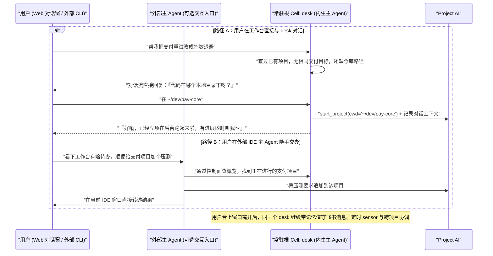

# 分册一：`desk` 升级为可双向对话的内生主 Agent（兼顾外部主 Agent 接入）

## 一、背景与现状痛点

在当前架构中，系统同时存在两个扮演“总管家”的大模型入口：
1. **常驻树根 `desk`（`inline` 预设）**：住在本地后台服务中，拥有持久 `Cell` 状态与 `cli:session`，能被外部 Webhook、定时 `sensor` 和内部冲突请求异步唤醒；但人类在工作台界面上只能通过顶栏「随手记（Capture）」向它做**单向盲投**——既看不到 `desk` 的完整回复流，也无法针对它的追问在同一个聊天窗口里自然多轮对话。
2. **外部日常 CLI 主 Agent（Antigravity / Claude Code / Codex）**：人类在 IDE 或终端里直接跟它多轮聊天，体验顺滑；但它只是外部客户端进程，没有后台常驻生命力，且在 [guide.ts](../../apps/gtd-desk/src/agent/guide.ts) 里重复背负了一整套与 `desk` 高度重合的查重、追问路径、立项分拣逻辑。

---

## 二、目标形态：「常驻 `desk` 即主 Agent」+「外部主 Agent 轻便协同」

### 核心设计要点

1. **`desk` 具备一等公民的「双向持久对话会话（Chat Thread）」**：
   - **对话记录本身就现成躺在 `evidence` 与 `channel_outbox` 里**：`desk` 作为持久 `Cell`，每一轮收到的 `user.message`（人类输入）和发往 `channel:ui:owner` 的消息及 `assistant_text`，都已经按严格序号存在 SQLite 的 `evidence` 表中。
   - **升级点**：
     - 在服务端新增面向 `desk` 与任意子节点统一复用的**时间线与发话接口**（完整契约见[分册四](./04-agents-topology-and-live-chat-tab.md#42-服务端-http-api-契约统一服务于-desk-与全部子节点)）：
       - `GET /api/cells/:cellId/timeline?afterSeq=0&beforeSeq=...&limit=...`：直接将入站消息、发给主人的回复与关键动作提示投影为干净的人类可读时间线（支持切为「纯对话」或「精简实况」模式，自动过滤内部工具 JSON 噪音，保留“已为你立项 `proj_xxx`”、“已存入偏好”等清爽动作胶囊）。
       - `POST /api/cells/:cellId/messages`：人类直接发送对话消息进入 `desk`（正在运行时默认 `mode: "enqueue"` 顺手补充，亦可选 `mode: "steer"` 立即打断插话），并通过 `/api/events` SSE 通道实时增量推送 `desk` 的状态与回复文本。
     - **调整 `desk` 提示词（[prompts.ts](../../presets/src/shared/prompts.ts)）**：从原来“只做静默分拣员、尽量别跟主人多说话”升级为**“你就是主人的常驻主助理：主人在聊天框问你问题、商量方案、查询项目或闲聊交代事情时，自然直接地回复；收到后台异步信源或纯通知时，依然保持安静高效分拣不刷屏”**。
2. **「随手记」与「分身实况（`Agents`）根节点主对话」自然合一**：
   - 与常驻 `desk` 的多轮历史对话统一收口在新增第 4 视图 **「分身实况 · Agents」** 默认选中的树根节点 `desk` 面板中（见[分册四](./04-agents-topology-and-live-chat-tab.md)），不再重复建设多余的全局侧滑聊天抽屉；
   - 其他视图底部的快速输入框继续作为向 `desk` 随手发话的快捷栏，并提供一键跳至 `#/agents/desk` 查看完整对话历史的入口；
   - 用户在“仓库路径在哪？”下面回复路径时，入口自动携带 `replyToId` 关联这条追问，`desk` 把路径补到对应事项，按原来的目标继续办理。
3. **外部主 Agent（Antigravity / Claude Code / Codex）的保留与精简定位**：
   - 外部主 Agent **完全保留**，因为工程师写代码时经常手头就开着 IDE/CLI 窗口，就近喊一嗓子最顺手。
   - **定位更清晰**：外部主 Agent 是操作工作台的**便捷伴随交互层**——
     - 查状态（`workbench_overview`、`get_project`）、帮用户直接对某个项目或 `worker` 传话、审批非敏感卡片，依然走低延迟控制面工具直达；
     - 遇到模糊需求或需要走统一分拣/查重时，可直接通过 `chat_with_desk`（原 `capture` 的对话化升级）交给常驻 `desk` 统筹，确保偏好记忆与全局上下文沉淀在同一个常驻大脑里，不再维护两套互相打架的分拣规则。

### 双入口怎样识别同一件事

两种入口都要把消息归属交给接收方。每条对话消息带上消息标识、经入口确认的发送者身份和会话标识。回答追问时带上被回复的消息标识，已知所属项目时带上项目标识。外部主 Agent 代传消息时保留自己的 `agent:*` 身份。转交、抄送和读取历史时，都能沿这些标识找到原话。

例如网页正在追问支付仓库的路径，终端也在追问日志仓库的路径。用户在网页回复 `~/dev/pay-core`，这条回复只补到支付事项。若用户另起对话只发了一个路径，且两项都可能匹配，主 Agent 才追问一次“这是支付仓库还是日志仓库？”

`desk` 的提示词和外部主 Agent 的接入指南都应说明三层分工。`desk` 查找已有项目、决定事项归属并协调跨项目工作。`project` 对一个交付目标负责，安排执行和验收。`worker` 承接具体工作。外部主 Agent 知道项目归属时可以直接追加要求，归属不清时交给 `desk` 判断。
