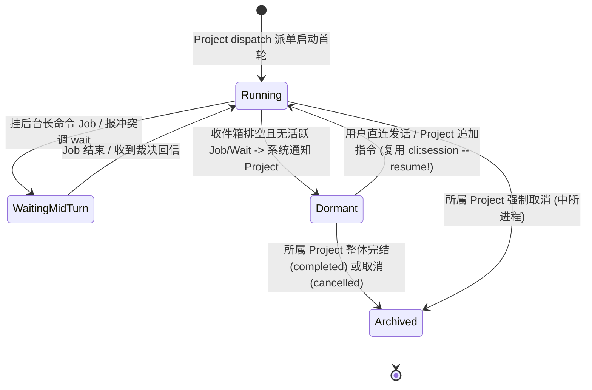

# 分册二：用户直连可唤醒叶节点 `Worker` 与「退场通知 + 主动 Pull」机制

## 一、四个紧耦合的设计决策

围绕「允许用户随时直接跟 `worker` 对话并下达指示」，若沿用旧版“单次死关 + 指望 `worker` 自己汇报”的模型，必然出现消息发不进去或父级 `project` 状态滞后。为此将执行层机制整体重构为以下四条契约：

1. **`worker` 与 `watcher` 物理收口为纯叶节点（Leaf-Only）**：在 `Cell` 监督树中绝不再向下派生子 `Cell`；至于底层 CLI（Claude Code / Codex / Antigravity）自身内部的 sub-agent 机制，内核完全放行不干预。
2. **淡化 `close`：`worker` 跑完进入「静默待命（Dormant / Idle）」，可被消息随时重唤醒**：系统自身绝不主动空唤醒已结束回合的 `worker`，但只要用户（或上级 `project`）发来新消息，它立刻带着原 `cli:session` 苏醒续跑。
3. **用户直连 `worker` 对话全留痕 + 父 `project` 防滞后同步**：用户对 `worker` 说的每一句话既留在 `worker` 会话里，又实时留下抄送线索并在任何状态查询中穿透可见。
4. **不指望 `worker` 主动发消息汇报：改为「系统退场通知 + `Project` 主动 Pull」**：每次 `worker` 回合排空停下时，由内核确定性通知父 `project`，由 `project` 调用跨引擎统一的 Pull 工具拉取该 `worker` 这段时间干了什么、跟用户聊了什么。

---

## 二、纯叶节点化与 CLI 内部 Multi-Agent 放行

1. **预设层锁死 `maxDepth: 0`**：
   - 在 `workerPreset`（[isolated-worker/preset.ts](../../presets/src/isolated-worker/preset.ts)）与 `watcherPreset`（[thread-watcher/preset.ts](../../presets/src/thread-watcher/preset.ts)）中统一声明 `requestBounds: () => ({ maxDepth: 0 })`。
   - 效果：`Gate.attenuate` 物理封死其调用 `spawnCell` 的能力；`STD.cells` 中的 `spawn_cell / control_cell / close_cell` 因 `availableFor: bounds.maxDepth > 0` 自动从工具列表中隐去（`watcher` 仅保留修改自身 `watches / schedules` 的 `update_cell`），直接节省工具 Schema Token。
2. **解绑底层 CLI 自带 Sub-Agent 限制**：
   - 修改 [loop.ts](../../packages/loop/src/cli/loop.ts) 的 `kernelSystem` 提示：移除原 *"Do not use this CLI's own sub-agents..."* 限制，仅保留**禁止调用阻塞终端的 `ask-user` 交互提示**（因为后台无人类盯终端 stdin，向主人提问走内核工具或直接回复对话）。
   - 用量统计与证据采集：保持 `ClaudeDriver / CodexDriver / AgyDriver` 对主会话最终汇总用量的计量，内部 sub-agent 开销自动归入该 `worker` 账本。

---

## 三、`Worker` 的「静默待命 + 可重唤醒」生命周期

### 3.1 状态流转对比

- **旧模型**：`Running -> Closed（永久死亡，后续发消息一律报错 NOT DELIVERED: closed）`。
- **新模型**：

### 3.2 四处内核边界的精确调整（确保零副作用）

1. **平时静默零开销、系统不自激**：处于 `Dormant`（代码层面即为 `status === "active"` 但无活跃 `Run`、无 `pending` 消息、无 `Job`、无定时器/`watches`）的 `worker` 不占任何进程与内存，内核绝不会主动唤醒它；五锚点停滞检测 `anchorsOf` 本就只统计真正在跑或有等待锚点的节点，因此静默待命的 `worker` **绝不会误充锚点掩盖项目停滞**。
2. **并发子节点上限（`maxConcurrentChildren`）只计“真正在忙”的叶节点**：
   - 修改 [lifecycle.ts](../../packages/cell/src/lifecycle.ts) 中的配额检查：仅统计当前正在运行 `Run`、有待消费 `wakeup` 消息或有运行中后台 `Job` 的活跃子节点。干完活静默待命的历史 `worker` 不占那 16 个并发槽位。
3. **项目结项与停靠（`finish_project` / `settleSelf`）不被静默 `worker` 阻塞**：
   - 修改 [ports.ts](../../packages/cell/src/ports.ts) 与 [dispatcher.ts](../../packages/cell/src/dispatcher.ts) 的子任务未完检查：仅当存在**真正在忙（有活跃 `Run` / 待处理 `wakeup` 信封 / 运行中 `Job`）或挂有外部监听（活跃 `watcher` / 未决 `wait`）**的子节点时才拦截结项；所有已进入 `Dormant` 静默待命的 `worker` 在项目结项/取消时随子树一并平滑置为 `closed` 归档。
4. *(兜底兼容)*：即使某个 `worker` 因旧逻辑或手动被标成了 `closed`（且所属 `project` 仍未结束），若用户显式点名给该 `worker` 发消息，控制面亦可支持一键恢复其状态为 `active` 并沿原 `cli:session` 唤醒，彻底消除“慢了 3 秒发不进去”的挫败感。

---

## 四、用户直连 `Worker` 对话与状态防落后机制

当用户通过工作台聊天窗（点进某个 `worker`）或通过外部主 Agent（调用 `message_cell` / `control_cell`）绕过 `project` 直接向某个 `worker` 下达指令时：

1. **对在跑 vs 待命 `worker` 的投递体验**：
   - 若 `worker` 正在跑：支持实时插话（`steer`，打断或回合间注入当前 CLI 会话）或追加消息（回合末 `drainInbound` 吸收续跑）；
   - 若 `worker` 已静默待命：消息入箱立即唤醒它，`CliAgentLoop` 命中 `cli:session` 执行 `--resume`，带着完整前文直接响应用户。
2. **防 `Project` 失明与查询滞后的双保险**：
   - **写入时同步抄送父级（`silent_inject` + 可选实时唤醒）**：
     - 内核在接收用户（`owner` 或 `agent:*`）发往子 `worker` 的直连消息/插话时，**同一 SQLite 事务内**自动向其父 `project` 收件箱写入一条 `type: "cell.direct_chat"` 信封（默认 `delivery: "silent_inject"`，附 `workerId`、时间戳与用户原话；若标记紧急方向变更也可设为 `wakeup` 立即唤醒 `project`）。
     - 抄送信封引用原消息标识，并保留原发送者、会话、关联追问和所属项目。父 `project` 因此能看出这句话是在回复哪项工作。消息归属沿用[双入口对话约定](./01-conversational-desk-and-dual-entry.md#双入口怎样识别同一件事)。
     - 效果：如果用户跟 `worker` 连续聊了 5 句，`project` 不会陪着空转 5 轮烧钱；但**只要 `worker` 聊完这轮停下触发退场通知（或 `project` 因任何其他原因被唤醒），这 5 句用户原话一字不落全在 `project` 本轮唤醒的输入里**！
   - **任何 Agent 随时查状态时「实时穿透重读」（0-Token）**：
     - 改造 `get_project`、[readmodel.ts](../../packages/cell/src/readmodel.ts) 与看板投影：记录 `project` 对每个子 `worker` 已检视到的证据游标 `pulledSeq`（或对比 `project.lastRunAt`）。
     - 只要某个 `worker` 的最新 `lastEvidenceSeq` 大于 `project` 上次醒来时的游标，任何 Agent 调用 `get_project` 查状态时，服务端**当场实时读取该 `worker` 新增的用户直连对话与最新动作尾部**，在返回结果中单列 `【尚未汇总至项目的 Worker 最新动态】`——无需等 `project` 跑大模型，外部随时查到的都是 100% 最新实况！

---

## 五、系统确定性退场通知 + `Project` 主动 Pull（四引擎统一适配）

### 5.1 为什么从 `Worker Push` 改为 `System Notify + Project Pull`？
- 用户直连 `worker` 后，`worker` 往往直接用自然语言回答用户或改完代码就结束了 CLI 回合，指望它每次都记得调用 `report_to_parent` 并把多轮改动浓缩无遗是不现实的。
- 因此：**`worker` 无需背负“必须调汇报工具”的心智负担**（`report_to_parent` 降级为可选补充或对 `worker` 隐藏，专注干活与回复即可）。

### 5.2 系统确定性退场通知（`cell.turn_settled` / 升级版 `cell.result`）
在 [dispatcher.ts](../../packages/cell/src/dispatcher.ts) 的单事务结算 `settleRun` 中：
- **触发条件**：当叶节点 `worker` 本轮运行正常结束（非挂起审批卡、无未完成 `wait`、无运行中后台 `Job`、且收件箱 `pendingWakeupCount === 0` 已排空）转入静默待命时；
- **唯一幂等键按轮次生成**：使用 `${cellId}:${handle.claimId}:settled`（替代原先一辈子仅一次的 `${cellId}:${epoch}:cell.result`），确保哪怕这个 `worker` 后来被用户唤醒了第 2 次、第 3 次，每次停下时系统都会准时通知父 `project`！
- **通知信封自动附带 0-Token 客观摘要头**：
  - `childCellId`、本轮起止证据游标 `[fromSeq, toSeq]`；
  - `hadDirectUserChat: boolean`（期间是否有用户绕过 `project` 直接跟它说过话，若有则附原话条数）；
  - 本轮创建/更新的 `artifactIds` 列表、执行工具步数、退出状态（正常结束 / 报错 / 拒答）以及最后一段文本预览。

### 5.3 新增 `Project` 主动 Pull 工具：`inspect_cell`（四套后端全适配）

为协调器（`project` / `desk`）在 `STD.context`（或 `STD.cells`）中提供统一的增量拉取工具 `inspect_cell`：
- **输入参数**：
  - `cellId: string`（目标 `worker` ID）
  - `afterSeq?: number`（增量游标：只拉取上次 Pull 之后新发生的内容，默认拉取最近一轮或未读区间）
  - `detail?: "summary" | "full"`（`summary` 紧凑提炼所有入站对话、助手文本、写文件/跑命令摘要与产出物；`full` 展开完整工具输出或给出溢出 `res://` 链接）
- **跨后端（`claude` / `codex` / `agy` / `api`）统一适配保障**：
  - 四套引擎在 [loop.ts](../../packages/loop/src/cli/loop.ts) 中均已将 `inbound`、`assistant_text`、`tool_call`、`tool_result`、`system_note` 统一镜像至 SQLite `evidence` 表。
  - **补齐各 CLI 驱动的采集死角**：
    - `ClaudeDriver`：采集全部主会话文本、内置 `Edit/Write/Bash` 调用及结果；
    - `CodexDriver`：除常规 `command_execution / file_change / agent_message` 外，同步补齐对 Codex 隐藏工具项的采集（顺手解决 `BUG-008` 采集缺口），确保文件修改与命令执行无遗漏；
    - `AgyDriver`：采集 ACP `agent_message_chunk` 与 `tool_call / tool_call_update` 的输入路径与状态；
    - `API Loop`：原生全量写入 `evidence`。
  - 因此无论底层跑哪家 Agent，`project` 调用 `inspect_cell(workerId, afterSeq)` 拿到的都是格式完全一致的真实操作与对话账单！
