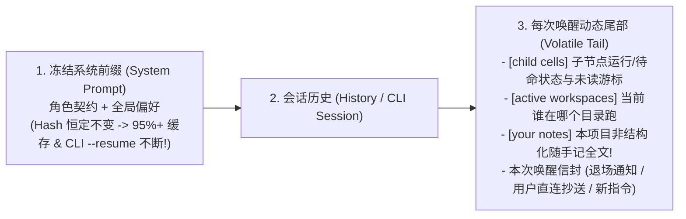

# 分册三：AI 驱动的目录协同（取消内核排队）与 `Project` 常驻非结构化笔记

## 一、取消内核目录读写调度（方案 A）与冲突汇报机制

### 1.1 为什么要去掉内核的 `cwdMode` 读写排队？
- 在旧设计中，派单时需预先声明 `cwdMode: "read" | "write"`，并由内核 `Dispatcher` 按 `git.toplevel(cwd)` 维护单写者阻塞队列。
- 一旦引入**「用户随时直接找 `worker` 说话改需求」**（例如原本派去查日志的 `worker`，用户直接对它说“顺手把这行修了吧”）以及**「已待命 `worker` 随时被消息唤醒」**，预设死板的只读/读写分类与内核硬排队不仅增加派单心智负担，还会限制 `worker` 灵活响应用户直连指令。

### 1.2 新的协同模型：内核亮事实，AI 做分配，遇冲突主动停手汇报

1. **内核层减负（删掉硬排队）**：
   - 移除 [dispatcher.ts](../../packages/cell/src/dispatcher.ts) 中的 `writeSlotKey` 拦截与 `parked` 等待队列，所有到期的 `Cell` 直接按常规并发上限（`maxConcurrentRuns`）立即调度启动。
   - 取消对 `cwdMode: "read"` 挂载底层只读工具阉割的做法，`worker` 默认拥有完整的本地读写与命令执行能力（信源探头 `sensor` 因安全边界仍保持纯只读）。
2. **上下文层亮明实时目录实况（`[active workspaces]`）**：
   - 保留并简化 [readmodel.ts](../../packages/cell/src/readmodel.ts) 在每次唤醒尾部注入的 `[active workspaces]` 动态提示：清晰列出**当前正在运行（`running` 或有活跃后台 `Job`）的 `worker` 分别在哪个目录（及所属 Git 根目录）、属于哪个项目、正在做什么**。
3. **`desk` 分工前先比对交付目标**。收到需要项目接手的工作时，先查已有项目的目标、在办动作和验收条件，再决定归属。
   - “支付重试改造再补个压测”直接追加到正在做支付重试的项目，由该 `project` 调整动作和验收，决定交给原 `worker` 还是另派一棒。
   - 同仓库的“修正对账报表”有独立的交付和验收，可以单独立项。若两项工作预计会改到同一处，`desk` 协调重叠部分的分工或先后顺序。
   - 命中的是已停靠项目时，先给用户看已有结论，确认继续后再激活原项目，沿用[停靠项目的重启流程](../02-workflows/uc04-someday-research-and-reactivate.md)。
4. **`Project` AI 派单策略升级（Prompt 引导）**：
   - 在 `project` 提示词（[prompts.ts](../../presets/src/shared/prompts.ts)）中明确分配准则：
     - 派发新任务前先看一眼唤醒尾部的 `[active workspaces]` 与自己的项目笔记：
       1. 若目标仓库当前已有本项目的 `worker` 正在干活且事情相关，优先直接发消息给那个 `worker` 顺手处理，或等它退场后再派下一棒；
       2. 若目标仓库正被当前项目或隔壁项目的另一个 `worker` 改动代码，而新任务只是纯查阅分析，在指令里交代“当前有人在改代码，只做查阅不要改文件/切分支”；
       3. 若确实需要同时在同一个仓库并行改两套互不干扰的代码，直接在指令里让新 `worker` 用 `git worktree add` 建一个独立工作树目录去改。
5. **`Worker` 冲突自检与汇报停手机制**：
   - `worker` 准备改文件、切分支或提交前，依然先看一眼 `git status --short --branch`：
   - 如果发现**目录里有任务说明之外的陌生未提交改动、陌生分支，或者运行中察觉有其他进程正在同时修改同一批文件导致冲突**：
     - **严禁强行 `reset / clean / stash / checkout -f` 覆盖他人现场**；
     - 立即发消息汇报冲突（发给自己的父 `project` `inbox:<parentId>`，涉及跨项目公共阻塞或无主脏现场也可报 `inbox:desk`），说明当前目录、分支与看到的冲突文件，然后调用 `wait` 暂停当前回合等待上级或主人指示！

---

## 二、`Project` 非结构化常驻笔记（防失忆且不破缓存）

### 2.1 解决现有盲区
- 核查现有 [hydrate.ts](../../packages/context/src/hydrate.ts) 与 [readmodel.ts](../../packages/cell/src/readmodel.ts) 发现：`project` 调用 `save_note(kind: "note", scope: "cell")` 保存的笔记**并不会在后续唤醒时自动出现在模型视野中**——一旦会话经历上下文压缩（Compaction）或 CLI 会话重建，若模型忘记手动调用 `read_resource("note://...")`，就会彻底丢失对各 `worker` 分配脉络的记忆。
- 同时，`project` 记录派单与进展完全不需要僵化的 JSON 表结构，**一段自由格式的非结构化 Markdown 随手记（Scratchpad Note）**对大模型最自然、最抗脆弱。

### 2.2 实现方案：动态尾部自动挂载 `[your project notes]`



1. **写笔记（零格式束缚）**：
   - `project` 直接用现有的 `save_note`（例如约定随手记名字如 `board` 或直接展示该 `project` 名下全部 `scope: "cell", kind: "note"` 笔记，限制合理总长如 `8000` 字符以防意外塞爆）。
   - 提示词引导 `project` 把它当成自己的**项目白板**随手维护，例如：
     ```markdown
     - 目标与当前阶段：正在做支付重试改造（仓库 ~/dev/pay-core，分支 feat/retry）
     - worker_a1（已待命，已 pull 到 #42）：完成了核心退避逻辑并提交 commit 9f2c1；期间用户直接找它把最大重试从 5 次改成了 3 次
     - worker_b2（运行中）：正在跑集成测试并截图
     - 待办下一步：等 worker_b2 退场 pull 结果后，请主人验收
     ```
2. **读笔记（每次唤醒 100% 自动摆在眼前）**：
   - 在 [readmodel.ts](../../packages/cell/src/readmodel.ts) 的 `tailNotes(cellId)` 中，对所有非叶节点协调器（`project` / `desk` / `hub`）自动读取其 `scope: "cell", kind: "note"` 记录，拼入动态尾部 `[your notes — kept across every wake-up; update with save_note]`。
   - **关键收益**：
     - **绝不破坏缓存与会话复用**：笔记走动态 `tail` 注入，绝不触碰 `prompt_prefixes.hash`，因此 `claude --resume` / `codex exec resume` / `agy session/resume` 100% 继续命中原会话！
     - **跨月唤醒 / 上下文压缩零失忆**：哪怕项目停靠在 `以后再说` 三个月后重开、哪怕历史对话被折叠压缩，或者切换了模型档位重建了新 CLI 会话，这块白板一醒来就原封不动摆在眼前！
