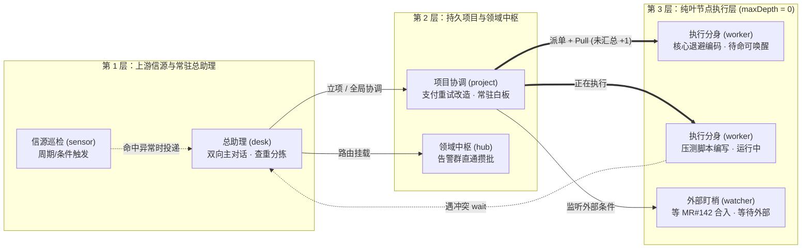

# 分册四：工作台第 4 视图「分身实况（Agents）」——全局拓扑、工作实况流与直连对话设计

## 一、背景与设计定位

在前三册提案将 `desk` 升级为双向持久对话主助理（[分册一](./01-conversational-desk-and-dual-entry.md)）、将 `worker` 演进为可重唤醒纯叶节点并补齐父项目防滞后同步（[分册二](./02-direct-worker-chat-and-pull-handoff.md)）、将目录协同交由 AI 感知并挂载 `project` 常驻白板笔记（[分册三](./03-ai-driven-workspace-and-project-notes.md)）之后，Web 工作台需要一个统一的交互现场把这三项底层能力直观交付给人类。

若强行把拓扑树、分身工具执行流水与多轮聊天塞进原有的 `Clarify / Engage / Radar`，会严重破坏前三视图清爽克制的 GTD 拍板体验；因此我们在顶栏新增第 4 个一等视图 **「分身实况 · Agents」**，确立**「三视图管事与判断 + 第四视图管人与现场」**的清晰边界：

| 视图 | 核心关注点 | 人类在这里做什么 |
| :--- | :--- | :--- |
| **`1. 待确认 Clarify`** | 待拍板的决策卡 | 确认对外发送版本、审批复杂立项、处理受阻或超预算升级卡 |
| **`2. 专注工作区 Engage`** | 球在人类脚下的行动 | 勾选线下速办项、双栏沉浸编辑深度初稿（自动开启外部通知免打扰） |
| **`3. 项目全局 Radar`** | 结果导向的全局进展 | 查看活跃项目球权、点开 `以后再说` 调研报告抽屉、完成 15 分钟周回顾 |
| **`4. 分身实况 Agents`（新增）** | **实时拓扑、执行足迹与双向对话** | **俯瞰全局监督树与同仓协作关系、查看每个分身具体做了什么、随时与 `desk` 或任意 `worker` 直接发话续聊** |

### 核心表层铁律约束

1. **严守 `P-UX-1`（表层零内核黑话，100% 保留真实工程术语）**：
   - 拓扑画布与时间线中**绝不暴露内核机制黑话**（如 `claimId`、`expectedEpoch`、`silent_inject`、`kernel.stalled_check`、`serial_coalesce`），统一投影为自然中文状态（「待命可唤醒」「已同步给所属项目」「系统巡检唤醒」）；
   - 分身实际操作的**本地仓库路径、Git 分支与 commit、源码文件名与标识符、执行的终端命令与测试输出**必须 100% 原样等宽展示，严禁意译篡改。
2. **专注免打扰与底部栏自适应**：
   - 沿用 [App.tsx](../../apps/gtd-desk/src/web/App.tsx) 的 `useFocusMode` 规则：仅停留在 `Engage` 时开启免打扰，切入 `Agents` 自动解除免打扰；
   - 处于 `Agents` 视图时，右侧面板自带针对当前选中节点的专属发话框，因此底部 [BottomBar](../../apps/gtd-desk/src/web/components/chrome.tsx) 自动收起重复的全局速记输入框（仅保留单行快捷键提示），将纵向可视高度完整让给拓扑与对话流。
3. **总助理 `desk` 主对话自然归口（不造多余聊天抽屉）**：
   - 拓扑图的树根就是常驻总助理 `desk`。初次切入 `#/agents`（未指定具体子节点时）默认选中 `desk`，右侧直接呈现与总助理的完整双向历史对话流；在其他视图点击底栏「查看与总助理对话」亦可一键跳至 `#/agents/desk`，无需在全局右侧再维护一套功能重叠的侧滑聊天抽屉。
   - 原顶栏快捷键 `4` 的「随手记 / 信源」抽屉顺延绑定快捷键 `5`（保留 `/` 快速聚焦速记）。

---

## 二、双栏界面架构与「三层确定性拓扑画布」（左 5 $\times$ 右 7）

```text
+---------------------------------------------------------------------------------------------------+
|  1. 待确认 [2]   2. 专注工作区   3. 项目全局   [ 4. 分身实况 · 2 在跑 ]      模型切换 | 信源抽屉(5) |
+---------------------------------------------+-----------------------------------------------------+
| 展示: [拓扑图] [树状列表]  筛选: [活跃与待命]| 面包屑: 总助理 > 支付重试改造 > [分身: 核心退避编码]  |
| [ ] 含已归档   [x] 标出同目录协作            | 状态: ● 待命可唤醒 · 目录: ~/dev/pay-core (feat/retry)|
|---------------------------------------------| 模型: codex (strong) · 预算 18k/200k · [看产出报告v2] |
|                                             |-----------------------------------------------------|
|  [信源: 报错巡检] -.-> [总助理 (desk)]       | 密度: [精简实况(默认)]  [全量步骤]  [纯对话]  [暂停]  |
|                           |                 |-----------------------------------------------------|
|            +--------------+--------------+  | [派单说明 · 来自项目协调 16:12]                       |
|            |                             |  |   请实现指数退避重试，跑通单测后提交分支。            |
|            v                             v  |                                                     |
|  +--------------------+       +-----------+ | > [已折叠 6 步操作: 读 3 文件 · 改 retry.ts · 跑测试] |
|  | 项目: 支付重试改造  |       | 项目: 周报| |   (点击展开查看每一步命令、耗时与变更摘要)            |
|  | 球在: Agent · 1未读 |       | ● 待命    | |                                                     |
|  +--------------------+       +-----------+ | [分身回复 · 16:18]                                  |
|       |            |                        |   已完成退避实现并提交 9f2c1，单测 14/14 通过。       |
|       v            v                        |                                                     |
|  +===========+  +--------------+            |                       [你直连发话 · 16:25 (已同步项目)]|
|  | 分身: 退避 |  | 盯梢: 等 CI  |            |                   把最大重试次数从 5 改成 3 再跑一遍  |
|  | ● 待命 [聊]|  | ● 等待外部   |            |                                                     |
|  | pay-core  |  | 每2m查MR#142 |            | [运行中实时预览 · 正在执行: pnpm test ...]            |
|  +===========+  +--------------+            |-----------------------------------------------------|
|                                             | 提示: 该分身正在运行 — 默认顺手补充，本轮收尾无缝吸收 |
|  [同目录提示: 2 个活跃节点位于 pay-core]     | [ 给「核心退避编码」发补充指示... ] [顺手补充↵][打断] |
|                                             |   自动同步给所属项目「支付重试改造」 [ ] 立即唤醒项目 |
+---------------------------------------------+-----------------------------------------------------+
```

### 2.1 零重型图库依赖的三层确定性拓扑

得益于[分册二](./02-direct-worker-chat-and-pull-handoff.md)将 `worker` 与 `watcher` 物理收口为**纯叶节点（`maxDepth = 0`）**，全系统的 `Cell` 监督树深度严格有界，天然呈现清晰的**三层列式（或上下分层）有向结构**，直接采用 **HTML 语义节点卡 + 底层 SVG 贝塞尔连线** 即可实现丝滑、可无障碍聚焦的拓扑画布（窄屏或项目过多时支持一键切为缩进树状列表）：



### 2.2 五种节点状态与三类拓扑关系信号

节点状态严格复用 [tokens.css](../../apps/gtd-desk/src/web/styles/tokens.css) 的克制色彩体系，不引入刺眼杂色：

1. **`运行中 (running)`**：`--agent` 绿色呼吸圆点 + 当前正在执行的步骤或状态行摘要（`statusLine` / 在跑命令）。
2. **`等待外部或协同 (waiting)`**：`--waiting` 琥珀圆点 + 具体等待条件（如定时探针下次触发时间、或调用了 `wait` 等待其他节点回信）。
3. **`等你拍板 (blocked_human)`**：`--human` 蓝色圆点 + 直跳 `#/clarify/:cardId` 或 `#/engage/:cellId/:actionId` 的快捷角标。
4. **`待命可唤醒 (dormant)`**：柔和中性灰圆点，副标题显示「已待命 · 发消息即唤醒」（不占并发槽位、零算力驻留，但保留完整 `cli:session` 可随时续聊）。
5. **`已暂停 / 已归档 (paused / archived)`**：人工暂停标 `已暂停`；随完结项目归档的历史分身默认折叠为父节点下的「已归档 (N)」胶囊，勾选顶部「含已归档」即可展开回溯。

画布同时呈现三类跨节点工程信号：
- **父子实线 + 未汇总动态胶囊（对齐分册二游标穿透）**：当子 `worker` 的最新 `lastEvidenceSeq` 大于父 `project` 上次检视游标 `pulledSeq`（例如人类刚绕过项目直接对 `worker` 下了补充指令），连线上标出 `未汇总 +N` 胶囊；同时若该 `worker` 发生过人类直连对话（`hadDirectUserChat`），节点右上角挂 `直连对话` 标记。
- **跨节点等待虚线（`WaitRecord`）**：读取 `kernel.listWaits()`，当某 `worker` 撞见陌生脏目录调 `wait("inbox:desk")` 或等待兄弟节点时，绘制琥珀色虚线箭头并悬停展示等待原因。
- **同工作树占用联动（对齐分册三目录感知）**：按规范化 `gitRoot` 对当前活跃节点分组；勾选「标出同目录协作」或鼠标悬停某节点时，共享同一代码仓库工作树的活跃分身同步高亮目录徽章，直观呈现谁与谁正在同一目录并行操作。

---

## 三、右栏设计：一体化「工作实况流 + 智能直连发话框」

### 3.1 节点头部与专属资产入口

选中任意节点后，右栏顶部固定展示：
- **层级面包屑**：如 `总助理 › 支付重试改造 › 分身：核心退避编码`，点击任一层级直接切换检视对象；
- **运行现场条**：状态胶囊、工作目录 `cwd`（附检测到的当前 Git 分支名）、执行引擎与模型档位（如 `codex · strong` / `claude · fast` / `零算力脚本`）、子树 Token 预算使用量；
- **关联资产快捷抽屉**：
  - 若节点或其所属项目产出了 `Artifact`（调研报告、方案初稿、终审结论），顶部直接列出 `[查看报告：xxx (v2)]` 按钮，点击滑出共享 Markdown 报告阅读抽屉（与 `Radar` 共用同一抽屉组件，顺手闭环 `BUG-010`）；
  - 若当前选中的是 **`project` 协调节点**，顶部额外提供 **`[项目常驻白板 (Notes)]`** 展开开关，可直接检视[分册三](./03-ai-driven-workspace-and-project-notes.md)中挂在动态尾部的非结构化项目随手记，以及尚未汇总的子 `worker` 动态摘要；
- **单节点同步控制**：根据状态提供 `暂停`、`继续`、`紧急叫停` 按钮（直走同步控制旁路，秒级中断在途进程并安全保留宿主机工作目录文件）。

### 3.2 三档密度的交织时间线（Activity & Chat Stream）

时间线直接从 SQLite [evidence](../../packages/context/src/evidence.ts) 表投影生成，在服务端过滤掉纯内部调度控制噪音后，按自然时间序交织呈现**「任务交接 + 操作足迹 + 双向对话」**，并提供三档阅读密度切换：

1. **`精简实况（默认）`**：
   - 完整展开：**派单任务书**（首条上级派单指令）、**你的直连消息**（右侧高亮气泡，注明同步状态）、**分身的自然语言回复与阶段总结**（Markdown 渲染）、**关键交付里程碑**（创建/局部修订了哪份 `Artifact`、回合排空退场通知）；
   - **连续工具步骤自动折叠**：将连续多步底层工具调用（如 `Read`、`Edit`、`Bash`、`custom_tool_call`）聚合成单行可展开的**操作步骤组卡片**，自动提炼人话摘要（例如：`执行了 6 步操作：读取 3 个文件 · 修改 src/retry.ts · 运行 pnpm test (通过)`）。点击即可原地展开每一步的命令参数、耗时与输出预览；若输出超长已溢出至 `resources` 表（`spillUri: res://...`），提供「加载完整输出」按页懒加载按钮。
2. **`全量步骤`**：默认逐条展开所有工具调用与返回摘要，便于深度排查问题。
3. **`纯对话`**：折叠隐藏全部中间工具调用组，仅保留人类与该节点的对话往来及核心交付胶囊（检视根节点 `desk` 时可作为清爽的主聊天窗口）。
4. **底部在途实时区**：若当前节点正在运行 `Run` 或挂有跨轮次后台长进程 `Job`，时间线最底部固定浮现实时状态行与 `job.output` 滚动尾部预览。

### 3.3 按状态自适应的「智能直连发话框」

发话框根据当前选中节点的处理器类型与运行状态自动切换交互契约：

| 选中节点类型 / 状态 | 默认发送行为与交互契约 |
| :--- | :--- |
| **`总助理 (desk)`** | **双向持久主对话**：输入需求、回答路径追问或查询进展回车即发；回复某条追问时自动携带 `replyToId`，与外部 CLI 主 Agent 共享同一套会话归属标识（见[分册一](./01-conversational-desk-and-dual-entry.md)）。 |
| **`待命可唤醒 (dormant)` 的 `worker`** | **原会话无缝唤醒**：提示「分身已待命，发消息将沿原上下文立即唤醒续跑」；发送后消息入箱，底层 `CliAgentLoop` 命中原 `cli:session` 执行 `--resume` 续跑（若历史节点曾被标为 `closed` 且所属项目仍处于活跃态，服务端在同一事务内先恢复其状态为 `active` 再入箱，确保 100% 可送达）。 |
| **`运行中 (running)` 的 `worker`** | **默认「顺手补充」+ 可选「立即打断插话」**：<br>1. 主按钮默认为**「顺手补充（`mode: "enqueue"`）」**——消息写入收件箱，不粗暴打断正在执行的编译或测试命令，待当前回合收尾排空检查时自动 `--resume` 吸收处理；<br>2. 旁设独立次级按钮**「立即打断插话（`mode: "steer"`）」**——当发现分身方向跑偏时点击，立即走 `inbox.control({ action: "steer" })` 实时中断纠偏。 |
| **`project` / `hub` 协调节点** | **直接向协调器传达指令**：例如「先别合入，加一轮压测」，协调器唤醒后自动调整项目白板笔记、动作账本与派单安排。 |
| **纯脚本节点（`processor.type === "code"`）** | **防呆只读提示**：对零算力定时脚本 `sensor` 或脚本探针 `watcher` 自动禁用自由聊天框，提示「这是零算力确定性脚本探针，不接受自然语言对话」，改供「立即触发一次检查 / 暂停」快捷按钮。 |
| **已完结/取消项目的归档节点** | **归档只读保护**：禁用直接输入，提供「重新启动所属项目」或「跳至总助理另起新事项」快捷入口。 |

- **父项目零滞后同步保障**：每当人类向某个项目下的子 `worker` 发送直连消息（无论 `enqueue` 还是 `steer`），服务端在**同一个 SQLite 事务**内自动向其父 `project` 收件箱写入一条 `type: "cell.direct_chat"` 信封（默认 `delivery: "silent_inject"` 静默留痕不触发额外空转；发话框底部附可选复选框「同时立即唤醒项目协调器」，勾选时改为 `delivery: "wakeup"`）。

---

## 四、事件总线、HTTP 接口契约与跨视图联动

### 4.1 事件总线与 SSE 增量流扩展

1. **[bus.ts](../../packages/protocol/src/bus.ts) 新增事件主题**：
   - `"evidence.appended": { cellId: string; seq: number; kind: EvidenceKind; runId: string | null }`
   - 在 [evidence.ts](../../packages/context/src/evidence.ts) 的 `append` 事务提交后（`afterCommit(db, ...)`）发出，确保前端拿到事件时 SQLite 记录已 100% 可读。
2. **[events.ts](../../apps/gtd-desk/src/server/events.ts) 实时转发**：
   - [shared/api.ts](../../apps/gtd-desk/src/shared/api.ts) 中 `ViewName` 扩展加入 `"agents"`，`ViewKey` 扩展为 `"clarify" | "engage" | "radar" | "agents"`；
   - `cell.changed`、`run.started`、`run.finished`、`job.changed`、`inbox.control`、`inbox.enqueued` 自动标记 `"agents"` 拓扑视图刷新；
   - `EventHub` 对 `evidence.appended` 按 `cellId` 做 `80ms` 合并去抖，向 `/api/events` SSE 推送轻量事件 `{ event: "cell_tail", data: { cellId, lastSeq } }`（并对开启流式预览的后台任务推送 `{ event: "job_chunk", data: { cellId, jobId, chunk } }`）。前端仅对当前右侧打开的 `cellId` 调用 `GET /api/cells/:cellId/timeline?afterSeq=...` 增量追加尾部，**零轮询、零闪烁**。

### 4.2 服务端 HTTP API 契约（统一服务于 `desk` 与全部子节点）

在 [app.ts](../../apps/gtd-desk/src/server/app.ts) 新增以下同源鉴权接口（统一替代分册一早期草拟的独立 `/chat` 路径，使 `desk` 与 `worker` 共用同一套时间线与消息协议）：

1. **`GET /api/agents/topology?includeArchived=0&projectId=`** $\rightarrow$ `TopologyDTO`
   ```ts
   export type AgentVisualState = "running" | "waiting" | "blocked_human" | "dormant" | "paused" | "archived";

   export interface TopologyNodeDTO {
     cellId: string;
     parentId: string | null;
     projectId: string | null;
     preset: PresetName | null;
     roleLabel: string;           // "总助理" | "项目协调" | "执行分身" | "外部盯梢" | "信源巡检" | "领域中枢"
     title: string;
     state: AgentVisualState;
     processorType: "llm" | "code";
     canChat: boolean;
     engine: string | null;       // "claude" | "codex" | "agy" | "api" | null
     modelTier: "strong" | "fast" | null;
     cwd: string | null;
     gitRoot: string | null;
     statusLine: string | null;
     lastEvidenceSeq: number;
     unpulledCount: number;       // 父 project 尚未 Pull 汇总的新增证据条数
     hadDirectUserChat: boolean;
     tokensUsed: number;
     tokensLimit: number | null;
     pendingCardId: string | null;
     engageItem: { cellId: string; actionId: string } | null;
     updatedAt: number | null;
   }

   export interface TopologyDTO {
     generatedAt: number;
     deskCellId: string;
     counts: { running: number; waiting: number; dormant: number; archived: number };
     nodes: TopologyNodeDTO[];
     waits: Array<{ fromCellId: string; targetCellId: string | null; targetLabel: string; description: string; since: number }>;
     workspaces: Array<{ gitRoot: string; label: string; activeCellIds: string[] }>;
   }
   ```
2. **`GET /api/cells/:cellId/timeline?afterSeq=0&beforeSeq=&limit=100`** $\rightarrow$ `CellTimelineDTO`
   - 返回节点头部元数据（含关联 `artifacts` 列表、`project` 节点的常驻 `notes` 文本、活跃 `jobs` 列表、待回复追问标识）及结构化 `items: TimelineItemDTO[]`（细分为 `dispatch_brief`、`user_chat`、`assistant_reply`、`tool_group`、`artifact_event`、`milestone`、`system_event`）。
3. **`GET /api/resources?uri=res://...&offset=0&limit=16000`** $\rightarrow$ `ResourcePageDTO`
   - 安全读取 `resources` 表中的溢出大文本，返回 `{ uri, content, offset, limit, totalChars, hasMore }`（同步暴露给外部主 Agent MCP 控制面 `read_resource` 工具）。
4. **`POST /api/cells/:cellId/messages`** $\rightarrow$ `SendCellMessageResponse`
   - 请求体：
     ```ts
     export interface SendCellMessageRequest {
       text: string;
       clientId: string;                     // 幂等消息 ID，断网重试绝不双发
       mode?: "enqueue" | "steer";           // 默认 "enqueue"（顺手补充）；"steer" 为立即打断插话
       notifyParent?: "silent" | "wakeup";   // 默认 "silent"（静默抄送父 project）
       replyToId?: string;                   // 关联回复的追问消息 ID
     }
     ```
   - 同步事务保证：拒绝 `processor.type === "code"` 或已完结归档项目节点 $\rightarrow$ 若目标 `worker` 处于 `dormant` 或可恢复 `closed` 则确保激活 $\rightarrow$ 按 `mode` 投递入箱或执行 `steer` 控制旁路 $\rightarrow$ 若存在父 `project` 则同事务写入 `cell.direct_chat` 抄送信封 $\rightarrow$ 返回最新状态与入账条目。
5. **`POST /api/cells/:cellId/control`**
   - 请求体：`{ action: "pause" | "resume" | "cancel" }`，以人类 `owner` 身份执行节点控制并返回刷新后的状态快照。

### 4.3 跨视图双向跳转闭环

- **从 `Radar` 跳入 `Agents`**：在 [Radar.tsx](../../apps/gtd-desk/src/web/views/Radar.tsx) 的项目卡片底部渲染分身实况入口（如 `3 个分身（1 个在跑） →`），点击直接导航至 `#/agents?project=<projectId>` 并自动展开选中该项目下正在运行的分身。
- **从 `Agents` 跳回业务拍板与阅读**：
  - 节点挂有待确认卡片（`pendingCardId`）时，点击「去拍板 →」直达 `#/clarify/:cardId`；
  - 节点挂有 `@Human` 动作时，点击「去处理 →」直达 `#/engage/:cellId/:actionId`；
  - 点击节点或时间线上的 `Artifact` 胶囊，原地滑出共享 Markdown 报告阅读抽屉（与 `Radar` 的 `以后再说` 报告抽屉完全复用同一套组件）。
