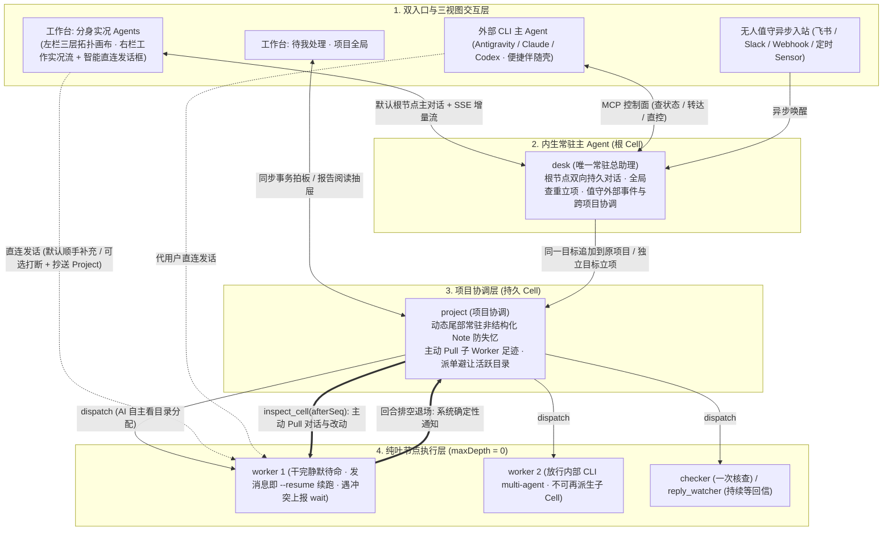

# 架构演进记录：对话式主台、可唤醒分身、统一人类收件箱与命令层

> [!NOTE]
> 分册 01–06 均已落地。当前工作台分为「待我处理」「项目全局」「分身实况」三个视图。`worker` 回合结束转为待命，`checker` 一次核查后排空自关，`reply_watcher` 持续等待回信。退场通过附带 `turn` 与 `childState` 的 `cell.result` 通知父节点。现行规则以 [产品与架构原则](../01-principles/) 和 [工作流与用例](../02-workflows/) 为准。

> 第一节记载演进前的问题，末节保留最初四册的实施批次。

---

## 一、本次演进要解决的五个核心问题

1. **主台（`desk`）与外部主 Agent 职责重叠、且缺乏持久双向对话体验**：
   - 现状下内部 `desk` 与外部主 Agent 各自维护了一套几乎重合的查重、追问、立项与偏好逻辑，但用户在工作台里只能向 `desk` 单向投递“随手记”，无法像跟主 Agent 聊天一样与常驻 `desk` 进行带完整上下文历史的连续对话。
   - **目标**：将常驻 `desk` 升级为**可直接双向对话、拥有完整持久化对话记录的内生主 Agent**（在岗时陪用户聊天派活，离线时继续值守外部渠道、定时信源与跨项目协调）；同时保留外部主 Agent（Antigravity / Claude Code / Codex）作为便捷交互壳接入。两个入口都标明发送者身份、会话、关联追问与已知项目归属；`desk` 分工前先查已有项目，优先把服务于同一交付目标的工作追加给原 `project`。
2. **用户需要直接与 `worker` 对话，且 `worker` 跑完后仍可能被再次追问唤醒**：
   - 现状下 `worker` 仍持有派生子 `Cell` 的工具，且一旦单轮结束即被内核永久置为 `closed` 拒收后续消息；若用户直接对 `worker` 插话，父级 `project` 与状态查询端会出现信息滞后。
   - **目标**：将 `worker` 与 `watcher` 彻底收敛为**纯叶节点（`maxDepth: 0`）**（剥离派生子 `Cell` 工具，放行底层 CLI 自身内部的 sub-agent）；淡化硬性 `close`——`worker` 跑完当轮后进入**静默待命态（`Dormant`）**（系统不主动唤醒、不占并发配额、不拦项目结项），但用户或上级发消息时可随时沿原 `cli:session` 无缝唤醒续聊；且用户对 `worker` 的直连对话全程留痕并自动抄送父 `project`。
3. **不能指望 `worker` 每次都自觉调用汇报工具交卷**：
   - 一旦允许用户直接与 `worker` 多轮自由对话，底层 CLI 模型极易在完成修改或回答完问题后直接自然退出回合，漏调 `report_to_parent` 或遗漏前序对话中的关键改动。
   - **目标**：改为**「`worker` 每轮排空退场时由系统确定性通知 `project`，由 `project` 主动 Pull 该 `worker` 的增量对话与操作记录」**，并做好 `claude / codex / agy / api` 四套引擎的统一采集适配。
4. **内核死板的只读/读写目录排队限制了临时改码，且 `project` 缺乏防失忆的自由记事本**：
   - 事先硬分 `cwdMode: "read" | "write"` 并在内核排队，在“用户半路找只读 `worker` 顺手改代码”时显得僵化；同时现有 `save_note` 不会在唤醒时自动展现给 `project`，会话压缩或重建后容易失忆。
   - **目标**：**取消内核工作树写锁排队与 `cwdMode` 调度**，改由 AI 根据实时目录占用提示自主协调，并为 `worker` 提供清晰的冲突上报停手机制；同时将 `project` 的**非结构化笔记（Note）自动挂载到每次唤醒的动态尾部**，不破缓存、永不失忆。
5. **Web 工作台缺少俯瞰全局拓扑、检视分身具体做了什么以及直连发话的交互现场**：
   - 演进前的 `Clarify / Engage / Radar`专注决策拍板与结果总览，不适合塞入执行步骤流与聊天窗口，导致后台分身对人类而言像黑盒，也无处直接在网页上给 `desk` 或指定 `worker` 发消息。
   - **目标**：新增 **「分身实况 · Agents」**，后续由提案 05 将处理入口合并为「待我处理」（左 5 三层确定性拓扑画布 $\times$ 右 7 一体化工作实况流与自适应直连发话框），把全局监督树、同仓协作关系、折叠操作步骤流以及与 `desk` / `worker` 的直连对话统一收口（运行中默认「顺手补充」排队吸收，另设独立「立即打断插话」按钮）。

---

## 二、演进后的全局拓扑与交互流

---

## 三、提案分册目录

1. **[01-conversational-desk-and-dual-entry.md](./01-conversational-desk-and-dual-entry.md)**
   - 常驻 `desk` 升级为带完整对话历史的内生主 Agent、双入口归属标识约定与主对话收口方案。
2. **[02-direct-worker-chat-and-pull-handoff.md](./02-direct-worker-chat-and-pull-handoff.md)**
   - `worker / watcher` 纯叶节点化、淡化 `close` 的可重唤醒待命模型、用户直连 `worker` 状态防滞后双保险、以及系统退场通知 + `project` 主动 Pull（`inspect_cell` 四套引擎统一适配）。
3. **[03-ai-driven-workspace-and-project-notes.md](./03-ai-driven-workspace-and-project-notes.md)**
   - 移除内核读写调度队列、AI 目录感知与 `worker` 冲突上报停手机制、以及 `project` 非结构化 Note 动态尾部常驻防失忆方案。
4. **[04-agents-topology-and-live-chat-tab.md](./04-agents-topology-and-live-chat-tab.md)**
   - 工作台新增「分身实况 · Agents」：左 5 三层确定性拓扑画布（含未汇总动态、等待虚线与同仓占用高亮）$\times$ 右 7 三档工作实况流与按状态自适应的直连发话框、SSE `evidence.appended` 增量协议与 HTTP API 契约。

### 已实施的后续演进（Phase 0 → 05 → 06）

5. **[05-unified-human-inbox-and-custom-cards.md](./05-unified-human-inbox-and-custom-cards.md)**（状态：已落地 · 方案 A 修订版）
   - 专注**人机协作层**：合并 `Clarify` 与 `Engage` 为唯一人类处理入口（顶栏精简 3 视图，左列表 + 右详情卡，8/4 专注编辑配租约式 DND）；底层正交拆分为 **`HumanItem`（唯一人类收件箱）× `Gate`（纯权限与信任引擎）** 并彻底解耦 `subjectKey` 与 `relatedProjectIds`；开放 Agent 自定义 `options: CardOption[]`（单行可选输入框空回车直发），以 5+1 封闭效果原语保零死状态；新增受控 **`reopenProject`** 与非外发操作撤销恢复。
6. **[06-architecture-ssot-cli-sync-and-boundaries.md](./06-architecture-ssot-cli-sync-and-boundaries.md)**（状态：已落地 · 继 05 后实施）
   - 专注**内核与控制面深度拔根**：真 SSOT 字段归属表（删除影子 KV、`PresetDef.onCellClosed` 解耦假薄内核）；**CLI Session = SQLite Evidence 带游标物化缓存同步协议**（`lastDeliveredEvidenceSeq + systemHash`、macOS 跨平台孤儿清理）；**唯一领域命令层 `DeskService`** 与单事务边界；`watcher`（`checker` / `reply_watcher`）与 `knowledge`（`working_note` / `reference`）正交拆分（并明确除叶节点 `maxDepth: 0` 禁派生子 Cell 外不对宿主机读写/命令工具施加限制）。

---

## 四、落地时对第一、二层规范的同步修订清单

| 规范文件 | 随代码批次同步修订的条款 |
| :--- | :--- |
| [01-product-principles.md](../01-principles/01-product-principles.md) | 1. **`P-UX-2` 升级**：常驻 `desk` 成为支持直接双向持久对话的内生主 Agent，外部 CLI 主 Agent 作为轻量伴随入口共存； 2. **`P-UX-6` 升级**：三视图分别负责待我处理、项目全局、分身实况。 |
| [02-kernel-principles.md](../01-principles/02-kernel-principles.md) | **`P-KERN-1` 升级**：`worker / checker / reply_watcher` 物理收口为纯叶节点（`maxDepth: 0`）；从“单次排空死关 + 强依赖子主动汇报”演进为“回合排空转静默待命 `Dormant`（可被消息 `--resume` 重唤醒）+ 系统确定性退场通知 + 父节点 `inspect_cell` 主动 Pull 客观足迹”。 |
| [03-safety-and-boundaries.md](../01-principles/03-safety-and-boundaries.md) | **`P-SAFE-2` 重写**：移除内核按工作树根单写排队与 `cwdMode` 读写门禁，信源只看由预设提示词约束，改为内核暴露实时活跃目录事实 `[active workspaces]`、AI 自主协调目录分配、`worker` 动刀前验现场遇冲突主动上报并 `wait`。 |
| [00-system-mechanics.md](../02-workflows/00-system-mechanics.md) & `uc05` / `uc08` | 更新全局拓扑与视图映射表（现行三视图包含「分身实况」）、更新 `Worker` 状态机（加入 `Dormant` 可重唤醒态与 `Turn-Settled Pull` 闭环）、将 `uc05` 重写为 AI 驱动目录协同与冲突上报，并新增 **`uc08`（用户通过 `Agents` 视图或控制面直连 `Worker` 对话与退场 Pull 同步）**。 |

---

## 五、历史实施批次（分册 01–04）

将 [`03-bugs/README.md`](../03-bugs/README.md) 中的 13 条压测缺陷与本目录 4 册提案对齐去重后，整体按 **4 个无返工批次** 推进（其中 `BUG-008` 的 `worker` OS 只读沙箱、`BUG-012` 动态改 `cwdMode` 与 `BUG-013` 写锁槽位测试已被分册三取消 `cwdMode` 排队直接消解，**切勿再去白做旧修补**）：

1. **第 1 批（P0 账本与防吞信封止血 —— 多轮直连续聊的安全前提）**：
   - 修复 `BUG-002`（CLI `--resume` 单轮增量计费，消除 $O(K^2)$ 虚增，否则开放直连 `worker` 多轮续聊会立刻刷爆预算） $\rightarrow$ `BUG-001`（认领前零成本预算预检，严禁吞没入站信封） $\rightarrow$ `BUG-003`（缓存折扣权重、祖先链一键联调续费、协调器收尾免死缓冲、移除派生静态余额焊死） $\rightarrow$ `BUG-004`（`auto` 模式下 `fast` 档位正确映射轻量/低推理档）。
2. **第 2 批（演进内核底座：可唤醒叶节点 + 主动 Pull + AI 目录协同 + 常驻笔记）**：
   - 落地[分册二](./02-direct-worker-chat-and-pull-handoff.md)与[分册三](./03-ai-driven-workspace-and-project-notes.md)：收口 `worker / watcher` 的 `maxDepth: 0` 并放开 CLI 内部 sub-agent；改硬 `close` 为 `Dormant` 静默待命（调整活跃子节点配额与结项检查）；实现系统退场通知、直连发话 `cell.direct_chat` 静默抄送、跨四引擎统一的 `inspect_cell`（**顺手修掉 `BUG-008` 子项 1 Codex 隐藏 `custom_tool_call` 漏采**）；移除 `Dispatcher` 工作树写锁队列与 `cwdMode` 分支；在 `ReadModel.tailNotes` 自动挂载 `project` 常驻非结构化笔记；在 `BusTopics` 新增 `evidence.appended`。
3. **第 3 批（第 4 视图「分身实况 · Agents」全栈落地 + 对话式 `desk` + Web UI / 控制面闭环）**：
   - 落地[分册一](./01-conversational-desk-and-dual-entry.md)与[分册四](./04-agents-topology-and-live-chat-tab.md)：实现 `/api/agents/topology`、`/api/cells/:cellId/timeline`、`/api/resources`、`/api/cells/:cellId/messages`（默认 `enqueue` 顺手补充 + 可选 `steer` 打断插话 + 纯脚本节点防呆）与 SSE `cell_tail` 增量推送；完成前端第 4 视图「分身实况 · Agents」（左 5 三层拓扑画布 + 右 7 三档时间线与发话台）及共享 `Artifact` 阅读抽屉；升级 `desk` 提示词与外部主 Agent 引导词，**一并收口 `BUG-010`（`Radar` 停靠报告阅读抽屉）、`BUG-011`（`waiting` 文案/周回顾过滤/`someday` 双徽章）与 `BUG-012`（历史子分身视野与大资源分页）**。
4. **第 4 批（Watcher 零算力探针、局部修订与宿主机韧性收尾）**：
   - 修复 `BUG-006`（`Artifact` 升版保留原标题 + `patch_artifact` 局部补丁） $\rightarrow$ `BUG-005`（零 Token 脚本探针 `watcher`、单一定时源与重跑防误毁） $\rightarrow$ `BUG-007`（过滤已内联技能、偏好目录/角色作用域、禁词纠偏保留源码技术术语、报告篇幅治理） $\rightarrow$ `BUG-009` & `BUG-013` 子项 1（macOS `caffeinate -i` 防休眠、合盖唤醒租约顺延、macOS 无 `/proc` 下的 `markedAlive` 防 PID 复用校验）。
