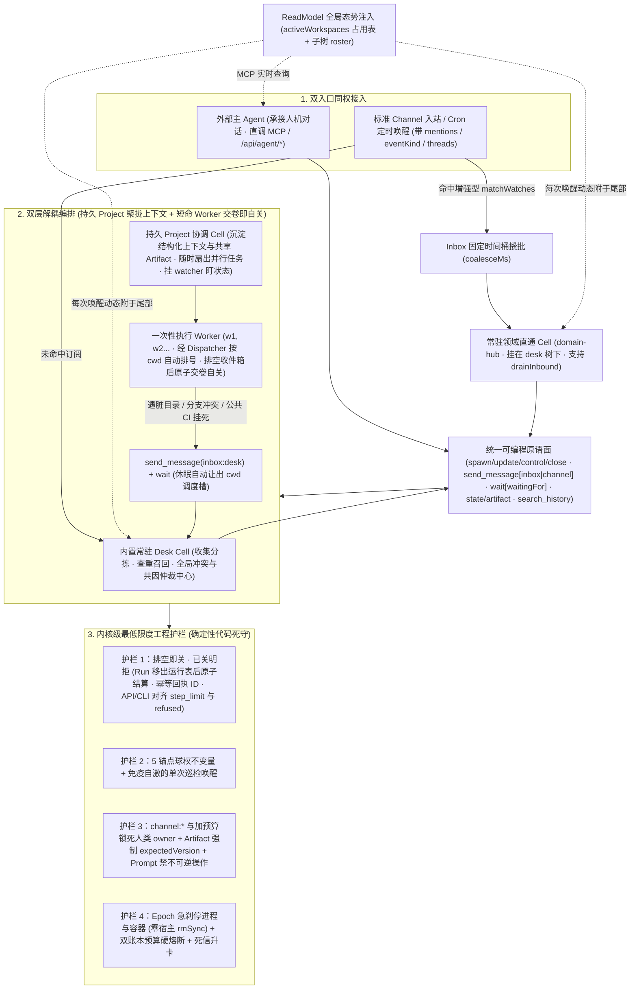
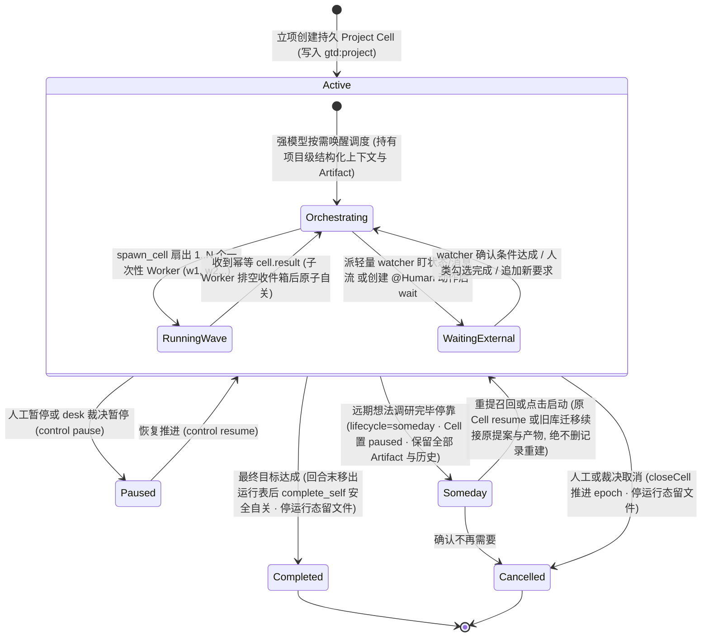
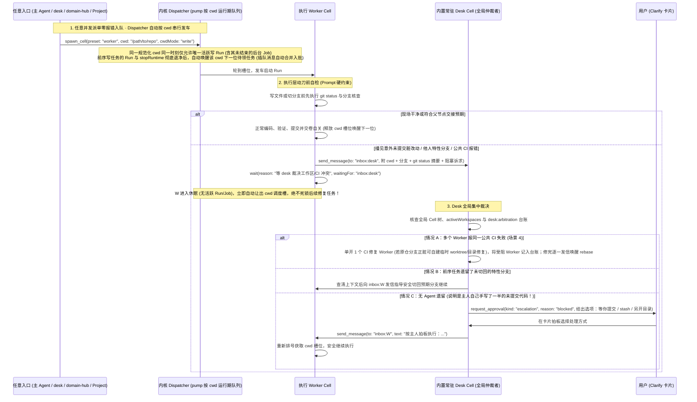

# 真实工作场景架构推导与极简演进方案

> [!IMPORTANT]
> **核心结论（基于基线 `2de41dd` 源码深挖与架构边界收敛）：**
> 1. **产品定位与三大架构前提**：
>    * **双入口同权**：`ng-agents` 同时作为**本地常驻异步编排守护进程**（承接外部 `Channel` 与定时 `Sensor` 事件）与**暴露给外部主 Agent 的结构化工作台底座**（MCP / 控制面 API）。桌面悬浮窗、斜杠输入框、缺参数追问等壳层交互由外部主 Agent 自然承接。
>    * **零自动 Worktree、零空间回收**：内核彻底退出文件系统与 Git 分支生命周期管理——不暗建假仓、不自动 `git worktree add`、不自动打快照 commit、更不在 `closeCell` 时 `rmSync` 删任何目录或篡改空 `$HOME`。`closeCell` 仅执行**进程/容器运行态与控制面回收**（推进 `epoch`、停 `Run`、杀孤儿 `Job`、停掉显式容器隔离下的常驻容器、销钟撤卡，绝不触碰宿主机工作目录）。
>    * **同工作区并发靠「`Dispatcher` 运行期按 `cwd` 自动排号 + 动刀前验现场报 `desk` 裁决」解决**：无需规划层手搓跨树锁等待或 CAS 报错重试。内核调度器 `dispatcher.pump()` 原生保证同一规范化 `cwd` 同一时刻仅发车唯一写任务 `Run`（含其在途后台 `Job`，进程彻底退净后才放行下一位；休眠等待时自动让出槽位绝不死锁）；执行层 `Worker` 动刀前先验 `git status`，一旦撞见主人手写脏改动、未知分支或公共 CI 挂死，立即发信给 `inbox:desk` 并休眠等裁决。
> 2. **真正的症结不在 6 原语不足，而在上层写死了过多“防呆死锁”**：阻塞 6 大场景的根源，80% 来自上层预设、CLI 驱动与宿主层自设的 **6 处硬编码能力镣铐**（纯代码 `Coordinator` 垄断且跑完自毁、禁 `inbox:*` 通信、封锁宿主读写与 CLI `--restricted` / 断网沙箱、强制 Worktree 删目录与假 `$HOME`、锁死单 `Cell` 独占 `Artifact/State`、宿主同步接口强耦合 `Coordinator` 私有状态），剩下 20% 才是底层缺失的 **3 个物理原语**（全域含溢出表检索、直通 `Watch` 算子 + 时间桶攒批 + 安全流式吸纳、外部主 Agent 同权控制面）。
> 3. **演进总纲（拆镣铐 × 精状态机 × 严 Prompt 契约 × 5 锚点护栏 × 补原语）**：回归 **“一切可编程可编排，靠强模型 + 严密 Prompt 契约自主协同，内核死守确定性安全底线”**。

---

## 一、原始目标场景清单

### 1.1 孔罗星：五类连续、临时、周期与受阻协同场景

1. **场景 1：大的有连续性的事情（Harness 对比任务）**
   * 同事找我沟通 Harness 对比任务并开了会（有飞书会议纪要），但我手头还有别的事，主体可以明天开始做。
   * **预期**：
     * AI 读到会议纪要，知道我有这件事，自动创建一个 Todo / 项目；
     * 识别出部分工作可以先启动：`traecli / trae ide` 的代码本地已有，先行分析；`Doubao work` 的代码本地没有，需要找别人要——给我生成一个明确的 `@Human` Action；
     * 当我要到代码之后，AI 知道 `Doubao work` 代码已就绪，自动继续往下分析；
     * 全部跑完给我一份结论报告，我提出补充分析内容继续交给它，它能承接之前的分析上下文，把补充要求放进去产出新版报告。

2. **场景 2：临时的小事情，但有一点工作量（TUI 复制 Markdown 表格）**
   * 有个 TUI 功能需要修改：希望复制 Markdown 表格时复制出 Markdown 源码格式而不是 Unicode 制表符。
   * **预期**：
     * 调出入口输入 `/todo 修改markdown表格复制的时候复制markdown格式而不是Unicode字符`；
     * AI 识别该需求可直接开干，但不知道代码库在哪里，先向我确认路径；
     * 给出路径后创建 Todo，拉起后台 Worker 会话开始改代码；
     * AI 改完后没有创建 MR，我跟它说“继续用 `/ship-mr` 跟进”——**后续需自动识别并固化成长期偏好**；
     * MR 建好后我觉得验证不够充分，希望它补录个屏——继续追加任务；
     * **MR 合入后，Todo 自动标为 Done**。

3. **场景 3：日常定时琐事（周报）**
   * **预期**：AI 识别到我有一个重复的周会日历日程，扫描我创建的飞书文档发现每周固定写周报，并且翻看历史上我用多个 Session 总结过周报内容；于是自动分析历史周报和过往 Session 都用了哪些数据源，在每次周会前帮我整理好周报推送给我。

4. **场景 4：多个日常事项同时被 Block（共因修复与批量唤醒）**
   * 有多个正在实现的 feature / bugfix，因为同一个公共 CI 问题都没法推进到可合入，这些会话暂停了。
   * **预期**：AI 识别到这些事项都在等同一个 CI Fix，新开一个独立会话去解决；解决完后自动向之前暂停的会话追加消息：*“ci已修复，可以 rebase develop 然后继续推进”*。

5. **场景 5：临时的 Idea，不确定要不要做、什么时候做（极简模式）**
   * 最近用户比较在意 Token 消耗，计划做个极简模式，输入 `/todo` 随手记一下。
   * **预期**：
     * AI 识别这个 Todo 只是远期计划、暂不推进研发，但为明确极简模式该做成什么样，主动先调研其他产品的做法，出份报告就停止（归入以后再说）；
     * 过段时间忘了这事，再次提起 `/todo 要做个极简模式`；
     * AI 识别之前已有相关 Todo 且附有调研报告，问我要不要先看一眼、是否现在正式开做；
     * 我确认并做一些调整，因事情较大需拆成几个阶段来做——AI 拆分出子事项，**根据我的注意力先一个个做，不并发全部都做**。

### 1.2 马烨：飞书直通模式场景

6. **场景 6：直通模式（面向 Code Review、问题排查、某事项下的新任务实现）**
   * **预期**：
     * 收到飞书特定消息时，**不经过收件箱（`Clarify` / 全局主台 `desk`）**，直达匹配后转到几个唯一的常驻会话上；
     * 每个唯一会话对应一批项目（根据偏好预设好基于哪些代码仓库及各自的默认分支）；
     * 对收到的请求能派生独立子 Session 去完成对应任务；
     * **前置区间聚合**：能对时间区间内未处理的同类直达消息做前置聚合；
     * **执行中动态聚合**：若同类任务已在执行中，能把新来的直通消息 Append 上去做聚合。

---

## 二、七条核心设计原则与代码级真问题溯源

### 2.1 七条核心架构设计原则（防止打补丁填坑的第一性标尺）

任何机制若需要靠不断叠加补丁来堵时序漏洞，往往说明违背了以下第一性原则。后续演进与实现一律以这 **7 条原则** 为准绳：

1. **表层极简恒定，双入口同权直控（壳层交互 × 编排底座解耦）**
   * 用户表层永远只保留最直觉的 GTD 概念（信箱与信源、单事项至多 1 张待确认卡、清晰球权与以后再说），定时巡检归入“产生事项的信源”而非塞进待办列表充数，绝不向用户暴露队列、进程等底层名词。
   * 底座同时作为**常驻异步守护进程**（承接外部 `Channel` 与 `Sensor`）与**面向外部主 Agent 的同权控制面**（MCP / `/api/agent/*`）；悬浮输入框、缺仓库路径追问等实时壳层交互由外部主 Agent 自然承接，底座不重复造对话壳子。
2. **上下文上浮归持久 `Project`，执行下沉归短命 `Worker`（防黑盒单会话淤积）**
   * **严禁将多阶段长任务闷在单一超长 CLI Session 黑盒里跑到底**——否则系统对中间进展彻底失明，后续一旦插入新的并行工作流便无法拆分扇出。
   * **`Project` 常驻管资产，`Worker` 排空即自关**：`Project` Cell 持久存活，专门聚拢结构化状态、阶段结论与版本化 `Artifact`；重体力执行外包给一次性 `Worker`，完工后在收件箱排空时原子交卷自关（`Drain-then-Close`，刚到追单则顺手消化，已关则同步明拒让父级派新棒），逼迫一切有效上下文沉淀在透明的 `Project` 维度，随时支持并行扇出 `1..N` 个子工作流。
3. **回归真实宿主态：零自动 Worktree、零宿主目录误删（运行态回收与文件系统解耦）**
   * 内核彻底退出宿主机目录与 Git 分支代管——不暗建假仓、不自动 `git worktree add`、不乱打快照 commit、不覆盖空目录假 `$HOME`、**更绝不在 `closeCell` 时执行宿主机目录 `rmSync`**。
   * 关单只回收**进程与容器运行态**（推进 `epoch`、停 `Run`、杀后台 `Job`、停显式容器）；若某任务确需独立临时目录或 worktree（如不碰原分支现场修公共 CI），由 Agent 在计划中显式执行命令并自行负责。
4. **资源互斥下沉至调度层，现场异常上浮至 `desk` 仲裁（绝不在规划层手搓分布式锁）**
   * **机制归内核单点调度，业务归中心模型裁决**：不在规划层搞猜锁、CAS 报错重试或手写跨子树等待广播表——同目录写串行直接下沉为内核 `Dispatcher` 运行期按规范化 `cwd` 自动排号发车（旧进程彻底退净才发下一辆车；任务 `wait` 休眠无 `Job` 时立即自动让出槽位，天然杜绝自我死锁）。
   * 执行层动刀前必验 `git status`：一旦撞见主人手写脏改动、未知分支或公共 CI 挂死，严禁擅自清现场，一律发信给树根 `inbox:desk` 集中裁决。
5. **外部监听看“当前事实与持久历史”，不赌“瞬时边沿巧合”（Level-Triggered 优于 Edge-Triggered）**
   * 外部渠道消息先持久化落库可查；等待外部条件达成（如 MR 合入、等同事回消息给代码）本质是由轻量 `watcher / sensor` Agent 核查**当前远端事实状态或近期持久消息记录**，而非赌某一毫秒刚好挂上了无状态包过滤规则——无论事件发生在监听启动前 3 秒还是启动后 3 小时，对看状态的 Agent 而言先后时序完全无关紧要。
6. **一切协同流程可编程，靠严密 Prompt 契约与 `SKILL.md` 替代硬编码业务状态机**
   * 拆除纯代码写死的 `Coordinator` 垄断与工具阉割，把阶段门控、人类注意力节流、共因批量唤醒、结项即时提炼长期 `preference` 与 `SKILL.md` 全部交给强模型基于 6 原语组合编排，后续扩展新办公场景无需改动内核代码。
7. **诚实划定安全边界：内核死守确定性硬底线，宿主开放能力立明文红线**
   * **代码确定性死守**：5 锚点球权不变量（杜绝任务静默掉地上或巡检死循环烧钱）、`channel:*` 对外发送与 `budget_exhausted` 预算加额锁死人类 `owner` 审批、共享 `Artifact` 强制 `expectedVersion` 乐观锁与人工稿 `park`、`epoch` 急刹与双账本预算熔断。
   * **不伪造物理上做不到的拦截**：坦诚承认开放真实宿主 `bash` 与网络后，命令行内部的远端写操作超出内核端口可观察范围——不搞虚假包装，直接在全角色 Prompt 立下铁律：**未经人类当场确认，绝对禁止执行任何可能造成不可逆伤害的操作**（强推覆盖、删库删远端分支、抹除本地未提交改动等）。

### 2.2 代码级真问题溯源：为什么当前基线（`2de41dd`）跑不通？

逐行审查 `apps/gtd-desk`、`presets` 与 `packages/*` 源码，阻塞全部场景的病根集中在 **6 处违背可编程原则的硬编码限制** 与 **3 处底层物理原语缺口**：

#### 根源 A：上层与驱动自设的 6 副“硬编码镣铐”（占卡点的 80%，应做减法拆除）

1. **项目编排被纯代码 `Coordinator` 垄断，跑空即自毁，且完结信号被 `prepareRun` 静默截胡**（卡死场景 1、2、4、5）
   * [plan.ts](../presets/src/shared/plan.ts#L186-L199) 将所有项目根硬编码为无模型的 `COORDINATOR_PROCESSOR`（[coordinator.ts](../presets/src/shared/coordinator.ts)，650 行死状态机）：`#init`（L228-L236）一上来无脑并发拉起全部子任务，无串行阶段门控能力；
   * 子槽位一旦跑空，`#finishIfDone`（L578-L584）立即宣布完结，紧接着 [items.ts](../presets/src/inline-desk/items.ts#L291-L305) 的 `settleDeskBatch` 直接 `closeCell(projectCellId)` 把项目根永久封死（`epoch + 1`），导致无法转 `someday` 停靠、无法挂监听等 MR 合入、更无法在交付后往同一项目续派下一棒；
   * [items.ts](../presets/src/inline-desk/items.ts#L194-L200) 在消费完 `cell.result` 后直接返回 `"handled"` 跳过模型推理，导致 `desk` 无法在公共 CI 修复完结时醒来执行批量联动唤醒。
2. **宿主层（`desk.ts` / `toolset.ts`）与 `Coordinator` 私有状态死耦合**（卡死场景 1、2、5 的人工协同与转向）
   * [coordinator.ts](../presets/src/shared/coordinator.ts#L100-L114) 的 `syncItemAfterOwnerChangeSync` 硬校验目标 Cell 必须存有 `KEYS.coordinator`，否则直接返回 `false`——一旦将项目根换成 `llm` Cell，用户在界面勾选完成 `@Human` 动作（如场景 1 要回代码）根本不会发唤醒信封；
   * [toolset.ts](../presets/src/inline-desk/toolset.ts#L668-L695) 的 `steer_item` 与 `stop_item` 强读 `readCoordinator`，无此状态即报错失效；
   * [desk.ts](../apps/gtd-desk/src/server/desk.ts#L375-L399) 与 `repropose`（L758-L800）在点“以后再说”时创建空壳 Cell 立即 `closeCell("cancelled")`，重新激活时竟执行 `commitState(projectId, { "gtd:project": null })` 删光原项目状态重建空白立项卡，导致场景 5 的前置调研上下文彻底断链。
3. **内部 `inbox:*` 可编程通信被工具层与默认权限裁剪锁死，且缺全局工作区占用视野**（卡死场景 4、6 及工作区冲突裁决）
   * [comms.ts](../packages/loop/src/tools/comms.ts#L141-L144) 的 `send_message` 硬编码 `!isChannelAddr(args.to)` 拒收一切 `inbox:*` 地址；[attenuate.ts](../packages/gate/src/attenuate.ts#L137-L141) 默认将子 Cell 的 `canSendTo` 削成只剩直属父节点 `[inbox:<parentId>]`——子 Worker 遇到工作区脏改动或公共 CI 失败时，根本无法越级发信给 `inbox:desk` 请求裁决；
   * [readmodel.ts](../packages/cell/src/readmodel.ts#L98-L124) 的 `rosterFor` 只展示直属子节点且不含 `cwd` 路径，`desk` 与 `domain-hub` 既看不见孙子辈 `Worker` 占着哪个目录，也看不见跨子树的并发占用，无法在计划层避让冲突。
4. **内核端口与 CLI 适配器双重封锁宿主工具、跨路径访问、网络与真实 `$HOME`**（卡死场景 1、2、3、6）
   * 内核层：[constants.ts](../packages/cell/src/constants.ts#L26-L27) 与 [ports.ts](../packages/cell/src/ports.ts#L141-L143) 在 `isolation === "none"` 下硬拒 `write / edit / bash / code_rpc`；[plan.ts](../presets/src/shared/plan.ts#L18-L58) 将 `DESK_PROCESSOR`、`SENSOR_LLM_PROCESSOR`、`research` 锁死为 `["read"]`，改稿时甚至塞入连 `read / bash` 都没有的 `EDITOR_PROCESSOR`；
   * **CLI 驱动层（极易遗漏的真凶）**：[claude.ts](../packages/loop/src/cli/adapters/claude.ts#L45-L60) 硬传 `--restricted`（将文件访问锁死在当前 `cwd`，且屏蔽用户本地 `~/.claude` 下的 `/ship-mr` 等自定义命令/技能）并注入 `CLAUDE_SANDBOX_SETTINGS`（OS 沙箱直接断网 `no network`）；[codex.ts](../packages/loop/src/cli/adapters/codex.ts#L49-L55) 强制 `network_access=false`；[agy.ts](../packages/loop/src/cli/adapters/agy.ts#L33-L60) 强制 `--sandbox` 与写路径 `inside` 封锁——导致跨目录读 `trae / Doubao` 代码、`git push` 与调接口提 MR 全部失败；
   * 环境层：[manager.ts](../packages/workspace/src/manager.ts#L74-L88) 的 `sandboxEnv` 强行把 `HOME` 改成空目录 `<dataDir>/home/<cellId>`、把 Git 身份改成 `ng-agents@localhost`，导致本机 `~/.gitconfig`、`~/.ssh` 与 CLI 登录态全部丢失。
5. **自动假仓、自动 Worktree 快照与关停 `rmSync` 删目录**（卡死场景 1、2 多轮接力）
   * [ports.ts](../packages/cell/src/ports.ts#L44) 未传仓库时调 `ensureScratchRepo()` 暗建假仓；`closeCell` 调 `workspace.destroy` 时，不仅 `GitWorktreeDriver` 执行 `retireWorktree`（[git.ts](../packages/workspace/src/git.ts#L139-L161)）乱打快照 commit 并删光工作树，连 `NoneDriver.release`（[host.ts](../packages/workspace/src/drivers/host.ts#L74-L80)）与 [manager.ts](../packages/workspace/src/manager.ts#L254-L255) 也会执行 `rmSync` 清空 `scratch / home / jobs` 目录。
6. **`Context` 状态、版本化产物、溢出资源与自管理端口锁死**（卡死场景 1、2、5 多棒协作、自挂监听与 `desk` 查账）
   * [artifacts.ts](../packages/context/src/artifacts.ts#L85-L92) 硬校验 `current.cellId !== cellId` 拒绝跨 Cell 更新同一份报告 `Artifact`，且在省略 `expectedVersion` 时允许 `agent -> agent` 静默覆盖；[ports.ts](../packages/cell/src/ports.ts#L190-L227) 将 `readState` 限制为只能父读子，[context.ts](../packages/loop/src/tools/context.ts#L14-L55) 没给 `read_state` 暴露 `cellId` 参数；[evidence.ts](../packages/context/src/evidence.ts#L134-L140) 拦截非直系上下级读取 `res://` 溢出日志；
   * [ports.ts](../packages/cell/src/ports.ts#L274-L285) 与 [lifecycle.ts](../packages/cell/src/lifecycle.ts#L83-L88) 仅允许操作严格后代（`ancestorId !== cellId`），导致持久 `Project` Cell 无法给自己挂外部 MR `watches` 或在结项时自主收尾；同时 [lifecycle.ts](../packages/cell/src/lifecycle.ts#L258-L264) 将 `paused` 停靠项目与常驻中枢一并计入 `maxConcurrentChildren: 16`，攒满即堵死新立项。

#### 根源 B：底层真正缺失的 3 个“物理原语缺口”（靠 Prompt 无法绕过，需精准补齐）

1. **`Context` 全文检索存在子树盲区与表级盲区（漏 `artifacts`、`cell_state` 与 `resources` 溢出表）**（卡死场景 2、3、5）
   * [search.ts](../packages/context/src/search.ts#L6-L19) 只向上追溯自身与 `fork` 祖先，查不到已关闭子孙 Worker 的执行轨迹；`artifacts` 与 `cell_state`（含 `someday` 项目）未入索引；且 [evidence.ts](../packages/context/src/evidence.ts#L148-L164) 将超长工具输出截断存入 `resources` 表后，`evidence_fts` 仅索引头尾截断片段，导致场景 3 搜不到藏在长输出中间的数据源细节。
2. **入站 `Watch` 表达力不足，且缺少前置时间桶攒批与无损运行期流式吸纳**（卡死场景 6）
   * [spec.ts](../packages/cell/src/spec.ts#L125-L132) 的 `watchFilterMatches` 仅支持严格全等 `===`，无法表达群聊提及/关键词直通规则；
   * 入队默认 `deliverAt = now` 触发 `0ms` 抢锁，无窗口攒批机制；运行期 `drainSteerSync` 只抽 `control.steer`，而 [cli/loop.ts](../packages/loop/src/cli/loop.ts#L415-L428) 与 [agy.ts](../packages/loop/src/cli/adapters/agy.ts#L118-L130) 在处理动态插入消息时会直接 `killNow()` 或 `session/cancel` 中断正在执行的回合。
3. **缺少面向外部主 Agent 的同权结构化控制面**（卡死双入口协同）
   * [app.ts](../apps/gtd-desk/src/server/app.ts) 仅提供面向 Web 按钮的接口与纯文本 `/api/capture`，主 Agent 无法直接读取全局工作区占用、编排 Cell 或操作受阻卡。

---

## 三、核心架构重构：状态机、控制流与内核护栏精雕

我们将系统收敛为：**开放同权的原子工具面 + 严密打磨的双层状态机与仲裁控制流 + 四大角色 Prompt 契约 + 5 锚点内核级工程护栏**。

---

### 3.1 状态机设计一：双层解耦生命周期（持久 `Project` 沉淀上下文 × 一次性 `Worker` 排空自关）

彻底废除“子任务槽跑空即关死项目根”与“`someday` 删状态重建”的旧耦合，同时坚守**「一切阶段结论与产物必须上浮沉淀为 `Project` 维度资产，绝不淤积在单个黑盒 CLI Session 中」**的核心设计——这样系统始终对事项进展全局有感，随时能基于透明的 `Project` 上下文扇出新的并行子工作流：

* **持久容器配额与执行并发物理切分**：`paused` 停靠项目（含 `someday`）与处于等待态的常驻 `Project / domain-hub` 容器**不占用**活跃执行并发配额（仅活跃消耗执行槽的 `Worker` 计入子并发上限，全局真并发由 `core.maxConcurrentRuns` 兜底），彻底消除“攒够 16 个以后再说/常驻中枢就无法立新项”的配额死锁。
* **一次性 `Worker` 无竞态“排空交卷自关（Drain-then-Close）”子状态机**：
  * `running`（在指定宿主 `cwd` 干活，慢命令调 `start_job` 释放轮次；API 与 CLI 双后端触达步数上限统一返回 `step_limit` 自动排续跑，模型拒答统一返回 `refused` 转失败回执，绝不伪装成 `completed`）；
  * ➔ **无损交卷自关（唯一发送点、零自锁、零双发、零断电漏发、零吞追单）**：一次性 `worker` 固定采用串行认领（`serial_coalesce`）；调用 `report_to_parent(result)` 时**工具自身不立即发信，仅在当前 Cell 状态中暂存候选交付结果**并置 `endRun: "completed"`；随后 `dispatcher` 先将其移出内存运行表 `runs / byCell`，再把收件箱 `settleClaim` 与交卷关单合并进**同一个 SQLite `withTx` 事务（作为最终回执的唯一发送方）**：
    1. **若无待领的可唤醒消息（`wakeup === 0`，忽略不唤醒的 `silent_inject` 进度记录）且无其他活跃 `claim`**：在同一事务内完成 `completeSync`、读取候选交付（或自然完结文本）以子 Cell 自身 `${cellId}:${epoch}:cell.result` 为固定幂等 ID 向父节点入队唯一回执、并将自身置为 `closed`，随后异步执行 `stopRuntime`；
    2. **若有刚入队的可唤醒追单（`wakeup > 0`）**：同一事务内仅完成当前批次 `completeSync` **而不发旧回执、不关单**，立即开启下一轮 `--resume` 消化追单并刷新候选交付，待排空后再一次性交卷自关！
    3. **若已置 `closed` 后父节点才发来追单**：`send_message / control_cell` 同步返回 `closed` 状态，父节点（`Project` 或 `domain-hub`）凭手头完整的项目上下文直接续派下一棒 `w2`！
  * ➔ **受阻休眠（让出调度槽）**：遇到工作区脏改动或公共 CI 挂死，调 `send_message(to: "inbox:desk")` + `wait({ reason, waitingFor: "inbox:desk" })` ➔ 结束本轮进入休眠等待态（无运行中 `Run` 与 `Job`，自动让出 `cwd` 执行槽，绝不阻塞公共修复任务）➔ 收到 `desk` 裁决回信后排号恢复执行！

---

### 3.2 控制流设计二：`Dispatcher` 运行期按 `cwd` 自动排号与 `desk` 现场裁决闭环

彻底砍掉规划层手动猜锁、CAS 报错重试与跨子树等待广播表，下沉为内核调度器 `dispatcher.pump()` **15 行运行期按 `cwd` 自动串行队列** + 执行层动刀前 `git status` 现场核验：

* **外部事件监听回归 Agent 原生「看状态与查历史（Level-Triggered）」**：对于“等 MR 合入”或“等某人发消息推进”，不再依赖纯边沿触发的瞬时路由巧合——外部渠道消息先持久化落库可查，项目通过挂载轻量 `watcher / sensor` 子任务（支持定时巡检 + 渠道事件唤醒）直接核查**当前远端事实状态或近期持久消息记录**。无论目标事件发生在监听启动前 3 秒还是启动后 3 小时，监听 Agent 第一眼核查状态即可命中回报，天然对先后时序完全免疫！

> [!TIP]
> **拓扑统一设计**：场景 6 的所有常驻直通会话 `domain-hub` 统一作为 `desk` 的常驻子 Cell 创建（`parentId = "desk"`）。入站飞书消息命中 `watches` 时由 [routing.ts](../packages/cell/src/routing.ts#L46-L59) 直接投进 `domain-hub`（天然绕过 `desk`，零额外延迟）；而一旦其派生的子 Worker 发生工作区冲突上报 `inbox:desk`，作为树根的 `desk` 天然拥有对全工作台所有子孙 Cell 的 `read_state / send_message / control_cell` 完整仲裁权！

---

### 3.3 控制流设计三：前置固定时间桶攒批（`coalesceMs`）× 运行期双轨消息注入

针对场景 6 的高频消息流，严格区分**“未跑之前的区间聚合”**、**“跑之中的温和追加”**与**“紧急人工打断”**：

1. **前置固定时间桶攒批（Tumbling Window，按订阅窗口键隔离，防误借普通提醒或无限顺延）**：
   * `CellWatch` 新增 `coalesceMs?: number`。消息经 `matchWatches` 路由入队时，按命中的订阅与聚合维度生成专属窗口键 `coalesceKey = "coalesce:<watchId>"`（写入 `cancel_group` 或专用列，与 `scheduleSelf` 普通定时提醒严格隔离）：
     * 若目标 Cell **当前正在运行活跃 `Run`**：直接设 `deliver_at = now` 入队，转交下方运行期吸纳；
     * 若目标 Cell **当前空闲**：仅查询该 Cell 下**同一 `coalesceKey`** 是否已有 `status = 'pending' AND delivery = 'wakeup' AND cancel_group = :coalesceKey AND deliver_at > now` 的未到期窗口行——**若有则直接复用该窗口的 `deliver_at`（固定桶右边界，既绝不误用明天的普通提醒时间，也绝不因消息连发无限顺延饿死！）**，若无则设 `deliver_at = now + coalesceMs`。窗口到点时，`SQL_TAKE_SERIAL` 将到期消息一次性打包成一个 `ClaimedBatch` 唤醒模型。
2. **运行期双轨分流（`control.steer` 紧急打断 vs `drainInbound` 认领并入与无损续接）**：
   * **高优纠偏轨（`control.steer`）**：用户或上级发现方向跑偏主动下发 `steer` 时，保持立即生效语义（API 步间直插；CLI 实时流写 stdin，非实时流允许中断当前回合立即重拉 `--resume`）。
   * **同线程追加轨（`drainInbound`，针对开启 `absorbInbound: true` 的直通中枢或收到显式转发的子 Worker）**：
     * **认领并入与 `handback` 闭环**：`drainInboundSync` 抽取新到的 `pending` 入站消息时，**不得直接标为 `'done'`**，而是将其原子并入当前活跃 `claim_id`（置 `status = 'claimed'`），同步追加 `inbound` 证据**并将信封并入当前运行态 `snapshot.batch.envelopes`**——这样既完全满足 `comms.ts` 按标识查找与 `inbox.handbackSync` 的活跃认领校验（聊跑题的新需求可随时 `handback(envelopeId)` 退回 `desk`），又保证万一本轮中途崩溃时新消息随 `releaseSync` 安全回队不丢失！
     * **API Loop**：每步工具结束后调用 `ports.drainInbound()` 拼入对话上下文；
     * **CLI Loop（修复暴力 `killNow()`）**：在 [cli/loop.ts](../packages/loop/src/cli/loop.ts#L332-L379) 外层循环中，等待当前 CLI 回合自然结束（`out.turnOk`）后调用 `ports.drainInbound()`；若运行期间有新消息到达（如 `domain-hub` 转发进子 Worker 收件箱的同线程追单），直接复用刚落盘的 `sessionId` 开启下一轮 `--resume` 无缝续喂，**严禁中途强杀正在执行编译/脚本的子进程**。

---

### 3.4 绝不退让的 4 条内核级工程护栏（升级为 5 锚点球权不变量）

放开自主编排后，内核用确定性代码死守以下 **4 条硬约束**，同时彻底消除“误杀内部等待 Worker”与“巡检死循环烧钱”两类边界漏洞：

1. **护栏 1：排空即关 · 已关明拒 · 幂等交付（消除一切交棒瞬间竞态）**
   * **API 与 CLI 双后端统一非完结状态码**：[loop.ts](../packages/loop/src/loop.ts#L135-L175) 与 [cli/loop.ts](../packages/loop/src/cli/loop.ts#L353-L356) 触达单轮步数上限统一返回 `"step_limit"`（自动排续跑唤醒，超阈值升死信卡）；模型明确拒答（`stopReason === "refusal"`）统一返回 `"refused"`（一次性 `worker` 向父节点发 `status: "failed"` 回执，协调节点升受阻卡），**绝不将截断或拒答伪装成 `"completed"`**。
   * **候选暂存 + 移出运行表后单事务唯一发送与自关**：修改 [comms.ts](../packages/loop/src/tools/comms.ts#L331-L354) 使一次性 `worker` 调 `report_to_parent(kind: "result")` 时**仅暂存候选结果而不即时发信**（防后续因追单续跑导致父节点提前按旧结果推进）；限定 `serial_coalesce` 模式，在 [dispatcher.ts](../packages/cell/src/dispatcher.ts#L128-L240) 先从内存 `runs / byCell` 摘除当前句柄，随即在**同一个 SQLite `withTx` 事务（最终回执的唯一发送方）**内联合提交 `completeSync(claimId)`、回执投递与关闭判定：
     * 若存在待领的 `delivery = 'wakeup'` 消息（忽略 `silent_inject`）或仍有其他活跃认领：仅提交 `completeSync` **不发回执、不关单**，留存 `active` 开启下一轮 `--resume` 消化追单并更新候选结果；
     * 若无待领 `wakeup` 消息且无其他活跃认领：同事务完成 `completeSync`、统一按子 Cell 的 `${cellId}:${epoch}:cell.result`（避免与调度器级 `workerId` 混淆撞键）向 `parentId` 投递唯一最终结果并置 `status = "closed"`，随后异步执行 `workspace.stopRuntime` 停净残留进程后再释放工作树调度槽。
   * **向已关目标发信同步明拒**：`send_message(to: "inbox:*")` 与 `control_cell` 若检测到目标已 `closed`，当场向调用方返回明确的 `closed` 结果（不再静默吞入 `cancelled`），令父节点直接续派新 `Worker`。
2. **护栏 2：5 锚点球权不变量与单次防刷屏唤醒（No Unmarked Dangling Task）**
   * **按目标独立持久化的内部等待锚点**：升级 `wait({ reason, waitingFor?, timeoutMinutes? })` 工具——传入 `waitingFor`（如 `"inbox:desk"`）时按 `(cellId, waitingFor)` 记录内部等待项（仅在收到来自该目标的回复/事件、显式取消或超时后销账，**无关消息插队唤醒绝不误清未满足的等待项**）。
   * **5 锚点不变量（剔除巡检自激伪锚点）**：任何处于 `lifecycle === "active"` 且未 `paused` 的项目（及其活跃子树），在任意时刻必须至少具备以下 **5 类推进锚点**之一（**注：`type === "kernel.stalled_check"` 消息及仅由该消息触发的巡检 `Run` 不计入有效锚点！**）：
     1. **`@Agent`（执行锚点）**：子树内有非巡检运行中 `Run`、已到期或正排 `cwd` 槽的非巡检 `wakeup` 消息、或运行中 `Job`；
     2. **`@Waiting(external)`（外部事件/时间锚点）**：挂有活跃 `watches` / 子 `watcher` 或未到期非巡检 `deliverAt / cron` 调度；
     3. **`@Waiting(internal)`（内部裁决/协同锚点）**：存有未销账的内部等待记录，且所等目标 Cell 当前未关闭（`status !== "closed"`）；
     4. **`@Human`（人工锚点）**：挂有 `pending / snoozed` 的 `Gate` 卡片，或存在 `open` 状态的 `@Human` 动作；
     5. **显式停靠态**：已切入 `paused` 或 `lifecycle ∈ {"someday", "completed", "cancelled"}`。
   * **单次唤醒免疫死循环**：当项目首次 5 锚皆空掉入 `stalled` 时，记录 `stalledSince` 并在 `Radar` 置顶标红；仅当 `stalledNotifiedAt === undefined` 时，延迟 `2s` 宽限期向该 `Project` Cell（若已关则向 `desk`）投递**唯一一次** `kernel.stalled_check` 巡检唤醒并写入 `stalledNotifiedAt = now`。若模型醒来空转退出仍未建立真实业务锚点，`stalledNotifiedAt` 保持非空，**绝不二次自动唤醒烧 Token**；仅当项目恢复任一非巡检合法锚点时才重置。
3. **护栏 3：`channel:*` 与预算加额锁死人类 `owner`、`Artifact` 强制版本乐观锁 + 宿主不可逆操作 Prompt 红线**
   * **物理边界与审批身份硬隔离**：凡经内核 `notifyChannel` 发往外部 `channel:*` 的消息一律经 `Gate.authorize`；外部主 Agent 控制面（MCP / `/api/agent/*`）强制绑定独立 `agent:*` 身份（严禁默认回退 `owner`），**`budget_exhausted` 预算追加与对外发送最终放行仅接受人类 UI 的 `owner` 身份**，杜绝 Agent 自调 `continue` 击穿预算硬熔断。同时坦诚承认真实宿主 `bash` 的外部网络副作用超出内核端口拦截范围，统一由**第四章通用安全红线严禁 Agent 未经确认执行不可逆破坏性操作**。
   * **共享 `Artifact` 强制乐观锁**：删除创建者独占限制后，凡更新已存在的 `Artifact`（`current !== null`）**强制要求携带读取时的 `expectedVersion`**，遇人工手改版自动 `park` 旁路暂存。
4. **护栏 4：失控急刹停进程与容器（零宿主文件误删）+ 双账本预算硬熔断 + 死信升卡**
   * `control(cancel)` 与 `closeCell` 原子递增 `epoch`（丢弃一切迟到旧回执），调用 `workspace.stopRuntime` 杀干净残留 `Job` 进程树并回收任何显式容器隔离（含历史遗留）的 `sleep infinity` 常驻容器，待进程退净后释放 `cwd` 调度槽，**绝不执行宿主机工作目录 `rmSync` 或删分支**；维持监督树 Token + 美分双账本硬熔断与连续失败死信升卡。

---

### 3.5 六大目标场景端到端闭环推演

* **场景 1（Harness 对比）**：`desk` 或主 Agent 立项创建持久 `Project` Cell，先派 `w1`（直跑宿主模式，跨目录读取本地 `trae` 源码无 `--restricted` 阻碍）产出初版报告 `Artifact v1` 后排空自关，结论沉淀回 `Project`；同时写入 `@Human` 动作“要回 Doubao 代码”（或派轻量路径探针 `watcher`）休眠；你在界面勾完该动作唤醒 `Project` Cell，续派 `w2` 分析 `Doubao` 并凭 `expectedVersion: 1` 更新报告至 `v2`（若此时临时加塞并行对比项，直接从透明的 `Project` 上下文并行扇出 `w2_b` 即可）；你提补充要求后，续派 `w3` 迭代出 `v3`。
* **场景 2（TUI 改功能与追单闭环）**：主 Agent 追问拿到路径传入 `cwd`，派 `w1` 改完代码交卷自关（不删目录、真 `$HOME` 保留全部 git/cli 登录态）；你说“继续用 `/ship-mr` 跟进”、又说“补录屏”——`Project` Cell 在同一 `cwd` 续派 `w2`（正常联网调本地 `/ship-mr` 推特性分支建 MR）、`w3`（复用已编译产物录屏）；`w2` 建好 MR 后，`Project` Cell 派一个轻量 `watcher / sensor` 盯该 MR 状态（启动即先看一眼当前状态 + 周期/消息触发核查，哪怕 MR 秒合入也绝不漏检！）；待 **MR 合入条件达成且所有已承接在途子任务（如补录屏 `w3`）全部交卷完结后**，才将 `gtd:project` 标为 `completed`、触发**结项即时偏好复盘**（将 `/ship-mr` 存为 `preference` / 技能建议，不等周末）并调 `complete_self` 安全自关（绝不在 `w3` 仍在跑时提前拉闸误杀子任务）。
* **场景 3（定时周报感知与生成）**：通过 `search_history(scope: "global")` 穿透检索过往所有已关闭会话与 `resources` 溢出表中的工具调用记录，摸清周报固定的飞书文档与数据源，挂载 `sensor` 定时在周会前生成草稿推送。
* **场景 4（多事项共因 CI 受阻联动）**：多个编码 Worker 遇到公共 CI 报错，按 Prompt 严禁强改公共配置或瞎猜，直接 `send_message(to: "inbox:desk")` 上报并 `wait({ waitingFor: "inbox:desk" })`——休眠后无运行中 `Run/Job`，**自动让出 `cwd` 调度槽绝不死锁**；`desk` 识别共因，单开 1 个 CI 修复 Worker（若原目录正处于未完结特性分支则显式建独立临时目录/worktree 拉主干修复）并在 `desk:arbitration` 登记等待队列；修复完结唤醒 `desk`，逐一向各 `inbox:<workerId>` 发信唤醒它们排号 `rebase develop` 继续推进。
* **场景 5（极简模式调研停靠与分阶段串行）**：先派调研 Worker 产出竞品报告 `Artifact` 自关，随后 `Project` Cell 将 `lifecycle` 设为 `"someday"` 并调 `pause_self` 在回合结算后安全自停靠（保留原 Cell 与全部产物，且 `paused` 不占并发配额）；日后重提“极简模式”时，全域 FTS5 秒召回旧报告供你确认；确认启动后原地 `resume`（若为升级前旧库已 `closed` 的历史停靠项则无缝迁移继承原提案与产物），派完阶段 1 出卡等你确认唤醒再派阶段 2。
* **场景 6（马烨飞书直通模式）**：在 `desk` 下创建常驻 `domain-hub` 子 Cell，记录负责的 `{ repoId, cwd, defaultBranch }` 映射，挂载增强算子 `watches` + 按窗口键隔离的 `coalesceMs` 时间桶；桶到期收到攒批消息，噪音直接由 `domain-hub` 调 `handback` 退回 `desk`；有效诉求若命中在途子 Worker，调 `send_message(to: "inbox:<workerId>")` 转发（若子 Worker 未关则排空前自动 `--resume` 消化；若刚置 `closed` 则同步返回 `closed`，`domain-hub` 当场拿项目上下文续派下一棒！）；多个写任务派往同一 `cwd` 时由 `dispatcher` 自动串行发车，零报错零丢单。

---

## 四、四大核心角色的 Prompt 协议与行为契约精雕

放开硬编码状态机与宿主环境后，**Prompt 就是系统的柔性控制流代码与宿主安全守则**。以下通用安全红线与四份核心角色契约必须精确写入 `presets` 默认提示词与内置 `SKILL.md`：

> [!CAUTION]
> **全角色通用宿主安全红线（严禁不可逆破坏性操作）**：在真实宿主环境（`isolation: "none"`）下，未经人类明确当场确认（`request_approval`），**任何角色绝对禁止执行可能造成不可逆伤害或高爆炸半径的操作**——包括但不限于：`git push --force`、直接推送或删除受保护主干分支、删除远端分支/Tag/MR、执行 `rm -rf` / `git reset --hard` / `git clean` 抹除本地未跟踪或未提交文件、删改数据库/线上生产配置、公开发布软件包或向外部大规模群发不可撤回写请求。可逆的常规研发流转（如新建特性分支、按用户指令或既定偏好调 `/ship-mr` 推送特性分支提 MR）正常高效执行。

### 4.1 `desk`（主台分拣与全局冲突仲裁中心）Prompt 契约

1. **派单前查重召回与态势感知**：
   * 收到任何新任务/想法时，第一步检索是否已有相关的 `active / someday` 项目、历史报告 `Artifact` 或长期 `preference`（Phase 1 先基于现有检索入口与项目台账查重，Phase 2 全域 FTS5 就绪后启用 `search_history(scope: "global")` 深度召回；命中旧项先带旧报告向主人确认，不重复造轮子）。
   * 委派任务时参考尾部的 `[active workspaces]` 了解全局态势：只读分析任务显式传 `cwdMode: "read"` 以全速并行；同目录写任务直接正常派发，由内核 `dispatcher` 自动按 `cwd` 串行排号执行，无需手写跨树锁等待。
2. **收到 `inbox:desk` 阻塞/冲突求助信封时的标准三分支裁决协议**：
   * **分支 A（共因基础设施阻塞，如公共 CI 挂死）**：读取 `desk:arbitration` 状态检查是否已在修——若未修，单开一个专用修复 Worker（若故障仓库原目录正停留在求助者的特性分支上，指示修复 Worker 在独立临时目录/worktree 基于远端主干修复，不踩原现场），并将求助者 `cellId` 追加进等待列表；待修复 Worker 回报完结时，遍历等待列表逐一调用 `send_message(to: "inbox:<workerId>", text: "公共问题已修复（详情：...），请拉取/rebase 最新主干后继续推进")` 并清理台账。
   * **分支 B（前序任务遗留分支或现场疑问）**：核对全局树与历史结论，查清上下文后回信指导求助者安全切回预期分支或承接改动继续。
   * **分支 C（撞见主人手写未提交脏代码，或需业务决策）**：当无任何 Agent 遗留却存在未提交脏改动时，说明是主人自己正在改代码！**严禁指令 Worker 执行 `git reset / clean / checkout -f / stash` 动主人现场**，必须调用 `request_approval(kind: "escalation", reason: "blocked")` 出卡向主人说明目录状态并给出处理选项，收到 `approval.resolved` 后再通知 Worker 执行。

### 4.2 `project`（持久项目协调者）Prompt 契约

1. **聚拢项目级上下文、重活外包一次性 Worker**：自身专注维护透明的 `gtd:project / gtd:action:*` 项目级上下文与共享 `Artifact`、发起审批卡或调度分支；凡读大代码库、改代码、跑测试、录屏、深度调研，一律 `spawn_cell(preset: "worker", cwd)` 派一次性子 Worker 完成——Worker 交卷自关后将结论提炼回 `Project`，确保上下文永不淤积在黑盒单会话中，随时可并行扇出新子任务。
2. **台账与球权严丝合缝**：
   * 派子 Worker 时同步将对应 `gtd:action` 标为 `owner: "agent"`；
   * 缺外部材料需主人出面（如要代码）时，创建 `owner: "human"` 动作写明具体 `nextStep`，随后调 `wait({ reason, waitingFor: "human" })` 休眠；
   * 代码已提 MR 需等合入（或等其他外部状态达成）时，派一个轻量 `watcher / sensor` 子任务盯住该目标（启动即核查当前状态 + 定时/事件唤醒核查，达成即回报），将对应动作切为 `owner: "waiting"`；收到合入回报后先勾完该等待动作，**确认本项目下所有已承接动作与在途子 Worker（如中途追加的补录屏）均已交付完结后**，再标 `completed`、完成偏好复盘并调 `complete_self` 安全结项（严禁在仍有活跃子任务时提前关单级联误杀）；
   * 分阶段大事项严格遵循**人类注意力门控**：完成当前阶段出卡等主人确认唤醒后，再启动下一阶段。
3. **结项即时偏好沉淀（不等周回顾）**：在将项目标为 `completed` 收尾前，快速回顾本项目周期内主人是否在中途追加过通用流程要求（例如：改完代码后要求“用 `/ship-mr` 跟进”、提 MR 后要求“补录屏验证”、报告要求固定格式）——若有明确可复用的工程习惯，当场调用 `save_note(kind: "preference", scope: "global")` 或写入 `suggest_skill`，下一次同类任务立即生效！

### 4.3 `worker`（一次性执行专员）Prompt 契约

1. **动刀前必验现场铁律（防踩踏核心防线）**：
   * 若任务只读分析，直接跨路径读取所需仓库与文档；
   * **凡涉及修改文件、切分支、rebase、合并或提交代码，动第一行文件前必须先在 `cwd` 执行 `git status --short --branch` 核验现场**：
     * 现场干净，或正处于父节点交接说明里明确指定的上棒分支/改动上 ➔ 正常开工；
     * **一旦发现未知的未提交修改、未预期的他人分支、锁文件冲突、或遇到非自身改动导致的公共 CI 挂死**：**绝对禁止擅自执行 `git reset --hard`、`git checkout -f`、`git clean`、`git stash` 或强行覆盖！** 必须立即：
       1. 调用 `send_message(to: "inbox:desk", summary: "工作区冲突/公共受阻请求裁决", text: "cwd: ...\nbranch: ...\ngit status: ...\n任务诉求: ...")`；
       2. 紧接着调用 `wait({ reason: "等待 desk 裁决工作区/CI 阻塞", waitingFor: "inbox:desk" })` 结束本轮（自动让出 `cwd` 调度槽），等待 `desk` 回信唤醒后再按裁决执行。
2. **长任务异步化与结构化交卷**：耗时编译、测试套件、录屏一律走 `start_job` 异步运行并结束本轮等结果唤醒；长报告与方案通过 `read_artifact` + 带 `expectedVersion` 的 `save_artifact` 写入；完工调用 `report_to_parent(kind: "result")` 登记分支、改动文件、验证结论与 `artifactId` 候选交付（由内核在结算事务确认无新追单时统一发送唯一回执并关闭释放）。

### 4.4 `domain-hub`（常驻领域直通中枢）Prompt 契约

1. **常驻路由不亲自下场干重活**：维护本领域负责的 `{ repoId, cwd, defaultBranch, rules }` 台账与议题上下文；收到时间桶聚合后的飞书消息批时，先合并同类诉求，与本领域无关的群聊噪音或跨界事项直接 `handback` 退回 `desk`。
2. **极简无损分派与追单续接**：核对唤醒尾部的 `[in-flight child cells]`：
   * 同议题子 Worker 正在跑 ➔ 调 `send_message(to: "inbox:<workerId>")` 转发追加诉求：**若返回成功**，子 Worker 在排空自关前自动 `--resume` 一并消化；**若同步返回 `closed`**（说明前棒刚交卷关单），直接携本领域沉淀的议题上下文 `spawn_cell` 续派下一棒子 Worker！仅当需紧急中断纠偏时调 `control_cell(steer)`；
   * 新议题或前棒已结 ➔ 直接 `spawn_cell` 传入对应仓库 `cwd`（写任务默认 `cwdMode: "write"`，同仓并发由内核 `dispatcher` 自动排队串行运行，无需 Hub 手动管锁）。

---

## 五、具体代码改造清单与文件落点

### 5.1 做减法：彻底拆除 6 处硬编码镣铐与空间回收包袱

1. **`@ng/workspace`、`@ng/cell` & `@ng/loop/cli`：运行态停机与目录物理拆离、`cwdMode` 读写权硬绑定、`Dispatcher` 跨重启按 `cwd` 排号、恢复真 `$HOME`、解锁 CLI 驱动**
   * 删除 [scratch.ts](../packages/cell/src/scratch.ts) 及 [ports.ts](../packages/cell/src/ports.ts#L40-L46) 中的 `ensureScratchRepo()`；`CellSpec` 与 `WorkspaceAcquireOptions` 增加一等 `cwd?: string` 与 `cwdMode?: "read" | "write"`（子 Cell 默认继承父 `cwd`；带写权限的一次性 `worker` 默认 `"write"`，`project / domain-hub` 与只读调研默认 `"read"`），默认隔离级别改为 `"none"`。
   * **`cwdMode` 与真实执行权限强绑定（防名义只读偷写）**：凡 `cwdMode === "read"` 的 Cell，在 [ports.ts](../packages/cell/src/ports.ts#L131-L144) 内核工具检查与 [cli/loop.ts](../packages/loop/src/cli/loop.ts#L556-L561) `capabilitiesOf` 中强制收紧为真只读（禁用 `write / edit / bash / code_rpc` 写能力）；反之，任何需要使用写/命令执行工具改动本地仓库的任务必须持有 `cwdMode === "write"` 并纳入下方目录写队列。
   * **按工作树根排队与 `cancelling` 跨重启防漏**：在 [dispatcher.ts](../packages/cell/src/dispatcher.ts#L90-L138) `pump()` 增加 `byWorktree` 调度门控——排队键取 **`git.toplevel(cwd) ?? realpath(cwd)`**（命令执行仍用原 `cwd`：同一工作树下的 `/repo` 与 `/repo/packages/ui` 自动归入同一队列串行，而两个独立 worktree 天然并行！）；修复 [jobs.ts](../packages/workspace/src/jobs.ts#L386-L476) 取消与恢复时序：新增可恢复的 `"cancelling"` 过渡态（先记 `cancelling` ➔ 确认进程组退净 ➔ 再落 `cancelled`；`recover()` 同时扫描 `["running", "cancelling"]` 确保旧写进程彻底终止后才释放目录槽位并启动 `dispatcher`）。
   * **拆分运行态回收与目录保留**：修改 [lifecycle.ts](../packages/cell/src/lifecycle.ts#L415-L428) `cleanupClosed` 改调 `workspace.stopRuntime(id)`（执行 `cancelJobsForCell(id)`，且若存在显式容器隔离或升级前遗留的 `containerId` 则执行 `docker rm --force` 停掉常驻容器），同时彻底移除 [host.ts](../packages/workspace/src/drivers/host.ts#L74-L80) `NoneDriver.release`、`GitWorktreeDriver` 自动快照删树及 [manager.ts](../packages/workspace/src/manager.ts#L254-L255) 中的一切宿主机 `rmSync` 删目录逻辑。
   * 修改 [manager.ts](../packages/workspace/src/manager.ts#L74-L88) `sandboxEnv`：在 `isolation: "none"` 下保留宿主真实 `HOME` 与 Git 作者身份配置；移除 [constants.ts](../packages/cell/src/constants.ts#L26-L27)、[ports.ts](../packages/cell/src/ports.ts#L141-L143) 与 [policy.ts](../packages/gate/src/policy.ts#L68) 对 `isolation: "none"` 下写/执行工具的硬拦截。
   * **同步解锁 CLI 驱动**：在 `isolation: "none"` 模式下，移除 [claude.ts](../packages/loop/src/cli/adapters/claude.ts#L45-L60) 的 `--restricted` 与强制断网 `CLAUDE_SANDBOX_SETTINGS`（允许跨目录读写、正常联网及加载用户本地 `/ship-mr` 等命令/技能），移除 [codex.ts](../packages/loop/src/cli/adapters/codex.ts#L49-L55) 的 `network_access=false` 与 [agy.ts](../packages/loop/src/cli/adapters/agy.ts#L33-L60) 的 `--sandbox` 及 `inside` 写路径拦截（仅在 `cwdMode === "read"` 时保持只读约束）。
2. **`@ng/loop`、`@ng/cell` & `@ng/gate`：打通 `inbox:*` 明拒寻址、受限自管理（含自停靠）与多键内部等待锚点**
   * 扩展 [comms.ts](../packages/loop/src/tools/comms.ts#L116-L206) 的 `send_message`：支持任意合法 `InboxAddr` 与 `ChannelAddr`。目标为 `inbox:*` 时在同一事务内校验目标状态——**若目标已 `closed` 则同步返回明确 `closed` 结果供调用方改派新 Worker**，若仍活跃则免审入队；目标为外部 `channel:*` 时保持原 `Gate` 审批不变。
   * 扩展 [comms.ts](../packages/loop/src/tools/comms.ts#L397-L404) 的 `wait` 工具：新增可选 `waitingFor?: string` 与 `timeoutMinutes?: number`，按 `(cellId, waitingFor)` 独立记录等待项（仅在收到该目标回复/事件、取消或超时后销账，不被无关插队消息误清）。
   * 放开受限自管理与配额解耦：在 [ports.ts](../packages/cell/src/ports.ts#L274-L285) 与 [lifecycle.ts](../packages/cell/src/lifecycle.ts#L83-L88) 允许非根 Cell 对自身 `updateCell`（严格限 `watches / schedules / title / meta`，禁改 `bounds / processor`），并提供回合末结算钩子 **`complete_self`（安全自关）与 `pause_self`（场景 5 调研完安全自停靠为 `paused/someday`，避开 [ports.ts](../packages/cell/src/ports.ts#L350) 后代限制）**；修改 [lifecycle.ts](../packages/cell/src/lifecycle.ts#L258-L264) 使 `paused`（含 `someday`）与常驻等待容器不消耗活跃 Worker 子并发配额；调整 [attenuate.ts](../packages/gate/src/attenuate.ts#L137-L141) 默认继承内部 `inbox:*` 通信能力。
3. **`@ng/context` & `@ng/cell`：放开跨 Cell 状态只读、强制 `expectedVersion` 共享 `Artifact` 与全局占用视图**
   * [artifacts.ts](../packages/context/src/artifacts.ts#L85-L92) 移除 `current.cellId !== cellId` 创建者独占锁，同时**强制所有对已有 `Artifact`（`current !== null`）的更新必传 `expectedVersion`**，遇人工手改版自动 `park`，并在版本历史记录修改者 `cellId`。
   * [ports.ts](../packages/cell/src/ports.ts#L189-L228) 与 [evidence.ts](../packages/context/src/evidence.ts#L134-L140) 放开内部 Cell 之间的只读 `readState / listState / listArtifacts / readResource`；在 [context.ts](../packages/loop/src/tools/context.ts#L14-L55) 的 `read_state` 与 `read_artifact` 工具中增加可选 `cellId?: string` 参数。
   * [readmodel.ts](../packages/cell/src/readmodel.ts) 新增 `activeWorkspaces()` 聚合计算（展示各 `cwd` 在途/排队任务与状态摘要），由 `hydrate.ts` 自动附在协调类 Cell 的动态尾部 `tail` 中。
4. **`@ng/presets` & `apps/gtd-desk`：切换强模型 `Project` 协调、清扫旧耦合与兼容旧库 `someday`**
   * 移除 [plan.ts](../presets/src/shared/plan.ts#L18-L58) 对 `DESK_PROCESSOR`、`SENSOR_LLM_PROCESSOR`、`research` 的 `allowedTools: ["read"]` 限制，移除残疾的 `EDITOR_PROCESSOR`；新增持久 `PROJECT_PROCESSOR` 作为立项默认根处理器；修改 [items.ts](../presets/src/inline-desk/items.ts) 不再吞没需联动的 `cell.result`、不再擅自 `closeCell(projectId)`。
   * **清扫宿主层耦合与历史数据兼容**：重写 `syncItemAfterOwnerChangeSync`（[coordinator.ts](../presets/src/shared/coordinator.ts#L100-L114)）与 [toolset.ts](../presets/src/inline-desk/toolset.ts#L668-L695) `steer_item / stop_item` 直接面向持久 `Project` 子树工作；修复 [desk.ts](../apps/gtd-desk/src/server/desk.ts#L375-L399) 与 L738-L800 的 `someday / activate` 逻辑——新建项直接 `pause / resume`，若遇升级前旧库已置 `closed` 的历史 `someday` 记录则自动迁移继承原 `gtd:project` 提案与历史 `Artifact` 启动新持久 `Project` Cell。

### 5.2 筑底线：落地候选暂存单事务排空自关、双后端状态对齐与防自激巡检

1. **API/CLI 双后端状态对齐与唯一发送点排空自关（`@ng/loop` & `@ng/cell/src/dispatcher.ts`）**：统一 [loop.ts](../packages/loop/src/loop.ts#L135-L175) 与 [cli/loop.ts](../packages/loop/src/cli/loop.ts#L353-L356) 的 `"step_limit"` 与 `"refused"` 结束码；`report_to_parent(result)` 仅暂存候选交付，一次性 `worker` 限定 `serial_coalesce`，在 `dispatcher.ts` 摘除内存运行表句柄后，由**同一 SQLite 事务作为最终回执唯一发送方**联合提交 `completeSync(claimId)`、`${cellId}:${epoch}:cell.result` 入队与 `closeCellSync`（若 `wakeup > 0` 则不发旧回执留活续跑），等 `stopRuntime` 结束后释放工作树槽位。
2. **5 锚点悬空检测与免疫自激的单次唤醒（`@ng/cell/src/readmodel.ts` & `apps/gtd-desk/src/server/projections/radar.ts`）**：实现剔除 `kernel.stalled_check` 消息及其巡检 `Run` 的 5 锚点判定；对首次掉入 `stalled` 的活跃项目投递唯一一次 `kernel.stalled_check`，仅在恢复真实非巡检业务锚点时复位。

### 5.3 补原语：补齐 3 个底层物理能力缺口

1. **标准 `Channel` 元数据契约、事件持久可查与声明式 `Watch` 算子（`@ng/protocol` / `@ng/cell`）**：在入站 `UserMessagePayload` 规范可选 `mentions`、`eventKind`、`tags` 字段，入站事件落库供 `watcher / sensor` 随时按状态/历史核查；扩展 [spec.ts](../packages/cell/src/spec.ts#L125-L132) `watchFilterMatches` 支持 `{ $in: [...] }`、`{ $contains: "..." }`、`{ $anyKeyword: [...] }`。
2. **按窗口键隔离的时间桶 `coalesceMs` 与认领并入型回合末续跑（`@ng/inbox` / `@ng/loop`）**：在 `matchWatches -> ingest` 按专属 `coalesceKey` 复用同一订阅窗口的未到期 `deliver_at`；新增 `drainInboundSync`（将新入队消息并入当前活跃 `claim_id` 置 `status = 'claimed'`、补写证据并追加进 `snapshot.batch.envelopes`，原生兼容 `handback` 与崩溃回队），并在 [cli/loop.ts](../packages/loop/src/cli/loop.ts) 等待当前 CLI 回合自然结束后无缝 `--resume`（严禁默认强杀进程，与紧急中断的 `control.steer` 分轨）。
3. **全域含溢出表 FTS5 检索与双凭证隔离的一等 `agent:*` 控制面（`@ng/protocol` / `@ng/context` / `@ng/cell` / `@ng/gate` / `apps/gtd-desk`）**：扩展 [search.ts](../packages/context/src/search.ts) 支持 `scope: "lineage" | "subtree" | "global"` 覆盖 `artifacts`、`cell_state` 与 `resources` 溢出正文；在 [address.ts](../packages/protocol/src/address.ts#L102-L108) `parsePrincipal` 新增一等 `{ kind: "agent"; agentId: string }` 主体，并在 [lifecycle.ts](../packages/cell/src/lifecycle.ts#L71-L88) 与 [gate.ts](../packages/gate/src/gate.ts#L997-L1011) `authorizeControlSync` 中同步授予其编排及 `pause / resume / steer / cancel` 控制权；在 [app.ts](../apps/gtd-desk/src/server/app.ts#L75-L91) 拆分人类 `ownerToken` 与外部 Agent 专用 `agentToken`（MCP 同理绑定 `agent:*` 主体），并在 [approvals.ts](../packages/cell/src/approvals.ts#L213-L294) 全入口硬拒 `agent:*` 凭证执行 `budget_exhausted` 预算追加或 `channel:*` 外发放行。

---

## 六、分阶段落地路线图

| 阶段 | 核心目标 | 包含改造项 | 打通能力与验证场景 |
| :--- | :--- | :--- | :--- |
| **Phase 1：去镣铐 + 工作树根排号 + 唯一发送点排空自关** | 保持 `Project` 沉淀上下文与 `Worker` 用完即收，根除目录锁与交棒竞态 | ① 拆分 `workspace.stopRuntime`，移除自动 Worktree/假仓与假 `$HOME`，解锁 CLI 限制；落地 `cwdMode` 读写硬绑定、`jobs.ts` `"cancelling"` 过渡态与 `dispatcher` 按 `git.toplevel(cwd)` 跨重启自动排号； ② 打通 `send_message(inbox:*)`（已关明拒）、受限自管理（含 `complete_self` 与 `pause_self`）、强制 `expectedVersion` 共享 `Artifact` 与配额解耦； ③ 切换持久强模型 `Project` Cell（全在途动作完结才结项）、兼容旧库 `someday`、写入安全红线与角色契约（查重先走现有入口，Phase 2 切全域检索）； ④ 落地 API/CLI `step_limit / refused` 分流、`report_to_parent` 暂存 + 单事务唯一发送 `${cellId}:${epoch}:cell.result` 排空自关、防自激 5 锚点单次唤醒； ⑤ 贯通 `lifecycle + gate` 一等 `agent:*` 授权与双凭证隔离控制面（全入口禁加预算或放行外发） | 完整打通**场景 1、2、4**（MR 快速合入在 Phase 1 通过本地 CLI / 测试状态适配器核验）：覆盖双兄弟 Worker 交付不撞键、汇报后到追单不提前发旧结果、结算及 `Job` 取消未发信号断点重启零漏投零抢目录、同仓子目录串行而独立 worktree 并行、Agent 独立凭证可派单/暂停但禁加预算、先录屏再合入等录屏完才结项 |
| **Phase 2：补齐全域深度检索与直通时间桶聚合原语** | 补齐靠 Prompt 无法替代的检索穿透与高频流控引擎能力 | ① `search_history` 支持 `subtree / global` 并覆盖 `artifacts`、`cell_state` 与 `resources` 溢出正文； ② 标准 `Channel` 结构化契约 + 持久事件可查 + `watchFilterMatches` 集合/关键词算子； ③ 按窗口键隔离的固定时间桶 `coalesceMs` + CLI 回合末无损 `--resume` 消化追单 | 完整打通**场景 3**（穿透历史子会话与长输出定位周报数据源）、**场景 5**（新旧库 `someday` 无损停靠恢复、查重召回与分阶段串行门控）、**场景 6**（`domain-hub` 直通攒批、噪音 `handback` 与在途/刚关 Worker 无缝追单续接） |
| **Phase 3：沉淀推荐 `SKILL.md` 与接入办公渠道插件** | 开箱即用的最佳实践模板与真实飞书/GitLab 生态联调 | ① 内置 `project-relay`、`domain-hub`、`workspace-arbitration`、`habit-and-routine-discovery` 推荐技能模板； ② 按标准 `Channel` 契约对接飞书（群消息/妙记/日历/文档）与 GitLab/GitHub 状态工具 | **全部 6 大场景**端到端开箱丝滑运行，后续新增复杂办公协同场景仅需组合原语与 `SKILL.md`，无需再动内核 |
